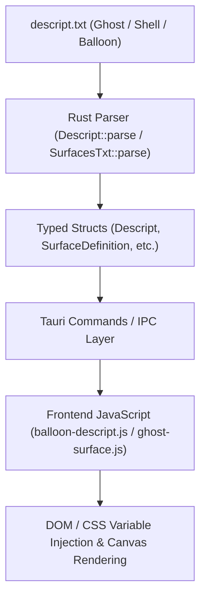

# Descript.txt Specification to Implementation Mapping Report

This artifact provides a comprehensive cross-reference mapping connecting every major `descript.txt` (ghost, shell, and balloon) property defined in the UKADOC specifications (`docs/spec/ukadoc-spec/descript/`) to its exact implementation handlers in Rust (`src-tauri/src/` and `crates/ui/src/`) and JavaScript (`ui/js/`).

## Summary of Mappings

| Property / Category | Spec Path | Implementation File | Key Functions / Handlers |
| :--- | :--- | :--- | :--- |
| **Ghost / Shell Meta** (`name`, `craftman`, `homeurl`, `type`, `sakura.name`) | `docs/spec/ukadoc-spec/descript/ghost/descript-txt/` | [descript.rs](crates/ui/src/descript.rs) | `Descript::parse()`, `name()`, `sakura_name()`, `homeurl()`, `type_()` |
| **DPI Scaling** (`dpi`) | `docs/spec/ukadoc-spec/descript/balloon/descript-txt/dpi.md` | [balloon-descript.js](ui/js/core/actions/balloon-descript.js) | `balloonDescriptActions.applyBalloonDescript()` (CSS variables `--balloon-dpi-scale`) |
| **Balloon Fonts & Styling** (`font.name`, `font.height`, `font.bold`, `font.color`) | `docs/spec/ukadoc-spec/descript/balloon/descript-txt/font.*.md` | [balloon-descript.js](ui/js/core/actions/balloon-descript.js) | `applyBalloonDescript()` (`--balloon-font-family`, `--balloon-font-size`, etc.) |
| **Balloon Valid Rect / Padding** (`validrect.*`) | `docs/spec/ukadoc-spec/descript/balloon/descript-txt/validrect.*.md` | [balloon-descript.js](ui/js/core/actions/balloon-descript.js) | `applyBalloonDescript()` (dynamic padding calculation) |
| **Balloon Origin** (`origin.x`, `origin.y`) | `docs/spec/ukadoc-spec/descript/balloon/descript-txt/origin.*.md` | [balloon-descript.js](ui/js/core/actions/balloon-descript.js) | `applyBalloonDescript()` (`balloonDisplay.style.left` / `top`) |
| **Mouse Cursors** (`mousecursor.*`) | `docs/spec/ukadoc-spec/descript/balloon/descript-txt/mousecursor.*.md` | [balloon-descript.js](ui/js/core/actions/balloon-descript.js) | `applyBalloonDescript()` (`--balloon-cursor-arrow`, etc. with `convertFileSrc`) |
| **Shell Bind Groups** (`bindgroup[N]`, `bindoption.group`) | `docs/spec/ukadoc-spec/descript/shell/descript-txt/` | [descript.rs](crates/ui/src/descript.rs) | `Descript::bind_groups()`, `bindoption_group()` |
| **Surface Animations & Elements** (`animation`, `element`, `collision`) | `docs/spec/ukadoc-spec/descript/shell/surfaces-txt/` | [handlers.rs](crates/ui/src/surfaces/parser/handlers.rs) | `apply_collision()`, `apply_element()`, `apply_animation_line()`, `apply_point()` |

## Detailed Implementation Architecture

