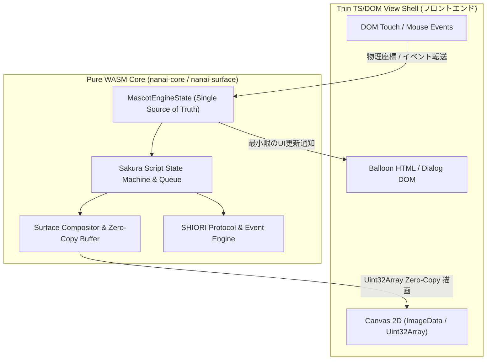

# Pure WASM コアエンジン完全一元化 アーキテクチャ計画書 (Unified WASM Engine Plan)

本ドキュメントは、**nanai-android-mascot** におけるフロントエンド (TypeScript / V8) とコアエンジン (WASM / Rust) の境界を再定義し、**アプリケーションのデータ・状態・計算・描画演算のすべてを WebAssembly に一元化する計画書**です。

---

## 1. 一元化の背景と基本設計思想 (Core Principles)

### 🔴 現状と課題
これまでで各パース・合成・レイアウトロジックの Pure Rust 化と WASM ブリッジ連携は完了していますが、状態（現在のゴースト、サーフェスID、アニメーションタイマー、バルーン表示テキストなど）が TypeScript (TS) 側と WASM 側で一部分散しています。これにより、境界越えのシリアライズ (JSON/Object) オーバーヘッドや状態同期の複雑さが生じています。

### 🟢 究極目標: Thin Client Design (WASM-Centric Model)
- **Single Source of Truth (WASM Core)**:
  すべての状態、タイマー、アニメーション状態機械、さくらスクリプト再生キュー、SHIORIイベントルーティングを WASM (`nanai-core` / `nanai-surface`) 内の単一ステートマシンに集約。
- **Thin UI Shell (DOM / Event Listener)**:
  TS 側は「物理入力（DOMタッチ/マウス）の受取」と「WASMからの最終描画命令（Zero-Copy Canvas Buffer, HTML表示命令）の適用」のみを行う極小のシェルに特化。



---

## 2. 領域別 一元化仕様 (Detailed Domain Architecture)

### 2.1 状態管理の一元化 (`MascotEngineState`)
Rust 側に全体状態を一元管理する `MascotEngineState` を構築します。

- **管理データ**:
  - 現在のゴースト情報、シェル名、バルーンテーマ名
  - スコープ別サーフェス ID、アニメーション状態、描画レイヤー
  - さくらスクリプト再生キュー、Wait/Pause タイマー状態
  - 当たり判定領域・ヒットテストキャッシュ
- **TS側との通信**:
  - TS 側からの状態変更はすべて WASM FFI メソッド (`engine_select_ghost`, `engine_update_surface`, `engine_tick` 等) に一本化。

### 2.2 Zero-Copy Pixel Buffer 描画パイプライン
WASM ヒープ上のフレームバッファを、中間変換なしで Canvas2D に描画するパイプラインを確立します。

- **メモリ構造**:
  - `nanai-surface` 内の `SurfaceFrameBuffer` を `RGBA8888` 連続ピクセルアレイ（`Vec<u32>` または `Vec<u8>`）としてアロケート。
- **Zero-Copy メカニズム**:
  - `wasm_bindgen` の `Clamped<&[u8]>` または `Uint8ClampedArray(wasm.memory.buffer, ptr, len)` を用いて `ImageData` にバインド。
  - `ctx.putImageData(imageData, 0, 0)` のみで Canvas へダイレクト描画。

### 2.3 さくらスクリプト & SERIKO アニメーション完全同期ループレジスタ
タイマー管理とフレーム進行を JS の `setTimeout` / `setInterval` から分離し、WASM 内のハイリフレッシュタイマーで統一管理します。

- **`engine_tick(delta_ms: f64)` API**:
  - JS 側の `requestAnimationFrame` から毎フレーム呼び出し。
  - WASM 内で SERIKO アニメーションのコマ進行、スクリプトの `\w[ms]` ウェイト減少、タイピング表示を一括更新し、更新された領域のみを返却。

### 2.4 Web Worker + WASM SHIORI 内包型アーキテクチャ
SHIORI 3.0 エンジン（Kawari, Yaya, Satoriya 等）の仮想実行環境を Web Worker 内の Pure WASM インスタンスへ完全移管。

- **WebWorker 役割**:
  - SHIORI リクエスト (`GET SHIORI/3.0`, `NOTIFY SHIORI/3.0`) の構築・送受信・辞書読み込みを WASM 内で直接実行。
  - スレッドロックやガベージコレクションの影響を排除。

---

## 3. 移行フェーズ別ロードマップ (Execution Phases)

```
[Phase A: WASM Core 状態統合]
   ├── MascotEngineState 構造体の設計と crates/nanai-core への組み込み
   └── FFI 状態制御インターフェースのエクスポート

[Phase B: Zero-Copy Canvas パイプライン]
   ├── SurfaceFrameBuffer の Uint8ClampedArray 直接参照構造化
   └── surface-render.ts の putImageData ゼロコピーパス実装

[Phase C: WASM イベントループ & アニメーション同期]
   ├── requestAnimationFrame から engine_tick(deltaMs) への一本化
   └── さくらスクリプト再生キューの WASM 完全自律化

[Phase D: Thin UI Shell リファクタリング & 検証]
   ├── ui/ts/ 内の計算・状態維持コードの徹底排除
   └── Vitest / Cargo test / 実機描画パフォーマンスベンチマーク
```

---

## 4. 領域別コード整理・役割一覧 (Final File Distribution)

| コンポーネント / ファイル | 一元化後の役割 | 旧処理からの変更点 |
| :--- | :--- | :--- |
| **`crates/nanai-core/src/state.rs`** [NEW] | **Single Source of Truth** (全体状態マシン) | TS側のゴースト・サーフェス・再生状態をPure Rustへ集約 |
| **`crates/nanai-surface/src/framebuffer.rs`** | **Zero-Copy FrameBuffer** | `Uint8ClampedArray` 適合バッファを直接提供 |
| **`ui/ts/core/wasm-bridge.ts`** | **WASM Fast Bridge** | FFI 呼び出しの最小ラッパー |
| **`ui/ts/surface/surface-render.ts`** | **Thin Canvas Renderer** | WASM メモリの `ImageData` 直描きのみ担当 |
| **`ui/ts/ghost/ghost.ts` / `GhostController`** | **DOM Event Delegate** | DOMイベント受取・WASM FFI呼出への委譲 |
| **`ui/ts/ui/*`** | **Pure View (DOM/CSS)** | メニュー・モーダル・ダイアログのHTML生成のみ担当 |

---

## 5. 検証・品質保証計画 (Verification Strategy)

1. **パリティ・アロケーションテスト**:
   - `tests/nanai-core-wasm.test.ts` にて、WASMメモリ動的アロケート・解放時のリーク非発生を自動チェック。
2. **フレームレート・描画性能ベンチマーク**:
   - 60FPS アニメーション再生時の JS ガベージコレクション発生回数・フレームドロップ率を計測（目標: 0フレーム落ち）。
3. **UKADOC 仕様適合統合監査**:
   - `npm run verify` スクリプトによる自動監査を継続実行。
