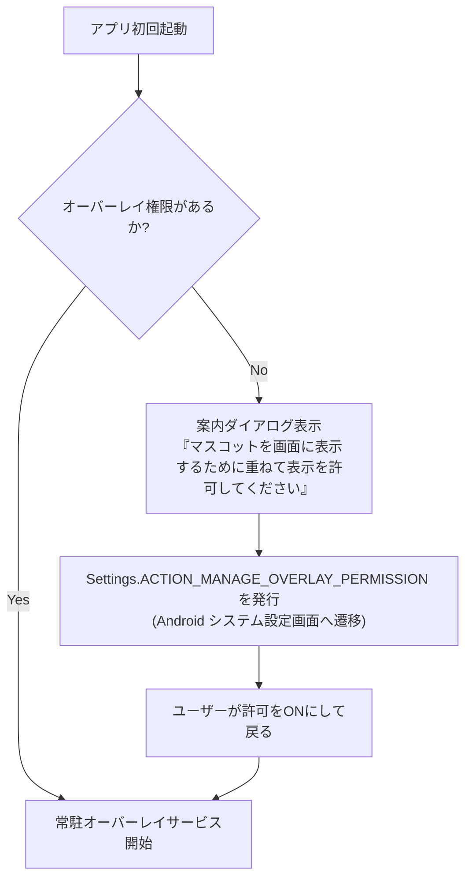
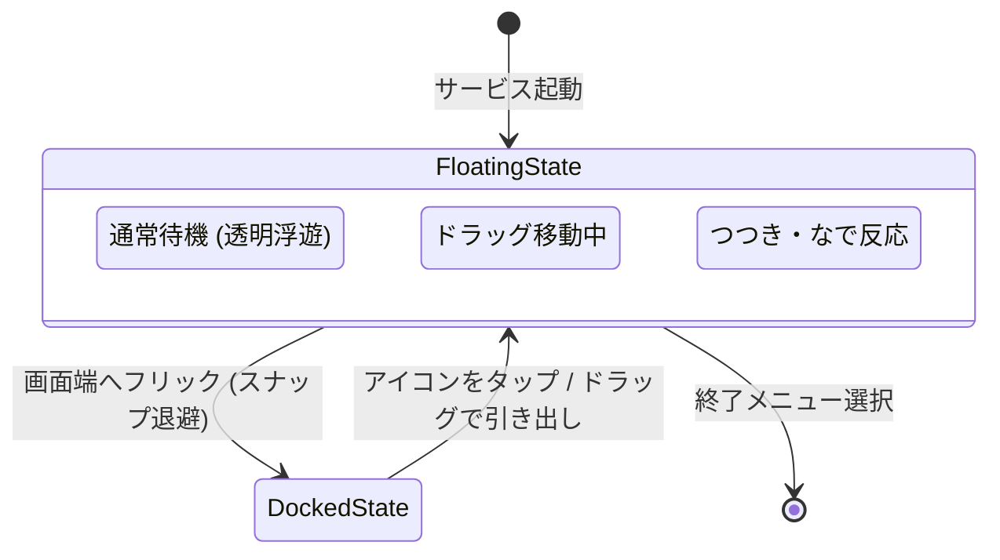

# Android システムオーバーレイ & 常駐生存（Background Service）仕様書

本仕様書は、**nanai-android-mascot** が Android 端末上において、ホーム画面や他の起動中アプリの前面に **透過フローティングマスコットとして常駐** し、OS の省電力タスクキラーから生存して動作し続けるためのシステム連携仕様を定義します。

---

## 1. Android 常駐マスコットの成立要件

Android 上でデスクトップマスコット（伺か）体験を成立させるには、以下の 3 つの OS レベル要件を満たす必要があります：

```text
┌─────────────────────────────────────────────────────────────┐
│ 1. システムオーバーレイ表示 (SYSTEM_ALERT_WINDOW)           │
│    -> 他のすべてのアプリの前面にウィンドウを浮遊表示         │
├─────────────────────────────────────────────────────────────┤
│ 2. タッチ透過制御 (Touch-through / Passthrough)             │
│    -> キャラクター以外の透明部分をタップしたとき、           │
│       背後のホーム画面や他アプリをそのまま操作可能にする     │
├─────────────────────────────────────────────────────────────┤
│ 3. フォアグラウンドサービス (Foreground Service)            │
│    -> バックグラウンドで OS に強制終了されず、               │
│       OnSecondChange タイマーや音声通知を継続可能にする      │
└─────────────────────────────────────────────────────────────┘
```

---

## 2. 権限（Permissions）と初期誘導フロー

### 2.1 必要な Android マニフェスト権限

```xml
<!-- 他のアプリの上に重ねて表示する権限 -->
<uses-permission android:name="android.permission.SYSTEM_ALERT_WINDOW" />

<!-- フォアグラウンドで生存するための権限 -->
<uses-permission android:name="android.permission.FOREGROUND_SERVICE" />
<uses-permission android:name="android.permission.FOREGROUND_SERVICE_SPECIAL_USE" />

<!-- 端末再起動時の自動起動（任意設定） -->
<uses-permission android:name="android.permission.RECEIVE_BOOT_COMPLETED" />

<!-- 常駐通知用 (Android 13+) -->
<uses-permission android:name="android.permission.POST_NOTIFICATIONS" />
```

### 2.2 権限取得 UX フロー

`SYSTEM_ALERT_WINDOW` は危険度の高い特別な権限であるため、通常のダイアログではなく OS の設定画面を開く必要があります。



---

## 3. ウィンドウ透過 & タッチスルー（Touch-through）制御仕様

### 3.1 WindowManager レイアウトパラメータ

Android の `WindowManager` に登録する浮遊ビュー（または WebView）のフラグ制御：

```java
WindowManager.LayoutParams params = new WindowManager.LayoutParams(
    WindowManager.LayoutParams.MATCH_PARENT,
    WindowManager.LayoutParams.MATCH_PARENT,
    WindowManager.LayoutParams.TYPE_APPLICATION_OVERLAY,
    // 透過制御用フラグ
    WindowManager.LayoutParams.FLAG_NOT_FOCUSABLE |
    WindowManager.LayoutParams.FLAG_NOT_TOUCH_MODAL |
    WindowManager.LayoutParams.FLAG_LAYOUT_NO_LIMITS,
    PixelFormat.TRANSLUCENT
);
```

### 3.2 透過領域のタッチ判定（動的フラグ切替）

マスコット以外の透明領域を裏のアプリへ素通し（パススルー）させるための設計：

1. **方式 A: 透明ピクセルのタッチスルー（推奨）**
   - WebView 側で `pointer-events: none` をベースコンテナに設定。
   - `.ghost-display`（マスコット）および `.balloon`（吹き出し）のみ `pointer-events: auto` を設定。
   - Android ネイティブ側でタッチイベントをフックし、マスコットの矩形外へのタップは直ちに親ウィンドウ（背後）へ転送。
2. **方式 B: ウィンドウサイズ追従方式**
   - 画面全体を覆う透明ウィンドウではなく、マスコット本体とバルーンの周囲のみを矩形ウィンドウとして動的に移動・リサイズする。

---

## 4. フォアグラウンドサービス（常駐生存）仕様

### 4.1 通知バー（ステータスバー）常駐仕様

Android OS（特に Xiaomi、Huawei、Samsung 等のバッテリー最適化）によるプロセスキルを回避するため、`ForegroundService` を実行します。

- **通知チャネル名**: `Nanai Android Mascot 常駐サービス`
- **通知表示内容**:
  - タイトル: `Nanai Android Mascot が常駐中`
  - テキスト: `ゴースト: ナナイ (タップでメニュー表示)`
- **通知アクションボタン**:
  - `[ 隠す / 表示 ]`: 一時的に画面からマスコットを退避
  - `[ 終了 ]`: 常駐サービスを停止して完全に終了

---

## 5. モバイル専用ジェスチャーと状態遷移



### 5.1 画面端スナップ（Docked State）

- ホーム画面操作やゲームプレイの邪魔にならないよう、マスコットを画面左端／右端にフリックすると、**半透明の小さなタブアイコン（幅 24px 程度）** に折りたたまれる仕様。
- タブをタップすることで、元のサイズ・位置にスムーズに復帰。
