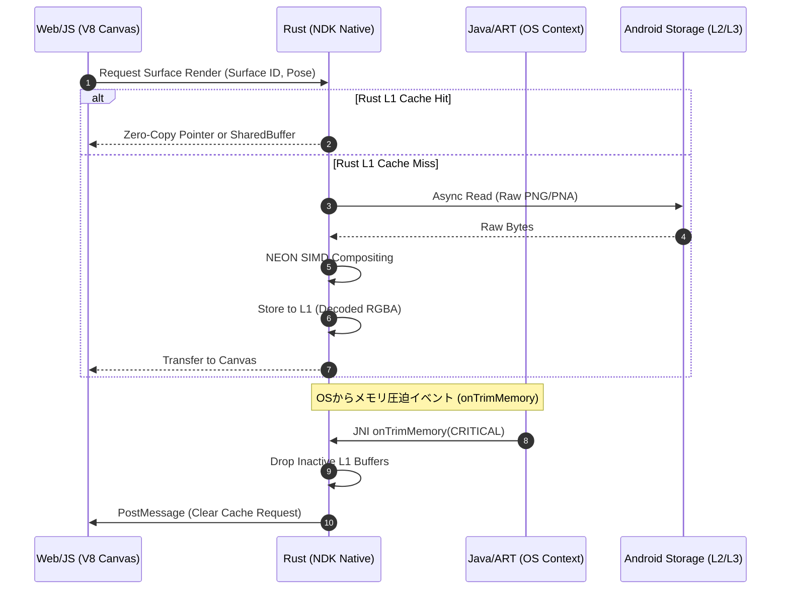
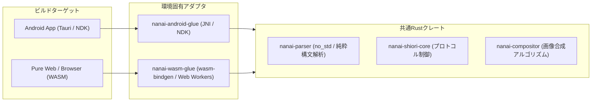

# Android/ARM多言語ランタイム並列協調と非同期キャッシュアーキテクチャ

- **言及規格の元ドキュメント・権利者・ライセンス**:
  - **SHIORI 仕様 / 各種サブシステム**:
    - **SHIORI/3.0 規格**: [ukadoc-spec: shiori3](https://ukatech.shillest.net/ukadoc-spec/spec/shiori3/) - © UKADOC project (CC BY 4.0)
    - **里々 (SATORI)**: [ukatech/satori-docs](https://ukatech.shillest.net/satori-docs/) - © Kusigahama Yagi / SEIBIHAN (BSD 2-Clause License)
    - **YAYA**: [YAYA-shiori/yaya-docs](https://yaya-shiori.github.io/yaya-docs/) - (The Unlicense / Public Domain)
    - **華和梨 (KAWARI)**: [ukatech/kawari-docs](https://ukatech.shillest.net/kawari-docs/) - © KAWARI Development Team (BSD 2-Clause License)
  - **バルーン仕様 (Balloon)**: [ukadoc-spec: balloon](https://ukatech.shillest.net/ukadoc-spec/) - © UKADOC project / Ukagaka Tech Team (CC BY 4.0)
  - **FMO / Mutex 規格**: [ukadoc-spec: fmo-mutex](https://ukatech.shillest.net/ukadoc-spec/spec/fmo-mutex/) - © UKADOC project / Ukagaka Tech Team (CC BY 4.0)
  - **surfaces.txt / アニメーション合成 / 当たり判定**: [ukadoc-spec: surfaces.txt](https://ukatech.shillest.net/ukadoc-spec/spec/surfaces/) - © UKADOC project / Ukagaka Tech Team (CC BY 4.0)

本ドキュメントでは、Android OSおよびARMアーキテクチャ特有のハードウェア・OS制約を踏まえ、**Java/Kotlin (JVM/ART)**、**Rust (Native/NDK)**、**JavaScript/WASM (WebView V8)** という3つの並列ランタイム間における非同期協調・キャッシュ・メモリ境界の整合性設計を整理します。

---

## 1. 3大ランタイムの並列構造と責務境界

Android上での本アプリケーションは、単一の垂直スタックではなく、**3つの異なるメモリモデルとガベージコレクション／ライフサイクルを持つランタイムが並列稼働**する複合システムです。

```mermaid
graph TB
    subgraph HostOS["Android OS (Linux Kernel / ARM64 big.LITTLE)"]
        Ashmem[共有メモリ / AHardwareBuffer / Ashmem]
        SAF[Scoped Storage / MediaStore / VFS]
        SysService[ActivityManager / WindowManager / AudioFlinger]
    end

    subgraph ART["1. Java/Kotlin Runtime (Android ART)"]
        Activity[MainActivity / Foreground Service]
        Lifecycle[Lifecycle / onTrimMemory / Doze Mode]
        JNI_Bridge[JNI Interface Layer]
    end

    subgraph NativeRust["2. Rust Native Runtime (ARM64-v8a NDK)"]
        TokioAsync[Tokio Async Reactor (IO / Worker)]
        NativeCache[L1/L2 Decoded Buffer / LRU Cache]
        ImageCompositor[Surface PNA Compositor (NEON SIMD)]
        ShioriHost[SHIORI Protocol Host]
    end

    subgraph WebViewV8["3. Web / WASM Runtime (Chromium V8 Engine)"]
        DOMCanvas[Canvas 2D / DOM Renderer]
        JSAsync[JS Event Loop / Promises]
        WasmMem[WASM Linear Memory (Optional)]
    end

    %% ランタイム間連携
    Activity <--> JNI_Bridge
    JNI_Bridge <--> NativeRust
    NativeRust <-->|IPC / PostMessage / Shared Buffer| WebViewV8

    %% OSリソースとの結合
    ART <--> Lifecycle
    Lifecycle -.->|メモリ圧迫通知| NativeRust
    NativeRust <--> Ashmem
    WebViewV8 <--> Ashmem
    NativeRust <--> SAF
```

### ランタイム別のメモリ・スレッド特性

| 観点 | 1. Java / Kotlin (ART) | 2. Rust (Native NDK) | 3. JS / WASM (WebView V8) |
| :--- | :--- | :--- | :--- |
| **実行形態** | ART (AOT / JIT), JVMバイトコード | ARM64 Native機械語 (LLVM) | V8 JIT / Bytecode, WASM Linear Mem |
| **メモリ管理** | トレーシングGC (世代別コンパクション) | 所有権 / RAII (明示的解放, No GC) | V8 GC (Orinoco / Scavenger) |
| **スレッドモデル** | OSスレッド (Java Threads / Coroutine) | OSスレッド + Tokio非同期Green Threads | 単一UIスレッド (EventLoop) + WebWorkers |
| **主な責務** | OSライフサイクル、権限、通知、SAF | 画像合成、ZIP展開、SHIORI、L2キャッシュ | 描画プレゼンテーション、UIイベント、バルーン |

---

## 2. ARMアーキテクチャ特性と最適化

Androidが動作するARM（特にARM64-v8a）アーキテクチャおよびモバイルプロセッサの特性に応じた最適化設計を行います。

### 2.1 big.LITTLE (DynamIQ) コアと非同期タスク配置

- **リトルコア（高効率コア）**:
  - バックグラウンド待機、SHIORIの定期タイマー（`OnTimer` / トーク待機）、NARダウンロード監視。
  - OSに電力効率の良いコアへスケジューリングさせるため、Tokioの非同期タスク優先度を設定。
- **ビッグコア（高性能コア）**:
  - サーフェス画像切り替え時のPNAアルファ抜き・パーツ合成、大量テクスチャのロード・展開。

### 2.2 NEON SIMD によるピクセル合成

- PNA（マスク画像）を用いたサーフェス抜き合わせやアルファブレンディングは、ARM NEON命令セットを活用したRustコードでベクトル演算を行い、CPU負荷と発熱・バッテリー消費を抑制。

### 2.3 弱メモリモデル (Weak Memory Ordering)

- x86と異なりARMはメモリ順序付けが弱いため、ランタイム間で共有メモリ（Shared Buffer）を介してバイナリを受け渡す際は、Rust側の適切なアトミック操作（Acquire/Releaseセマンティクス）またはミューテックス・フェンス処理を徹底。

### 2.4 NANDフラッシュ保護とスワップレス仮想メモリ（zRAMとLMK）

- **NANDフラッシュの書き換え寿命（P/Eサイクル）とI/O負荷への配慮**:
  - Androidはストレージ（UFS/eMMCのNANDフラッシュ）の劣化防止および電力消費抑制のため、一般的なPC OSのような**二次記憶ディスクへのページスワップ（Swap-out to Disk）を行いません**。
  - 代わりにRAM領域の一部を圧縮領域として使う **zRAM** を採用しており、ダーティページ（Dirty Pages: アプリが書き換えたメモリ領域）はzRAMで圧縮保持されるか、限界に達すると **LMK (Low Memory Killer)** によってプロセスごと即座に強制終了されます。
- **クリーンページ（Clean Pages）としてのファイルマップ活用**:
  - 実行可能コードや不変リソース（`mmap` されたサーフェス画像や辞書ファイルなど）はクリーンページとして扱われ、メモリ逼迫時にOSによってストレージ書き戻しなしで安全にページ破棄（Page Eviction）され、再アクセス時に再ロードされます。
  - 一時中間データをむやみにストレージ（L2/L3）へ頻繁にWriteせず、メモリ内ストリーミング処理を行うことで、NANDフラッシュへの過剰な書き込み（Write Amplification）を回避します。

---

## 3. ランタイム間キャッシュ階層と共有パイプライン

各言語ランタイムが独自に画像やスクリプトを抱え込むと、メモリ使用量が3重に膨張しAndroid OSのOOM（Out of Memory）キラーの対象になります。キャッシュ階層を単一責任に整理します。



### 責務分担と同期ルール

1. **デコード済み生ピクセル（重いデータ）はRustネイティブが主導管理 (L1)**
   - V8ヒープやJVMヒープに巨大なBitmapを保持させず、Rust側のヒープ（または`AHardwareBuffer`等のOS共有バッファ）に一元保持。
   - JS側は必要なフレームのみ描画コンテキストへ転送（ImageBitmap / Canvas描画）。
2. **OSとの仲介はJava/ARTが担当**
   - バッテリー状態（Doze Mode）、画面の表示/非表示（Activity onStop）、メモリ枯渇（`ComponentCallbacks2.onTrimMemory`）の検知。
   - JNIコールバックを経由して即座にRust側のTokio/キャッシュマネージャへ通知。
3. **Rust側のTokio非同期ランタイムによる多重化抑制**
   - 同一サーフェスに対する連続リクエストが発生した場合、進行中の非同期タスクへ合流（Coalescing）させ、不要な重複デコードを防止。

---

## 4. Web / WASM と Native Rust のクレート連携方針

Webベース（ブラウザ/WASM単体）とAndroid（Native NDK + WebView）でコードを共通化するためのクレート設計です。



- **純粋計算ロジック（`nanai-parser`, `nanai-compositor`）**:
  - `std::fs` や OS API に依存せず、バイトスライス（`&[u8]`）を入力として受け取る純粋関数として構成。
  - WebAssembly（`wasm32-unknown-unknown`）とARM64 Android（`aarch64-linux-android`）の双方でまったく同じコードがコンパイル可能。
- **I/O・ストレージ抽象化**:
  - Android Nativeでは Tokio + OS Native File System + JNI SAF。
  - Pure Web/WASMでは Web Worker + IndexedDB / OPFS。

---

## 5. 関連ドキュメント

- [Androidキャッシュ階層構造と非同期アーキテクチャ設計](./android-cache-and-async-architecture.md)
- [Web/WASM/Rustクレート連携アーキテクチャ設計](./web-wasm-rust-integration-spec.md)
- [実装タスクとマイルストーン](./cache-async-implementation-roadmap.md)
