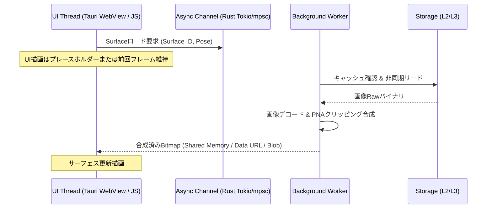

# Androidキャッシュ階層構造と非同期アーキテクチャ設計

- **言及規格の元ドキュメント・権利者・ライセンス**:
  - **SHIORI 仕様 / 各種サブシステム**:
    - **SHIORI/3.0 規格**: [ukadoc-spec: shiori3](https://ukatech.shillest.net/ukadoc-spec/spec/shiori3/) - © UKADOC project (CC BY 4.0)
    - **里々 (SATORI)**: [ukatech/satori-docs](https://ukatech.shillest.net/satori-docs/) - © Kusigahama Yagi / SEIBIHAN (BSD 2-Clause License)
    - **YAYA**: [YAYA-shiori/yaya-docs](https://yaya-shiori.github.io/yaya-docs/) - (The Unlicense / Public Domain)
    - **華和梨 (KAWARI)**: [ukatech/kawari-docs](https://ukatech.shillest.net/kawari-docs/) - © KAWARI Development Team (BSD 2-Clause License)
  - **伺か標準仕様 / ゴースト / シェル**: [ukatech/ukadoc-spec (UKADOC project)](https://ukatech.shillest.net/ukadoc-spec/) - © UKADOC project / Ukagaka Tech Team (CC BY 4.0)
  - **surfaces.txt / アニメーション合成 / 当たり判定**: [ukadoc-spec: surfaces.txt](https://ukatech.shillest.net/ukadoc-spec/spec/surfaces/) - © UKADOC project / Ukagaka Tech Team (CC BY 4.0)

本ドキュメントでは、nanai-android-mascotにおけるAndroid環境のストレージ・キャッシュ階層構造と非同期データフロー、並びにメモリマネジメント設計を整理します。

---

## 1. キャッシュ・ストレージ階層構造 (Hierarchy)

Androidプラットフォーム上でゴースト（サーフェス画像、スクリプト、音声、設定データ等）を効率的かつセキュアに扱うため、以下の多層キャッシュ構造を採用します。

```mermaid
graph TD
    UI[WebView / Web UI (Vanilla JS / Canvas)]
    L1[L1: メモリキャッシュ (RAM / Decoded Bitmaps / LRU)]
    L2[L2: アプリ内部キャッシュ (Context.getCacheDir() / Fast I/O)]
    L3[L3: アプリ永続ストレージ (Context.getFilesDir() / App Specific)]
    L4[L4: 外部・共有ストレージ (Scoped Storage / Downloads / SAF)]
    Remote[Remote / Network / .nar Archive]

    UI --> L1
    L1 -- Miss --> L2
    L2 -- Miss --> L3
    L3 -- Miss --> L4
    L4 -- Import/Download --> Remote
```

### 階層一覧と特性

| 階層 | 格納先 (Android API) | 用途 | ライフサイクル・保持期間 | 耐障害性 / 制限 |
| :--- | :--- | :--- | :--- | :--- |
| **L1: メモリキャッシュ** | RAM (WASM Linear Memory / JS Heap / Rust Heap) | デコード済みサーフェスBitmap、パース済みSHIORI辞書 | アプリ終了時・Activity破棄時・LowMemory時に解放 | 容量制限小 (LRU退避必須) |
| **L2: 内部キャッシュ** | `context.cacheDir` | 展開済みNAR一時ファイル、HTTPリクエスト中間データ | OSの容量逼迫時に自動削除される可能性あり | 高速、他アプリ非公開 |
| **L3: 内部永続ストレージ** | `context.filesDir` | インストール済みゴースト実体、セーブデータ、設定ファイル | ユーザーがアプリデータ消去またはアンインストールするまで保持 | 容量制限あり、最も安全 |
| **L4: 外部・共有ストレージ** | `MediaStore` / SAF (Storage Access Framework) | NARパッケージのインポート元、エクスポート先 | アプリ削除後も残存（SAF経由） | パーミッション・SAF制御が必要 |

---

## 2. 非同期I/Oとタスクスケジューリング設計

ゴーストのファイル群（特に数百枚のPNG/PNA画像、大容量音声ファイル、SHIORIスクリプト辞書）のロードはメインスレッド（UIスレッド）をブロックしてはなりません。

### 2.1 スレッド分離モデル

- **UI / Main Thread**:
  - Web UI（HTML5 Canvas / Vanilla JS）、Tauri WebViewイベントループ、タッチ入力およびアニメーション描画（60fps維持）。
  - ディスクI/Oや重い画像合成は一切行わない。
- **I/O Worker Pool (Tokio / Async-std / Android Native Threads)**:
  - NARアーカイブ解凍、ZIP展開、L2/L3ディスク読み込み、ネットワーク通信。
- **Compute / Heavy Processing (SHIORI Execution / Image Decoding)**:
  - PNA抜き合わせ合成（アルファブレンド処理）、SHIORI評価エンジンの実行。

### 2.2 非同期パイプライン



---

## 3. メモリ制約とLow Memory対策 (TrimMemory)

Android特有のメモリ圧迫イベントに対応するため、以下の3段階退避ポリシーを策定します。

1. **TRIM_MEMORY_RUNNING_LOW / TRIM_MEMORY_UI_HIDDEN**:
   - 非アクティブなサーフェス差分画像キャッシュ（直近5分以上未使用のL1）を破棄。
   - BGMや再生終了した音声バッファを解放。
2. **TRIM_MEMORY_RUNNING_CRITICAL**:
   - カレント表示フレーム以外の全L1画像キャッシュを即時破棄。
   - L2一時解凍ファイルをクリーンアップ。
3. **Activity一時停止時 (onPause / onStop)**:
   - レンダリングループのサスペンドおよびSHIORIポーリングタイマーの停止。

---

## 4. 関連ドキュメント

- [Android/ARM多言語ランタイム並列協調と非同期キャッシュ設計](./android-arm-multiruntime-and-cache-architecture.md)
- [Web/WASM/Rustクレート連携アーキテクチャ](./web-wasm-rust-integration-spec.md)
- [実装タスクとマイルストーン](./cache-async-implementation-roadmap.md)
