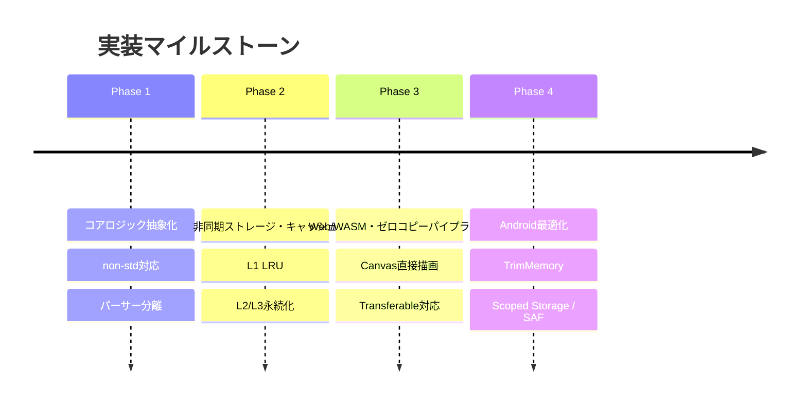

# キャッシュ・非同期・Web/WASM連携 実装ロードマップ

- **言及規格の元ドキュメント・権利者・ライセンス**:
  - **surfaces.txt / アニメーション合成 / 当たり判定**: [ukadoc-spec: surfaces.txt](https://ukatech.shillest.net/ukadoc-spec/spec/surfaces/) - © UKADOC project / Ukagaka Tech Team (CC BY 4.0)

本ドキュメントでは、[Androidキャッシュ・非同期設計](./android-cache-and-async-architecture.md)および[Web/WASM/Rust連携設計](./web-wasm-rust-integration-spec.md)を具現化するための実装フェーズとタスク分割を整理します。

---

## 1. 実装フェーズ概要

---

## 2. フェーズ別タスク一覧

### Phase 1: コアロジックのクレート分離と抽象化

- [ ] `descript.txt` / `surfaces.txt` パーサーのコア抽出（OS依存性の排除）。
- [ ] プラットフォーム抽象化トレイト（`FileSystemAsync` / `StorageBackend`）の定義。
- [ ] ターゲット別ビルドマトリクス（Android / Web / Desktop）のCI整備。

### Phase 2: 非同期I/OとL1〜L3キャッシュ基盤

- [ ] L1インメモリLRUキャッシュ実装（容量上限・スレッドセーフ制御）。
- [ ] PNA抜き合わせ合成のバックグラウンドタスク化（Tokioスレッドプール）。
- [ ] NARアーカイブ非同期展開プロセスのプログレス通知機構。

### Phase 3: Web/WASM連携とゼロコピー画像パイプライン

- [ ] WASM Linear Memoryへのポインタ直結によるCanvas描画インターフェース実装。
- [ ] Web Worker環境下でのサーフェス合成とTransferableバイナリ連携。
- [ ] Web UIコンポーネント（Vanilla JS / Canvas）からの非同期イベントリスナー統合。

### Phase 4: Android固有最適化とリソース管理

- [ ] Android Activityライフサイクル連携（`onTrimMemory` によるキャッシュ段階破棄）。
- [ ] Scoped Storage / SAF対応のインポート・エクスポートハンドラ。
- [ ] 省電力モード・バックグラウンド実行時の負荷抑制機構。

---

## 3. 関連ドキュメント

- [Androidキャッシュ階層構造と非同期アーキテクチャ設計](./android-cache-and-async-architecture.md)
- [Web/WASM/Rustクレート連携アーキテクチャ設計](./web-wasm-rust-integration-spec.md)
