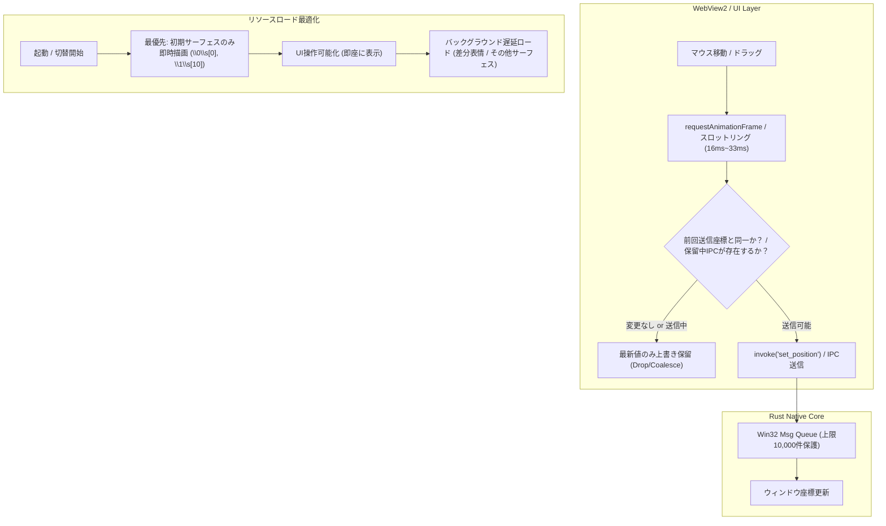

# 軽量化・フリーズ防止およびIPCキューあふれ対策仕様 (Performance & IPC Stabilization Plan)

本ドキュメントは、Nanai Android Mascot におけるWebView2/Tauriハイブリッド構成に起因する高負荷、UIフリーズ、およびOS/ランタイム間のプロセス間通信（IPC）キューあふれ（Win32 `0x80070718` エラー）の根本対策と最適化方針をまとめた技術仕様書です。

---

## 1. 課題分析とボトルネック要因

### 1.1 Win32 / Tauri IPC メッセージキューの飽和 (Error 0x80070718)

- **現象**:
  開発環境・実行時において以下のエラーが発生し、ウィンドウ操作不能やクラッシュを誘発する。

  ```text
  PostMessage failed ; is the messages queue full? Error code 0x80070718 - このコマンドを実行するための十分なクォータがありません。
  ```
- **原因**:
  - Windows の Win32 スレッドメッセージキューの上限は既定で **10,000 件**。
  - キャラクターやバルーンのドラッグ移動（`mousemove`）、カーソル部位追従（なで判定等）において、UI（WebView2）からRustネイティブ側へ `invoke("set_position")` や `emit` がミリ秒単位で非間引きで送出される。
  - WebView2 内部の `PostMessage` 呼び出し頻度がメッセージディスパッチ速度を上回り、キューがあふれる。

### 1.2 起動・ゴースト切替時のUIメインスレッド同期フリーズ

- **現象**:
  起動時やゴースト切り替え時に数十秒間ウィンドウが白画面または操作不能になる。
- **原因**:
  - シェルの全サーフェス画像（数十〜数百枚のPNG/PNA合成）の一括先読み・デコード。
  - SHIORIの巨大辞書ファイル（里々・YAYA等の辞書群）の同期パースおよび初期化処理がUIレンダリングループやRustのメインスレッドをブロックする。

### 1.3 補助ウィンドウ（Tauri Window）多重生成によるオーバーヘッド

- **現象**:
  メニュー表示、サブメニュー展開、ローディングバナーなどで複数の独立したネイティブウィンドウ（`menu_window`, `submenu_window`, `loading_banner`）を頻繁に生成・破棄（または表示切り替え）することによるOSリソース消費とメッセージループ負荷。

---

## 2. 対策アーキテクチャ方針



---

## 3. 具体的な対策フェーズと実装項目

### Phase 1: IPC / ウィンドウ移動の最適化・キューあふれ防止（最優先）

1. **`requestAnimationFrame` (RAF) または時間間隔（16ms〜33ms）によるスロットリング**
   - 対象: `ui/js/surface/balloon-drag.js`, `ui/js/surface/interaction.js`
   - `mousemove` イベントハンドラ内で即座に `invoke` を呼ばず、フラグ管理と `requestAnimationFrame` を介して1フレームあたり最大1回に制限する。
2. **IPC呼び出しの合流（Coalescing）と直列化**
   - 直前の `set_position` 非同期呼び出しが完了する前に次の移動要求が発生した場合、キューに積まずに内部の「最新目標座標」変数のみを更新し、完了通知後に最新値で1回だけ再送する。
3. **イベントリスナーの二重登録・リーク防止**
   - ゴースト切替やサーフェス再ロード時に古いイベントリスナーが多重蓄積しないよう、明示的な `removeEventListener` または `AbortController` による一括破棄を実施。

### Phase 2: 段階的ロード（Lazy Loading）によるUIフリーズ解消

1. **初期サーフェス優先描画（First Meaningful Paint）**
   - 起動時は `\0\s[0]` および `\1\s[10]` の描画に必要な画像アセットのみを最優先で読み込み、直ちにキャラを表示する。
   - 他のサーフェス差分・アニメーションフレームはアイドル時（`requestIdleCallback`）や各サーフェス指定（`\s[N]`）の初回要求時にオンデマンドでデコード・合成する。
2. **SHIORI重処理の非同期バックグラウンド実行**
   - 辞書ロードや構文解析をメインUIスレッドから分離し、UI側には軽量なプログレス表示のみを戻す。

### Phase 3: ウィンドウ管理とDOMレンダリングの最適化

1. **補助ウィンドウの再利用（シングルトン・Hide/Show運用）**
   - メニューウィンドウ等の作成・破棄の繰り返しを抑止し、一度作成したインスタンスを非表示（`hide()`）で待機させ、必要な時だけ `show()` と位置同期を行う。
2. **DOMレンダリング負荷の削減**
   - バルーン描画時の頻繁なリフロー・再計算を抑え、DocumentFragment や CSS `transform` / `will-change` を活用してGPU支援を最大化する。

---

## 4. 期待される効果と検証基準

- **Win32エラー `0x80070718` の根絶**: ドラッグ中やマウス移動中にメッセージキューエラーが一切発生しないこと。
- **初回表示速度の向上**: 起動からキャラクターが表示されるまでの体感待機時間を大幅に短縮し、UIが操作を受け付けないフリーズ状態を排除すること。
- **メモリ・CPU使用率の平準化**: アイドル時のCPU負荷を低減し、省電力性を向上させること。
