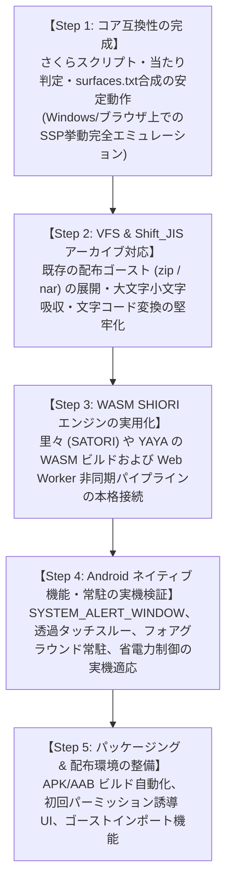

# 今後の開発における検討事項・仕様化ロードマップ

- **言及規格の元ドキュメント・権利者・ライセンス**:
  - **SSP 互換拡張 / ポップアップメニュー規格**: [SSP BUG-SLIK-PRACTICE / 仕様リファレンス](http://ssp.shillest.net/) - © PONapook 氏 / SSP開発チーム (SSP リファレンス仕様)
  - **伺か (Ukagaka) / ゴースト / シェル**: [伺か / 偽春菜 / あれ以外の何か with「何か」](https://ukatech.shillest.net/ukadoc-spec/) - © MATERIA開発チーム / うさださくら 氏 / コミュニティ有志 (コミュニティ規格 / オープンドキュメント)
  - **surfaces.txt / アニメーション合成 / 当たり判定**: [ukadoc: surfaces.txt](https://ukatech.shillest.net/ukadoc-spec/spec/surfaces/) - © MATERIA開発チーム / SSP開発チーム / ukadoc プロジェクト (ukadoc 仕様 / パブリックリファレンス)
  - **さくらスクリプト (Sakura Script)**: [ukadoc: さくらスクリプト](https://ukatech.shillest.net/ukadoc-spec/spec/sakura-script/) - © MATERIA開発チーム / SSP開発チーム / ukadoc プロジェクト (ukadoc 仕様 / パブリックリファレンス)
  - **SHIORI / 各SHIORIサブシステム (里々, YAYA, 華和梨 等)**: [ukadoc: SHIORI/3.0](https://ukatech.shillest.net/ukadoc-spec/spec/shiori3/) - © MATERIA開発チーム / 里々開発チーム / YAYA開発チーム / 華和梨開発チーム / ukadoc プロジェクト (ukadoc 仕様 / 各コミュニティライセンス)
  - **バルーン仕様 (Balloon)**: [ukadoc: surfaces.txt / balloon](https://ukatech.shillest.net/ukadoc-spec/) - © MATERIA開発チーム / SSP開発チーム / ukadoc プロジェクト (ukadoc 仕様 / パブリックリファレンス)

本ドキュメントは、**nanai-android-mascot** を本格的な伺か互換環境および Android 透過常駐マスコットとして完成させるために、**今後順番に検討・仕様化・実装を進めるべき技術的課題** を整理・一覧化したものです。

---

## 1. SSP をリファレンスとした位置付けと設計方針

本プロジェクトは、現代のデファクトスタンダードである **SSP (BUGFIX)** の仕様・プロトコル体系（SHIORI 3.0 / さくらスクリプト / surfaces.txt 合成 / 当たり判定）を規範（リファレンス）としつつ、制約と特性の異なる **Android（モバイル常駐）環境** への適応を図ります。

- **リファレンス（継承する点）**:
  - SHIORI 3.0 プロトコルイベント（`OnBoot`, `OnMouseClick`, `OnChoiceSelect`, `OnSecondChange`, `OnMouseMove` など）
  - さくらスクリプトタグ体系（`\0`, `\1`, `\s`, `\w`, `\q`, `\n`, `\c`, `\e` 等）
  - surfaces.txt によるアニメーション・差分合成・当たり判定（Collision）
  - 伺か標準の階層化メニュー構成と機能性
- **Android 向け適応（モバイル再設計）**:
  - **Win32 DLL からの脱却**: WebAssembly (WASM) / C++ FFI / JS フォールバックの多層実行
  - **Single Container レンダリング**: 複数ウィンドウではなく、単一オーバーレイ透過レイヤー内での多キャラクター仮想配置
  - **タッチインタラクション**: マウス右クリック・ホバーに代わるタップ（つつき）、スワイプ（なで）、長押し（メニュー）、画面端ドッキング
- **公式エコシステムの移植ステータスと対応策**:
  - 公式コミュニティ（Ukagaka Tech Team）においても、里々（`satoriya-shiori`）や YAYA（`yaya-shiori`）のクロスプラットフォーム（Linux/macOS/POSIX）対応が段階的に進行中であり、Android NDK / WASM への完全移植版が公式提供されているわけではありません。
  - そのため本プロジェクトでは、公式 C++ ソースの直接組み込み（NDK/Rust `cc`）を追求しつつ、**内蔵 JavaScript SHIORI（即時稼働）** と **多層フォールバック** を設けることで、公式の移植状況に左右されずに安定稼働させる構成とします。

---

## 2. 実装順序の再検討（5段階ロードマップ）

---

## 3. 各フェーズの詳細課題と検証内容

### 【課題1】さくらスクリプト（SakuraScript）タグパーサー & バルーン文字送り仕様

ゴースト対話の基本となる「台詞テキスト・演出タグ」を順次解釈し、バルーンに自然なテンポで表示するための仕様。

- **主な検討項目**:
  1. **初期サポート対象タグ**:
     - キャラ切り替え: `\0` (sakura), `\1` (kero)
     - サーフィス指定: `\s[ID]`, `\s0`
     - ウェイト制御: `\w[1-9]`, `\_w[ms]`
     - テキスト制御: `\n` (改行), `\c` (クリア), `\e` (終了)
     - インタラクティブ: `\q[ラベル,ID]` (選択肢ボタン)
  2. **文字送り（タイピング演出）エンジン**:
     - 一括表示ではなく、1文字ずつウェイト（標準約50ms）をかけた自然な文字送り。
     - クリックによる「スキップ（全文字即時表示）」仕様。
  3. **選択肢クリック時の挙動**:
     - `\q` ボタン押下時に、SHIORI へ `OnChoiceSelect` イベントを送り返すデータ連携。

---

### 【課題2】`surfaces.txt` アニメーション合成 & 当たり判定（Collision）仕様

`mock_nanai` をはじめとするゴーストの豊かな表情変化・まばたき・着せ替え・触れ合いを実現するための仕様。

- **主な検討項目**:
  1. **サーフィス合成モード**:
     - `base` (下地画像), `overlay` (上乗せ), `replace` (差し替え) の Canvas レイヤー描画。
  2. **アニメーションインターバル周期**:
     - `sometimes` (約2秒に1回), `rarely` (約4秒に1回), `always` (常時ループ) 等の乱数タイマー駆動。
  3. **当たり判定（Collision）とタッチマッピング**:
     - `surfaces.txt` 内の `collision,x1,y1,x2,y2,ID` 定義。
     - スマホのタップ/スワイプ座標と Collision 矩形を照合し、「頭を撫でた」「つついた」部位情報を付与した `OnMouseClick` / `OnMouseMove` を生成。

---

### 【課題3】文字コード変換（Shift_JIS ↔ UTF-8）& 仮想ファイルシステム（VFS）仕様

歴史的な伺かゴースト資産（Shift_JIS/CP932）を、モダンな UTF-8 環境（Rust / Web / Android）で文字化けなく透過的に読み込むための仕様。

- **主な検討項目**:
  1. **自動文字コード判別 & デコード**:
     - `descript.txt` の `charset,Shift_JIS` 判定。
     - JS 側の `TextDecoder("shift-jis")` または Rust 側の `encoding_rs` の使い分け。
  2. **パスの大文字・小文字差異の吸収**:
     - Windows と Android/Linux の大文字・小文字区別問題（Case Insensitivity）を吸収する仮想パスリゾルバー。

---

### 【課題4】Android システムオーバーレイ & 常駐生存（Background Service）仕様

Android 端末のホーム画面や他アプリ前面に「邪魔にならず常駐する」ための OS 連携仕様。

- **主な検討項目**:
  1. **オーバーレイ権限 (`SYSTEM_ALERT_WINDOW`) の取得**:
     - アプリ起動時の権限チェックおよび Android 設定画面への誘導 UX。
  2. **タッチスルー（透過部分のタッチ透過）**:
     - マスコット以外の透明領域を背後の別アプリへ透過（Touch-through / Passthrough）させるウィンドウフラグ設定。
  3. **フォアグラウンドサービス通知**:
     - OS の省電力キラーから保護するための常駐通知バー常駐仕様。

---

## 4. 進め方（アプローチ方針）

上記の **Step 1 〜 Step 5** に従い、以下の原則で進めます:

1. **Windows First**: まずデスクトップ環境で SSP 相当の動作（さくらスクリプト・当たり判定・描画・VFS）の品質を固め、テストサイクルを高速に回す。
2. **WASM & モジュラー化**: Win32 固有依存を排除し、Ukagaka Tech Team 等の標準 SHIORI ソース（里々・YAYA）を WASM / ネイティブ両用として整備する。
3. **実機 Android 最適化**: コア機能が安定した段階で Android オーバーレイ・省電力常駐・タッチ操作を実機で順次テスト・チューニングする。
