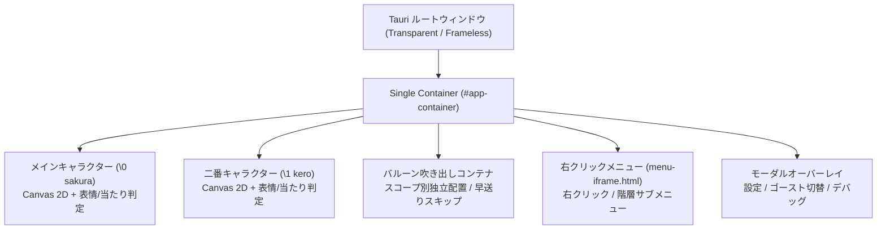

- **言及規格の元ドキュメント・権利者・ライセンス**:
  - **SSP 拡張仕様 / メニュー規格**: [ukatech/ukadoc-ssp](https://github.com/ukatech/ukadoc-ssp) / [SSP BUG-SLIK-PRACTICE](http://ssp.shillest.net/) - © UKADOC project (CC BY 4.0) / © PONapook 氏
  - **さくらスクリプト (Sakura Script)**: [ukadoc-spec: さくらスクリプト](https://ukatech.shillest.net/ukadoc-spec/spec/sakura-script/) - © UKADOC project / Ukagaka Tech Team (CC BY 4.0)
  - **バルーン仕様 (Balloon)**: [ukadoc-spec: balloon](https://ukatech.shillest.net/ukadoc-spec/) - © UKADOC project / Ukagaka Tech Team (CC BY 4.0)
  - **伺か標準仕様 / ゴースト / シェル**: [ukatech/ukadoc-spec (UKADOC project)](https://ukatech.shillest.net/ukadoc-spec/) - © UKADOC project / Ukagaka Tech Team (CC BY 4.0)
  - **surfaces.txt / アニメーション合成 / 当たり判定**: [ukadoc-spec: surfaces.txt](https://ukatech.shillest.net/ukadoc-spec/spec/surfaces/) - © UKADOC project / Ukagaka Tech Team (CC BY 4.0)

> **AI 関与について**: このドキュメントは GitHub Copilot / Antigravity の支援により作成・更新されました。キャラクター設定・仕様はオーナーユーザーと AI の協議により決定されています。

# ウィンドウ & コンテナ設計 (window-design)

## 1. 概要

本ドキュメントは、**nanai-android-mascot** におけるウィンドウ構成、コンテナ設計、および透過表示制御のアーキテクチャを定義します。
従来のデスクトップ環境（SSP）におけるマルチウィンドウ（本体、相方、バルーン、メニューが独立した OS ウィンドウ）の表現力を、モダンな **Single Activity / Single Transparent Window** 内で高度にエミュレート・再現するアプローチを採用しています。

---

## 2. ウィンドウ・コンテナ構成

### 2.1 アーキテクチャ概念

PC（Windows）環境および Android モバイル環境の双方で統一したレンダリングを行うため、メインウィンドウは **完全透過のルートコンテナ** として起動し、その内部で各コンポーネントを DOM / Canvas レイヤーとして配置します。

### 2.2 透過・ポインタ制御（タッチスルー）

マスコット以外の背景領域をクリック・タップした際に、背後のデスクトップ画面や他アプリの邪魔をしないよう、以下のポインタ制御を行っています：

- **ルートコンテナ / 背景領域**: `pointer-events: none;` により透過
- **キャラクター本体 / バルーン / メニュー**: `pointer-events: auto;` によりイベント捕捉
- **Android オーバーレイ適応時**: 必要に応じてウィンドウ全体のタッチ透過フラグをネイティブ連携

---

## 3. レイヤー別設計

### 3.1 キャラクタービュー (`#character-container`)

- **レンダリング**: HTML5 Canvas 2D
- **インタラクション**:
  - マウスドラッグ & タッチスワイプによる任意移動
  - 画面端スナップ（ドッキング退避 & タップ復帰）
  - 表示倍率（50%〜200%）のリアルタイム動的拡縮

### 3.2 バルーンビュー (`#balloon-container`)

- **配置制御**: キャラクターの位置・拡縮率に追従して自動計算配置
- **スコープ分離**: `\0` (sakura) と `\1` (kero) それぞれの吹き出しを独立表示

### 3.3 メニュービュー (`menu-iframe.html`)

- **分離理由**: CSS 干渉の防止、セキュアなコンテキスト分離
- **通信**: 親子間の `postMessage` API による完全双方向通信（メニュー開閉、アクション返送）

---

## 4. プラットフォーム別適応方針

### 4.1 Windows (Windows First)

- デスクトップ常駐、透明ウィンドウ（`transparent: true`）、タスクバー/トレイ連携、キーボードショートカット（Ctrl+W, Ctrl+I 等）のフルサポート。

### 4.2 Android (Android Adaptation)

- **Single Activity Container**: Android の単一 Activity 内で WebView を透過表示。
- **システムオーバーレイ**: `SYSTEM_ALERT_WINDOW` 権限と常駐サービス（Foreground Service）の連携により、他アプリ利用中も画面上にマスコットをオーバーレイ表示。
