# キャラクター操作領域・ジェスチャー統合仕様書

本ドキュメントは、キャラクター領域上で発生する各種操作（ドラッグ移動、タップ会話、撫で/Stroke判定、長押しメニュー、透明ピクセル透過、バルーン追従）の相互干渉を防ぎ、密接に連携させるためのイベント優先度と領域結合仕様です。

---

## 1. インタラクションエリア・優先度チェーン (Interaction Priority Chain)

キャラクターウィンドウ上の同一領域に対して複数の操作（ジェスチャー）が存在するため、以下の厳密な優先度判定ルールを適用します：

```mermaid
graph TD
    A[Pointer Down / Mouse Down] --> B{透明ピクセル判定 isTransparentPixel}
    B -- 透明 (Alpha = 0) --> C[操作パススルー / 透過]
    B -- 不透明 (Alpha > 0) --> D[インタラクション開始]
    D --> E1[1. ネイティブドラッグ起動 startDraggingWindow]
    D --> E2[2. 長押しタイマー開始 LONG_PRESS_DELAY: 600ms]
    
    E1 --> F{Pointer Move 移動距離}
    F -- 移動量 > 5px --> G[ドラッグ移動確定]
    G --> H1[長押しタイマーキャンセル]
    G --> H2[バルーン位置同期 sync_character_balloon]
    
    E2 -- 600ms 経過 (未移動) --> I[長押しメニュー表示 openCharacterMenu]
    
    F -- 未移動 (Pointer Up) --> J{長押し発火済みか？}
    J -- Yes --> K[終了]
    J -- No --> L[タップ会話発火 OnRandomTalk / Talk]
```

---

## 2. 操作領域の密接結合と排他ルール

1. **透明ピクセル透過判定 (Click-Through)**:
   - キャンバス/画像のクリックされたピクセルの Alpha 値を判定。Alpha = 0 の透明領域への操作はすべてスルー（裏のウィンドウやデスクトップへ透過）。
2. **長押し (Long Press) vs ドラッグ移動 (Drag)**:
   - 押下時に 600ms の長押しタイマーが始動するが、5px 以上のポインター移動が発生した瞬間に長押しタイマーを即座に破棄（キャンセル）し、滑らかなドラッグ移動へシフト。
3. **タップ会話 (Click) vs 長押し/ドラッグ**:
   - ポインターリリース（Pointer Up）時、長押しメニューが既に発火している場合、またはドラッグ移動が発生した場合はタップ会話を発火させない（誤発火防止）。
4. **バルーン追従同期 (Balloon Follow Sync)**:
   - ドラッグ移動中および移動完了時に `sync_character_balloon` を呼び出し、キャラクターの座標変化に吹き出しバルーンをミリ秒単位で追従させる。
