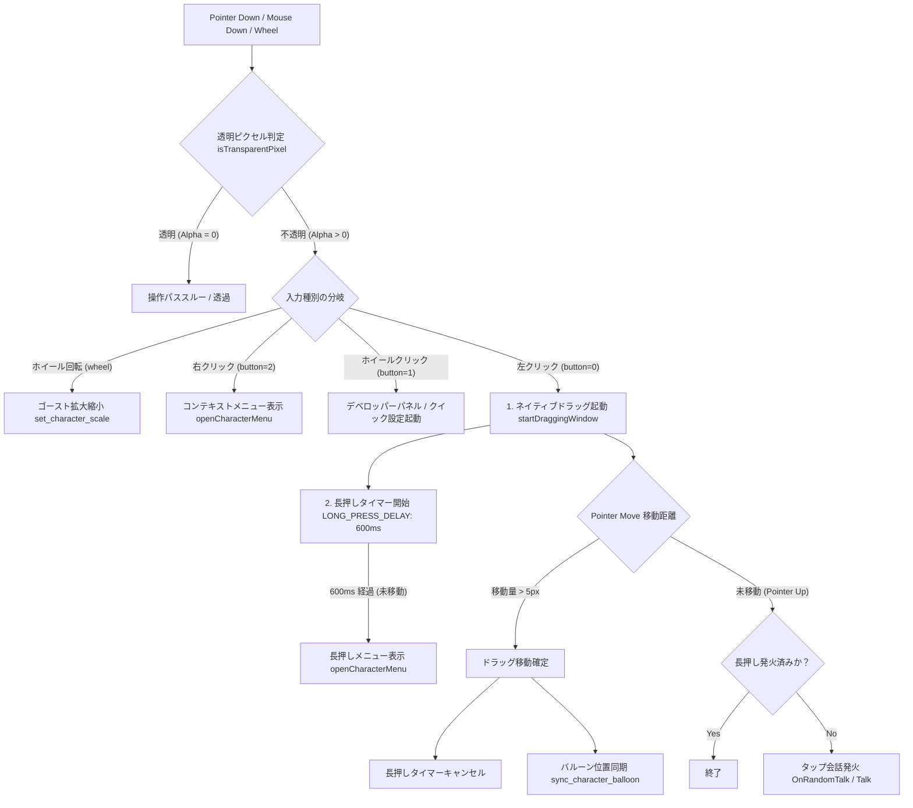

# キャラクター操作領域・ジェスチャー統合仕様書

本ドキュメントは、キャラクター領域上で発生する各種操作（ドラッグ移動、タップ会話、撫で/Stroke判定、長押しメニュー、右クリックメニュー、ホイールクリック、ホイール拡大縮小、透明ピクセル透過、バルーン追従）の相互干渉を防ぎ、密接に連携させるためのイベント優先度と領域結合仕様です。

---

## 1. インタラクションエリア・優先度チェーン (Interaction Priority Chain)

キャラクターウィンドウ上の同一領域に対して複数の操作（ジェスチャー）が存在するため、以下の厳密な優先度判定ルールを適用します：

---

## 2. 操作領域の密接結合と排他ルール

1. **透明ピクセル透過判定 (Click-Through)**:
   - キャンバス/画像のクリック・ホイールされたピクセルの Alpha 値を判定。Alpha = 0 の透明領域への操作はすべてスルー（裏のウィンドウやデスクトップへ透過）。
2. **長押し (Long Press) vs ドラッグ移動 (Drag)**:
   - 押下時に 600ms の長押しタイマーが始動するが、5px 以上のポインター移動が発生した瞬間に長押しタイマーを即座に破棄（キャンセル）し、滑らかなドラッグ移動へシフト。
3. **タップ会話 (Click) vs 長押し/ドラッグ**:
   - ポインターリリース（Pointer Up）時、長押しメニューが既に発火している場合、またはドラッグ移動が発生した場合はタップ会話を発火させない（誤発火防止）。
4. **バルーン追従同期 (Balloon Follow Sync)**:
   - ドラッグ移動中および移動完了時に `sync_character_balloon` を呼び出し、キャラクターの座標変化に吹き出しバルーンをミリ秒単位で追従させる。
5. **マウスホイール回転 (Wheel Scrolling / Scale Control)**:
   - キャラクター不透明領域上でのマウスホイール上下スクロールを検知し、ゴーストスケール（`set_character_scale`）をダイレクトに変更・適用。
6. **ホイールクリック / ミドルクリック (Middle Click / Quick Action)**:
   - マウス中央ボタン（`button === 1`）押下時、デベロッパーパネル/クイック操作パネルを起動。右クリック（`button === 2`）時はメインコンテキストメニューを起動。
