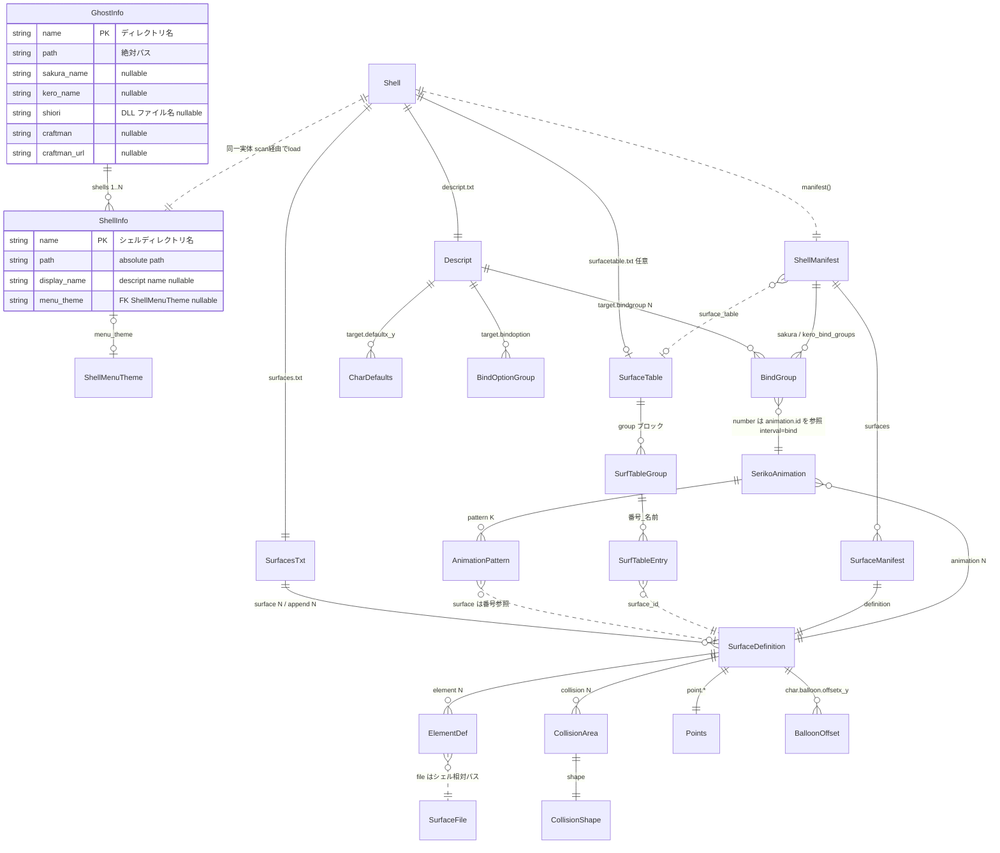
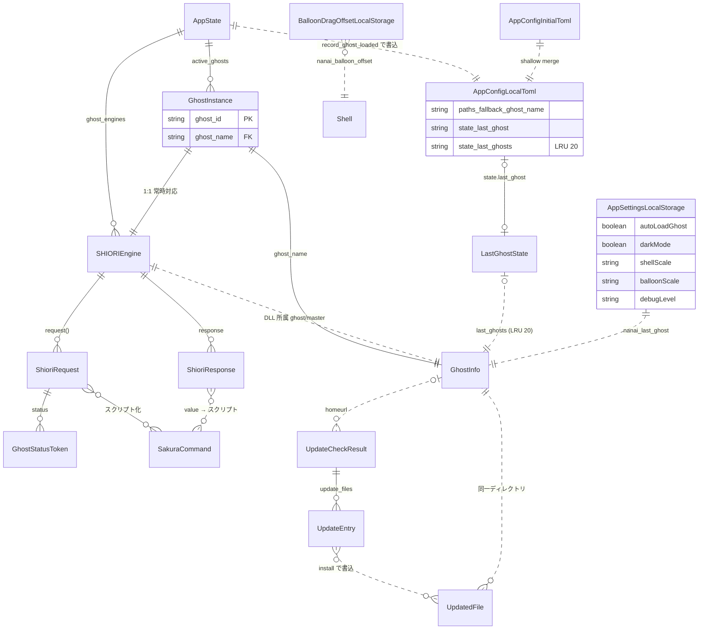

> **AI 関与について**: このドキュメントは AI エージェントの支援により作成・更新されました。

# データモデル・ER図 - Nanai Android Mascot

## 1. 概要

本プロジェクトには **SQL データベースは存在しない**。永続化は完全にファイルベース（`descript.txt` / `surfaces.txt` / `surfacetable.txt` / TOML 設定 / localStorage JSON）であり、以下の ER 図はそれらをパースして構築される serde 構造体群の関係性を表したものである。

| ソースファイル                                       | 実体                           | 参照                                     |
| ---------------------------------------------------- | ------------------------------ | ---------------------------------------- |
| `assets/ghost/<名前>/ghost/master/descript.txt`      | ゴースト定義                   | `src-tauri/src/common.rs:33`             |
| `assets/ghost/<名前>/ghost/<shell>/descript.txt`     | シェル定義・着せ替え           | `crates/ui/src/descript.rs:60`           |
| `assets/ghost/<名前>/ghost/<shell>/surfaces.txt`     | サーフィス・アニメ・当たり判定 | `crates/ui/src/surfaces/types/txt.rs:11` |
| `assets/ghost/<名前>/ghost/<shell>/surfacetable.txt` | サーフィス一覧（任意）         | `crates/ui/src/surfacetable.rs:35`       |
| `config.initial.toml` / `config.local.toml`          | アプリ設定・前回状態           | `src-tauri/src/commands/config.rs`       |
| localStorage 各キー                                  | フロントエンド設定             | `ui/js/core/config.js:35-42`             |

---

## 2. ER図（コア: ゴースト / シェル / サーフィスモデル）

### 2.1 エンティティ詳細

#### スキャン層（src-tauri）— `src-tauri/src/common.rs`

| エンティティ     | 属性                                                                                                                                                                           | 備考                                                       |
| ---------------- | ------------------------------------------------------------------------------------------------------------------------------------------------------------------------------ | ---------------------------------------------------------- |
| `GhostInfo`      | name (PK), path, sakura_name, kero_name, shiori, craftman, craftman_url, shells[1..N]                                                                                          | `ghost/master/descript.txt` 由来。shiori は DLL ファイル名 |
| `ShellInfo`      | name (PK), path, display_name, menu_theme?                                                                                                                                     | `ghost/<ゴースト>/shell/*/` 由来                           |
| `ShellMenuTheme` | background_color, foreground_color, font_color, background_font_color, disable_font_color, separator_color, background_bitmap, foreground_bitmap, sidebar_bitmap (全て Option) | シェル descript の `menu.*` キー由来                       |

#### シェル層（crates/ui）— `descript.rs`, `shell.rs`, `surfacetable.rs`

| エンティティ      | 属性                                                                    | 備考                                                                                           |
| ----------------- | ----------------------------------------------------------------------- | ---------------------------------------------------------------------------------------------- |
| `Shell`           | directory (PK), descript, surfaces_txt, surface_table?                  | シェルディレクトリの統合ランタイムビュー                                                       |
| `Descript`        | properties: HashMap(String,String)                                      | key=value 全退避。主要キー: `type`, `name`, `sakura.name`, `kero.name`, `homeurl`, `craftmanw` |
| `CharDefaults`    | x, y, left, top (全て Option i32)                                       | `<target>.defaultx/y/left/top`                                                                 |
| `BindOptionGroup` | category, options[]                                                     | `mustselect` / `multiple` 等                                                                   |
| `BindGroup`       | number (PK: u32), category, part, thumbnail?, default (bool), add_ids[] | `number` は SHEIKO アニメーションID と一致、`interval=bind`                                    |
| `SurfaceTable`    | charset?, version, scope?, options[][], groups[], properties            | 1行目 charset 必須                                                                             |
| `SurfTableGroup`  | name (PK。`__disabled` は非表示), entries[]                             |                                                                                                |
| `SurfTableEntry`  | surface_id, name                                                        |                                                                                                |

#### サーフィス層（crates/ui）— `surfaces/types/{txt,surface,collision,draw}.rs`

| エンティティ        | 属性                                                                                                          | 備考                                               |
| ------------------- | ------------------------------------------------------------------------------------------------------------- | -------------------------------------------------- |
| `SurfacesTxt`       | charset?, version, maxwidth?, animation_sort?, collision_sort?, surfaces[], aliases, kero_aliases, properties | aliases は エイリアス名→番号列（現専用構造体なし） |
| `SurfaceDefinition` | name?, elements[], collisions[], animations[], points, balloon_offsets[], properties                          | `surface[N]` 単位の定義                            |
| `ElementDef`        | id (PK), method (DrawMethod), file, x, y, options[]                                                           | file はシェル相対パス（`.pna` 同梱）               |
| `CollisionArea`     | id?, name (head/bust/...), shape                                                                              | front 優先の hit_test                              |
| `CollisionShape`    | Rect\|Polygon\|Circle\|Ellipse                                                                                |                                                    |
| `SerikoAnimation`   | id (PK), interval? (Interval), name?, patterns[], options[][]                                                 |                                                    |
| `AnimationPattern`  | index (PK), method, surface (i32, -1=クリア), wait (ms), x, y, options[]                                      | pattern の surface は他サーフィス番号参照          |
| `Points`            | center_x/y, basepos_x/y, kinoko_center_x/y                                                                    |                                                    |
| `BalloonOffset`     | x?, y?                                                                                                        | キーは `sakura` / `kero` / `*`                     |

### 2.2 主要 Enum（属性ドメイン）

| Enum         | 値                                                                                                                          | 参照                           |
| ------------ | --------------------------------------------------------------------------------------------------------------------------- | ------------------------------ |
| `DrawMethod` | Base / Overlay / OverlayFast / Interpolate / Replace / Add / Bind / Blend(String) / Custom                                  | `surfaces/types/draw.rs:7`     |
| `Interval`   | Always / Sometimes / Rarely / Random(n) / Periodic(n) / RunOnce / Never / Bind / Talk / StartTalk / EndTalk / YenE / Custom | `surfaces/types/draw.rs:48`    |
| `SortKind`   | Id / UniqueJunk / UScoped / Custom(String)                                                                                  | `surfaces/types/surface.rs:97` |

---

## 3. ER図（実行時状態・設定・更新）

### 3.1 設定・永続化ストア一覧

| ストア                                       | 実体 / キー                                                                                         | 参照                                      |
| -------------------------------------------- | --------------------------------------------------------------------------------------------------- | ----------------------------------------- |
| `config.initial.toml`（読取専用）            | `[paths]` / `[timing]` / `[scale]` / `[shiori]` / `[state]`                                         | リポジトリルート                          |
| `config.local.toml`（自動生成・書込）        | initial を shallow-merge。`[state].last_ghost` / `last_ghosts`（LRU 20）                            | `src-tauri/src/commands/config.rs:67-133` |
| localStorage `nanai-android-mascot-settings` | `{autoLoadGhost, enableNotifications, darkMode, alwaysOnTop, shellScale, balloonScale, debugLevel}` | `ui/js/core/app-settings.js:6`            |
| localStorage `nanai_last_ghost`              | 最終選択 GhostInfo の JSON                                                                          | `ui/js/ghost/ghost.js:155`                |
| localStorage `nanai_balloon_offset`          | `{x,y}` バルーンドラッグオフセット                                                                  | `ui/js/surface/balloon-drag.js:18`        |
| localStorage `nanai_balloon_theme`           | バルーンスキン文字列                                                                                | `ui/js/ghost/balloon-window.js:12`        |
| AppState（メモリのみ）                       | `recent_files` (LRU 10) / `current_ghost_name` / `ghost_engines` / `active_ghosts`                  | `src-tauri/src/common.rs:45`              |

---

## 4. 関係性補足（設計メモ）

1. **Ghost → Shell の 1..N**: スキャナー（`src-tauri/src/ghost/scan/`）は `ghost/master/`、ルート `descript.txt`、`install.txt` の順で探索し、`shell/*/` を走査して ShellInfo 列を構成する。
2. **BindGroup → SerikoAnimation の外部キー**: `bindgroup[N].number` はシェル descript ではなく `surfaces.txt` の SERIKO アニメーションID（`interval=bind` 指定）を参照する。この間接参照が「着せ替えメニュー ⇄ 描画」の正的中継点である。
3. **AnimationPattern → SurfaceDefinition**: パターンの `surface` フィールドは別サーフィス番号の再帰参照（描画フレーム差分）。`-1` （クリア）は参照無しを示す sentinel。
4. **Shell → ShellManifest**: 同一データの serde JSON 直列化（Tauri コマンド `shell_manifest`）。JS 側（Canvas 合成・SERIKO 再生）はマニフェストのみを消費する。
5. **パース失敗時の退避先**: 各ファイル形式とも未知キーは `properties` / `options` に退避され、前方互換を保つ。
