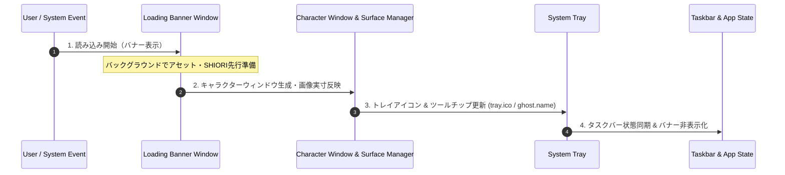

# ゴースト初期起動・切替における統一ライフサイクル仕様書

本ドキュメントは、アプリケーションの「初期起動時（Initial Boot）」および「ゴースト切替時（Ghost Switch）」における、バナー表示・キャラクターウィンドウ・システムトレイ・タスクバーの統一されたUI・アセット制御シーケンスを定義した仕様書です。

---

## 1. 統一ライフサイクルの原則 (Unified Lifecycle Principle)

アプリの初期起動であっても、実行中のゴースト切り替えであっても、ユーザーへ提示されるアセット読み込み・表示シーケンスは**完全に同一の順序（バナー → キャラクターウィンドウ → システムトレイ → タスクバー）**で進行します。

これにより、画面の崩れや未読み込み画像のチラつき（1頭身化等）を完全に防ぎます。

---

## 2. フェーズ別制御仕様

### フェーズ 1: バナー表示フェーズ (Banner Phase)
- **動作**:
  - `show_loading_banner_window` を発火し、画面上にローディングバナーを表示。
  - バックグラウンドで新ゴーストの `descript.txt` / `surfaces.txt` / シェルマニフェスト、および `surface0` / `surface10`（または `tray.ico`）を非同期でパース・プリロード。
  - SHIORI エンジンのロード (`load_ghost`) と `OnBoot` イベント送信を実行。

### フェーズ 2: キャラクターウィンドウフェーズ (Character Window Phase)
- **動作**:
  - バックグラウンドで読み込みが完了したサーフィス画像の自然解像度（`naturalWidth` / `naturalHeight`）を取得。
  - キャラクターウィンドウ（`subchar_window_0`, `subchar_window_1` 等）の枠サイズを画像実寸にピタリと一致させて表示（`set_size` / `show`）。

### フェーズ 3: システムトレイ同期フェーズ (System Tray Phase)
- **動作**:
  - ゴーストマスターフォルダ内の `tray.ico` または `tray.png` を読み込み、タスクトレイのアイコンを切り替え (`update_tray_for_ghost`)。
  - ツールチップの文字列を `Nanai Mascot - <GhostName>` に自動更新。

### フェーズ 4: タスクバー同期・完了フェーズ (Taskbar & Completion Phase)
- **動作**:
  - タスクバー上の表示・状態を同期。
  - ローディングバナーウィンドウをフェードアウト / 非表示（`hide_loading_banner_window`）。
