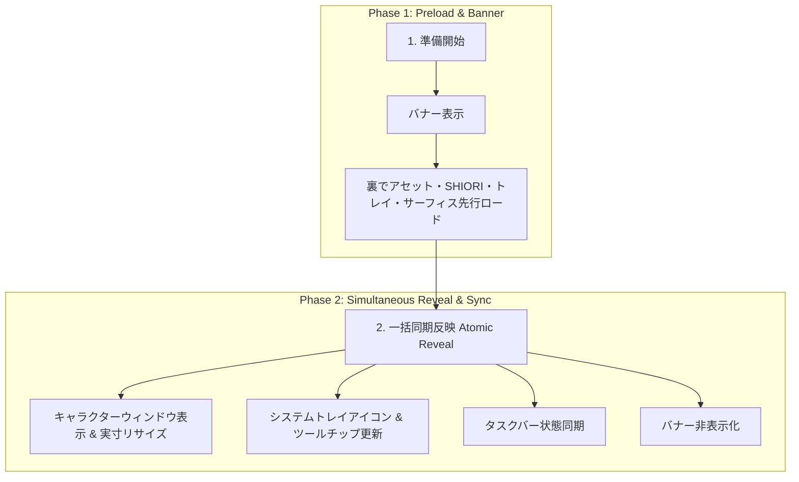

# ゴースト初期起動・切替における統一ライフサイクル仕様書

本ドキュメントは、アプリケーションの「初期起動時（Initial Boot）」および「ゴースト切替時（Ghost Switch）」における、バナー表示および各ターゲット要素（キャラクターウィンドウ・システムトレイ・タスクバー）の統一されたUI・アセット制御シーケンスを定義した仕様書です。

---

## 1. 統一ライフサイクルの原則 (Unified Lifecycle Principle)

アプリの初期起動・実行中のゴースト切替の双方において、表示制御は**「1. 準備中のバナー表示」→「2. キャラクターウィンドウ・システムトレイ・タスクバーの一括同期反映（アトミック展開）」**という2段階の統一モデルに従います。

バナー表示中のバックグラウンド準備完了と同時に、キャラクター表示・トレイアイコン/ツールチップ・タスクバー状態を同期させて一度に展開（Atomic Reveal）することで、アセット未読み込みによる崩れや個別の表示遅延を防止します。

---

## 2. 段階別制御仕様

### 第1段階: バナー表示 & プリロード段階 (Banner & Preload Phase)
- **動作**:
  - `show_loading_banner_window` を発火し、画面上にローディングバナーを表示。
  - 裏で新ゴーストのアセット（`descript.txt` / `surfaces.txt` / シェルマニフェスト）、サーフィス画像（`surface0` / `surface10` 等）、トレイアイコン（`tray.ico` / `tray.png`）、および SHIORI エンジン（`load_ghost`）を非同期プリロード。

### 第2段階: キャラクターウィンドウ・システムトレイ・タスクバー一括反映段階 (Simultaneous Sync Phase)
- **動作（アトミック展開）**:
  - プリロード完了と同時に、以下の状態を一度に同期反映：
    1. **キャラクターウィンドウ**: 画像の実寸解像度に合わせたウィンドウリサイズ・位置適用・表示。
    2. **システムトレイ**: ゴースト固有アイコン（`tray.ico` / `tray.png`）およびツールチップ（`Nanai Mascot - <GhostName>`）の更新。
    3. **タスクバー**: タスクバー上の表示・アイコン状態の同期。
  - 反映完了後、ローディングバナーをフェードアウト / 非表示（`hide_loading_banner_window`）。
