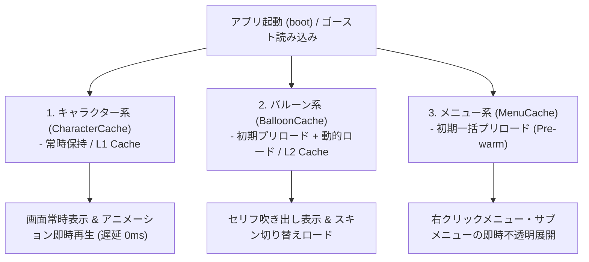

# Nanai アセットキャッシュ & プリロード保持戦略 (Asset Caching Strategy)

本文書では、Nanai Android Mascot アプリケーションにおける画像・グラフィックアセットの三層キャッシュ構造およびプリロード戦略について規定します。

---

## 1. キャッシュ分類と保持戦略一覧

アプリケーションで消費される各種画像アセットは、その描画頻度およびユーザー体験（UX）への影響度に応じて以下の **3つのレイヤー（三層キャッシュ構造）** に分類・管理されます。

| アセット分類                                | 保持ライフサイクル                             | プリロードタイミング                           | 主な対象アセット                                                                         | 設計目的                                                                                        |
| :------------------------------------------ | :--------------------------------------------- | :--------------------------------------------- | :--------------------------------------------------------------------------------------- | :---------------------------------------------------------------------------------------------- |
| **1. キャラクター系** (`CharacterCache`) | **ウィンドウ常時保持** (ゴースト生存期間中) | アプリ起動時 (`boot`) / サーフィス定義パース時 | 全登場キャラクター (Scope 0, Scope 1+) の基本サーフィス、PNAマスク、合成済み framebuffer | 立ち絵描画・SERIKO アニメーション・表情変化時の非同期レンダリング遅延 (描画落ち) をゼロにする。 |
| **2. バルーン系** (`BalloonCache`)       | **初期プリロード + オンデマンド**              | アプリ起動時 + スキン変更 (`\b[...]`) 時       | アクティブバルーンスキン画像 (`balloon0.png`, `balloon1.png`, `arrow.png` 等)            | セリフ吹き出し表示の即時性を確保しつつ、未所有バルーンによる無駄なメモリ消費を抑制する。        |
| **3. メニュー系** (`MenuCache`)          | **初期一括プリロード** (Pre-warm)           | アプリ起動時 / ゴースト・シェル決定時          | メインメニュー (`menu_background`, `menu_sidebar`)、サブキャラメニュー、各サブメニュー   | 右クリック時の画像デコード遅延（画像読み込めずに一瞬透明化する現象）を排除し、即時展開を実現。  |

---

## 2. 実装レイヤー構造 (`AssetCacheManager`)

TypeScript フロントエンド階層において、[asset-cache.ts](ui/ts/core/asset-cache.ts) が全アセットのメモリ/GPUフェッチとデコード（`Image.decode()`）を一元管理します。

### 1) キャラクター系 (`category: "character"`)

- `SurfaceManager` および `ghost-surface.ts` が制御。
- `boot()` 完了時に登場するメインキャラクター (Scope 0) およびサブキャラクター (Scope 1) の初期サーフィスアセットを即座にフェッチ。
- ウィンドウが表示されている間、メモリおよび GPU テクスチャ上に常時保持されます。

### 2) バルーン系 (`category: "balloon"`)

- `BalloonManager` および `balloon-descript.ts` が制御。
- 現在設定されているバルーンスキン（`default` 等）のパーツ画像を読み込み。
- スクリプト再生中や設定変更によるバルーン切り替え（`sync-balloons`）が発生した際に動的に事前ロードおよびキャッシュの差し替えを行います。

### 3) メニュー系 (`category: "menu"`)

- `menuThemeRenderer` および `app-menu.ts` が制御。
- シェル決定時（`syncMenuGhosts`）に、メインメニュー・サブキャラクターメニュー・サブメニューに必要なスキン画像（`menu_background.png`, `menu_sidebar.png`, `menu_foreground.png` 等）を一括先行読み込み (Pre-warm)。
- 右クリックされた瞬間には既にデコード済み画像がメモリから引き出されるため、画像ロードの遅延やチラつき（透明化）が解消されます。

---

## 3. Rust バックエンド (`src-tauri`) との連携

- Native OS / Tauri 環境下では、ローカルファイルシステム (`convertFileSrc` 経由) または VFS (Virtual File System) から直接画像ストリームをフェッチします。
- `AssetCacheManager` が `HTMLImageElement` および `Image.decode()` を用いて明示的に GPU テクスチャデコードをプロンプトするため、UI レンダリングスレッドのブロックを回避します。
