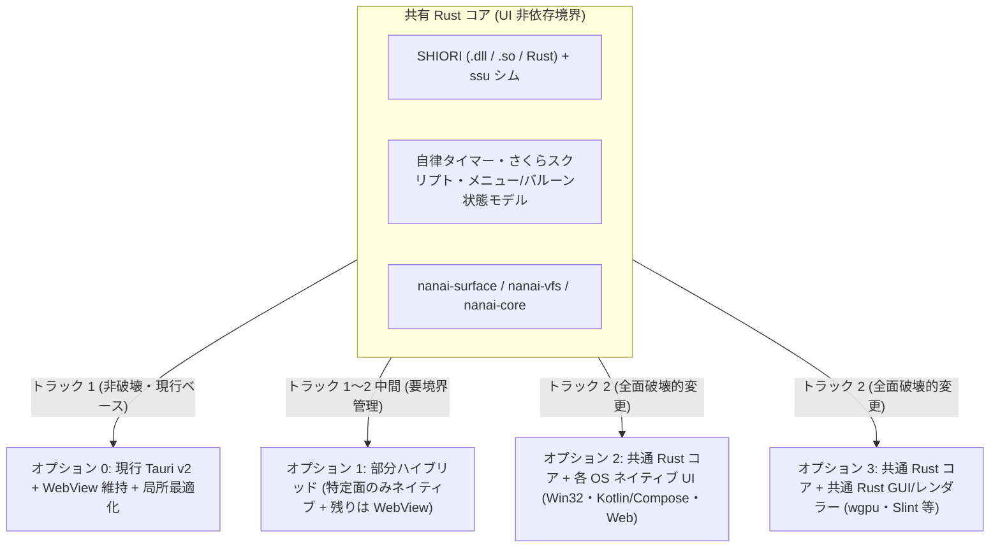

> **AI 関与について**: このドキュメントは Antigravity の支援により作成されました。本ドキュメントは現行アーキテクチャに対する「検討案（オプション整理）」であり、採用・実装を決定するものではありません。

# ネイティブ化アーキテクチャ検討案（Windows / Android 横断・破壊的変更オプション整理）

> **ステータス**: 検討案（ドラフト・未決定）  
> **位置づけ**: 直近の漸進的改善（場当たり的・局所的な改修）と、中長期的な全面破壊的変更（脱 Tauri / ネイティブ UI 再構築）を混同せず、プラットフォーム横断・機能領域横断で選択肢をフラットに整理するための検討文書です。

関連ドキュメント:
- [rust-migration-summary.md](./rust-migration-summary.md) - Rust / WASM 移行計画 総論
- [shiori-runtime-and-dynamic-module-policy.md](./shiori-runtime-and-dynamic-module-policy.md) - SHIORI 実行環境および動的モジュール配信・ロード方針仕様書
- [shiori-support-design.md](./shiori-support-design.md) - SHIORI 対応検討・実行アーキテクチャ設計（単一ゴースト複数キャラクター前提）
- [android-window-architecture.md](../nam-spec/android-window-architecture.md) - Android ウインドウアーキテクチャおよびオーバーレイ提供方式の検討・計画
- [android-unified-overlay.md](../nam-spec/android-unified-overlay.md) - Android 全キャラ単一ウインドウ統合表示（opt-in）
- [android-native-overlay-study.md](../nam-spec/android-native-overlay-study.md) - Android オーバーレイ ネイティブ化案 検討書（オーバーレイ特化・局所アプローチの詳細）

---

## 1. 前提整理：2 つの全く異なる方向性（直近の局所改変 vs 全面的な破壊的変更）

「ネイティブ化」を議論する際、**直近の現行構成を前提とした局所的・現実的な対処** と、**アプリケーションの UI 基盤そのものを入れ替える全面的な破壊的変更案** は、目的・投資対効果・リスクの性質が根本的に異なる。これらを同一線上で曖昧に混ぜて進めると、中途半端な二重スタックや無計画な作り直しを招きやすい。

| 観点 | トラック 1: 直近の局所・漸進的対応（現行 Tauri v2 + WebView 前提） | トラック 2: 全面的な破壊的変更案（脱 Tauri / ネイティブ再構築） |
| :--- | :--- | :--- |
| **目的・スコープ** | 現行の Tauri v2 + TypeScript / WebView 基盤を維持したまま、ブロッカーとなっている OS 固有制約やメモリ問題を局所改修する | WebView / Tauri 依存を構造的に見直し、プラットフォームネイティブ UI または共通 Rust GUI 上へアプリ全体を再設計する |
| **既存 Web UI 資産の扱い** | 100% 維持・活用する（既存の Vitest 等テスト資産・HTML/CSS/TS 実装をそのまま生かす） | 大半または全部を破棄・置換する（UI 層は新基盤側で再実装する） |
| **主な対象課題** | Android オーバーレイ枠接続、JNI スレッド安全化、SHIORI `.so` / 32bit ブリッジ、WebView メモリ最適化 | Windows 800MB 級メモリ膨張の構造解消、Android LMK 限界突破、Explorer 等の OS ネイティブ級操作性・起動速度の獲得 |
| **リスク・コスト** | 変更コストは最小だが、WebView プロセス構造に起因する上限（メモリ下限・起動ラグ・IPC 境界）は残る | 実装・テスト・保守コストが極めて大きく、既存機能の再検証が全面的に必要になる |
| **意思決定の重さ** | 個別タスク単位で着手・撤回が可能 | プロジェクト全体の基盤転換であり、明確な採用判断なしに着手すべきではない |

---

## 2. オーバーレイに限定されないネイティブ化の適用範囲（Windows / Android 横断）

ネイティブ化の議論は Android の `TYPE_APPLICATION_OVERLAY` だけに閉じた問題ではなく、以下の 3 層・両プラットフォームにまたがる。

1. **Windows（デスクトップ）領域**
   - [shiori-runtime-and-dynamic-module-policy.md](./shiori-runtime-and-dynamic-module-policy.md) で挙げられている **800MB 級メモリ膨張問題**（キャラ・バルーン・メニュー等の複数 WebView2 プロセス、Rust と V8 の二重ヒープ、IPC 遅延）は、Android の LMK 問題と同根の構造課題である。
   - Win32 Layered Window（`UpdateLayeredWindow` / Direct2D / wgpu 等）を用いれば、SSP 相当の低メモリ常駐・ピクセル単位の透過クリックスルー・非フォーカス描画・60fps ドラッグ追従が得られる。また、Explorer 等のリスト画面もネイティブコントロールなら大量データ時の応答性が大幅に向上する。
2. **Android（オーバーレイ以外も含む）領域**
   - `TYPE_APPLICATION_OVERLAY`（常駐マスコット・バルーン・SSP メニュー）だけでなく、権限未許可時の `InAppStage`、**Explorer（大量ゴースト／シェル／バルーン一覧・サムネイル・SAF 連携・タブレット 2 ペイン Activity Embedding）**、将来的な **ライブ壁紙（`WallpaperService`）** やウィジェットまでが対象範囲に入る。
   - とくに **Explorer・ファイル管理・タブレット 2 ペイン** は、WebView 越しに大量サムネイルや仮想スクロールを扱うより、OS 標準のネイティブ UI（`RecyclerView` / Jetpack Compose・SAF・Activity Embedding）の方が適性が高い領域である。
3. **実行コア層（UI より下層）**
   - [shiori-support-design.md](./shiori-support-design.md) の SHIORI（`.dll` / `.so` / Rust 系エンジン）、SAORI シム（`ssu` 等）、SERIKO 合成（`nanai-surface`）、VFS（`nanai-vfs`）、さくらスクリプト解析・自律タイマーを完全に Rust 側へ集約する層。
   - この層を UI 非依存でネイティブ完結させておけば、上位が Tauri WebView であってもネイティブ UI であってもそのまま接続できる。

---

## 3. 機能領域ごとの「ネイティブ適性 vs WebView 維持の利点」フラット評価

「管理画面は WebView 向き・表示面だけネイティブ向き」といった先入観を排し、各機能領域ごとに両面をフラットに評価する。

| 機能領域 | ネイティブ適性 | ネイティブ化の主な利点 | WebView 維持の主な利点 |
| :--- | :--- | :--- | :--- |
| **実行コア（SHIORI / SAORI / VFS / SERIKO / タイマー）** | **非常に高い** | Rust で Windows / Android 完全共通化でき、`MainActivity` や WebView の生存に左右されない自律稼働が可能 | V8 上での WASM / JS SHIORI 実行基盤として補完利用できる |
| **Explorer・一覧管理・ファイル連携・タブレット 2 ペイン** | **高い** | 大量ゴースト／サムネイルの仮想スクロール、スクロール慣性、省メモリ、Android SAF / D&D、Activity Embedding との親和性が非常に高い | Win / Android 間で単一の HTML/TS コードを保守できる |
| **キャラクター表示（Win 透過窓 / Android オーバーレイ・InApp・壁紙）** | **高い** | 常駐メモリ最小化、透過ピクセルの正確なクリックスルー、60fps ドラッグ、Android 12+ 最小矩形制約への適合 | 既存の Canvas / DOM 資産と Vitest 検証環境をそのまま流用できる |
| **SSP オーナードローメニュー** | **高い** | 起動ラグ 0ms、`WRAP_CONTENT` 実寸フィット、枠外タップ閉鎖、サブメニューのはみ出し制約なし | 既存の `menu-iframe` 装飾・CSS レイアウトを流用できる |
| **バルーン** | **中〜高** | 常駐・発話時のメモリ削減、最小矩形制御、IME 自動退避との連携が素直 | 文字装飾・インライン要素・既存実装との表現一致や HTML 拡張に強い |

---

## 4. 全面変更を含むアーキテクチャ選択肢の比較（オプション 0〜3）

現行の延長から全面的な破壊的変更まで、取り得るアーキテクチャ選択肢を 4 案として整理する。いずれも検討段階のオプションであり、特定案の採用を決定するものではない。

### 各オプションの概要とトレードオフ

- **オプション 0: 現行 Tauri v2 + WebView 維持＋局所最適化（トラック 1）**
  - WebView 主導の UI 構成を維持し、Android のオーバーレイ枠や Rust 側 SHIORI `.so` 統合など、必要な足回りだけを局所的に補う。
  - **トレードオフ**: 既存資産を最も活かせるが、Windows のマルチ WebView メモリ消費や Android オーバーレイでの WebView 制約は構造的に残る。
- **オプション 1: 部分ハイブリッド（特定面のみネイティブ ＋ 残りは Tauri WebView 維持）**
  - 常駐マスコット面だけ、あるいは Android のオーバーレイ／Explorer の一部だけをネイティブ UI 化し、残りを Tauri WebView で維持する折衷案。
  - **トレードオフ**: 一部課題は改善するが、「どの領域をどちらのスタックで持つか」の境界設計が曖昧だと二重保守と IPC 複雑化だけを招くリスクがある。
- **オプション 2: 共通 Rust コア ＋ 各 OS ネイティブ UI（脱 Tauri・全面破壊的変更）**
  - Rust コア（C-ABI / UniFFI 等）を共通土台とし、Windows（Win32 Layered Window / Direct2D / WinUI 等）、Android（Kotlin Canvas / Jetpack Compose / RecyclerView 等）、Web（WASM + Canvas）で各 OS 最適の UI を実装する。
  - **トレードオフ**: Explorer を含む全画面の応答性・OS 馴染み・省メモリは理論上最高となる一方、UI 層をプラットフォーム別に全面再構築・保守するコストが発生する。
- **オプション 3: 共通 Rust コア ＋ 共通 Rust レンダラー／GUI 統一（脱 Tauri・全面破壊的変更）**
  - `wgpu` / `Vello` / `Skia` / `Slint` / `egui` 等で描画と UI を Rust 側に統一し、OS 固有の窓枠（Win32 Layered Window、Android `WindowManager` / `SurfaceView`）のみ薄く包む。
  - **トレードオフ**: UI コードを Rust で一本化できる可能性がある一方、日本語組版・フォールバックフォント・IME 統合・OS 標準のファイルピッカー／メニュー操作感の作り込みコストが高い。

### 横断比較マトリクス

| 比較軸 | オプション 0（現行維持＋局所最適化） | オプション 1（部分ハイブリッド） | オプション 2（共通 Rust ＋ OS 別ネイティブ UI） | オプション 3（共通 Rust ＋ 統一 Rust GUI） |
| :--- | :--- | :--- | :--- | :--- |
| **変更規模** | 小（非破壊・漸進的） | 中〜大（境界次第） | 最大（全面破壊的変更） | 最大（全面破壊的変更） |
| **Windows 800MB 問題対策** | 限定的（プロセス統合等で緩和） | 該当面を置き換えれば改善 | 根本解消（数十 MB 級が可能） | 根本解消（GPU/CPU 描画に依存） |
| **Android LMK・背面透過** | 構造的制約が残る | 常駐面をネイティブ化すれば改善 | 最適（WebView 常駐 0 個） | 良好（ただし GPU コンテキスト消費に注意） |
| **Explorer 操作性・OS 親和性** | WebView 相当 | 選択次第（Android のみ改善等も可） | 最高（OS 標準の仮想リスト・SAF・2 ペイン活用） | 中（独自 GUI の操作感になりやすい） |
| **UI 実装・保守コスト** | 最小（単一 Web UI） | 中〜高（2 スタック混在の恐れ） | 最大（OS ごとに UI 実装が必要） | 高（Rust GUI での SSP・日本語組版再現） |
| **WASM / JS 資産との相性** | 高い（そのまま活用） | 高い〜中 | 低い（UI テスト・WASM SHIORI 連携は再構成） | 中（WASM ターゲット対応のフレームワーク限定） |

---

## 5. 両トラック共通で「今投資しても無駄にならない」境界領域

トラック 1（直近の局所対応）とトラック 2（将来の破壊的変更案）のどちらを採るか未確定の段階でも、以下の投資は双方でそのまま活きるため手戻りになりにくい。

1. **SHIORI 実行層と自律タイマーの Rust 側独立化**: 単一ゴースト・同梱 `.so` / DLL・`ssu` シム・ランダムトークタイマー・さくらスクリプト状態遷移を WebView の JS ループから切り離す。
2. **純粋 Rust 境界へのロジック集約**: `crates/nanai-core` / `crates/nanai-surface` / `crates/nanai-vfs` へ、サーフェス合成・メニュー項目ツリー・さくらスクリプトパーサ・Explorer 用データモデルを集約し、UI フレームワーク非依存の API を保つ。
3. **Android 側の共通足回り修正**: `OverlayJniBridge` の `MainLooper` スレッド安全化、実権限照会、`WorkArea` 算出、`onTrimMemory` 接続など OS 境界の不具合修正。

逆に、**トラック 2 の全体合意なしに特定の画面（例: Explorer だけ、設定画面だけ）を場当たり的に別 UI スタックへ書き換えること**は、保守対象を無秩序に増やすため避けるべきである。

---

## 6. 将来判断するための検討・観測ポイント（採用基準メモ）

トラック 1 に留まるか、トラック 2（全面的な破壊的変更）へ踏み切るかを将来判断するための客観的な観測ポイントを以下に整理する。

- **Windows 実測負荷**: 複数ウィンドウ＋ゴースト実運用時の WebView2 合計メモリ消費と起動・切替レスポンスが許容範囲内に収まるか。
- **Android 実機挙動**: `TYPE_APPLICATION_OVERLAY` 下での LMK 生存率、バックグラウンド復帰安定性、大量ゴースト導入時の Explorer スクロール性能が実用基準を満たすか。
- **保守体制と開発コスト**: 単一 Web UI 基盤の保守速度と、OS 別ネイティブ UI（または統一 Rust GUI）へ移行した場合の長期保守コストのどちらを優先するか。
- **Web / WASM 互換の重要度**: 外部 WASM / JS SHIORI やブラウザ版ターゲット、既存の Vitest テスト資産をどこまで中核要件として維持するか。
