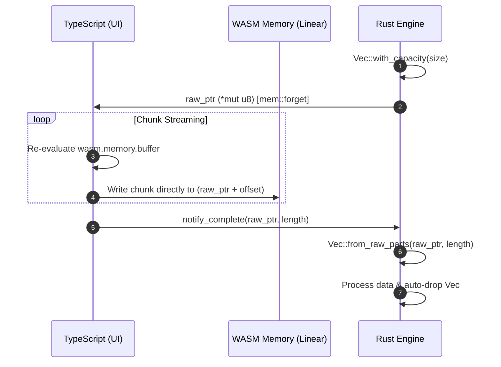

# 各論2：WASMにおけるメモリ管理とゼロコピー（Zero-Copy）戦略

## 1. WASM リニアメモリとヒープの根本特性

### ① メモリ縮小不可 (`memory.shrink` 不在) とピークメモリの維持
- WASM のリニアメモリ（`WebAssembly.Memory`）は JS 側からは単一の `ArrayBuffer` として参照されます。
- WASM 仕様上 `memory.grow()` によるメモリ拡張はサポートされていますが、**`memory.shrink()` による縮小はサポートされていません**。
- Rust 側で `drop()` やアロケータ（`dlmalloc` 等）によるメモリ解放を行っても、それは WASM ヒープ内部で「再利用可能領域」としてマークされるのみであり、**ブラウザ/OSに返却されるメモリサイズ（`ArrayBuffer`）はピーク時のサイズのまま維持**されます。

### ② ArrayBuffer の離脱 (Detachment) への対策
- WASM 内で動的割り当てが行われ `memory.grow()` が発火すると、JS 側で参照していた既存の `ArrayBuffer` は**離脱（Detached / 無効化）**されます。
- 対策として、TypeScript 側で WASM メモリ上の `Uint8Array` や `Uint32Array` ビューを保持し続けるのではなく、**毎回のアクセス直前に `wasm.memory.buffer` から最新のビューを再生成**する設計を徹底します。

---

## 2. 実用的なメモリ転送とゼロコピー（Zero-Copy）パターン

### ① ステージングバッファと生ポインタ（Raw Pointer）の活用
JS/TS 側から大型ファイル（アーカイブデータや大容量画像等）を WASM に流し込む際、デフォルトの `Uint8Array` 引数指定だと「JSヒープ」と「WASMヒープ」で二重にメモリが消費されます。

これを回避するため、以下のステートフルなステージングバッファパターンを採用します：

1. **Rust 側の領域確保と所有権放棄 (`std::mem::forget`)**:
   - Rust 側で `Vec<u8>` バッファを確保し、`Box::into_raw` や `std::mem::forget` で自動解放をスキップした上で、生ポインタ (`*mut u8`) とキャパシティを JS 側に返却。
2. **TS 側のダイレクト書き込み**:
   - TS 側は取得したポインタオフセットに基づき、WASM メモリ上の `Uint8Array` ビューに対してストリーミング直接書き込みを実行（JSヒープの消費量を最小化）。
3. **Rust 側の所有権再取得と解放 (`Vec::from_raw_parts`)**:
   - 書き込み完了後、TS 側からポインタとデータ長を Rust に通知。Rust 側で `Vec::from_raw_parts` により所有権を復元し、関数の終了とともに安全に `drop()` 解放。

---

## 3. WebWorker による完全メモリ回収（ターミネート戦略）

- ピークメモリが極めて大きい一時処理（例: 大容量ゴースト/ZIP アーカイブの解凍・インポート等）では、WASM インスタンスを **WebWorker** 内で起動します。
- 処理完了後に `worker.terminate()` を実行してインスタンス参照チェーン（`Worker Global` $\rightarrow$ `WASM Instance` $\rightarrow$ `WebAssembly.Memory` $\rightarrow$ `ArrayBuffer`）を断ち切ることで、**ブラウザの GC が領域全体を正しく回収し、OSへメモリを返却できる環境**を実現します。

---

## 4. 参考文献・参照 URL (References)

- **WASM のメモリ仕様と WebWorker による解放戦略**:  
  [https://zenn.dev/nanash/articles/6df11870451548](https://zenn.dev/nanash/articles/6df11870451548)
- **WASM メモリ管理・生ポインタによるストリーミング転送・ArrayBuffer Detachment 対策**:  
  [https://zenn.dev/collabostyle/articles/562ae0c1129c32](https://zenn.dev/collabostyle/articles/562ae0c1129c32)
