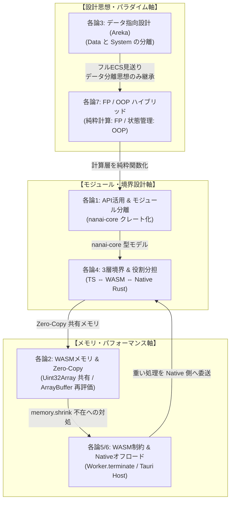

# 総論：各論の総合結果・最終結論と移行ロードマップ

## 1. 各論の統合分析と最終結論

各テーマ（各論1〜7）の技術検証と設計検討を踏まえ、本プロジェクトでは **「ハイブリッド WASM/Rust コア + Native Rust オフロード + TypeScript UI」** アーキテクチャを最終決定とします。

### 1.1 各論ごとの要約と結論

- **各論1（API/拡張性）**: `web-sys` による Web API 直結と `nanai-core` クレート分離により、安全な WASM プラグイン構造を形成。
- **各論2（メモリ管理）**: `Uint32Array` によるゼロコピー共有と、`memory.shrink` 不在対策としての WebWorker 解体 (`terminate`) 戦略を導入。
- **各論3（データ指向 ECS）**: フル ECS (`bevy_ecs`) の導入は過剰 (Overkill) として見送り、「データと処理の分離」思想のみを継承した軽量イベント駆動型状態機械を採用。
- **各論4（3層境界分担）**: UI (TS/DOM) ⇔ WASM (Rust Core) ⇔ Native Host (Tauri Rust) の責務を厳格化し、型定義を `nanai-core` で100%統一。
- **各論5/6（WASM制約対策）**: WASM メモリの縮小不可特性やマルチスレッド制限を考慮し、大容量処理や重い演算は Tauri ネイティブ側に柔軟にオフロード。
- **各論7（パラダイム設計）**: パース・計算・描画演算層は純粋関数 (FP) を重視し、UI・ウィンドウ・ステート管理層は Struct + Trait のカプセル化 (OOP) を採用。

### 1.2 各論間の相互関係とシナジー (Architecture Synergy)

1. **設計思想とモジュール分離の相関 (各論3 ✕ 各論7 ✕ 各論1)**:
   - ECSの「データと処理の分離」思想（各論3）を継承し、計算層を純粋関数（FP/各論7）として `nanai-core`（各論1）にクレート化。高テスト性と安全な改変性を確保。
2. **メモリ制約とインフラ・境界の相関 (各論2 ✕ 各論5 ✕ 各論4)**:
   - WASMのメモリ縮小不可問題（各論2）に対し、日常の描画は Zero-Copy（各論4）で高速化しつつ、大容量処理は WebWorker 解体や Native Rust オフロード（各論5）で安全に回収。
3. **3層境界と型安全性の相関 (各論1 ✕ 各論4 ✕ 各論5)**:
   - TS ⇔ WASM ⇔ Native Rust の 3 層（各論4）に対し、`web-sys` / `tauri-specta`（各論1）および `nanai-core` の単一型モデルで型安全性を保証し、Native オフロード（各論5）時の通信トラブルを防止。

## 2. 段階的移行ロードマップ

> [!IMPORTANT]
> 既存の安定したテスト資産（266ファイル・1,070テスト）を保持・検証しながら、コア部分を段階的に Rust/WASM へ移行します。
- **フェーズ1（コアのクレート化 & WASM化）**:
  - さくらスクリプトパーサー、ASTトラバーサル、SERIKOアニメーションの状態機械を純粋な Rust クレートとし、`wasm-bindgen` でラップ。
- **フェーズ2（メモリ共有 & Web API連携）**:
  - `web-sys` を用いた Canvas 描画の Rust 化、および `Uint32Array` によるゼロコピーピクセルバッファ共有の導入。
- **フェーズ3（検証と最適化）**:
  - 既存の Vitest テストを WASM ビルドに対して実行、`wasm-opt` によるリリースビルドの軽量化。

## 3. 総括

本計画に基づき、API の利用しやすさと高い改変性を維持しながら、アプリケーション全体の中核を Rust / WASM に移行することで、圧倒的なパフォーマンスと堅牢性を兼ね備えたクロスプラットフォーム・マスコット環境を構築します。
