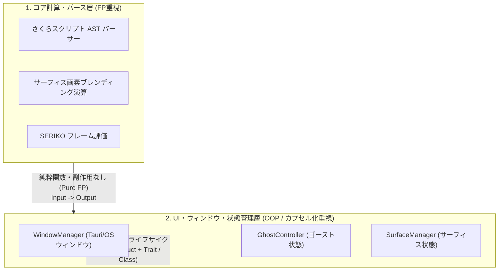

# 各論7：関数型 (FP) とオブジェクト指向 (OOP) の活用と関与設計

本ドキュメントでは、関数型プログラミング（FP）およびオブジェクト指向プログラミング（OOP）の定義・特徴を整理し、当プロジェクト（Rust / TypeScript / WASM）において両パラダイムをどのように適用・関与させるべきかの指針を提示します。

---

## 1. 関数型 (FP) と オブジェクト指向 (OOP) の本質と特徴

| 比較項目           | 関数型プログラミング (FP)                                      | オブジェクト指向プログラミング (OOP)                   |
| :----------------- | :------------------------------------------------------------- | :----------------------------------------------------- |
| **中心的な考え方** | **データと関数の分離 / 不変性 (Immutability)**                 | **データと振る舞いのカプセル化 (Data + Behavior)**     |
| **状態管理**       | 状態を変更（Mutate）せず、関数の返り値として新たな状態を生成。 | オブジェクトの内部状態を保持・変更（Mutable）する。    |
| **抽象化機構**     | パターンマッチ、高階関数、パイプライン、Enum (代数的データ型)  | クラス、インターフェース、ポリモーフィズム             |
| **強み**           | 副作用がなく挙動が予測可能。テストや並列処理が容易。           | 現実世界のUIやシステム構造を直感的にモデル化しやすい。 |
| **課題**           | 純粋関数のみでは状態変化やI/Oの表現が複雑化する場合がある。    | 共有状態の書き換えによるバグや密結合が発生しやすい。   |

---

## 2. Rust と TypeScript における言語的アプローチ

### 2.1 Rust のパラダイム設計

- Rust はクラスの**「継承 (Inheritance)」を排除**しており、代わりに **Struct + Trait** によるコンポジション（合成）を採用しています。
- 一方で、不変性（デフォルト `immutability`）、パターンマッチ (`match`)、Enum（代数的データ型）、`Option`/`Result` によるエラーハンドリング、イテレータチェーンなど、**関数型 (FP) の最も優れた機能をコアに取り入れたハイブリッド言語**です。

### 2.2 TypeScript のパラダイム設計

- TS も Class (OOP) と アロー関数 / イテレータ操作 (`map`, `filter`, `reduce`) / 判別可能なユニオン型 (FP) の双方を柔軟に扱えるマルチパラダイム言語です。

---

## 3. 当プロジェクトにおける関与・使い分け方針

二者択一ではなく、**レイヤー（層）の特性に応じた適切なハイブリッド使い分け** を採用します。

### ① パース・計算・描画演算層：関数型 (FP) アプローチを重視

- **対象**: さくらスクリプトの AST パース、SERIKO フレーム間隔計算、ピクセルバッファの色変換・合成演算。
- **方針**:
  - 副作用を持たない**純粋関数 (Pure Function)** として実装。
  - Rust の `match`（パターンマッチ）、`Option`/`Result`、`Iterator` (`map`/`filter`/`fold`) をフル活用。
  - **効果**: ガベージコレクションや副作用がなく、`cargo test` による単体テストが極めて書きやすく高速化。

### ② UI・ウィンドウ・ステート管理層：オブジェクト指向 (OOP / カプセル化) アプローチを重視

- **対象**: Tauri の OS ウィンドウ管理、`GhostController`、`SurfaceManager` などの状態を持つ管理クラス。
- **方針**:
  - 内部状態（現在のスコープ、バルーン座標、現在のゴースト名）と操作メソッドを **Struct + Trait（または Class/Module）でカプセル化**。
  - 継承（Inheritance）は一切使わず、**コンポジション（合成・委譲）** により柔軟な設計を維持。
