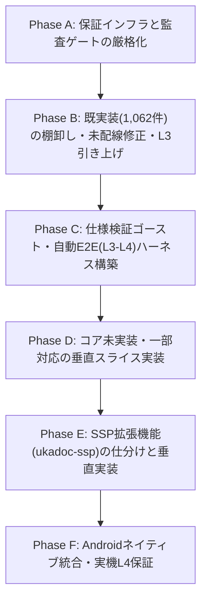

# 仕様実装・動作保証 通貫計画 (Phase A〜F)

## 1. 目的と基本方針

本ドキュメントは、**nanai-android-mascot** における「仕様実装件数を増やすこと」と「既実装を含む実際の動作を保証すること」を一体で進めるための通貫計画を定義する。

- **保証レベル（L0〜L4）中心の進捗管理**: キーワード一致や読込・代入のみを「実装済」とみなさず、入力から消費側（描画・イベント発火・OS反映）までを通貫検証できた項目のみを動作保証済（L3 以上）として扱う。
- **Specification-First**: 実装・修正前に `docs/doc/` および `docs/spec/` の該当仕様を確認・更新し、`npm run verify:spec` で整合性を担保する。
- **Rust コア一元化**: パーサー（`descript.txt` / `surfaces.txt` / さくらスクリプト）およびプロトコル処理は `crates/nanai-core`・`crates/nanai-surface`・`crates/nanai-shiori-vm`・`crates/nanai-vfs`・`crates/ui` へ集約し、`ui/` は描画とユーザー入力に専念させる。
- **Windows First → Android 適応**: Windows デスクトップ環境で SSP 互換挙動を確立した上で、Android 固有層（単一オーバーレイ・タッチ操作・常駐サービス）へ展開する。
- **不変条件の厳守**: `monitor.work_area()` 基準の座標/DPI 換算、バルーン縦方向クランプ、ドラッグ追従の `requestAnimationFrame` コアレス（[AGENTS.md](../../../../AGENTS.md) 準拠）を全フェーズで維持する。

---

## 2. 現状ベースラインと動作保証上の課題（実測）

[SUMMARY.md](../../../spec/SUMMARY.md) 時点の適合状況（全 **2,504** 項目）は以下の通りである。

| 規格カテゴリ | ✅ 実装済 | ⚠️ 一部対応 | ❌ 未実装 | ❓ 未確認 | 合計 |
| :--- | ---: | ---: | ---: | ---: | ---: |
| `ukadoc-spec/descript` | 358 | 195 | 55 | 0 | 608 |
| `ukadoc-spec/dev` | 16 | 19 | 15 | 0 | 50 |
| `ukadoc-spec/list` | 468 | 531 | 265 | 1 | 1,265 |
| `ukadoc-spec/manual` | 69 | 17 | 0 | 0 | 86 |
| `ukadoc-spec/memo` | 8 | 1 | 1 | 0 | 10 |
| `ukadoc-spec/spec` | 30 | 30 | 59 | 0 | 119 |
| `ukadoc-ssp/about` | 3 | 0 | 2 | 0 | 5 |
| `ukadoc-ssp/config` | 59 | 11 | 19 | 0 | 89 |
| `ukadoc-ssp/dev` | 34 | 0 | 33 | 0 | 67 |
| `ukadoc-ssp/functions` | 10 | 5 | 124 | 0 | 139 |
| `ukadoc-ssp/howto` | 7 | 28 | 31 | 0 | 66 |
| **合計** | **1,062** | **837** | **604** | **1** | **2,504** |

現状では「✅ 実装済（1,062 件）」であっても動作が保証されていない構造的要因が 4 点存在する。

1. **キーワード出現一致のみの自動判定**: `scripts/compliance/audit_processor.py` が本番コードとテストに検索語が出現するだけで `✅ 実装済` と判定しており、存在しない旧パス（`ui/js/`）参照の残留や `verify:spec` の未解消警告（Broken Links: 3 / Unlisted Leaf Specs: 43 / Missing Impl Paths: 22）が残存している。
2. **Write-only 実装の混在**: `ui/ts/core/actions/balloon-descript/` が設定する `--balloon-*` CSS 変数 **88 個のうち 41 個** が `ui/` 内の他 CSS/TS/HTML から一切参照されておらず、`tests/balloon-descript/all-properties/descript-test.ts` は CSS 変数への代入のみを検証している。
3. **Rust 単体テストの未実行**: Rust テストは **161 ファイル・471 件**存在するが、`scripts/verification/build-and-test.ts` は `cargo check` のみ実行しており、Windows 環境制約（`0xc0000139` / `.cargo/config.toml` の `sccache`）により実実行による成否が未検証である。
4. **TS/UI テストのモック中心構成と実行時プローブ不足**: `ui/ts/ui/compliance/runner.ts` のプローブは 6 件のみでモック依存であり、同梱基準ゴースト（`assets/ghost/mock_nanai`）およびローカル検証用ゴースト（非同梱）を通じた実 DOM・実 Canvas・実 IPC の通貫検証が未整備である。

---

## 3. 保証レベル定義（L0〜L4）

従来の「実装済 / 一部対応 / 未実装」に加え、以下の 5 段階の保証レベルを導入する。

| レベル | 状態 | 認定条件 |
| :--- | :--- | :--- |
| **L0** | 未実装 | 実装が存在しない |
| **L1** | 読込・構文・Write-only のみ | パース、値保持、CSS 変数代入、スタブ分岐のみで消費側が未接続 |
| **L2** | 単体保証 | 実ロジックに対する Rust / WASM / TS 単体テストが実実行で PASS |
| **L3** | 通貫動作保証 | 入力（`descript` / `surfaces` / SHIORI 応答 / 操作）→ Rust/WASM → IPC → 実 DOM / Canvas / Window の結果を自動検証で PASS |
| **L4** | 実ゴースト・実機保証 | 同梱基準ゴーストおよび実アプリ（Windows / Android 実機）で一連のシナリオを通過 |

既存の `✅ 実装済 (1,062 件)` は一旦「未格付け（L1〜L2 混在）」として扱い、新規実装を広げる前に L1 降格を含む棚卸しと L3 引き上げを実施する。

---

## 4. 通貫ロードマップ（Phase A〜F）

### Phase A: 保証インフラと監査ゲートの厳格化

- **目的**: 偽陽性・未配線・リンク切れを機械的に検出・遮断できる検証土台を確立する。
- **具体的タスク**:
  1. `scripts/verify_spec_compliance.py` の厳格化: Broken Links (3)・Unlisted Leaf Specs (43)・Missing Impl Paths (22)・旧 `ui/js/` 参照を解消し、違反時は終了コード 1 で失敗させる。突合マスタに保証レベル（L0〜L4）集計を追加する。
  2. 未配線（Write-only / No-op）自動検出の `npm run verify` 組込: CSS 変数の設定済／消費済チェック、およびさくらスクリプトコマンド・SHIORI イベントの空ハンドラ検出を追加する。
  3. 純 Rust クレート群のテスト実行経路確立: `src-tauri` の Windows DLL 制約（`0xc0000139`）を受けない `nanai-core`・`nanai-surface`・`nanai-vfs`・`nanai-shiori-vm`・`crates/ui` について、`sccache` 回避設定および CI 実行を含めて `cargo test`（471 件）を実実行可能にする。
- **完了条件**: `npm run verify:spec` のエラー 0 件、未配線検出スクリプト稼働、純 Rust クレートのテスト結果が全件可視化されていること。

### Phase B: 既実装（1,062件）の棚卸し・未配線修正・L3 引き上げ

- **目的**: 新規仕様実装の前に、既存実装の動作可否を確定し、主要経路を L3 へ引き上げる。
- **対象領域**:
  - **B1. 起動・VFS・文字コード**: Shift_JIS ↔ UTF-8 自動判別、大文字小文字吸収、ゴースト切替・リロード。
  - **B2. バルーン描画・`descript.txt`・ウィンドウ制御**: 未消費 `--balloon-*` CSS 変数 41 個の消費側接続（未対応項目は L1 へ降格）、DPI 換算、`work_area()` 縦クランプ、スナップ、`#coord-popup` 表示。
  - **B3. サーフィス・`surfaces.txt`・当たり判定**: Canvas 合成（`base` / `overlay` / `replace` / `bind`）、アニメーション周期、当たり判定逆算と `OnMouse*` 発火。
  - **B4. さくらスクリプト・SHIORI/3.0**: パーサ → 再生キュー → UI/サーフィス反映、選択肢 `\q`・アンカー `\_a` → `OnChoiceSelect`、プラグイン/SHIORI 経路の誤配線修正。
- **完了条件**: 4 コアドメインの既実装がすべて L1〜L3 に再格付けされ、P0 相当の既実装が L3 検証を通過していること。

### Phase C: 仕様検証ゴースト＆自動 E2E（L3→L4）ハーネス構築

- **目的**: 実レンダリング・実 IPC を通じた継続的な動作保証環境を構築する。
- **具体的タスク**:
  1. **Conformance Ghost 整備**: 主要タグ・バルーン `descript`・サーフィス合成・当たり判定・着せ替え・選択肢・エラー系を網羅発火する検証用ゴーストを整備する。
  2. **実ブラウザ / Tauri 実アプリ自動 E2E**: `getComputedStyle`・Canvas ピクセル比較・実ウィンドウ矩形・実 SHIORI 往復を自動検証し、モック単体テストを補完・置換する。
  3. **同梱基準ゴースト回帰スイート**: 同梱の `assets/ghost/mock_nanai` の起動・初回会話・クリック・着せ替え・バルーン表示・終了を自動スモークテスト化する（非同梱のローカル配置ゴーストは任意の手動/ローカル検証対象とする）。
- **完了条件**: 基準ゴースト（`mock_nanai`）の回帰スイートが自動実行で PASS すること。

### Phase D: コア未実装・一部対応の垂直スライス実装

- **目的**: 残存する標準仕様（`ukadoc-spec/descript`, `list`, `spec`）を L1 を増やさずに実装する。
- **実装原則**: 1 仕様ごとに「仕様確認 → Rust/WASM 実装 → UI/描画消費 → L2 単体＋L3 通貫テスト → 突合マスタ更新」を 1 セットで完了させる。
- **対象順**:
  1. 残存 `descript.txt`・さくらスクリプト・SHIORI イベント（P0/P1）
  2. SHIORI 実行環境（里々・YAYA・華和梨 静的リンク / Windows DLL ホスト / WebView V8 WASM）
  3. 外部プロトコル（SAORI / SSTP / FMO / PLUGIN）・アーカイブ導入（`.nar` / `.zip`）・ネットワーク更新（`updates2.dau` / `updates.txt`）
- **完了条件**: 一般ゴースト互換に必須の P0/P1 項目が L3 以上で完了していること。

### Phase E: SSP 拡張機能（`ukadoc-ssp`）の仕分けと垂直実装

- **目的**: SSP 拡張機能の優先実装と対象外整理を行う。
- **具体的タスク**:
  1. エクスプローラ、開発者パレット（当たり判定可視化・サーフェステスト・SHIORI ログ）、オーナードローメニュー・設定 UI を垂直スライスで実装する。
  2. OS 固有機能・モバイル非適合物（SSPIM 等）は仕様書で「非対象 / 代替仕様」と確定し、未実装残数から分離する。
- **完了条件**: 実装対象と非対象/代替仕様の境界が突合マスタ上で確定していること。

### Phase F: Android ネイティブ統合・実機 L4 保証

- **目的**: Windows で固めたコア仕様を Android 実機で常駐動作させる。
- **具体的タスク**:
  1. `MainActivity.kt` 等 Kotlin/Java 側の未実装スタブを解消し、`SYSTEM_ALERT_WINDOW` 権限誘導、透過タッチスルー、フォアグラウンドサービス常駐、単一オーバーレイ統合表示を実装する。
  2. Android 実機での L4 チェックリスト（常駐生存・省電力・タッチ操作・メモリ使用量）と APK/AAB ビルドを検証する。
- **完了条件**: Android 実機上で基準ゴーストの常駐・対話・タッチ操作が L4 基準で動作すること。

---

## 5. 完了の定義（Definition of Done）と検証ゲート

すべてのフェーズにおいて、以下をすべて満たさない限り仕様項目を `✅（L3以上）` と認定しない。

1. **消費側接続**: 読込・保持・CSS 変数代入だけでなく、描画・イベント発火・OS 反映まで接続されていること。
2. **実出力検証**: モック代入チェックではなく、入力 → 処理 → 実出力（計算後スタイル・描画結果・実プロトコル応答）で検証されていること。
3. **全検証ゲート通過**:
   - `npm run verify:spec`
   - `cargo fmt --check --manifest-path src-tauri/Cargo.toml`
   - `cargo check --tests --manifest-path src-tauri/Cargo.toml`（および Phase A 以降の純 Rust クレート `cargo test`）
   - `npx @biomejs/biome check`
   - `npm test`

---

## 6. サブモジュールリポジトリ更新追従ワークフロー

本リポジトリは公式仕様・独自仕様・SHIORI C++ エンジンの計 7 つの Git サブモジュールを参照している。サブモジュール更新時は以下の種別別ゲートを通して整合性を維持する。

| サブモジュール | 種別 | 更新時の確認ゲート |
| :--- | :--- | :--- |
| `docs/ukadoc-spec` / `docs/ukadoc-ssp` | 公式仕様正本 | `npm run verify:spec` で `ukadoc-spec Diff` / `ukadoc-ssp Diff` / `Heading Diff` を検出し、新規・変更ページを `docs/spec/` と `index.md` / `SUMMARY.md` へ反映 |
| `docs/doc-nam-spec` / `docs/doc-ssp-spec` | 独自・SSP 仕様群 | 参照リンク整合と `npm run verify:spec` を確認 |
| `cpp/yaya-shiori` / `cpp/satoriya-shiori` / `cpp/kawari` | SHIORI C++ エンジン | `npm run test:rust` および `cargo check --tests --manifest-path src-tauri/Cargo.toml` で `cc` 静的リンク・FFI 互換を検証 |

### 標準更新手順

1. `npm run verify:submodules` で全サブモジュールの現在状態（`clean` / `modified` / `uninitialized`）を確認する。
2. 対象サブモジュールを `git submodule update --remote <path>` で更新する（**`--remote --recursive` は子サブモジュールが親のピン留めコミットと乖離し親サブモジュールを汚すため禁止**）。
3. 子サブモジュールの同期が必要な場合は、`--remote` を付けずに `git submodule update --recursive <path>` を実行し、親が指定するコミットにのみ追従させる。
4. 上記の種別別確認ゲート（`npm run verify:spec` または `npm run test:rust`）を実行し、差分・破損がないことを確認してからコミットする。

---

## 7. 関連ドキュメント

- [SUMMARY.md](../../../spec/SUMMARY.md)
- [strict-code-verification-system.md](../../developer/strict-code-verification-system.md)
- [implementation-plan-and-spec.md](implementation-plan-and-spec.md)
- [pending-issues-and-roadmap.md](pending-issues-and-roadmap.md)
- [AGENTS.md](../../../../AGENTS.md)
