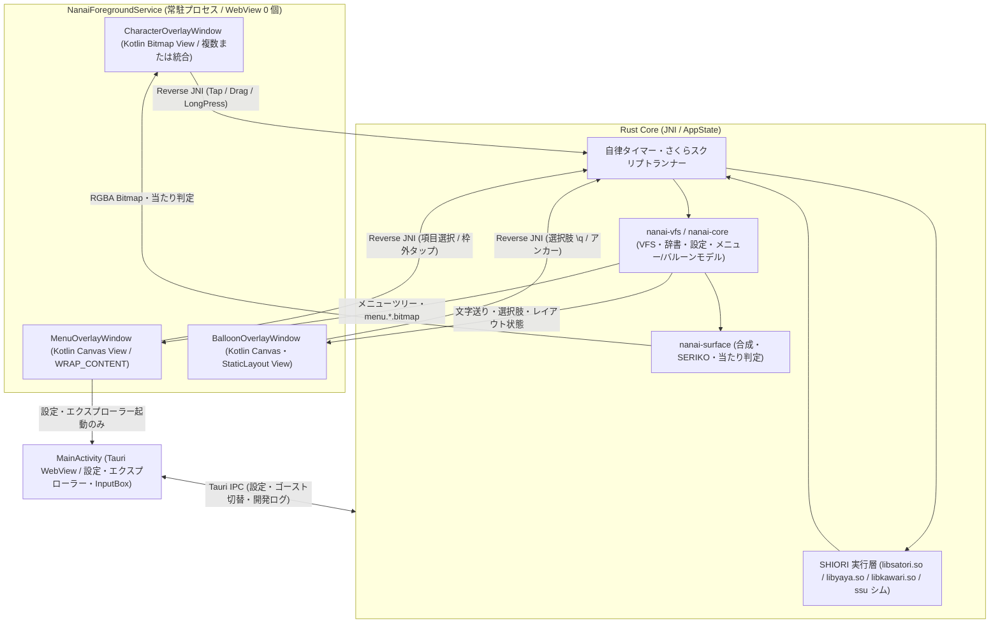

> **AI 関与について**: このドキュメントは Antigravity の支援により作成されました。本ドキュメントは [android-window-architecture.md](./android-window-architecture.md) のうち **Android システムオーバーレイ面（案 3・案 3'・案 4）に焦点を当てた検討案（未決定）** であり、採用・実装を決定するものではありません。Windows / Android 横断・Explorer 等を含む全面的な破壊的変更の比較は [native-architecture-study.md](../architecture/native-architecture-study.md) を参照してください。

# Android オーバーレイ ネイティブ化案 検討書

> **ステータス**: 検討案（ドラフト・未決定）  
> **対象スコープ**: Android の `TYPE_APPLICATION_OVERLAY`（キャラクター・SSP オーナードローメニュー・バルーン）をネイティブ View（Kotlin `View` / `Canvas` ＋ Rust コア）で実装する場合の技術検討。

関連ドキュメント:
- [android-window-architecture.md](./android-window-architecture.md) - Android ウインドウアーキテクチャおよびオーバーレイ提供方式の検討・計画（全 5 案比較・メニュー維持・共通 Phase 1）
- [android-unified-overlay.md](./android-unified-overlay.md) - Android 全キャラ単一ウインドウ統合表示（opt-in）
- [native-architecture-study.md](../architecture/native-architecture-study.md) - ネイティブ化アーキテクチャ検討案（Windows / Android 横断・直近局所対応 vs 全面破壊的変更オプション整理）
- [shiori-support-design.md](../architecture/shiori-support-design.md) - SHIORI 対応検討・実行アーキテクチャ設計（単一ゴースト複数キャラクター前提）
- [shiori-runtime-and-dynamic-module-policy.md](../architecture/shiori-runtime-and-dynamic-module-policy.md) - SHIORI 実行環境および動的モジュール配信・ロード方針仕様書

---

## 1. 本検討書の位置づけとスコープ

- **対象範囲**: [android-window-architecture.md](./android-window-architecture.md) で整理された 5 案のうち、オーバーレイ面をネイティブ View 化する **案 3（キャラのみネイティブ）・案 3'（キャラ＋メニューをネイティブ）・案 4（オーバーレイ全 3 要素をネイティブ）** の具体設計を深掘りする。
- **前景 `MainActivity` を一旦そのまま残す前提の意味**: 本検討書で「オーバーレイ 3 要素のみを対象とする」のは、あくまで **既存 Tauri WebView 資産の全面書き換え（全面的な破壊的変更）を避け、オーバーレイ固有の制約（Service 内 WebView の IPC 非接続、別プロセス Chromium レンダラーの単独停止・キル、`BadTokenException`、サブメニューのはみ出し制約、LMK 圧迫）へスコープを絞るため** の割り切りである。
  - Explorer や設定・タブレット 2 ペイン（Activity Embedding）・SAF 連携自体はネイティブ UI 適性が高い領域だが、それらを含む全面再構築の比較は [native-architecture-study.md](../architecture/native-architecture-study.md) 側で扱う。

---

## 2. オーバーレイ面ネイティブ化の粒度比較（段階 A〜C）と全面変更（段階 D）

| 段階 | オーバーレイ面（常駐 `TYPE_APPLICATION_OVERLAY`） | 前景 `MainActivity` | 常駐/発話メモリ目安 | 主な強み | 主な負担・トレードオフ |
| :--- | :--- | :--- | :--- | :--- | :--- |
| **段階 A: キャラのみネイティブ**（案 3） | キャラは Kotlin View、メニューとバルーンは WebView | Tauri WebView 維持 | 待機 10〜20MB、発話・メニュー時 +50〜80MB | バルーン・メニューの既存 Web UI を 100% 流用でき、キャラ自由配置と待機時省メモリを両立 | 発話・メニュー時の WebView 起動ラグ（150〜400ms）、サブメニューのはみ出し制約や `BadTokenException` が残る |
| **段階 B: キャラ＋メニューをネイティブ**（案 3'） | キャラと SSP メニューは Kotlin View、バルーンのみ WebView | Tauri WebView 維持 | 待機 10〜25MB、発話時 +50〜80MB | オーバーレイ WebView 最大の課題であるキャラ常駐と階層サブメニュー制約を先に解消できる | 発話時のみ WebView の常駐・都度生成トレードオフと、レンダラープロセス維持のケアが残る |
| **段階 C: オーバーレイ全 3 要素をネイティブ**（案 4） | キャラ・SSP メニュー・バルーンすべて Kotlin View | Tauri WebView 維持 | **常時 10〜25MB**（WebView 常駐 0 個） | LMK 耐性・60fps 追従・即時表示・Android 12+ 背面透過がすべて最良となり、管理画面の全面書き換えを回避できる | バルーン描画（さくらスクリプト表現・選択肢・インライン画像）を Kotlin 側にも実装する必要がある |
| **（参考）段階 D: Tauri 脱却・全面ネイティブ** | すべて Kotlin View | Jetpack Compose / Kotlin（Explorer 含む） | 最小（APK 容量も削減） | Tauri / WebView の制約が完全に消滅し、Explorer（仮想一覧・SAF・Activity Embedding）も含めて OS 統合が最も素直 | オーバーレイに留まらない全面的な破壊的変更となり、設定・開発パレット等を含む全画面の再開発・保守コストが発生 |

---

## 3. SHIORI ネイティブ実行との統合アーキテクチャ

[shiori-support-design.md](../architecture/shiori-support-design.md) の「単一ゴースト・複数キャラクター前提」および「Tier 1 エンジン（里々・YAYA・華和梨）の同梱 `.so`（`dlopen` / `dlclose`）または静的リンク実行」とオーバーレイのネイティブ View を組み合わせることで、WebView に依存しない自律常駐ループが成立する。

### この統合構成で解消される課題

1. **`MainActivity` 停止・破棄時のタイマー停止解消**: 従来のように JS 側の `setInterval` や `requestAnimationFrame` に SHIORI ランダムトークや文字送りを依存させないため、他アプリ利用中やタスク一覧からのスワイプ終了後も常駐動作が途切れない。
2. **Service 内 WebView 固有の不安定要因の排除**: `WebViewAssetLoader` + `@JavascriptInterface` の自前 IPC 互換レイヤー、Chromium レンダラーの単独キル復旧、`BadTokenException` 対策が不要になる。
3. **WASM / JS SHIORI との住み分け**: Tier 1（里々・YAYA・華和梨）および Tier 2 の Rust 系エンジン（Pasta・湊）は WebView なしでネイティブ実行できる。WebView V8 の `WebAssembly.instantiate` や JS ブリッジを要求する外部 WASM / JS SHIORI を扱う場合のみ、オンデマンドで隠し WebView（または将来の軽量ランタイム）を起動する補助経路として切り離せるため、通常ゴーストの常駐メモリを圧迫しない。

---

## 4. 二重実装を抑える Rust / Kotlin 責務分離設計

ワークスペース内の既存クレート（`crates/nanai-surface`、`crates/nanai-vfs`、`crates/nanai-core`）へ仕様解釈・状態計算を集約し、Kotlin 側は **「Rust から渡された描画データ／ビットマップを表示し、ユーザー操作を Reverse JNI で返すだけの薄い表示層」** に徹する。

| パーツ | Rust 側で一元化する責務（Windows / Android 共通） | Kotlin 側の責務（薄いネイティブ表示層） | 実装難易度・保守性評価 |
| :--- | :--- | :--- | :--- |
| **キャラクター** | `surfaces.txt` 解釈、SERIKO アニメーション進行、合成フレーム生成（`nanai-surface`）、当たり判定矩形、統合レイアウト座標計算 | `WindowManager` 窓管理、RGBA `Bitmap` 描画、60fps ネイティブドラッグ移動、タップ／ダブルタップ／撫で／長押しの Reverse JNI 通知 | **低〜中**（合成ロジックが Rust にあるため二重化が最小） |
| **SSP オーナードローメニュー** | SSP 2.x メニュー項目ツリー生成、`menu.background/sidebar/foreground.bitmap`・配色・フォント・チェック状態・無効状態の解決 | `Canvas` による背景・テキスト・区切り線描画、`WRAP_CONTENT` 実寸配置、`ACTION_OUTSIDE` 枠外タップ閉鎖、カスケード／ドリルダウン展開 | **中**（表示データの生成を Rust 側へ寄せれば View は薄い） |
| **バルーン** | さくらスクリプト解析、文字送りタイムライン、96 DPI 基準フォント換算、選択肢 `\q`・アンカー `\_a`・インライン画像 `\_b`・スクロール状態管理 | バルーン背景描画、`StaticLayout` / `Spannable` / `Canvas` テキスト描画、選択肢タップ通知、Y 軸ワークエリアクランプと IME 回避 | **中〜高**（さくらスクリプト標準表現の再現精度が鍵） |

### JNI / ブリッジの設計不変条件

- **スレッド安全性の統一**: Kotlin 側の `WindowManager` 操作（`addView` / `updateViewLayout` / `removeView`）および View 再描画は、すべて `OverlayJniBridge` 等を経由して `Handler(Looper.getMainLooper())` 上へディスパッチし、JNI ワーカースレッドからの `CalledFromWrongThreadException` を構造的に防ぐ。
- **フレーム転送の最小化**: キャラクターのサーフェス合成結果は Rust 側で変更時のみ更新し、Kotlin 側の事前確保済み `Bitmap` バッファへ書き込むことで、GC 負荷とフレーム間コピーを抑える。
- **双方向イベントの疎結合**: タップ・ドラッグ終了・メニュー項目選択・バルーン選択肢クリックはイベント ID と最小引数のみを Reverse JNI で Rust へ戻し、状態遷移はすべて Rust 側で決定する。

---

## 5. パーツ別の技術検討・リスクと対策

### 5.1 キャラクター（`CharacterOverlayWindow`）

- **自由配置と統合表示の両立**: 軽量ネイティブ View であるため、1 キャラ 1 窓（sakura と kero を離れた位置へ個別配置）でも、`androidOverlayUnified`（[android-unified-overlay.md](./android-unified-overlay.md) の単一統合表示）でも、常駐メモリ増加は数 MB 未満に収まる。
- **透明ピクセルと当たり判定**: `nanai-surface` の合成 RGBA バッファまたはアルファマスクを参照し、完全透明領域のタッチ判定や部位（`collision`）判定を正確に処理する。
- **ドラッグ追従と端ドッキング**: `MotionEvent` を Kotlin UI スレッド内で直接処理して `WindowManager.updateViewLayout` を駆動するため 60fps で追従する。ドラッグ終了時や画面端フリック時の半透明プルタブへのドッキング退避、バルーン追従座標の再計算は確定後に Rust へ通知する。

### 5.2 SSP オーナードローメニュー（`MenuOverlayWindow`）

- **必須仕様の維持**: SSP 2.x 標準項目・階層サブメニュー・シェルの `descript.txt` による `menu.*.bitmap`（`background` / `sidebar` / `foreground`）および配色・フォント指定をすべて維持する。
- **WebView に対する優位性**: 起動遅延がほぼ 0ms であり、`WRAP_CONTENT` による実寸フィットと `FLAG_WATCH_OUTSIDE_TOUCH`（`ACTION_OUTSIDE`）による枠外タップ即閉鎖が OS 標準機構で動作する。
- **モバイル向けサブメニュー展開**: 画面幅が狭いスマートフォンでは、デスクトップ流のカスケード展開（画面端で折り返し）に加えて、同一窓内で階層を切り替えるドリルダウン展開を選択できる設計にしておくと操作性が向上する。

### 5.3 バルーン（`BalloonOverlayWindow`）

- **対応対象の線引き**: SSP 標準のさくらスクリプト表現（`\n` / `\n[half]` / `\c` / `\f[height,...]` / `\f[color,...]` / `\q` / `\_a` / `\_b` / `\_q` 等、96 DPI フォント換算、スクロール矢印 `arrow.filename`）を優先対象とする。
- **Kotlin 描画方式**: 背景画像（`balloons*.png` / `balloonk*.png`）＋ テキスト領域をカスタム `View`（`Canvas` + `StaticLayout` + `Spannable`）で描画する。選択肢やアンカーのクリック領域はレイアウト時の行・矩形情報から算出し、タップ時にイベントを Rust へ返す。
- **ワークエリア・IME 不変条件**: [android-window-architecture.md](./android-window-architecture.md) の不変条件に従い、バルーン Y 座標は `WindowMetrics` のワークエリア `[work_y, work_y + work_h - height]` に厳格クランプし、IME 表示時は重ならない位置へ自動退避する。
- **HTML / CSS 独自拡張の割り切り**: バルーン本文に複雑な HTML タグや CSS アニメーションを直接埋め込む非標準表現は、初期スコープではプレーンテキスト／標準タグ相当へフォールバックするか、必要になった場合のみ WebView 補助を検討する。

### 5.4 既存 Android 制約・不変条件との整合

- **Android 12+（API 31+）Untrusted Touch 対策**: オーバーレイ各窓は可視要素の最小矩形（Tight Bounding Box）に一致させ、窓外の背面アプリ操作を阻害しない。クリックスルーモード（`FLAG_NOT_TOUCHABLE`）時は不透明度上限を `0.8` 以下にクランプし、常駐通知アクションおよび Quick Settings `TileService` からの確実な解除導線を維持する。
- **二重モード・二重描画禁止**: `SYSTEM_ALERT_WINDOW` 未許可時は `MainActivity` 単一 WebView の **InAppStage モード** で動作し、許可かつオーバーレイ稼働中（**SystemOverlay モード**）は `MainActivity` 側でマスコットを描画せず管理ハブとして動作させる。

---

## 6. 段階的導入の想定ステップ（もし案 3'〜4 を採る場合）

[android-window-architecture.md](./android-window-architecture.md) の Phase 1 を土台とし、各ステップが前のステップを壊さない順序で進める場合の想定ステップは以下の通りである。

| ステップ | 目標 | 主な作業内容 |
| :--- | :--- | :--- |
| **Step 1: 全案共通の基盤整備**（手戻りゼロ） | スレッド安全化・権限実測・Rust 自律制御の土台 | `OverlayJniBridge` の `MainLooper` 統一、`get_overlay_permission_state` / `request_overlay_permission` の実 JNI 接続、`get_android_work_area` 実装、`MainActivity` リサイズ誤結合解消と `InAppStage` / `SystemOverlay` 分離、`onTrimMemory` 接続、Rust 側タイマー・さくらスクリプト状態管理の独立化 |
| **Step 2: キャラ ネイティブ化 ＋ 里々 `.so` 垂直貫通** | WebView なしでのマスコット常駐表示 | `nanai-surface` の合成 Bitmap を `CharacterOverlayWindow` へ接続し、`libsatori.so` + `ssu` シムで `mock_nanai` の起動・ドラッグ・タップ・ランダムトークを通す |
| **Step 3: SSP オーナードローメニュー ネイティブ化** | 階層メニューの即時表示・外タップ閉鎖 | Rust 側でメニューツリーと `menu.*.bitmap` を解決し、Kotlin `MenuOverlayWindow` を実装（設定・エクスプローラー等のみ `MainActivity` を起動） |
| **Step 4: バルーン ネイティブ化** | オーバーレイ面の WebView 依存ゼロ化 | Rust 側で解析済みの文字送り・96 DPI 換算・選択肢 `\q`・インライン画像モデルを Kotlin `BalloonOverlayWindow` で描画し、常駐時 WebView 0 個を達成 |

---

## 7. 方針確定に向けた未決論点・判断チェックリスト

1. **アーキテクチャ方針の選択**: 現行延長の WebView オーバーレイ（案 1・案 2）、本検討書のオーバーレイ限定ネイティブ化（案 3〜案 4）、あるいは [native-architecture-study.md](../architecture/native-architecture-study.md) で整理した Explorer 等も含む全面ネイティブ化のいずれを採るか。
2. **バルーン移行順の選択**: オーバーレイネイティブ化を採る場合、最初からバルーンもネイティブ View 前提で設計するか、一時的にバルーンのみ WebView 維持（案 3'）を挟むか。
3. **Android における WASM / JS SHIORI の位置づけ**: 常駐時はネイティブ `.so`（里々・YAYA・華和梨・Rust 系）を主軸とし、WASM / JS SHIORI は「オンデマンド補助（後回し）」として扱ってよいか。
4. **バルーンの非標準 HTML / CSS 表現の扱い**: ネイティブバルーンの互換対象を「SSP 標準さくらスクリプト仕様（テキスト・装飾・選択肢・インライン画像・スクロール）」に割り切るか。
5. **実機 PoC での採用・切替基準**: Step 2〜4 の実機検証において、待機／発話時 PSS メモリ、メニュー展開レイテンシ、Android 12+ 背面透過、LMK 生存時間の定量目標をどこに置くか。
