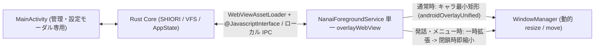
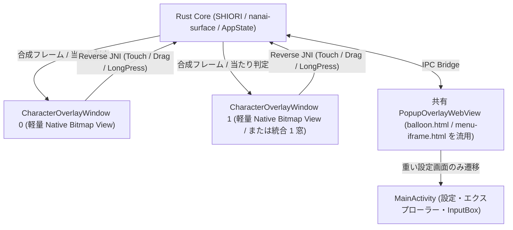
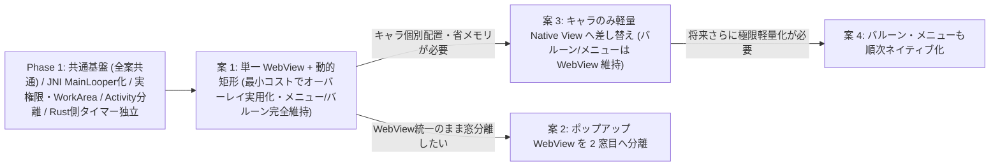

# Android ウインドウアーキテクチャおよびオーバーレイ提供方式の検討・計画

- **言及規格の元ドキュメント・権利者・ライセンス**:
  - **SSP 拡張仕様 / メニュー規格**: [ukatech/ukadoc-ssp](https://github.com/ukatech/ukadoc-ssp) / [SSP BUG-SLIK-PRACTICE](http://ssp.shillest.net/) - © UKADOC project (CC BY 4.0) / © PONapook 氏
  - **伺か標準仕様 / ゴースト / シェル / バルーン**: [ukatech/ukadoc-spec (UKADOC project)](https://ukatech.shillest.net/ukadoc-spec/) - © UKADOC project / Ukagaka Tech Team (CC BY 4.0)

本ドキュメントは、**nanai-android-mascot** における Android 向けウインドウアーキテクチャおよびシステムオーバーレイ提供について、**採り得る全アーキテクチャ案（案 1〜案 5）を網羅的に整理・比較**し、**SSP 互換メニュー（オーナードロー含む）の維持**・**Android 独自仕様（`nam-spec`）**・**Tauri / Web UI 資産の保守性**のバランスから方針を決定するための計画仕様書である。

関連仕様:

- [android-unified-overlay.md](./android-unified-overlay.md) - Android 全キャラ単一ウインドウ統合表示（opt-in）
- [android-native-overlay-study.md](./android-native-overlay-study.md) - Android オーバーレイ ネイティブ化案 検討書（オーバーレイ特化・案 3〜4 詳細・SHIORI 連携）
- [native-architecture-study.md](../architecture/native-architecture-study.md) - ネイティブ化アーキテクチャ検討案（直近の局所対応と全面的な破壊的変更オプションの分離整理）
- [window-design.md](../design/ui/window-design.md) - 従来の Single Container ウインドウ設計
- [ui-and-menu-spec.md](../design/ui/ui-and-menu-spec.md) - 標準 UI & 拡張メニュー仕様
- [右クリックメニュー（オーナードローメニュー）互換仕様.md](../ssp-spec/implicit-specs/ssp-compatibility-reference/右クリックメニュー（オーナードローメニュー）互換仕様.md) - SSP 2.x 標準メニュー互換仕様
- [menu-bitmap/index.md](../ssp-spec/external-specs/menu-bitmap/index.md) - オーナードローメニュー背景・ビットマップ仕様
- [window-snap/index.md](../ssp-spec/external-specs/window-snap/index.md) - デスクトップ版スナップ・ボーダーコリジョン仕様
- [platform-compliance.md](../compliance/platform-compliance.md) - プラットフォーム規格対応状況

---

## 1. 背景: 現状コードベースの混在と課題

現在の Android 実装には、**性格の異なる 3 つの方向性が混在**している。どの案を採るにしても、まずこの混在と共通の技術ギャップを整理する必要がある。

| 方向性 | 現在の該当箇所 | 特徴・目的 | 現状の課題 |
| :--- | :--- | :--- | :--- |
| **1. Single Activity / WebView コンテナ** | `MainActivity.kt` (`FLAG_SHOW_WALLPAPER`)、`ui/index.html`、`window-design.md` | 1 つの透過 Activity 内 WebView でキャラ・バルーン・メニューを描画 | 他アプリ起動時に `WryActivity.onPause()` で `mWebView.onPause()` が走り、オーバーレイ常駐できない |
| **2. System Overlay（常駐サービス）** | `NanaiForegroundService.kt`、`src-tauri/src/commands/android.rs`、`android-unified-overlay.md` | `TYPE_APPLICATION_OVERLAY` で他アプリ最前面にマスコットを表示 | 空の `WebView(this)` が `MATCH_PARENT` / `FLAG_NOT_TOUCHABLE` で置かれただけで URL 未ロード・IPC 未接続。また `applyResizeOverlayWindow` が Activity 側まで誤リサイズしている |
| **3. Activity Embedding 2ペイン分割** | `SubActivity.kt`、`SplitInitializer.kt`、`main_split_config.xml` | タブレット（840dp 以上）向けの 2 画面分割 UI | オーバーレイ常駐とは別軸の管理画面機能であり、ウインドウ設計上の責務が未分離 |

### 案を問わず共通で解消が必要な技術ギャップ

- **Rust ウインドウコマンドの Android 未分岐**: `src-tauri/src/commands/window/` 配下は `#[cfg(desktop)]` ガードのみで Android ではすべて no-op。
- **JNI スレッド安全性**: `NanaiForegroundService` の `WindowManager.updateViewLayout` 呼び出しが `Handler(Looper.getMainLooper())` 経由になっておらず、JNI スレッドから呼ぶと `CalledFromWrongThreadException` の危険がある。
- **権限・メモリのスタブ状態**: `request_overlay_permission` と `trim_memory_command`（`MainActivity.onTrimMemory`）が未接続。TS 側 `ui/ts/ui/touch/bridge/overlay.ts` も実権限を照会せず楽観的に有効扱いしている。
- **WebView 一時停止問題**: `MainActivity` がバックグラウンド化・破棄された際、SHIORI ランダムトークやタイマーを `MainActivity` の JS ループに依存させていると停止する。

---

## 2. 案を問わず共通で満たすべき要件・不変条件

どのアーキテクチャ案を採用する場合でも、以下を共通要件とする。

### 2.1 Android OS 制約

1. **Android 12+（API 31+）Untrusted Touch 対策**
   - `MATCH_PARENT` 等の広大なオーバーレイはタッチ遮断を引き起こす。タッチを受けるウインドウは **可視要素にフィットした最小矩形（Tight Bounding Box）** で配置し、矩形外は OS レベルで背面アプリへ透過させる。
   - CSS の `pointer-events: none` は WebView 内部の DOM 判定にしか効かず、Android OS レベルで背面アプリへタッチを透過させることはできない。
   - クリックスルーモード（`FLAG_NOT_TOUCHABLE`）時は API 31+ の `maximumObscuringOpacityForTouch` に準拠し、不透明度上限を `0.8` 以下にクランプする。また操作不能を防ぐため、通知アクションおよび Quick Settings タイルから確実に解除できる導線を必須とする。
2. **Android ワークエリア不変条件（`AGENTS.md` の Android 展開）**
   - API 30+ は `WindowManager.currentWindowMetrics` から `statusBars | navigationBars | displayCutout | ime` を差し引いた領域を基準とする（API 24〜29 は `DisplayMetrics` 基準）。
   - 論理座標は `dp`、ネイティブ `WindowManager.LayoutParams` は物理 `px`（`density` で一貫換算）。
   - バルーン Y 座標はワークエリア `[work_y, work_y + work_h - height]` に厳格クランプし、IME（キーボード）表示時は上部へ自動退避する。
3. **二重モード・二重描画禁止**
   - `SYSTEM_ALERT_WINDOW` 未許可時は **InAppStage モード**（`MainActivity` 単一 WebView）でフォールバック動作する。
   - `SYSTEM_ALERT_WINDOW` 許可かつオーバーレイ稼働中（**SystemOverlay モード**）は、`MainActivity` 側でマスコットを二重描画せず、設定・管理・エクスプローラーハブとして振る舞う（`SubActivity` / `SplitInitializer` はこの管理ハブ側のタブレット 2 ペイン表示に限定する）。

### 2.2 SSP 互換メニュー維持と Android 独自仕様（`nam-spec`）の分離

- **必須前提（最低条件）**: **SSP クラスメニュー表示**（SSP 2.x 標準項目・階層サブメニュー・`menu.*.bitmap` オーナードロー装飾）は Android 版においても必須条件とし、OS 標準の簡易ポップアップメニューへ退化させない。
- **維持する SSP 互換仕様**:
  - SSP 2.x 標準右クリックメニュー項目群と階層サブメニュー構造。
  - シェルの `descript.txt` によるオーナードローメニュー装飾（`menu.background.bitmap` / `menu.sidebar.bitmap` / `menu.foreground.bitmap`・配色・フォント・配置）。
  - バルーン表示仕様（96 DPI フォント換算、インライン画像・選択肢 `\q`、スクロール矢印）。
- **追加する Android 独自仕様（`nam-spec`）**:
  - 動作モード切替（`InAppStage` / `SystemOverlay`）、配置モード切替（個別 / `androidOverlayUnified` 単一統合）。
  - タッチ操作体系（タップ・ダブルタップ・撫で・ドラッグ・長押しメニュー・画面端フリックによる半透明プルタブへのドッキング退避）。
  - 常駐通知アクション（表示/隠す・クリックスルー切替・メニュー/設定・終了）および Quick Settings `TileService`。

### 2.3 オーバーレイ対象とメインウインドウ対象の境界（実装方式非依存の原則）

**案 1〜案 4 のいずれのオーバーレイ実装方式を採用する場合でも、非メニューの独立ウインドウはオーバーレイ上には出さず、すべてメインウインドウ（`MainActivity` / Tauri WebView）へ集約する。**

| 配置面 | 対象ウインドウ・機能 | 設計理由 |
| :--- | :--- | :--- |
| **オーバーレイ面（`TYPE_APPLICATION_OVERLAY`）** | キャラクター・バルーン・SSP コンテキストメニュー（＋画面端ドッキングタブ等の最小補助）のみ | 他アプリ利用中の常駐表示・即時対話が必須な 3 要素に限定 |
| **メインウインドウ面（`MainActivity` / Tauri WebView）** | 非メニューの独立ウインドウ全般（本体設定、ゴースト／シェル／バルーンエクスプローラー、着せ替えパネル、開発者パレット・スクリプトログ、リードミー・情報/ヘルプ、`\![open,inputbox]` 等の入力ダイアログ、インストール／アンインストール、プラグイン管理） | タブレット 840dp 以上では `SubActivity` / `SplitInitializer` による 2 ペイン表示対象とし、通常の Android Activity として表示 |

この境界分離により、全案共通で以下の利点が得られる。

1. オーバーレイ側へ IME・キーボードフォーカス制御・ファイルピッカー・長文スクロールを持ち込まずに済む。
2. 既存の Tauri WebView 設定・管理 UI 資産を案 1〜案 4 のすべてで 100% そのまま維持できる。
3. オーバーレイ側の実装・性能検討のスコープが「キャラ・バルーン・SSP コンテキストメニュー」の 3 要素のみへ純化される。

---

## 3. 全アーキテクチャ案の網羅比較

オーバーレイ描画と Tauri / Web UI 資産の扱いには、**WebView 維持寄り（案 1・案 2）**、**ハイブリッド折衷（案 3）**、**フルネイティブ化（案 4）**、および **参考・不適合確認（案 5）** の 5 案が存在する。

### 3.1 全案一望マトリクス

| 評価軸 | 案 1: 単一オーバーレイ WebView + 動的矩形リサイズ | 案 2: 用途別・少数 WebView（2〜3 窓上限） | 案 3: キャラのみ軽量ネイティブ + バルーン/メニューは WebView | 案 4: フルネイティブ描画（キャラ・バルーン・メニュー全部 Kotlin） | 案 5: 全画面透過 WebView（現行 `window-design` 延長） |
| :--- | :--- | :--- | :--- | :--- | :--- |
| **基本思想** | 薄いネイティブ枠で既存 Web UI を 1 窓維持 | デスクトップ多窓を上限付き WebView で再現 | 常時表示のキャラだけ軽量化し複雑 UI は Web 維持 | オーバーレイ面を完全ネイティブ化（脱 WebView） | 単一全画面 WebView のまま最前面化 |
| **常駐 WebView 数** | 1 個（`overlayWebView`） | 2〜3 個（キャラ窓＋バルーン/メニュー窓） | 待機時 0 個 / 発話・メニュー時のみ 1 個プール | 0 個（`MainActivity` 起動時のみ管理用 1 個） | 1 個（`MATCH_PARENT`） |
| **既存 Web UI 流用率** | 非常に高い（サーフェス・バルーン・メニュー全流用） | 非常に高い（`character` / `balloon` / `menu-iframe` 流用） | 高い（バルーン・オーナードローメニュー全流用、キャラのみ別描画） | 低い（管理モーダルのみ流用、他は二重実装） | 100% |
| **オーナードローメニュー維持** | 既存 `menu-iframe.html` をそのまま表示（完全互換） | 既存 `menu-iframe.html` を独立窓でそのまま表示（完全互換） | 既存 `menu-iframe.html` をオンデマンド窓で表示（完全互換） | Kotlin `Canvas` で `menu.*.bitmap` を再実装が必要 | 既存そのまま |
| **バルーン互換性（フォント・選択肢）** | 既存 `balloon` 実装をそのまま維持 | 既存 `balloon.html` をそのまま維持 | 既存 `balloon.html` をそのまま維持 | Kotlin View / `Spannable` で再実装が必要 | 既存そのまま |
| **キャラの自由な個別配置** | 制約あり（離して置くと外接矩形が広がるため統合配置向き） | 可能（キャラ 2 窓なら左上・右下等の分離配置可） | 自由に可能（1 キャラ 1 窓も統合 1 窓も低コスト） | 自由に可能（1 キャラ 1 窓も統合 1 窓も低コスト） | 画面内では自由だが背面操作不可 |
| **Android 12+ 背面透過** | 良好（矩形外は完全透過。発話/メニュー時のみ一時拡張） | 良好（各窓が最小矩形。窓外は完全透過） | 非常に良好（常時最小矩形＋発話時のみバルーン窓出現） | 非常に良好（全要素が最小矩形） | **不適合**（全画面が背面タッチを遮断） |
| **常駐メモリ負荷（目安）** | 中（約 60〜100MB） | 高（約 120〜220MB、LMK リスクあり） | 低〜中（待機時 10〜20MB、発話時 +50〜80MB） | 最小（約 10〜25MB） | 中（ただし操作不可で不適合） |
| **ドラッグ追従の滑らかさ** | 良好（ネイティブ側 `TouchListener` で窓移動すれば 60fps） | 良好（各窓のネイティブドラッグで 60fps） | 非常に良好（キャラ移動は完全ネイティブ 60fps） | 非常に良好（キャラ・バルーン追従とも完全ネイティブ 60fps） | 不適合 |
| **実装・保守コスト** | 最小〜中（IPC ブリッジ＋動的リサイズ制御のみ） | 中（IPC ブリッジ＋複数 WebView 状態同期・ライフサイクル管理） | 中〜高（キャラ描画・当たり判定のみ二重化、バルーン/メニューは共通） | 最大（Android 向け UI エンジンを丸ごと二重保守） | 低（ただし要件未達） |

---

### 3.2 各案の詳細設計とトレードオフ

#### 案 1: 単一オーバーレイ WebView ＋ 動的矩形リサイズ（Thin Native Shell）

**概要**:
`NanaiForegroundService` が **1 つの透過 `WebView`** だけを保持し、既存の Web UI（サーフェス・バルーン・オーナードローメニュー）をそのまま描画する。ネイティブ（Kotlin）側は「`WindowManager` の箱（座標・サイズ・透過・クリックスルー・ドラッグ移動）」だけに責務を限定する。

- **サブ案（WebView の所有・IPC 接続方式の 2 パターン）**:
  - **案 1-a（Service 独立 WebView + ブリッジ接続）**: `NanaiForegroundService` 内で `WebView` を生成し、`WebViewAssetLoader`（またはローカルループバック HTTP）で `dist/` をロード、`@JavascriptInterface` 経由の JNI で Rust コアの `invoke` 相当コマンドを呼び出す。`MainActivity` が破棄されても完全に独立して生き残る。
  - **案 1-b（`MainActivity` の `RustWebView` を Reparent）**: Tauri が生成した `RustWebView` を Activity の親 View からデタッチして `WindowManager` へ付け替える。Tauri IPC をそのまま使える利点がある一方、`WryActivity` のライフサイクル・コンテキスト（`Activity` 依存のダイアログや `onDestroy` 時の破棄処理）と衝突しやすく、Android バージョンや Tauri アップデートで壊れやすいリスクが高い。
- **既存の `android-unified-overlay.md` との相性**:
  - 既存の `computeUnifiedLayout`（全キャラ横並び・下端揃え・間隔 8px）と `resize_overlay_window(width, height)` に **最も直接的に噛み合う**。
- **長所**:
  - 既存のサーフェス・バルーン・オーナードローメニューの HTML/CSS/TS を **ほぼ 100% 維持**でき、二重実装が発生しない。
  - WebView が 1 個だけなのでメモリ消費が現実的。
  - 待機時はキャラの最小矩形しか占有しないため、Android 12+ でも背面アプリ操作を阻害しにくい。
- **短所・制約**:
  - 1 つの外接矩形しか持てないため、**sakura（左上）と kero（右下）のように離して個別配置すると外接矩形が画面全体へ広がってしまい破綻する**。実質的に「単一統合表示（`androidOverlayUnified`）」が前提になる。
  - バルーンやメニューを展開している間は外接矩形が一時的に大きくなるため、キャラとバルーンの隙間（矩形内の透明余白）では背面タッチが通らない。
  - Service 内 `WebView` に Tauri 互換 IPC アダプタ（`@JavascriptInterface` → Rust JNI またはローカル WebSocket/HTTP）を用意する必要がある。

---

#### 案 2: 用途別・少数 WebView オーバーレイ（2〜3 窓上限モデル）

**概要**:
デスクトップ版の多窓構成（`character.html` / `balloon.html` / `menu-iframe.html`）を、Android のメモリ上限を意識して **2〜3 個の `TYPE_APPLICATION_OVERLAY` WebView** に絞って再現する構成。

- **代表的な窓割り**:
  - **2 窓構成**: 「統合キャラ用 WebView（1 窓）」＋「バルーン／オーナードローメニュー共有ポップアップ WebView（1 窓）」
  - **3 窓構成**: 「sakura 窓（1 窓）」＋「kero 窓（1 窓）」＋「バルーン／メニュー共有ポップアップ窓（1 窓）」
- **長所**:
  - キャラとバルーン・メニューが別矩形になるため、**キャラとバルーンの間の空白でも背面タッチが透過**し、メニュー外タップ（`FLAG_WATCH_OUTSIDE_TOUCH`）による自動クローズも OS 標準機構で綺麗に動く。
  - 3 窓構成なら sakura と kero を画面上の離れた場所へ個別配置できる。
  - 描画コード自体は既存 `character.html` / `balloon.html` / `menu-iframe.html` を全面流用可能。
- **短所・制約**:
  - WebView 1 個あたり 50〜80MB 前後のメモリを消費するため、3 窓常駐は **150〜220MB 超** になり、中〜低スペック端末で他アプリ（カメラやゲーム等）を開いた際に LMK で落とされやすい。
  - バルーン／メニュー窓を「使うときだけ生成→閉じて破棄」にするとメモリは抑えられるが、初回表示時に 150〜400ms 程度の WebView 起動ラグが出る（プール保持すると常駐メモリが増えるトレードオフ）。
  - 複数 WebView 間の状態同期（Rust コア経由イベント配信）の仕組みが必要。

---

#### 案 3: キャラのみ軽量ネイティブ View ＋ バルーン＆オーナードローメニューは WebView 維持（ハイブリッド折衷）

**概要**:
画面上に **常時表示し続けるキャラクターだけ** を Rust 合成 Bitmap（`nanai-surface`）＋ Kotlin の軽量カスタム View（`Canvas.drawBitmap` + 当たり判定）で描画し、レイアウト・文字組版・装飾が複雑な **バルーンとオーナードローメニューだけは既存 WebView（`balloon.html` / `menu-iframe.html`）を単一プール（またはオンデマンド）で維持** する折衷案。

- **長所**:
  - **待機中（発話していない時間）の WebView 負荷を 0〜極小**に抑えられ、LMK キル耐性・バッテリー効率が非常に高い。
  - キャラが軽量ネイティブ View なので、**1 キャラ 1 窓の自由配置（sakura と kero を別位置へ配置）も、`androidOverlayUnified` の単一統合配置も低コストで両立**できる。
  - 最も二重実装コストが高い **SSP バルーン（96 DPI フォント換算・インライン画像・選択肢・スクロール）とオーナードローメニュー（`menu.*.bitmap`・CSS・階層サブメニュー）は既存 Web UI を 100% 維持**でき、「フルネイティブ化計画」になるのを回避できる。
  - キャラドラッグは Kotlin UI スレッド内で 60fps ネイティブ追従、透明ピクセルのアルファ抜き判定も正確。
- **短所・制約**:
  - サーフェス描画・アニメーション再生の提示部分だけは Web（Canvas/Img）と Android（Kotlin Bitmap View）の 2 経路になる（ただし合成本体を Rust の `nanai-surface` に寄せればロジック重複は最小限に抑えられる）。
  - ポップアップ用 WebView を非表示時に破棄するか待機プールするか、メモリと表示応答速度のチューニングが必要。
  - 同時に 2 キャラが独立バルーンを出す場合、バルーン WebView を 1 窓内で 2 領域表示するか最大 2 窓にするかの設計判断が要る。

---

#### 案 4: フルネイティブ・オーバーレイ描画（ネイティブ化路線）

**概要**:
オーバーレイ面から WebView を完全に排除し、キャラクター・バルーン・オーナードローメニューのすべてを Rust コア ＋ Kotlin ネイティブ View（`Canvas` / `Drawable` / `Spannable`）で描画する構成。Tauri WebView（`MainActivity`）は本体設定やゴーストエクスプローラー等の管理画面専用にする。

- **長所**:
  - メモリ消費・消費電力・起動速度・ドラッグ追従性・Android 12+ 適合性のすべてにおいて **理論上ベスト**。
  - `MainActivity` や WebView のライフサイクル・クラッシュ・メモリ圧迫に一切左右されない強固な常駐性。
- **短所・制約**:
  - **実質的に Android 版 UI エンジンのフルネイティブ化計画**となり、初期開発コスト・継続保守コストともに最大。
  - デスクトップ側（Web UI）に SSP 互換機能（バルーンの新規さくらスクリプトタグ、インライン要素フィット、メニューの細部装飾など）を追加するたびに、Android ネイティブ側へも都度同等の再実装が必要になる。

---

#### 案 5: 全画面透過 WebView のままオーバーレイ化（参考・不適合確認）

**概要**:
既存の `window-design.md`（Single Container / CSS `pointer-events: none`）をそのまま `MATCH_PARENT` の `TYPE_APPLICATION_OVERLAY` ウインドウに載せる案。

- **不適合となる技術的根拠**:
  - Android の `WindowManager` は「ウインドウ単位」でタッチ受取可否（`FLAG_NOT_TOUCHABLE`）を判定し、WebView 内部の CSS `pointer-events: none` を OS のタッチ配送へ伝播する標準 API が存在しない。
  - そのため、`FLAG_NOT_TOUCHABLE` を外すと背面アプリが一切操作不能になり（さらに Android 12+ の Untrusted Touch 制限に抵触）、付けるとマスコット自身が一切タップ・ドラッグできなくなる。
  - **結論**: オーバーレイ提供方式としては採用不可であり、`InAppStage`（権限未許可時のアプリ内表示モード）専用の構成として位置づける。

---

### 3.3 技術的実現可能性の評価（WebView をオーバーレイで使えるか vs ネイティブの自由度）

「デスクトップ用 HTML をそのまま流用できるか（保守性）」と「Android の `TYPE_APPLICATION_OVERLAY` 上で実際に安定動作するか（技術的実現可能性）」は切り分けて評価する必要がある。

#### WebView を Service 内 `TYPE_APPLICATION_OVERLAY` で使う際の現実的な壁

- **Tauri IPC 非接続**: Service で生成する `WebView` は `WryActivity` / `RustWebView` の管理外にあるため、`window.__TAURI__` や標準アセット解決が自動では効かない。`WebViewAssetLoader` + `@JavascriptInterface` 経由 JNI、またはローカル HTTP/WS ブリッジの自前実装が必須となる。
- **Chromium レンダラー別プロセスの不安定さ**: `MainActivity` がバックグラウンドにいる間、端末 OEM（MIUI / OneUI 等）の省電力制御や LMK により、メインプロセスは生きていても **WebView のレンダラープロセスだけ先に停止・破棄される** リスクがある。
- **`Service` コンテキスト制約**: `WebView(service)` は `<select>` 等のネイティブポップアップやテーマ追従で `WindowManager$BadTokenException` を起こしやすく、API 30+ の `createWindowContext(TYPE_APPLICATION_OVERLAY)` 等のケアが必要になる。
- **階層サブメニューの物理制約**: 1 窓 WebView のままだとサブメニューがウインドウ矩形外へはみ出せず、事前に大きく広げると透明余白が背面タッチを塞ぐ。一方、サブメニュー用に別 WebView 窓を都度生成すると **起動ラグ（150〜400ms）・透過サーフェスのちらつき・メモリ増** がメニュー操作のたびに発生する。

#### ネイティブ（Kotlin `View` / `Canvas`）の自由度と責務分離による軽量化

- **同一プロセス・`WindowManager` 直結の自由度**: レンダラー停止リスクがなく、起動はほぼ 0ms、`WRAP_CONTENT` による厳密な実寸フィット、`ACTION_OUTSIDE` による枠外タップ即クローズ、カスケード展開・モバイル向けドリルダウン展開のいずれも自由に設計できる。
- **Rust 側での共通解決による二重化抑制**: SSP オーナードローメニューの実体は「`menu.background` / `sidebar` / `foreground` のビットマップ合成 + 色指定テキスト行 + チェック／区切り線 + サブメニュー矢印」で構成される。項目ツリー構築と装飾ビットマップ解決を Rust 側で一元化すれば、Kotlin 側の描画 `View` 自体は薄く保つことができる。
- **前景 UI は Tauri WebView をそのまま活用**: 設定画面・ゴーストエクスプローラー・開発者ツール・`\![open,inputbox]` は前景の `MainActivity` で開くため、オーバーレイ制約を受けず既存の Tauri WebView 資産を 100% そのまま利用できる。

#### パーツ別の実現可能性マトリクス

| パーツ | オーバーレイでの WebView 実現性 | ネイティブでの実現性・自由度 | Rust 共通化による保守負担の見積り |
| :--- | :--- | :--- | :--- |
| **キャラクター** | △（矩形制約・常駐 RAM・レンダラー停止リスク） | ◎（最小コスト・60fps ドラッグ・自由配置） | 合成と当たり判定を `nanai-surface` に寄せれば Kotlin 側は Bitmap 描画のみ |
| **SSP オーナードローメニュー** | △〜×（起動ラグ・サブメニューはみ出し制約・`BadTokenException`） | ◎（即時表示・`WRAP_CONTENT`・外タップ閉鎖・展開方式も自由） | メニューツリーと `menu.*.bitmap` 解決を Rust 共通化すれば View 実装は薄い |
| **バルーン** | ○〜△（表現完全一致だが、常駐か都度生成かのジレンマあり） | ○（標準さくらスクリプト・選択肢・インライン画像は `Spannable` で現実的） | テキスト装飾・96 DPI 換算を共通化し、HTML 拡張のみ要判断 |
| **設定・管理・入力モーダル** | ◎（`MainActivity` 前景なので Tauri WebView がそのまま最強） | 不要（Web UI 資産をそのまま使うべき） | 追加の二重保守なし |

> 補足: この実現可能性を踏まえ、案 3 には段階的な変種（**案 3'**: キャラクターと SSP オーナードローメニューを軽量ネイティブで実装し、バルーンのみ単一 WebView 維持または標準さくらスクリプト範囲で順次ネイティブ化する構成）も存在する。

---

## 4. 判断軸と推奨の段階的進化パス

どの案を選ぶべきかは、**「何を優先し、どこまでを Android 版で許容するか」** の判断軸によって決まる。

### 4.1 意思決定の判断軸

1. **「Web UI 資産の単一保守（二重実装を避ける）」を最優先する場合**
   - → **案 1（単一オーバーレイ WebView + 動的矩形リサイズ）** を起点とする。
   - 受け入れるトレードオフ: オーバーレイ時の基本配置は `androidOverlayUnified`（統合 1 窓）中心になる。
2. **「バルーン＆オーナードローメニューは Web 資産を維持しつつ、キャラの自由な個別配置と省メモリ・常駐安定性を両立したい」場合**
   - → **案 3（キャラのみ軽量ネイティブ + バルーン/メニューは WebView 維持）** が最もバランスが良い。
   - 受け入れるトレードオフ: サーフェス表示の薄いネイティブ View（Bitmap 描画＋タッチ転送）だけは Android 向けに持つ。
3. **「デスクトップ同等の多窓（個別キャラ＋独立バルーン）を 100% WebView のまま動かしたい」場合**
   - → **案 2（2〜3 窓上限 WebView）** を採る。
   - 受け入れるトレードオフ: 常駐 RAM 負荷が高く、低メモリ端末では LMK 対策（非表示時破棄等）が必須。
4. **「Android オーバーレイの完成度・省電力・軽量性を極限まで追求する（ネイティブ保守を受け入れる）」場合**
   - → **案 4（フルネイティブ描画）** へ進む。

### 4.2 やり直しを最小化する段階的進化パス

重要な点として、**基盤整備（Phase 1）は案 1〜案 4 のすべてで完全に共通** であり、後から上位案へ段階的に移行できる構造に設計しておけば、初期選択による手戻りを最小限に抑えられる。

---

## 5. 全案共通で先行着手できる Phase 1（基盤整備）

どの最終案（案 1〜案 4）を採るか迷っている段階でも、以下は **100% 共通で必須かつ手戻りゼロ** のため先行して整備できる。

1. **JNI スレッド安全化 (`OverlayJniBridge.kt`)**: `NanaiForegroundService` への操作をすべて `Handler(Looper.getMainLooper())` 経由に統一。
2. **実権限・状態 API の整備 (`android.rs` / `MainActivity.kt` / `overlay.ts`)**: `get_overlay_permission_state`（実 `Settings.canDrawOverlays` 返却）、実 JNI による `request_overlay_permission`、楽観的状態更新の廃止。
3. **Activity とオーバーレイの誤結合解消 (`MainActivity.kt`)**: `applyResizeOverlayWindow` が `MainActivity` 自身をリサイズしてしまう不具合を除去し、`InAppStage` / `SystemOverlay` モードと二重描画抑止を導入。
4. **Android ワークエリア取得 (`get_android_work_area`)**: `WindowMetrics` + `statusBars | navigationBars | displayCutout | ime` の論理 `dp` 算出を実装。
5. **メモリ通知・Activity 非依存化**: `onTrimMemory` → Rust `trim_memory_command` 接続、および `src-tauri/src/commands/window/` の `#[cfg(target_os = "android")]` 抽象ルーティング枠（`android_host.rs`）を用意。

---

## 6. 検証基準

### ホスト環境（Windows）
- 仕様整合性: `npm run verify:spec`
- Rust 検証: `cargo check --tests --manifest-path src-tauri/Cargo.toml`、`cargo fmt --check --manifest-path src-tauri/Cargo.toml`
- Android クロス確認: `cargo check --target aarch64-linux-android --manifest-path src-tauri/Cargo.toml`（NDK 環境利用可能時）
- TS / CSS / バインディング: `npx @biomejs/biome check` および `overlay.ts` / `unified-layout.ts` / `dock.ts` 単体テスト

### Android ビルド・実機検証（各案の PoC / 採用判断時に計測）
- Gradle: `src-tauri/gen/android` で `./gradlew testDebugUnitTest assembleDebug`
- 実機・エミュレータ比較計測項目:
  1. **背面透過 & Android 12+ 準拠**: 他アプリ操作時に矩形外タッチが阻害されないこと、クリックスルー時の不透明度上限と通知／タイルからの復帰。
  2. **メモリフットプリント（PSS / RSS）**: 待機時・発話時・メニュー展開時それぞれの実測値（LMK 耐性の客観判断）。
  3. **バックグラウンド継続性**: `MainActivity` 背景化・タスク終了後のトーク・タップ・メニュー継続動作。
  4. **メニュー・バルーン互換性**: `menu.*.bitmap` オーナードロー装飾、階層サブメニュー、バルーン文字送り・選択肢 `\q`・IME 退避の動作一致。
