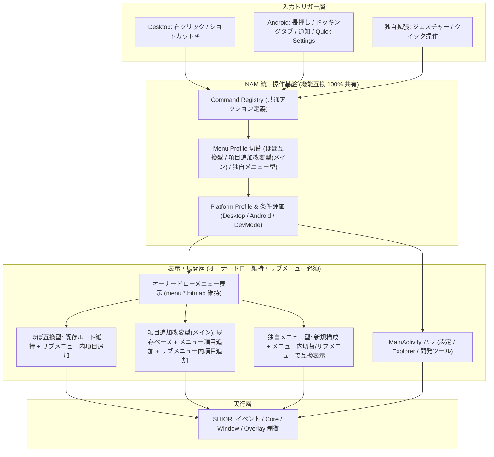

> **AI 関与について**: このドキュメントは Antigravity の支援により作成されました。本ドキュメントは NAM（Nanai Android Mascot）における独自操作システムおよびメニュー・サブメニュー拡張の検討案（未決定）であり、採用・実装を決定するものではありません。

# NAM 独自操作システムおよびメニュー・サブメニュー拡張 検討書

> **ステータス**: 検討案（ドラフト・未決定）  
> **対象スコープ**: **既存メニュー項目・サブメニュー・機能互換性・オーナードローメニュー表示を一切廃止・削減せず維持**したまま、**メニュー方式の 3 種選択式（ほぼ互換型 / 項目追加改変型（メイン） / 独自メニュー型）**、統一操作基盤（Command Registry）、および Desktop / Android 間の操作構造差への対応をまとめる。

関連ドキュメント:

- [android-window-architecture.md](./android-window-architecture.md) - Android ウインドウアーキテクチャおよびオーバーレイ提供方式の検討・計画（メニュー維持方針・オーバーレイ境界）
- [android-native-overlay-study.md](./android-native-overlay-study.md) - Android オーバーレイ ネイティブ化案 検討書
- [android-unified-overlay.md](./android-unified-overlay.md) - Android 全キャラ単一ウインドウ統合表示（opt-in）
- [ssp-extension-triage.md](./ssp-extension-triage.md) - Phase E: SSP 拡張機能（`ukadoc-ssp/functions`）仕分け・実装方針
- [ui-and-menu-spec.md](../design/ui/ui-and-menu-spec.md) - 標準 UI & 拡張メニュー仕様書
- [右クリックメニュー（オーナードローメニュー）互換仕様.md](../ssp-spec/implicit-specs/ssp-compatibility-reference/右クリックメニュー（オーナードローメニュー）互換仕様.md) - SSP 2.x 標準コンテキストメニュー互換仕様
- [機能（functions）サブメニュー仕様.md](../ssp-spec/implicit-specs/ssp-compatibility-reference/機能（functions）サブメニュー仕様.md) - SSP「機能」サブメニュー互換・再実装仕様
- [ssp-menu-compliance.md](../compliance/ssp-menu-compliance.md) - SSP 操作系・メニュー規格対応仕様
- [menu-bitmap/index.md](../ssp-spec/external-specs/menu-bitmap/index.md) - オーナードローメニュー背景・ビットマップ仕様

---

## 1. 背景と基本方針（既存項目・機能互換の完全維持と 3 種選択式）

Nanai Android Mascot（NAM）は「伺か」互換のベースウェアであり、ユーザーおよびゴースト制作者が期待する **機能互換性・オーナードローメニュー表示・サブメニュー** は不可欠な要件である。一方で、現在の実装は SSP 準拠の単一・固定構造のままとなっており、NAM 独自の機能追加や Android のタッチ操作・画面制約への最適化を行いにくい。

本検討書では、以下の 4 点を基本方針として置く。

1. **既存メニュー項目・サブメニュー・機能互換性は一切廃止・削減しない**
   - ゴースト／シェル／着せ替え／バルーン／更新／機能／設定／終了をはじめとする既存のメニュー項目およびサブメニューはすべて維持する。
   - 既存項目を削除・削減するのではなく、すべて到達可能な状態を保ったうえで、NAM 独自の操作系や拡張項目を追加する。
2. **メニューの表示（オーナードロー外殻）は維持する**
   - `menu.background.bitmap` / `menu.sidebar.bitmap` / `menu.foreground.bitmap`・配色・フォント・キャプション上書きによるオーナードロー表現を維持する。
   - Android 環境においても OS 標準の簡易ポップアップへ退化させず、伺かとしての視覚的一貫性を保つ（[android-window-architecture.md](./android-window-architecture.md) 2.2 節に準拠）。
3. **メニュー方式を「3 種選択式（ほぼ互換型 / 項目追加改変型 / 独自メニュー型）」とする**
   - 裏側の機能・コマンド層（Command Registry）を 100% 共有したまま、表側のメニュー構成・アクセス方式を以下の **3 種** から選択可能にする。
     - **ほぼ互換型**（`compat`）: ルートメニューの改変を行わず、**サブメニュー内項目追加のみ**で NAM 拡張を提供する方式。
     - **項目追加改変型（メイン）**（`extended`）: 既存メニューをベースに **メニュー項目追加＋サブメニュー内項目追加** を行う **メイン（標準）方式**。
     - **独自メニュー型**（`custom`）: 既存機能・表示をベースにした新規構成の独自メニュー。**互換用表示をサブメニュー的またはメニュー内の切り替えで呼び出せる** 方式。
4. **Desktop と Android の構造差を操作基盤レベルで吸収する**
   - 各種操作の実行経路（メニュー・ショートカット・タッチ・通知・クイック設定）を単一の Command Registry へ一本化し、プラットフォームプロファイルと展開方式の切り替えで差異に対応する。

---

## 2. 現状の課題と実態とのギャップ

現行コードベースおよび仕様書を確認すると、以下の技術・設計ギャップが存在する。

1. **単一・固定のメニュー構造による拡張・Android 適応のしづらさ**
   - 現状の [../../../ui/menu-iframe.html](../../../ui/menu-iframe.html) や [../../../ui/ts/ui/submenu-renderer.ts](../../../ui/ts/ui/submenu-renderer.ts) は SSP 準拠の単一レイアウトに直接結びついており、Android 向けのアクセス最適化（片手操作・枠内展開）や NAM 固有操作（オーバーレイ切替、クリックスルー、単一統合表示、画面端ドッキング等）を自然に組み込む受け皿が不足している。
2. **既存スタブ項目の実機能化・代替挙動の未定義**
   - `機能(F)` や `設定(O)` 内の項目（[../../../ui/ts/core/actions/menu-action-system.ts](../../../ui/ts/core/actions/menu-action-system.ts) でバルーン通知のみを行うスタブ項目や、無効状態の項目）について、項目自体を維持したまま実機能化・OS 標準連携・代替挙動のどれを割り当てるかの定義が未完了である。
3. **仕様書と実装メニュー定義の記述ズレ**
   - [右クリックメニュー（オーナードローメニュー）互換仕様.md](../ssp-spec/implicit-specs/ssp-compatibility-reference/右クリックメニュー（オーナードローメニュー）互換仕様.md) の 16 項目一覧と、[../../../ui/menu-iframe.html](../../../ui/menu-iframe.html) の実際のルートメニュー構成の記載にズレがある。
4. **Desktop / Android の構造差がメニュー定義で分離されていない**
   - プラットフォームごとの対応状況（ネイティブ実行・代替動作・無効表示・配置グループ）や入力トリガー（右クリック／キーボード vs 長押し／ドッキングタブ／通知／Quick Settings タイル）を統一的に表現するレイヤーが未整備である。

---

## 3. 統一操作基盤（NAM Operation / Command System）設計案

メニュー項目・キーボードショートカット・タッチジェスチャー・Android 通知アクション／Quick Settings タイルを、単一の **Command Registry（統一アクション定義）** から駆動する構成とする。表側のメニュー配列と展開方式は **Menu Profile（3 種選択式）** によって切り替え、裏側の機能互換層は完全に共有する。

### アクション定義スキーマ案

各操作は単なるボタン ID ではなく、以下のメタデータを持つコマンド定義として登録する。

| フィールド | 型・役割 | 説明 |
| :--- | :--- | :--- |
| `id` | 文字列（一意 ID） | 操作識別子（例: `balloon.reset-position`、`android.toggle-click-through`） |
| `category` | 分類キー | `ghost` / `shell` / `balloon` / `utility` / `settings` / `developer` / `platform` |
| `platforms` | プラットフォーム設定 | Desktop / Android ごとの対応状況（ネイティブ実行・代替動作・無効表示・配置グループ等）を制御 |
| `when` | 条件述語（任意） | 開発モード有効時のみ、オーバーレイ稼働時のみ等の動的表示条件 |
| `compatCaptionKey` | 文字列（任意） | シェル `descript.txt` のメニューキャプション上書きを適用する場合のキー |
| `triggers` | 入力バインディング群 | メニュー配置先（3 種プロファイル別）、ショートカットキー（Desktop）、ジェスチャー／通知（Android） |
| `targetSurface` | `overlay` / `hub` / `inline` | 実行時にオーバーレイ内で完結するか、`MainActivity` ハブを開くかの区別 |
| `handler` | 実行関数 | Rust / Tauri コマンドまたは SHIORI イベント呼び出し |

---

## 4. 3 種選択式メニュー方式とゾーン分離

### 4.1 3 種メニュー方式の比較

既存の機能・項目を一切削減せず、利用スタイルや環境に応じて以下の **3 方式** を設定から選択可能とする。

| 比較軸 | ほぼ互換型（`compat`） | 項目追加改変型（`extended` / メイン） | 独自メニュー型（`custom`） |
| :--- | :--- | :--- | :--- |
| **位置づけ** | 互換重視オプション | **メイン（標準）方式** | アクセス最適化・独自 UI オプション |
| **ルートメニュー** | **改変なし**（SSP 準拠の既存項目・並びをそのまま維持） | **既存ベース＋メニュー項目追加**（既存項目を維持しつつ NAM 主要項目を追加） | **既存ベースの新規構成**（操作頻度・タッチ操作前提で独自配列） |
| **サブメニュー** | **必須＋サブメニュー内項目追加**（既存サブメニューを維持し、その内部へ NAM 項目を追加） | **必須＋サブメニュー内項目追加**（既存サブメニューを維持し、その内部へ NAM 項目を追加） | **必須＋再構成**（用途別サブメニューを独自構成し、互換構成にも接続） |
| **互換メニューへの到達性** | ルート自体が互換構成 | ルート・サブメニューが互換ベース | **メニュー内の切り替えまたはサブメニュー的展開で互換用表示を即時表示** |
| **機能互換性** | **100% 共通**（Command Registry） | **100% 共通**（Command Registry） | **100% 共通**（Command Registry） |
| **オーナードロー表示** | **維持**（`menu.*.bitmap`・配色・キャプション） | **維持**（`menu.*.bitmap`・配色・キャプション） | **維持**（同じオーナードロー装飾を独自配列へ適用） |
| **主な用途・想定環境** | SSP と完全同じ位置感覚で使いたい場合 | Desktop / Android 双方の基本体験 | Android 片手操作・独自操作系を最大限使いたい場合 |

### 4.2 互換維持ゾーンと拡張ゾーンの分離

| 層 | 方針 | 具体的な設計ルール |
| :--- | :--- | :--- |
| **外殻・描画仕様** | **完全維持（SSP 互換）** | 3 方式すべてで `menu.*.bitmap`、サイドバー、配色、フォント、キャプション上書きを維持し、Command Registry の出力を描画する薄いビューに徹する |
| **ルートメニュー** | **既存維持＋3 種プロファイル** | ほぼ互換型は改変なし、項目追加改変型（メイン）は既存項目を維持したまま主要操作を追加、独自メニュー型は新規構成としつつ互換表示への切替導線を備える |
| **サブメニュー** | **必須維持＋サブメニュー内項目追加** | 3 方式すべてでサブメニューを必須とし、既存項目を削減せずに、ほぼ互換型・項目追加改変型では既存サブメニュー内への項目追加、独自メニュー型では新規構成と互換用表示への接続を行う |
| **追加操作導線** | **NAM 独自拡張** | Command Registry を介し、ショートカット・タッチジェスチャー・ドッキングタブ・クイック操作へ同一コマンドを割り当て可能にする |

### 4.3 方式別のサブメニュー・構成イメージ

| 対象領域 | ほぼ互換型（`compat`） | 項目追加改変型（`extended` / メイン） | 独自メニュー型（`custom`） |
| :--- | :--- | :--- | :--- |
| **ルートメニュー** | 変更なし（現行 SSP 準拠のまま） | 既存項目を維持し、NAM 操作・モード切替などのよく使う項目を追加 | 既存機能・表示をベースに、よく使う操作・グループへ新規配列。**メニュー内の切替ボタン／サブメニューから互換用表示へ即時切替可能** |
| **機能 (F) / 設定 (O)** | 既存項目を維持し、NAM 固有機能は各サブメニュー内へ項目追加 | 既存項目を維持しつつ、各サブメニュー内へクイックトグル（メニュー方式切替・自動会話・スナップ・表示設定等）や NAM ツールを追加 | 用途別（会話・外見・表示/操作・ツール・設定）にグループ化し、同階層または枠内ドリルダウンで直接アクセス |
| **表示・操作 (NAM 固有操作)** | `機能(F)`・`設定(O)` 等の既存サブメニュー内への項目追加として提供（既存ルートを崩さない） | ルートメニュー項目追加および既存サブメニュー内への項目追加として提供し、Desktop（スナップ・倍率）と Android（クリックスルー・オーバーレイ切替・単一統合表示・ドッキング）を配置 | トップレベルの主要カテゴリとして配置し、片手タップ・長押しからの到達性を最優先にする |

---

## 5. プラットフォーム構造差の吸収（Desktop vs Android）

[android-window-architecture.md](./android-window-architecture.md) で定義した「オーバーレイ面はキャラ・バルーン・コンテキストメニューのみ、独立 UI は `MainActivity` ハブへ集約」という原則と整合させ、Desktop / Android 間の差異に対応する。

基本となる **項目追加改変型（メイン）** を軸に、従来の操作感そのままを求める場合は **ほぼ互換型**、Android の片手操作やタッチアクセス性を最大化したい場合は **独自メニュー型（互換用表示のメニュー内切替付き）** を選択できる構成とする。

| 観点 | Desktop（Windows 等） | Android（モバイル / タブレット） |
| :--- | :--- | :--- |
| **起動トリガー** | マウス右クリック、キーボードショートカット（`Ctrl+Shift+F10` / `F12` 等） | キャラ長押し、画面端ドッキングタブ、常駐通知アクション、Quick Settings `TileService` |
| **サブメニュー展開方式** | ホバー＋隣接サブメニュー独立ウィンドウ | **オーナードロー枠内ドリルダウン**（同一枠内でサブ階層へ切り替え、先頭に `← 戻る` を配置）を第一候補とする。画面幅・背面タッチ透過（Android 12+ Untrusted Touch）と相性が良く、多窓はみ出しを回避できる |
| **互換用表示へのアクセス** | ほぼ互換型／項目追加改変型では常時互換ベース。独自メニュー型でも切替で即時呼び出し可能 | 独自メニュー型使用時でも、メニュー内切替またはサブメニュー展開で互換用表示へ即時アクセス可能 |
| **独立画面の遷移先** | 別モーダルまたはサブウィンドウ | `MainActivity` ハブ（設定、エクスプローラ、着せ替えパネル、開発者ツール、InputBox 等）。タブレット 840dp 以上では 2 ペイン表示と連携 |
| **プラットフォーム固有項目** | ゴーストフォルダを開く、ウィンドウモード、スナップ設定、アイコン化、ショートカット表記 | クリックスルー切替（不透明度 `0.8` 以下クランプ＋通知/タイルからの確実な解除導線）、オーバーレイモード切替、単一統合表示（`androidOverlayUnified`）、画面端ドッキング |
| **プラットフォーム差分の扱い** | Android 固有項目は非アクティブまたは別枠管理とし、Desktop 向け操作を前面に出す | 項目を廃止・削除するのではなく、OS 制約により直接実行できない操作（例: ローカルフォルダ直接開く操作等）は代替動作（統合エクスプローラ起動等）または無効表示・補助グループ配置で扱う |

---

## 6. 段階的移行ロードマップ

既存項目と互換性を一切壊さず維持したまま、Command Registry 上に 3 種方式を段階的に整備する。

1. **Phase 1: Command Registry 導入とアクション集約（ほぼ互換型の基盤確立）**
   - 現行の [../../../ui/ts/core/actions/menu-action-system.ts](../../../ui/ts/core/actions/menu-action-system.ts) やショートカット処理をコマンド定義データへ集約し、表示（HTML/DOM 生成）とアクション定義を分離する。現行の見た目・互換動作はすべて維持する。
2. **Phase 2: ほぼ互換型（サブメニュー内項目追加）と項目追加改変型（メイン）の実装**
   - ルートメニューを改変せずサブメニュー内への項目追加のみを行う **ほぼ互換型** と、既存メニューへメニュー項目追加＋サブメニュー内項目追加を行う **項目追加改変型（メイン）** を [../../../ui/ts/ui/submenu-renderer.ts](../../../ui/ts/ui/submenu-renderer.ts) およびメニュー描画層へ実装する。
3. **Phase 3: 独自メニュー型とプラットフォームプロファイル・Android ドリルダウン実装**
   - 既存ベースの新規構成である **独自メニュー型**（サブメニュー的展開またはメニュー内切替で互換用表示を呼び出せる機構を含む）を実装する。あわせて `desktop` / `android` プロファイルと Android 向けオーナードロー枠内ドリルダウン、Android 固有操作（クリックスルー・オーバーレイモード・単一統合表示）を接続する。
4. **Phase 4: 独自操作導線の拡張**
   - Command Registry を基盤に、タッチジェスチャー割り当て、ショートカットカスタマイズ、よく使う操作のクイックアクセス等の独自拡張を追加する。

---

## 7. 今後の検討・未決定事項（オープンイシュー）

本検討書をもとに仕様を確定させるにあたり、以下の論点を決定する必要がある。

1. **3 種メニュー方式の既定値（Desktop / Android / タブレット）と設定キー・切替 UX**
   - Desktop / Android それぞれで項目追加改変型（メイン）を既定とするか、Android のみ独自メニュー型を既定とするか、設定キー（例: `menuLayoutMode: "compat" | "extended" | "custom"`）の仕様をどう定めるか。
2. **独自メニュー型における互換用表示の切り替え UI**
   - 独自メニュー型から互換用表示を呼び出す際、「サブメニュー項目として階層展開する」か「メニュー内のトグル／ヘッダー切替で即座にビューを切り替える」か（または両方に対応するか）の UI 仕様。
3. **既存スタブ項目の代替挙動・実装優先度と各方式での配置**
   - 既存項目を廃止しない前提で、現在スタブ状態にある項目にどのような実機能・代替挙動を割り当て、3 方式それぞれでどのグループに配置するか。
4. **Android サブメニュー展開方式の最終選定**
   - 枠内ドリルダウン方式を標準としつつ、ほぼ互換型選択時の別枠展開や管理ハブ（ボトムシート等）との併用をどう扱うか。
5. **既存互換仕様書との整合更新タイミング**
   - [右クリックメニュー（オーナードローメニュー）互換仕様.md](../ssp-spec/implicit-specs/ssp-compatibility-reference/右クリックメニュー（オーナードローメニュー）互換仕様.md) および [機能（functions）サブメニュー仕様.md](../ssp-spec/implicit-specs/ssp-compatibility-reference/機能（functions）サブメニュー仕様.md) を、3 種プロファイル導入に合わせてどの段階で更新するか。
