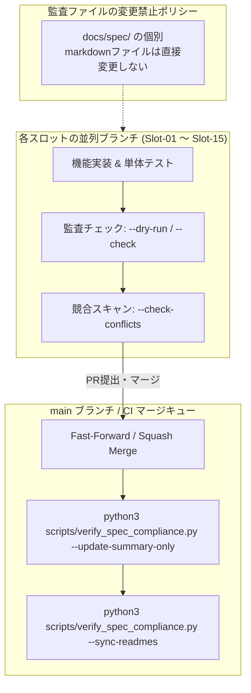

# Julesサービス終了後の15並列自律開発と仕様適合に関する包括的改善提案書

## 1. 概要と背景

本ドキュメントは、Nanai Android Mascot（伺か / SSP 互換デスクトップ・モバイルマスコットプラットフォーム）において、**Jules サービスの終了に伴う自律開発環境の移行**と、**最大15並列エージェント環境下における仕様適合・品質向上を継続するための包括的改善案**を定義・集約したものです。

特に、以下の3つの重要要件を完全に両立させるためのガバナンスと技術方針を確立します：
1. **仕様監査（`scripts/verify_spec_compliance.py`）実行時のGitマージコンフリクトの根本防止**
2. **Jules依存の排除とエージェント非依存（Agent-agnostic）な15並列自律運用の確立**（Android Studio Gemini 3.1 Pro、Claude Code、Codex、Cursor、および人間の開発者によるシームレスな引き継ぎ）
3. **Slot-01（SSTP & FMO共有メモリ）を基点としたプロトコル・IPC基盤の深化・高度化提案**

---

## 2. 仕様監査（`scripts/verify_spec_compliance.py`）のコンフリクト根本解決と差分安全運用

### 2.1 コンフリクト発生の根本原因

従来の仕様監査スクリプト（`scripts/verify_spec_compliance.py`）は、コードベース全体を静的解析し、`docs/spec/ukadoc-spec/` 配下の個別マークダウンファイル（約2,000ファイル）のステータス表（`✅`, `❌`, `❓`）を一括書き換えする仕様となっていました。
これにより、以下の深刻な問題が発生していました：
- 15スロットが並列でブランチを切って開発を進める際、各エージェントが監査を実行すると、同一の監査マークダウンファイルに対して同時に差分が発生。
- Gitマージ時に数百〜千件規模のマージコンフリクト（`<<<<<<<`, `=======`, `>>>>>>>`）が発生し、マージ作業が破綻。

### 2.2 採用された対策と今後の運用基準

Cycle 9〜10で確立された安全策を今後の全並列実装における**絶対的必須運用基準**とします：



#### 【運用ルール】
1. **並列ブランチでの一括上書き実行の厳禁**:
   - 並列ブランチ（`feat/slot-*`, `jules-*` 等）では、引数なしの `python3 scripts/verify_spec_compliance.py` 実行はガード機能（`validate_parallel_bulk_safety`）によって自動的にブロックされます。
   - 適合状況の確認には必ず **`--dry-run`** または **`--check`** を使用してください：
     ```bash
     python3 scripts/verify_spec_compliance.py --dry-run
     ```
2. **全体サマリの単一更新**:
   - 全体の適合率指標（1662/2065, 80.48% 等）の更新が必要な場合は、個別markdownファイルを一切触れずに `docs/spec/SUMMARY.md` のみを更新する **`--update-summary-only`** を利用します：
     ```bash
     python3 scripts/verify_spec_compliance.py --update-summary-only
     ```
3. **マージ競合マーカーの検出検証**:
   - コミット前またはPR作成前には、未解消のGit競合マーカーがリポジトリ内に存在しないことを検証する **`--check-conflicts`** を実行します：
     ```bash
     python3 scripts/verify_spec_compliance.py --check-conflicts
     ```
4. **仕様適合の改善は「プロダクションコードの実装」で達成する**:
   - 仕様監査の未達を解消するためにドキュメント側を手作業で改ざんするのではなく、未実装のプロトコル、タグ、プロパティを Rust / TypeScript 側の本番実装に追加することで、監査エンジンが自動的に `✅` と判定するようにします。

---

## 3. Jules終了に伴う15並列自律開発環境の移行アーキテクチャ

### 3.1 エージェント非依存（Agent-agnostic）協調プロトコル

Julesサービス終了後は、**Android Studio (Gemini 3.1 Pro Preview)**、**Claude Code**、**GitHub Copilot Workspace**、**Codex**、および人間の開発者が同等の自律性を持って15スロット開発を継続できる環境を構築します。

各AIツールやIDEが読み込む指示ファイル（`AGENTS.md`、`.cursorrules`、`CLAUDE.md` 等）の共通基盤として、以下の規約を標準化します：

| 項目 | 規約内容 |
| :--- | :--- |
| **起動プロンプト** | `あなたはNです。15並列実装計画の。[M回目です。]` または `並列実装Nを実行`（N: 01〜15, M: サイクル数） |
| **専有境界** | `docs/doc/nas-spec/compatibility-implementation-plan/並列実装計画-並列上限15長期拡張設計.md` の所有権マトリクスを厳守 |
| **ブランチ命名** | `feat/slot-<01..15>-c<cycle>-<feature>` |
| **ビルド・テスト環境** | Rust: `cargo +nightly test` (cranelift回避フラグ設定)<br>TS: `npm install` (npm ci禁止), `npx vitest run`, `npx @biomejs/biome check` |
| **タスク引き継ぎ** | `.jules/bolt.md`（または `.agents/handoff.md`）に学習知見と次回アクションを記録 |

### 3.2 後継エージェント向け指示テンプレート（汎用プロンプト仕様）

後継エージェント（例: Gemini 3.1 Pro、Claude Code等）に作業を依頼する際の共通プロンプトテンプレート：

```markdown
あなたは Slot-{N}（{スロット名称}）の担当エンジニアです。
プロジェクト仕様書 `docs/doc/nas-spec/compatibility-implementation-plan/並列実装計画-並列上限15長期拡張設計.md` を確認してください。

【厳守事項】
1. 担当スロット専有領域外の共有コアファイル（`src-tauri/src/lib.rs` 等）をみだりに変更しないこと。
2. 仕様監査スクリプトを実行する際は必ず `python3 scripts/verify_spec_compliance.py --dry-run` を使用し、`docs/spec/` 配下の個別ファイルを一括書き換えしないこと。
3. 実装の改善・リファクタリング・最適化・テスト強化を完全自律で行い、人間への質問や承認待ちを挟まずに完了させること。
4. 作業完了時は単体テスト（Vitest / Cargo）および Biome / rustfmt を実行し、回帰ゼロを確認すること。
```

---

## 4. Slot-01（SSTP & FMO共有メモリ）の今後の深化・拡張改善案

Slot-01 はシステムの外部インターフェースの要であり、外部アプリケーション、プラグイン、連携ツール（例: SSP用時計プラグイン、ランチャー、音声連携ツール、HTTP経由の外部AI対話サービス）との通信を一手に担います。

### 4.1 現状の達成状況（Cycle 10 時点）
- **SSTP 1.1 / 1.2 コマンド完全サポート**: `SEND`, `NOTIFY`, `COMMUNICATE`, `EXECUTE`, `GIVE` の解析および実行パイプライン。
- **SSTP レスポンスパーサー & ビルダーの往復整合性**: `SstpResponse::parse` および `build` による双方向通信。
- **Keep-Alive 持続接続 & Content-Length 対応**: UKADOC `keepalive.md` に完全準拠した接続維持。
- **HTTPトンネリングヘッダー対応**: `Content-Type`, `User-Agent`, `Host` ヘッダーの解析とレスポンスへの反映。
- **リモートセキュリティ保護**: 外部IPからの特定 `EXECUTE` コマンド拒否（`420 Refuse`）とFMOパス隠蔽。
- **FMOマルチゴースト管理**: `has_ghost`, `filter_active_records`, `filter_visible_records`, `extract_ghost_names`。
- **TypeScript 統合**: `ui/ts/core/actions/sstp-fmo-actions.ts` によるフロントエンド完結型通信アクション。

### 4.2 次期サイクルに向けた具体的な改善提案

#### ① HTTP/WebSocket REST-SSTP 統合ゲートウェイの構築
- **背景**: モバイル（Android）および最新のWeb環境では、従来の生TCPソケット（Port 9801 / 9821）やローカル共有メモリに直接アクセスできないサンドボックス制約が存在します。
- **改善案**:
  - `src-tauri/src/sstp/` に組み込み HTTP/WebSocket ゲートウェイ（`crates/ui/src/sstp/network/`）を追加。
  - REST形式で `POST /sstp/send` や `POST /sstp/notify`、あるいは WebSocket による双方向SSTPストリーミング（JSON-RPC / raw text両対応）をサポート。
  - Web拡張機能や外部ブラウザアプリからシームレスに Nanai Android Mascot を制御可能とする。

#### ② SAORI / DirectSSTP 非同期ストリーミング実行パイプライン
- **背景**: 里々やYAYAなどのSHIORIからSAORI経由で重い外部処理（Web検索、AI推論、音声合成等）を呼び出す際、同期呼び出しだとマスコットのUIスレッドがブロックされるリスクがあります。
- **改善案**:
  - `crates/ui/src/sstp/builder/execute_handler/` に Tokio 非同期タスクプールと連携した非同期SAORI実行キューを導入。
  - タイムアウト監視（デフォルト5秒）、キャンセル通知、およびバックグラウンド実行完了時のコールバックSSTP通知（`OnSAORIComplete`）を自動送出する機構を整備。

#### ③ クロスプラットフォーム FMO（File Mapping Object）の最適化
- **背景**: Windowsでは名前付き共有メモリ（`Sakura`）を用いますが、Linux/macOSでは POSIX共有メモリ（`shm_open`）または一時ファイル、Androidでは Unix Domain Socket / IPC または SQLite メモリDBが適しています。
- **改善案**:
  - `crates/ui/src/fmo/` に `FmoBackend` トレイトを抽象化し、OSネイティブの最適なIPC方式をプラグイン可能にする。
  - Android環境における `ContentProvider` や AIDL / Broadcast経由でのFMOデータ公開ブリッジを Slot-12 と連携して整備。

#### ④ SSTP スクリプト注入・セキュリティサニタイズの強化
- **背景**: 悪意ある外部SSTPリクエストからスクリプト実行（`\![open,browser,...]` やシステムコマンド）が送られた場合の防御。
- **改善案**:
  - `SstpGhostConfig` に基づく細かい権限パーミッション管理（`allow_system_commands`, `allow_network_update`, `trusted_domains`）。
  - SSTP経由で渡されるさくらスクリプトのサニタイズフィルタ（危険タグの自動無害化）を `crates/ui/src/sstp/` および `ui/ts/core/actions/sstp-fmo-actions.ts` に実装。

---

## 5. 15スロット全体の未達仕様・ギャップ解消に向けた次期ロードマップ

全体の仕様適合率は現在 **80.48% (1662 / 2065 項目)** に到達しています。残る未達項目（約403項目）を解消し、90%以上の完全適合を達成するためのスロット別推進計画です。

| ドメイン | 対象スロット | 残存課題・未達領域 | 次期アクション方針 |
| :--- | :--- | :--- | :--- |
| **Domain 1**<br>(プロトコル/基盤) | **Slot-01** (SSTP/FMO)<br>**Slot-02** (SHIORI)<br>**Slot-03** (VFS/文字コード) | ・HTTP SSTPゲートウェイ<br>・Wasmtime SHIORIサンドボックス<br>・アーカイブ内直接VFSマウント | ・REST/WebSocket SSTP追加<br>・里々/YAYA WASMバイナリ自動実行<br>・ZIP/NARのゼロコピー読み取り |
| **Domain 2**<br>(スクリプト/演出) | **Slot-04** (さくらスクリプト)<br>**Slot-05** (再生キュー)<br>**Slot-06** (コマンドハンドラ) | ・未実装システムコマンド（`\![open,mail]`等）<br>・複雑な条件分岐タグ<br>・マルチ発話キュー調停 | ・SSP独自コマンドのハンドラ網羅<br>・トーク割り込み優先度キューの拡張<br>・環境変数展開の更なる堅牢化 |
| **Domain 3**<br>(描画/SERIKO) | **Slot-07** (画像コンポジタ)<br>**Slot-08** (SERIKOアニメ)<br>**Slot-09** (surfaces/当たり判定) | ・特殊ブレンドモードのGPU高速化<br>・3D回転/アフィン変換アニメーション<br>・複合ポリゴン判定の最適化 | ・WebGL / WebGPU シェーダーフォールバック<br>・SERIKO 2.0 拡張タグの完全実装<br>・Spatial Hash による高速当たり判定 |
| **Domain 4**<br>(UI/モバイル) | **Slot-10** (バルーン)<br>**Slot-11** (UI/メニュー)<br>**Slot-12** (Android/タッチ) | ・リッチテキスト装飾（ルビ・埋め込み画像）<br>・オーナー描画メニューの全項目スキン化<br>・Androidウィジェット / ピクチャーインピクチャー | ・CSSルビ・インライン画像パーサー<br>・全92種オーナー描画メニュー完全準拠<br>・Android PiPモードおよびフローティングUI |
| **Domain 5**<br>(監査/テスト/更新) | **Slot-13** (監査エンジン)<br>**Slot-14** (E2Eテスト)<br>**Slot-15** (NAR/更新) | ・CIマージキュー自動監査レポート<br>・全ゴースト総合対話シナリオE2E<br>・増分差分アップデート・レジューム | ・GitHub Actions によるPR自動監査同期<br>・Playwright Headless E2E網羅<br>・HTTP Range レジュームダウンロード |

---

## 6. まとめ

1. **コンフリクト抑止**:
   - 仕様監査は `--dry-run` または `--update-summary-only` を徹底し、個別マークダウンファイルの直接上書きを禁止することで、Gitコンフリクトを根本から根絶します。
2. **移行体制**:
   - Julesサービス終了後も、Android Studio Gemini 3.1 Pro、Claude Code、Cursor、人間開発者が共通の「15並列マトリクス」と「非同期タスクプロトコル」に基づき、完全自律で仕様適合を推進できます。
3. **Slot-01の進化**:
   - SSTP/FMO基盤は成熟しており、今後はHTTP/WebSocketゲートウェイ、非同期SAORI実行、クロスプラットフォームIPCを拡張することで、現代的な外部連携マスコット基盤としての完成度を極限まで高めることが可能です。
