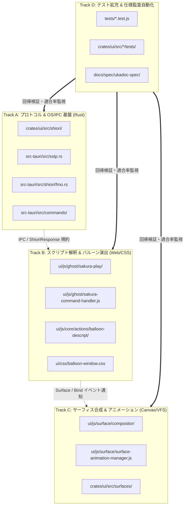

# 仕様適合に関する並列実装計画書 (セッション分割設計)

- **言及規格の元ドキュメント・権利者・ライセンス**:
  - **SHIORI 仕様 / 各種サブシステム**:
    - **SHIORI/3.0 規格**: [ukadoc-spec: shiori3](https://ukatech.shillest.net/ukadoc-spec/spec/shiori3/) - © UKADOC project (CC BY 4.0)
    - **里々 (SATORI)**: [ukatech/satori-docs](https://ukatech.shillest.net/satori-docs/) - © Kusigahama Yagi / SEIBIHAN (BSD 2-Clause License)
    - **YAYA**: [YAYA-shiori/yaya-docs](https://yaya-shiori.github.io/yaya-docs/) - (The Unlicense / Public Domain)
    - **華和梨 (KAWARI)**: [ukatech/kawari-docs](https://ukatech.shillest.net/kawari-docs/) - © KAWARI Development Team (BSD 2-Clause License)
  - **SSP 拡張仕様 / メニュー規格**: [ukatech/ukadoc-ssp](https://github.com/ukatech/ukadoc-ssp) / [SSP BUG-SLIK-PRACTICE](http://ssp.shillest.net/) - © UKADOC project (CC BY 4.0) / © PONapook 氏
  - **さくらスクリプト (Sakura Script)**: [ukadoc-spec: さくらスクリプト](https://ukatech.shillest.net/ukadoc-spec/spec/sakura-script/) - © UKADOC project / Ukagaka Tech Team (CC BY 4.0)
  - **バルーン仕様 (Balloon)**: [ukadoc-spec: balloon](https://ukatech.shillest.net/ukadoc-spec/) - © UKADOC project / Ukagaka Tech Team (CC BY 4.0)
  - **伺か標準仕様 / ゴースト / シェル**: [ukatech/ukadoc-spec (UKADOC project)](https://ukatech.shillest.net/ukadoc-spec/) - © UKADOC project / Ukagaka Tech Team (CC BY 4.0)
  - **surfaces.txt / アニメーション合成 / 当たり判定**: [ukadoc-spec: surfaces.txt](https://ukatech.shillest.net/ukadoc-spec/spec/surfaces/) - © UKADOC project / Ukagaka Tech Team (CC BY 4.0)

> **AI 関与について**: このドキュメントは AI アシスタントの支援により作成されました。仕様適合の実装を複数セッションで並行進行する際のコンフリクト抑止と責務境界を定義しています。

---

## 1. 背景と目的

Nanai Android Mascot において、伺か（UKAGAKA）/ SSP の膨大な仕様群（SHIORI 3.0、さくらスクリプト、SERIKO、バルーンスキン、SSTP 等）への適合を推進するにあたり、単一の直列セッションによる実装では開発リードタイムが長期化します。

しかし、無計画に複数のコーディングセッション（AI エージェントや複数開発者による並行作業）を立ち上げると、以下の重大な課題が発生します：
1. **Git マージコンフリクト**: 中核モジュール（`ui/main.js`, `ghost.js`, `src-tauri/src/lib.rs` 等）に対する同時編集による衝突。
2. **状態管理・インターフェースの不整合**: 並行セッション間でイベント引数やデータ型の解釈が食い違い、結合時にリグレッションを誘発。
3. **グローバルフォーマット・リント汚染**: 全体フォーマットの自動適用による大規模差分衝突。

本計画書は、**「変更領域が直交するセッション分割（Orthogonal Work Tracks）」** と **「疎結合なアーキテクチャ境界」** を定義し、マージコンフリクトをゼロまたは最小限に抑えながら仕様適合を並列推進するための実装戦略を定めます。

---

## 2. 変更領域の直交分割（4つの並列開発トラック）

各セッションが触れるディレクトリおよび責務を完全に分離し、同時に稼働可能な4つのトラックを定義します。



### Track A: プロトコル & OS/IPC 基盤トラック (Rust コア)

- **主担当領域**: `crates/ui/src/`, `src-tauri/src/`
- **対象仕様**:
  - SSTP 1.1 / 1.2 通信（`COMMUNICATE`, `NOTIFY`, `EXECUTE`）
  - FMO (File Mapping Object) および共有メモリ状態管理
  - SHIORI 3.0 動的ロード・リクエスト/レスポンス型定義
  - VFS（仮想ファイルシステム）のケースインセンシティブ解決
- **コンフリクト回避ルール**:
  - フロントエンドコード（`ui/**`）を直接変更しない。
  - 新規 Tauri コマンドの登録は専用モジュール内で行い、`src-tauri/src/lib.rs` への追記は1行追加に留める。

### Track B: スクリプト解釈 & バルーン演出トラック (フロントエンド UI)

- **主担当領域**: `ui/js/ghost/sakura-*/`, `ui/js/core/actions/balloon-*/`, `ui/css/`
- **対象仕様**:
  - さくらスクリプトタグ（`\q`, `\_a`, `\![open,...]`, `\![set,...]` 等）の解釈
  - クリック待ち（`\x`）、クリア（`\c`）、クイック描画（`\_q`）のタイミング制御
  - バルーンスキン定義（`descript.txt`）の CSS 変数バインディングとタイポグラフィ
- **コンフリクト回避ルール**:
  - サーフィス描画パイプライン（`ui/js/surface/`）の内部コードには手を出さず、イベント（`surface-change` 等）を経由して連携する。

### Track C: サーフィス合成 & アニメーショントラック (描画エンジン)

- **主担当領域**: `ui/js/surface/`, `crates/ui/src/surfaces/`
- **対象仕様**:
  - `surfaces.txt` 多重要素合成（`element0..N` の `base`, `overlay`, `replace` 等）
  - SERIKO アニメーション周期（`sometimes`, `rarely`, `periodic`, `talk` 等）
  - 当たり判定（`collision`）のヒットテストとマウス/タッチジェスチャー判定
- **コンフリクト回避ルール**:
  - スクリプト再生キューやバルーン DOM 操作を内包せず、渡されたサーフィス ID・バインド状態に基づいて描画することに専念する。

### Track D: テスト拡充 & 仕様監査自動化トラック (QA / 仕様同期)

- **主担当領域**: `tests/`, `crates/ui/src/**/tests/`, `docs/spec/`
- **対象仕様**:
  - UKADOC 仕様適合監査の更新（`scripts/verify_spec_compliance.py`）
  - Vitest / Cargo test 単体・統合テストの追加
  - エッジケース・パース失敗耐性のテスト拡充
- **コンフリクト回避ルール**:
  - プロダクションコードの破壊的リファクタリングを行わず、純粋なテストケース追加およびドキュメント更新に限定する。

---

## 3. コンフリクト抑止のためのアーキテクチャ境界規約

### 3.1 Mixin / 垂直機能分離の徹底

中核クラス（`NanaiAndroidMascotApp`, `GhostController`）に直接メソッドをベタ書きすることを禁止します。
- 機能追加は `ui/js/core/actions/` や `ui/js/ghost/command-handler/` 配下の独立ファイルに実装。
- 中核ファイルでは `Object.assign(Target.prototype, featureMethods)` による合成のみを行う。
- これにより、複数セッションが同一機能クラスを拡張する場合でも、編集対象ファイルが衝突しません。

### 3.2 IPC 通信インターフェースの事前凍結（Contract-First）

Track A（Rust）と Track B/C（Web）が協調する機能を追加する場合：
1. 先に IPC コマンド名、引数形式（JSON / Object）、戻り値型（Rust 構造体 / TS 型）のシグネチャを合意・ドキュメント化する。
2. それぞれのセッションで「モック引数」「スタブハンドラ」を先行配置することで、バックエンドとフロントエンドが完全に独立して並行コーディング可能とする。

### 3.3 局所フォーマット・リントルールの遵守

- `npx biome check . --write` や `cargo fmt --all` をグローバルに実行しない。
- 必ずセッション内で変更した個別ファイルのみに対してフォーマットを実行する（例: `npx biome check <filepath> --write`）。

---

## 4. 並行セッションの Git 運用フロー

```mermaid
gitGraph
    commit id: "origin/main"
    branch track-a-sstp
    branch track-b-sakurascript
    branch track-c-seriko
    checkout track-a-sstp
    commit id: "Rust: SSTP 1.1 COMMUNICATE"
    checkout track-b-sakurascript
    commit id: "JS: choice \\q tag click"
    checkout track-c-seriko
    commit id: "Canvas: talk mouth sync"
    checkout track-a-sstp
    commit id: "Rust: SSTP keepalive"
    checkout main
    merge track-a-sstp id: "Merge PR (Track A)"
    checkout track-b-sakurascript
    merge main id: "Rebase/Merge main"
    commit id: "JS: test update"
    checkout main
    merge track-b-sakurascript id: "Merge PR (Track B)"
    checkout track-c-seriko
    merge main id: "Rebase/Merge main"
    checkout main
    merge track-c-seriko id: "Merge PR (Track C)"
```

### 4.1 ブランチ命名規約

並列セッションの作業ブランチは、担当トラックと目的を明示します：
- `feat/track-a-sstp-communicate`
- `feat/track-b-sakura-quick-mode`
- `feat/track-c-seriko-interval-talk`
- `test/track-d-balloon-style-coverage`

### 4.2 セッション完了時の事前検証チェックリスト

PR 作成またはマージ前に、セッション担当者は以下を必ず確認します：
1. **変更ファイル一覧の検証**: 自身のトラック外の共有ファイル（`ui/main.js`, `src-tauri/src/lib.rs` 等）に余計な変更が含まれていないか。
2. **単体テストの全通過**: `npx vitest run` および `cargo test` が PASS すること。
3. **最新 main の取り込み**: 最新の `origin/main` を fetch してマージまたはリベースし、コンフリクトがないことを確認すること。

---

## 5. まとめ

本並列実装計画に基づき、各コーディングセッションを「Track A（Rust基盤）」「Track B（演出/さくらスクリプト）」「Track C（描画/SERIKO）」「Track D（テスト/監査）」に直交分離することで、開発速度の最大化とマージコンフリクトの根絶を同時に達成します。
