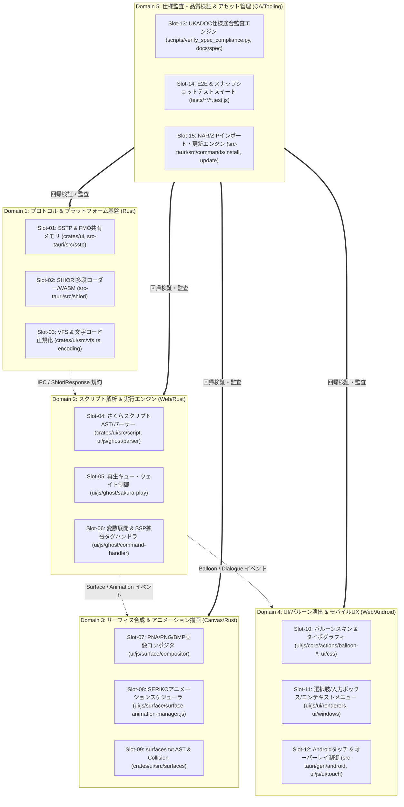
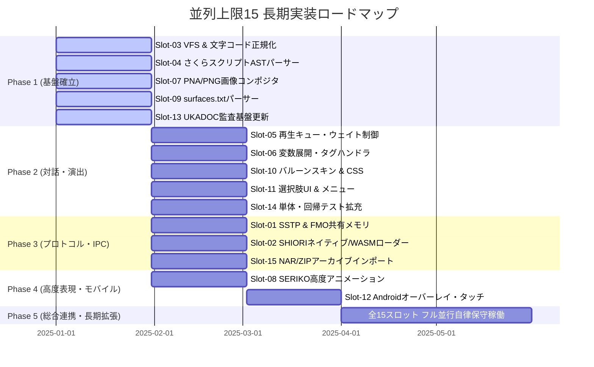
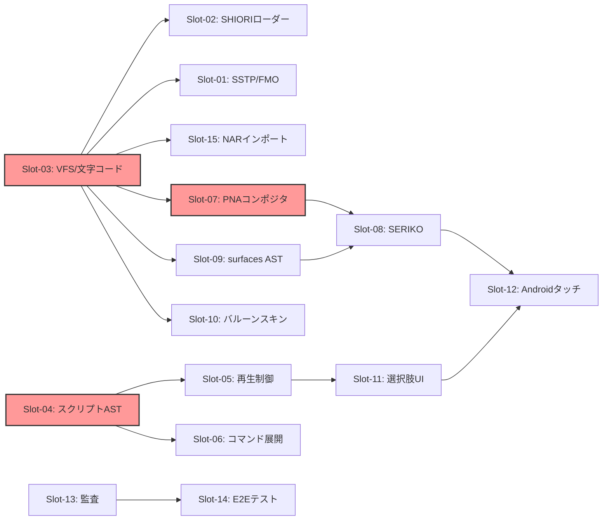

# 仕様適合に関する長期並列実装計画書 (並列上限15セッション拡張設計)

- **言及規格の元ドキュメント・権利者・ライセンス**:
  - **SHIORI 仕様 / 各種サブシステム**:
    - **SHIORI/3.0 規格**: [ukadoc-spec: shiori3](https://ukatech.shillest.net/ukadoc-spec/spec/shiori3/) - © UKADOC project (CC BY 4.0)
    - **里々 (SATORI)**: [ukatech/satori-docs](https://ukatech.shillest.net/satori-docs/) - © Kusigahama Yagi / SEIBIHAN (BSD 2-Clause License)
    - **YAYA**: [YAYA-shiori/yaya-docs](https://yaya-shiori.github.io/yaya-docs/) - (The Unlicense / Public Domain)
    - **華和梨 (KAWARI)**: [ukatech/kawari-docs](https://ukatech.shillest.net/kawari-docs/) - © KAWARI Development Team (BSD 2-Clause License)
  - **SSP 拡張仕様 / メニュー規格**: [ukatech/ukadoc-ssp](https://github.com/ukatech/ukadoc-ssp) / [SSP BUG-SLIK-PRACTICE](http://ssp.shillest.net/) - © UKADOC project (CC BY 4.0) / © PONapook 氏
  - **さくらスクリプト (Sakura Script)**: [ukadoc-spec: さくらスクリプト](https://ukatech.shillest.net/ukadoc-spec/spec/sakura-script/) - © UKADOC project / Ukagaka Tech Team (CC BY 4.0)
  - **バルーン仕様 (Balloon)**: [ukadoc-spec: balloon](https://ukatech.shillest.net/ukadoc-spec/) - © UKADOC project / Ukagaka Tech Team (CC BY 4.0)
  - **伺か標準仕様 / ゴースト / シェル**: [ukatech/ukadoc-spec (UKADOC project)](https://ukatech.shillest.net/ukadoc-spec/) - © UKADOC project / Ukagaka Tech Team (CC BY 4.0)
  - **surfaces.txt / アニメーション合成 / 当たり判定**: [ukadoc-spec: surfaces.txt](https://ukatech.shillest.net/ukadoc-spec/spec/surfaces/) - © UKADOC project / Ukagaka Tech Team (CC BY 4.0)

> **AI 関与について**: このドキュメントは AI アシスタントの支援により作成されました。既存の4トラック並列計画（`並列実装計画-セッション分割設計.md`）を基礎とし、最大15の同時稼働コーディングセッション（AIエージェント/エンジニア）がGitコンフリクトを起こさずに並行して仕様適合を推進するための長期並列アーキテクチャおよびガバナンス設計を定義します。

---

## 1. 背景と並列上限15拡張の狙い

Nanai Android Mascot において、伺か（UKAGAKA）/ SSP の膨大な仕様群（SHIORI 3.0/2.x、さくらスクリプト、SERIKOアニメーション、surfaces.txt/surfaces2.txt、バルーンスキン、SSTP、FMO、VFS、Androidオーバーレイ・サービス等）を網羅的に実装し、長期間にわたり高い品質で維持・拡張するためには、セッション並列度の向上が不可欠です。

従来の4トラック構成（Track A: Rust基盤、Track B: スクリプト演出、Track C: 描画、Track D: QA）では、同一トラック内でのサブタスク競合（例: さくらスクリプトパーサー改修とバルーンUI改修の衝突、SSTP実装とSHIORIローダー実装のRustファイル衝突など）が発生しやすく、並列数の上限が実質4程度に制約されていました。

本設計では、**「5大ドメイン × 3直交トラック ＝ 最大15並列スロット」** のマトリクス構造を確立し、以下の原則を徹底することで、並列上限15の自律的な長期並行開発を実現します：

1. **完全直交なファイル・ディレクトリ所有権（Ownership Matrix）**: 15スロットそれぞれが独立したファイル群を変更対象とし、共有コアファイルへの同時編集を排除。
2. **Contract-First（型・イベント・IPCインターフェースの先行確定）**: 依存関係にあるモジュール同士をスタブ・モックで疎結合化。
3. **DAG（有向非巡回グラフ）に基づくフェーズ依存関係管理**: 各スロットの先行要件と後続ブロックを明示。
4. **差分局所化とマージキュー運用**: セッションごとの局所フォーマット・リント、スカッシュマージによるコンフリクト根絶。

---

## 2. 5大ドメイン × 3直交トラック（15並列スロット構造）

システム全体を5つの機能ドメインに分類し、各ドメイン内に変更領域が重複しない3つの独立トラック（合計15スロット: `Slot-01` 〜 `Slot-15`）を配置します。



---

## 3. 各スロットの詳細責務と所有権マトリクス (Ownership Matrix)

各スロットは専有ディレクトリを持ち、スロット外の共有中核ファイルを直接編集することは禁止されます。

| スロットID | スロット名称 | 主担当ファイル / 専有ディレクトリ | 対象仕様・機能範囲 | 外部インターフェース規約 (Contract) |
| :--- | :--- | :--- | :--- | :--- |
| **Slot-01** | **SSTP & FMO共有メモリ** | `src-tauri/src/sstp.rs`<br>`src-tauri/src/fmo.rs` | SSTP 1.1/1.2 (`SEND`, `NOTIFY`, `COMMUNICATE`, `EXECUTE`), OS別FMO共有メモリ同期 | `SstpMessage`, `FmoEntry` 構造体 |
| **Slot-02** | **SHIORI多段ローダー / WASM** | `src-tauri/src/shiori/`<br>`crates/ui/src/shiori/` | SHIORI/3.0 C-ABI DLL動的ロード (Windows/Linux), Wasmtime/Wasmer WASM実行エンジン | `ShioriEngine` トレイト (`load`, `request`, `unload`) |
| **Slot-03** | **VFS & 文字コード正規化** | `crates/ui/src/vfs.rs`<br>`src-tauri/src/common/vfs.rs` | 大小文字不問パス解決 (Windows/Linux/Android差分吸収), Shift_JIS(CP932)/UTF-8自動判定 | `VfsResolver`, `detect_and_decode()` |
| **Slot-04** | **さくらスクリプトAST / パーサー** | `crates/ui/src/script/`<br>`ui/js/ghost/parser/` | さくらスクリプトタグトークナイズ、AST生成、ネスト構文・エスケープ解決 (`\\`, `\%`) | `SakuraToken`, `SakuraAstNode` |
| **Slot-05** | **再生キュー & ウェイト制御** | `ui/js/ghost/sakura-play/` | ウェイト処理 (`\w1`〜`\w9`, `\_w[]`)、クリック待ち (`\x`)、即時表示モード (`\_q`)、消去 (`\c`) | `SakuraPlaybackController` (イベント駆動) |
| **Slot-06** | **変数展開 & SSP拡張コマンド** | `ui/js/ghost/command-handler/`<br>`ui/js/ghost/sakura-command-handler.js` | 選択肢イベント (`\q[text,id]`), アンカー (`\_a`), 外部URLオープン (`\j`), システムコマンド (`\!`) | `CommandHandlerMap` (プラグイン拡張方式) |
| **Slot-07** | **PNA/PNG/BMP画像コンポジタ** | `ui/js/surface/compositor/`<br>`crates/ui/src/surfaces/compositor.rs` | PNAアルファマスク合成、単一PNG透過、左上1pxクロマキー、Canvas 2D (Uint32Array高速化) | `SurfaceFrameBuffer`, `compositeElements()` |
| **Slot-08** | **SERIKOアニメーション** | `ui/js/surface/surface-animation-manager.js`<br>`crates/ui/src/animation/` | SERIKO周期タグ (`sometimes`, `rarely`, `periodic`, `talk`, `bind`, `add`, `replace`) | `AnimationScheduler`, `FrameStepEvent` |
| **Slot-09** | **surfaces.txt AST & Collision** | `crates/ui/src/surfaces/`<br>`crates/ui/src/surfacetable.rs` | `surfaces.txt` / `surfaces2.txt` パース、当たり判定領域 (`collision`) 計算、ヒットテスト | `SurfaceTable`, `HitTestResult` |
| **Slot-10** | **バルーンスキン & タイポグラフィ** | `ui/js/core/actions/balloon-descript/`<br>`ui/css/balloon-*.css` | バルーン `descript.txt` (文字色、フォント、背景画像9スライス分割、マージン設定) | CSS Variables, `BalloonThemeManager` |
| **Slot-11** | **選択肢・入力・コンテキストメニュー** | `ui/js/ui/renderers/`<br>`ui/windows/`<br>`ui/js/ui/templates/` | `\![open,inputbox]`, `\![open,teachbox]`, 右クリックSSP標準メニュー、選択肢リスト | `ModalDialogController`, `MenuRenderer` |
| **Slot-12** | **Androidタッチ & オーバーレイ** | `src-tauri/gen/android/`<br>`ui/js/ui/touch/`<br>`src-tauri/src/commands/window/` | Androidフローティングウィンドウ (WindowOverlay), ジェスチャー (ピンチ/ドラッグ), ライフサイクル | `AndroidBridge`, `TouchGestureEvent` |
| **Slot-13** | **UKADOC仕様適合監査エンジン** | `scripts/verify_spec_compliance.py`<br>`docs/spec/ukadoc-spec/` | UKADOC仕様ドキュメント同期、適合項目自動抽出、適合率レポート生成・追跡 | `ComplianceReport` (Markdown / JSON) |
| **Slot-14** | **E2E & スナップショットテスト** | `tests/**/*.test.js`<br>`crates/ui/src/**/tests/` | Vitest / Cargo test 回帰テスト、パース異常系ファジング、Canvasピクセル比較テスト | テストスイート規約 (独立テストランナー) |
| **Slot-15** | **NAR/ZIPインポート & 更新** | `src-tauri/src/commands/install/`<br>`src-tauri/src/commands/update/` | NAR/ZIPアーカイブ展開、`install.txt` 解析、ネットワーク更新 (`updates2.dau`) | `InstallerEngine`, `UpdatePackage` |

---

## 4. 長期ロードマップとスロット並列展開フェーズ

実装フェーズ（Phase 1〜Phase 4および長期安定化Phase 5）において、15スロットを段階的にアンロックし、依存関係を解消しながら進行します。



### Phase 1: 基礎パーサーと描画基盤（5スロット並行）
- **稼働スロット**: `Slot-03`, `Slot-04`, `Slot-07`, `Slot-09`, `Slot-13`
- **成果物**: Shift_JIS/UTF-8両対応の堅牢なVFS、さくらスクリプトトークナイザー、PNA合成エンジン、surfaces.txtパーサー、仕様監査ベースライン。

### Phase 2: 対話エンジンと演出システム（5スロット並行）
- **稼働スロット**: `Slot-05`, `Slot-06`, `Slot-10`, `Slot-11`, `Slot-14`
- **成果物**: さくらスクリプト逐次実行制御、バルーンスキン9スライス描画、選択肢・入力ボックスUI、Vitest/Cargo自動テスト網。

### Phase 3: プロトコルと多段ローダー（3スロット並行 + 2スロット継続）
- **稼働スロット**: `Slot-01`, `Slot-02`, `Slot-15` （+ `Slot-06`, `Slot-14` 拡張）
- **成果物**: SSTP通信、FMO共有メモリ同期、SHIORI/3.0ネイティブDLL/WASM実行環境、NARパッケージ解凍・自動認識。

### Phase 4: 高度演出とプラットフォーム最適化（3スロット並行 + 継続）
- **稼働スロット**: `Slot-08`, `Slot-12`, `Slot-09`（当たり判定連携）
- **成果物**: SERIKOアニメーション（口パク、まばたき、ランダム発火）、Androidフローティングウィンドウとタッチ操作連携。

### Phase 5: 全15スロット完全並行稼働（自律長期保守）
- 全スロットが独立して稼働し、互いのインターフェース規約を保ったまま機能拡張・仕様適合・不具合修正を自律実施。

---

## 5. スロット間依存グラフ (DAG) とボトルネック解消戦略



### クリティカルパスとボトルネック解消のためのモック・スタブ設計

1. **`Slot-03 (VFS)` 先行ボトルネックの解消**:
   - `Slot-01`, `Slot-02`, `Slot-07`, `Slot-10` が VFS の完成を待たずに着手できるよう、メモリベースのインメモリストレージスタブ（`MockVfs`）を先行提供します。
2. **`Slot-04 (スクリプトAST)` 先行ボトルネックの解消**:
   - `Slot-05 (再生キュー)` および `Slot-06 (コマンドハンドラ)` は、事前に定義された `SakuraAstNode` の静的JSONフィクスチャを用いて並行開発します。
3. **`Slot-07 (画像コンポジタ)` 先行ボトルネックの解消**:
   - `Slot-08 (SERIKO)` は、ダミーのプレースホルダー画像バッファ（カラー矩形Canvas）を使用してアニメーションタイマー・スケジューリングロジックを先行構築します。

---

## 6. 並列上限15でのコンフリクト抑止とガバナンス設計

15セッションが同時にブランチを切ってPRを作成する環境下でのコンフリクト根絶ルールを規定します。

### 6.1 ディレクトリ・ファイル所有権（Ownership）の厳格化

- **共有禁止コアファイル**:
  - `ui/main.js`, `src-tauri/src/lib.rs`, `Cargo.toml`, `package.json`
- **中核拡張における Mixin / レジストリパターンの導入**:
  - 各スロットは、中核ファイルに直接処理を書かず、プラグイン/レジストリ登録方式をとる。
  - 例: Tauriコマンドの追加は各スロット専用のコマンド登録モジュール（`src-tauri/src/commands/slot_xx.rs`）に閉じ、登録用マクロ等で1行インポートする。
  - フロントエンドでは `ui/js/core/actions/` 配下のスロット専用アクション群を動的インポートまたはエントリーポイントでバインドする。

### 6.2 Contract-First（インターフェース先行確定）

スロット間の境界となるデータモデル・イベント名は、実装開始前に型定義ファイル（TypeScript型定義またはRustトレイト）として凍結・共有します。
- **イベント命名規則**: `nas:<domain>:<event-name>`（例: `nas:surface:change`, `nas:script:choice-select`）
- **IPC命名規則**: `nas_cmd_<domain>_<action>`（例: `nas_cmd_sstp_send`, `nas_cmd_shiori_request`）

### 6.3 局所フォーマット・リントルールの徹底

- リポジトリ全体を走査するグローバルフォーマット（`npx biome check . --write` や `cargo fmt --all`）のセッション内実行は**厳禁**。
- 必ず変更を加えた個別ファイルのみに対してフォーマッタ・リンタを実行する（例: `npx biome check ui/js/ghost/parser/foo.js --write`）。

### 6.4 Git運用とマージキュー戦略

```
[Slot-01 Branch] ──┐
[Slot-02 Branch] ──┼──> [GitHub Merge Queue / CI Check] ──> [main]
...                │           │
[Slot-15 Branch] ──┘           ├── Fast-Forward / Rebase
                               └── 単体テスト + リント自動パス
```

- **ブランチ命名規則**: `feat/slot-<01..15>-<feature-description>`
- **リベース必須ルール**: PR作成前およびマージ前に、必ず最新の `origin/main` を fetch し、`git rebase origin/main`（またはマージ）を行い、手元でテストが通過することを確認する。
- **スカッシュマージ運用**: PRマージ時は Squash Merge を採用し、履歴の直列性とロールバックの容易性を担保する。

---

## 7. 仕様適合率の追跡とスロット評価指標 (KPI)

15スロットの並行稼働による成果を定量的に測定するため、以下のKPIを定点観測します。

1. **UKADOC仕様適合率（Slot-13集計）**:
   - `docs/spec/ukadoc-spec/SUMMARY.md` における「実装完了（適合）」項目のパーセンテージ。
2. **テストカバレッジ & 合格率（Slot-14集計）**:
   - Vitest および Cargo test のテスト件数と通過率（目標: 各スロット100%パス、回帰ゼロ）。
3. **PRマージサイクルタイム & コンフリクト発生率**:
   - 15スロット全体でマージコンフリクト発生件数ゼロの維持。
