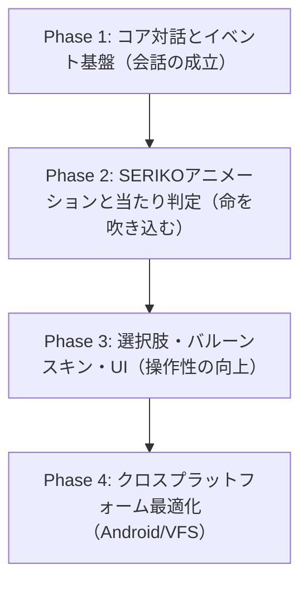

## 4. 改善優先順位・段階的ロードマップ

全体の依存関係を考慮し、**「会話が成立する」→「豊かに動く」→「操作・スキンが整う」→「マルチ展開」**の4フェーズで実装を推進します。

### Phase 1: コア対話とイベント基盤（最優先・必須基盤）

ゴーストが自律的に話し、会話の「間」やテンポが成立する状態を目指します。

1. **さくらスクリプト・ウェイト実装**:
   - `\w1` ～ `\w9`, `\_w[t]`, `\x`（クリック待ち）, `\c`（クリア）の正確な非同期ディレイ処理。
2. **定期時間イベント（タイマー）**:
   - フロントエンドまたはRustバックエンドからの `OnSecondChange` / `OnMinuteChange` 定期送出。
   - SHIORIの自律発話（AIトーク）のトリガー成立。
3. **サーフィス自動復帰（OnSurfaceRestore）**:
   - 発話完了時または一定時間経過後に `\s[0]`（基準表情）へ戻る処理。
4. **SHIORIの安全な終了・セーブ**:
   - ウィンドウ終了時の `OnClose` 処理と SHIORI `unload` の確実な実行。

### Phase 2: SERIKOアニメーションと当たり判定（表現力・インタラクション）

棒立ち状態を解消し、瞬き・口パク・触れ合いを実現します。

1. **SERIKO interval アニメーションエンジン**:
   - `periodic`（周期的な瞬き）、`sometimes`/`rarely`（ランダムなしぐさ）のタイマーループ実装。
   - `talk` によるテキスト出力中の口パク連動。
2. **当たり判定（Collision）とマウスイベント**:
   - `surfaces.txt` の当たり判定矩形を読み込み、透明なヒットテストレイヤーを構成。
   - マウス移動（なで検知）、クリック（つつき検知）を `OnMouseMove` / `OnMouseDoubleClick` としてSHIORIに送信。
3. **パーツ合成モードの拡充**:
   - `overlay`, `replace`, `asis` 等の複数レイヤー合成処理の精度向上。

### Phase 3: 選択肢・バルーンスキン・UI（操作性・再現性）

メニューやイベント選択肢を操作可能にし、視覚的な完成度を高めます。

1. **さくらスクリプト選択肢（\q）とアンカー（\_a）**:
   - 選択肢リンクのUI表示と、クリック時の `OnChoiceSelect` イベント通知。
2. **バルーンスキンパーサー**:
   - `descript.txt` および背景画像の解析、吹き出し形状とマージンの自動適用。
3. **インプットボックス（\![open,inputbox,...]）**:
   - ユーザーからのテキスト入力（名前入力やキーワード応答）のUIダイアログ。
4. **着せ替え機構（\![bind,...]）**:
   - 衣装・アクセサリの表示/非表示フラグ管理とレイヤー反映。

### Phase 4: クロスプラットフォーム最適化（Android・Web・堅牢化）

AndroidやWeb環境でも同一ゴースト資産を安定して動作させます。

1. **VFS（仮想ファイルシステム）による大文字小文字吸収**:
   - Linux/Androidのファイルシステム上での大文字小文字不一致エラーを完全防止。
2. **WASM版SHIORIランタイム統合**:
   - Windowsデスクトップ（32bit DLL）以外で動作する WebAssembly SHIORI（YAYA/里々）の自動切り替え。
3. **マルチキャラクター（\p[n]）の独立ウィンドウ・吸着制御**:
   - 第3キャラクター以降の表示対応と、複数ウィンドウの相対座標維持・追従ドラッグ。

---
