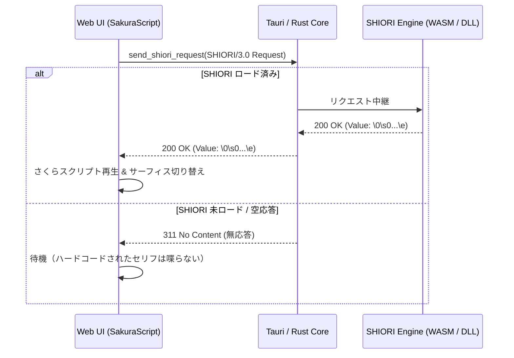

## 3. 埋め込みコード（ハードコード）の完全廃止仕様

### 3.1 撤廃対象と移行後動作一覧

| ファイル                   | 廃止する埋め込みコード                                           | 移行後の正規動作                                                                                                    |
| :------------------------- | :--------------------------------------------------------------- | :------------------------------------------------------------------------------------------------------------------ |
| **`src/js/ghost.js`**      | `triggerRandomTalk()` 内の固定セリフ配列 (`const talks = [...]`) | SHIORI へ `OnSecondChange` / `OnRandomTalk` を通知し、SHIORI から返却されたスクリプトを再生。返却なし時は無音維持。 |
| **`src/js/ghost.js`**      | `sendShioriEvent()` 内の `if (!isTauriAvailable())` モック分岐   | SHIORI コアへ透過的にリクエストを送信。未ロード時・無応答時は何も喋らない（余計なモック文字列を差し込まない）。     |
| **`src/js/surface.js`**    | デフォルト当たり判定 (`collisions.default: [head, face, body]`)  | `surfaces.txt` をパースした結果のみを登録。未定義の場合は判定なし（または全体タップ）。                             |
| **`../../../src-tauri/src/lib.rs`** | `send_shiori_request` 内の `match event_id { "OnBoot" => ... }`  | 組み込み文字列を廃止。SHIORI（WASM / DLL）へ中継し、SHIORI 未実装・未接続時は `311 No Content` を返却。             |

### 3.2 SHIORI 通信の純粋化

フロントエンドおよび Rust バックエンドは、特定のゴーストの内容に依存しない完全な「器（ベースウェア）」として動作させます。

---
