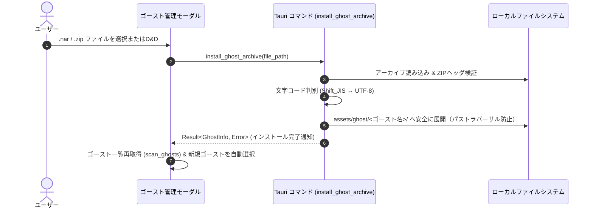

## 4. ゴースト取り込み機能（インストーラー）仕様

### 4.1 アーカイブ形式と検証ルール

- **対応拡張子**: `.nar`, `.zip`
- **文字コード自動判別**:
  - `install.txt` または `descript.txt` を Shift_JIS / UTF-8 でデコード。
- **検証手順**:
  1. アーカイブ内のルート直下または第1階層に `install.txt` または `ghost/master/descript.txt` が存在するかスキャン。
  2. `type` が `ghost` であること、またはゴースト基本構成（`shell/master/`, `ghost/master/`）が存在することを確認。
  3. `install.txt` 内の `name` または `descript.txt` の `name` をゴースト識別名として取得。

### 4.2 取り込みシーケンス

### 4.3 安全性要件 (Security Considerations)

- **Zip Slip (パストラバーサル) 脆弱性防止**:
  アーカイブ内のファイルパスに `..` が含まれる場合、解凍処理を即時拒否。
- **ファイル権限**:
  Android/Windows ともにアプリデータ領域配下の安全なスコープに限定展開。

---
