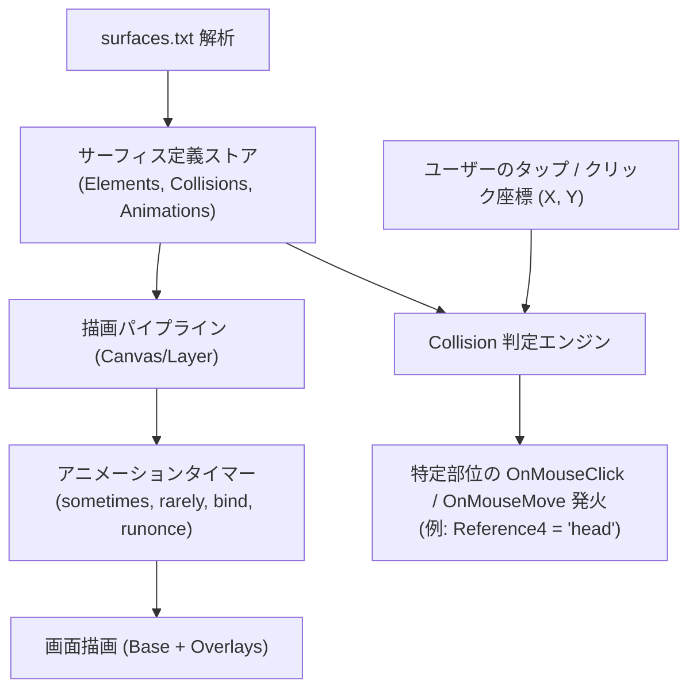

## 1. 処理アーキテクチャの全体像

本仕様は、公式仕様書 **[ukatech/ukadoc-spec: surfaces.txt 仕様](https://ssp.shillest.net/ukadoc/manual/descript_surfaces.html)** および **[ukatech/ukadoc-ssp: Collision 拡張仕様](https://ssp.shillest.net/ukadoc/manual/spec_shiori3.html)** に準拠しています。従来の静的な `` 表示から、HTML5 `<canvas>` または CSS スプライト合成レイヤーによる描画エンジンへと移行します。

---
