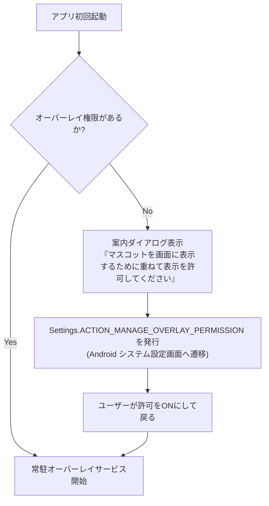

# 2. 権限（Permissions）と初期誘導フロー

### 2.1 必要な Android マニフェスト権限

```xml
<!-- 他のアプリの上に重ねて表示する権限 -->
<uses-permission android:name="android.permission.SYSTEM_ALERT_WINDOW" />

<!-- フォアグラウンドで生存するための権限 -->
<uses-permission android:name="android.permission.FOREGROUND_SERVICE" />
<uses-permission android:name="android.permission.FOREGROUND_SERVICE_SPECIAL_USE" />

<!-- 端末再起動時の自動起動（任意設定） -->
<uses-permission android:name="android.permission.RECEIVE_BOOT_COMPLETED" />

<!-- 常駐通知用 (Android 13+) -->
<uses-permission android:name="android.permission.POST_NOTIFICATIONS" />
```

### 2.2 権限取得 UX フロー

`SYSTEM_ALERT_WINDOW` は危険度の高い特別な権限であるため、通常のダイアログではなく OS の設定画面を開く必要があります。



---
