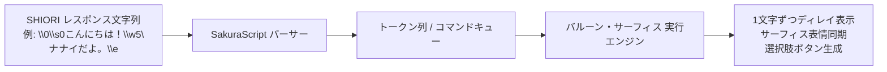

# 1. さくらスクリプト処理パイプライン

本仕様は、公式仕様書 **[ukatech/ukadoc-spec: さくらスクリプト仕様](https://ssp.shillest.net/ukadoc/manual/spec_sakura_script.html)** および **[ukatech/ukadoc-ssp: SSP 拡張タグ仕様](https://ssp.shillest.net/ukadoc/manual/spec_sakura_script.html)** に準拠しています。

---
