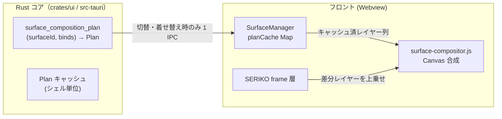

# 2. 目標アーキテクチャ



### 2.1 データ契約（IPC JSON）

Rust `Command`: `surface_composition_plan`

```jsonc
// 入力
{ "surfaceId": "0", "scopeId": 0 }

// 出力: CompositionPlanSnapshot
{
  "surface": 0,
  "layers": [
    { "kind": "element", "file": "surface0.png", "x": 0, "y": 0, "method": "base" },
    { "kind": "element", "file": "surface01.png", "x": 0, "y": 0, "method": "overlay" },
    { "kind": "pattern", "file": "", "surface": 100, "x": 0, "y": 0, "method": "add" }
  ],
  "planHash": "0-100-<layersFingerprint>"
}
```

- `kind` は Rust `CompositionLayer` の externally tagged（`Element` / `Pattern`）を
  JS でそのまま受ける。`file` は element、`surface` は pattern の source 番号。
- **method は Rust の `DrawMethod` を正とする**（`methodToString()` でレガシー文字列へ）。
- `planHash`（レイヤー数 + 各 method/file/surface の単純 fingerprint）で、
  フロント側キャッシュの無効化判定を IPC 無しで行う。

### 2.2 alias 解決の一本化

- Bind pattern の `surface` にエイリアス名が書かれている場合、**Rust 側で数値化**
  （`alias_numbers` / `kero_alias_numbers` + 乱数抽選 1 回）してから計画に含める。
  - 理由: 計画は「静止構成」であり、抽選結果はビルド時に凍結してよい
    （パーツ単位のランダム差分は bind 切替のたびに再抽選される）。
  - `plan_composition(number, binds)` に `aliases` 解決を注入（synthetic Shell で
    テスト可能にする）。
- 本体（\s のエイリアス）抽選は現行どおり JS 側 `resolveSurfaceNumber` で行い、
  その結果の数値サーフィスをコマンドへ渡す。

### 2.3 フロント側のキャッシュと描画フロー

`SurfaceManager` に追加:

```text
planCache: Map<`${surfaceId}__${planHash}`, LayerKey[]>
```

1. `updateSurface(surfaceId, scopeId, frameLayers)`:
   - planCache に plan がなければ `invoke("surface_composition_plan")`
     （着せ替え状態は Rust が保持する `dressupState` のミラーを引数で渡す必要はない —
     Rust は bind ID 列だけ受け取り、bind ID 列は JS の dressupState →
     bindgroup 番号で都度組む。**着せ替え変更時のみ 1 IPC 再取得**）。
   - 以後のアニメーションフレームは plan の layers を ImageBitmap 事前読み込みし、
     毎回 `composeSurfaceElements` を EXIF/dataURL 化せず drawImage 連呼で描く。
2. `bindDressup()`: planCache の当該 scope エントリを invalidate → 次回 draw 時に再取得。
3. `selectShell()` / シェル再ロード: planCache を全消去。

### 2.4 DrawMethod ↔ Canvas の対応（維持）

| Rust `DrawMethod`                                    | レガシー文字列                     | Canvas 処理（`drawLayer`）       |
| ---------------------------------------------------- | ---------------------------------- | -------------------------------- |
| Base                                                 | `base`                             | 最初の下地（configure なし描画） |
| Overlay                                              | `overlay`                          | 通常合成（デフォルト op）        |
| Replace / OverlayFast / Fast                         | `replace` / `overlayfast` / `fast` | 該当矩形 `clearRect` 後描画      |
| Blend(Multiply / Screen / Overlay / SoftLight / Add) | `blend-*` / `add`                  | `globalCompositeOperation` 切替  |
| Add                                                  | `add`                              | `lighter`                        |

合成モードの追加対応（`asis` 等）は Rust `DrawMethod::parse` に網羅させる
（**構文解析は Rust のみ**で進化させ、JS 側の文字列 switch は触らない）。
