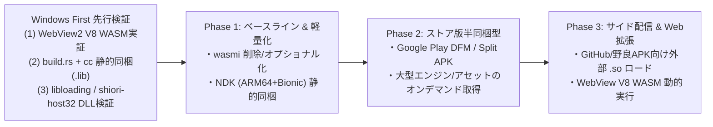
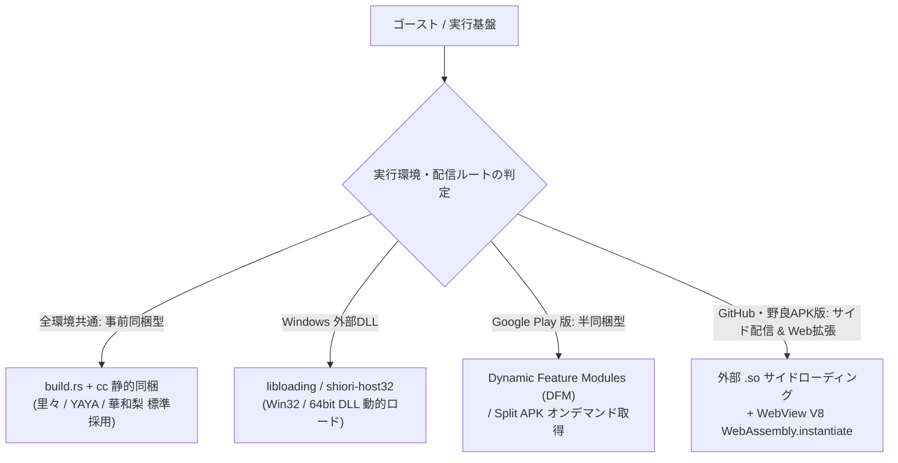

- **言及規格の元ドキュメント・権利者・ライセンス**:
  - **SHIORI 仕様 / 各種サブシステム**:
    - **SHIORI/3.0 規格**: [ukadoc-spec: shiori3](https://ukatech.shillest.net/ukadoc-spec/spec/shiori3/) - © UKADOC project (CC BY 4.0)
    - **里々 (SATORI)**: [ukatech/satori-docs](https://ukatech.shillest.net/satori-docs/) - © Kusigahama Yagi / SEIBIHAN (BSD 2-Clause License)
    - **YAYA**: [YAYA-shiori/yaya-docs](https://yaya-shiori.github.io/yaya-docs/) - (The Unlicense / Public Domain)
    - **華和梨 (KAWARI)**: [ukatech/kawari-docs](https://ukatech.shillest.net/kawari-docs/) - © KAWARI Development Team (BSD 2-Clause License)
  - **PLUGIN 規格**: [ukadoc-spec: plugin](https://ukatech.shillest.net/ukadoc-spec/spec/plugin/) - © UKADOC project / Ukagaka Tech Team (CC BY 4.0)
  - **SSP 拡張仕様 / メニュー規格**: [ukatech/ukadoc-ssp](https://github.com/ukatech/ukadoc-ssp) / [SSP BUG-SLIK-PRACTICE](http://ssp.shillest.net/) - © UKADOC project (CC BY 4.0) / © PONapook 氏
  - **さくらスクリプト (Sakura Script)**: [ukadoc-spec: さくらスクリプト](https://ukatech.shillest.net/ukadoc-spec/spec/sakura-script/) - © UKADOC project / Ukagaka Tech Team (CC BY 4.0)
  - **バルーン仕様 (Balloon)**: [ukadoc-spec: balloon](https://ukatech.shillest.net/ukadoc-spec/) - © UKADOC project / Ukagaka Tech Team (CC BY 4.0)
  - **伺か標準仕様 / ゴースト / シェル**: [ukatech/ukadoc-spec (UKADOC project)](https://ukatech.shillest.net/ukadoc-spec/) - © UKADOC project / Ukagaka Tech Team (CC BY 4.0)
  - **surfaces.txt / アニメーション合成 / 当たり判定**: [ukadoc-spec: surfaces.txt](https://ukatech.shillest.net/ukadoc-spec/spec/surfaces/) - © UKADOC project / Ukagaka Tech Team (CC BY 4.0)

> **AI 関与について**: このドキュメントは GitHub Copilot / Antigravity の支援により作成・更新されました。オーナーユーザーは主に方針決定と技術検討を担当し、コード実装やドキュメント整理は AI が支援しています。

# 開発手法・技術アプローチ (development-approach)

## 1. 概要

本ドキュメントは、**nanai-android-mascot** におけるシステム設計指針、技術スタックの選定理由、クロスプラットフォーム・互換レイヤーの実現アプローチ、および開発プロセスを体系的にまとめた技術文書です。

---

## 2. 開発基本方針

### 2.1 開発戦略: Windows First から段階的 Android 適応へ

当初は Android 向けに特化した開発を進めていましたが、プラットフォーム制約と実装の混在による複雑化を回避するため、**「Windows 環境での先行実証（Windows First）」** を開発プロセスとして定義し、検証済みの資産を Android へ段階展開する方針を採用しています（詳細は [doc-history.md](doc-history.md) 参照）。



#### Windows First 実証プロセス

1. **WASM (WebView2 V8) の実証**:
   - WebView2 (Edge Chromium) の DevTools および JavaScript (`WebAssembly.instantiate`) を使用し、`.wasm` モジュールの即時ロード・V8 上での実行性能・JS 連携をその場で高速検証します。
2. **静的同梱 (Static Linking) の実証**:
   - `build.rs` + `cc` クレートにより、Windows 上で定番 SHIORI（里々 / YAYA / 華和梨）の C++ ソースを `.lib` としてコンパイルし、Rust から直接 C-ABI 関数を呼び出す構成を検証します。
3. **DLL / 動的ロードの検証**:
   - `libloading` および 32bit ブリッジホスト (`shiori-host32`) を用いて Win32 / 64bit DLL を動的ロードし、既存ゴーストとの互換性およびライフサイクル動作を直接デバッグします。

#### 3フェーズ段階展開ロードマップ

1. **Phase 1 (ベースライン & 軽量化)**:
   - `wasmi` 依存関係を整理（削除・オプショナル化）してビルドサイズを数 MB 削減し、Windows 上で実証済みの定番エンジン（里々 / YAYA / 華和梨）を Android NDK (ARM64 + Bionic) 用に **静的同梱 (Static Linking)** してコンパイルします。
2. **Phase 2 (ストア版半同梱型 DFM)**:
   - Google Play 配布版において、将来の大型エンジンや追加アセットを **Dynamic Feature Modules (DFM)** / Split APK で分割し、必要時にオンデマンド取得します。
3. **Phase 3 (サイドローディング & 即時 Web 拡張)**:
   - GitHub / 野良配信版では「サイド配信型」として追加 `.so` の自由ロードを解放し、即時バグ修正や拡張機能には WebView (V8) 内での WASM (`WebAssembly.instantiate`) 動的取得・実行を活用します。

### 2.3 仕様定義の前提とアプローチ（独自仕様と推測仕様）

本プロジェクトでは、仕様やドキュメントを整理・策定する際、以下の前提を厳守します。
- **独自仕様（Unique Specs / `doc-nam-spec`）**: モバイル適応やTauri/Rust基盤など、本アプリ独自の設計判断を明確に定義。
- **推測仕様（Implicit/Inferred Specs / `doc-ssp-spec`）**: SSPや過去のベースウェアの暗黙の挙動について、「無知の知」に基づき推測で実装せず、実機検証を元に文面化して安全に互換処理へ還元。


### 2.2 コア設計原則

1. **高い互換性 (SSP 互換)**: 既存の伺か（UKAGAKA）規格（descript.txt, surfaces.txt, さくらスクリプト, SHIORI 3.0）を最大限尊重
2. **高い拡張性とアクセシビリティ**: 拡張機能や UI 開発に Web 標準技術を採用し、ユーザー・作者の参入障壁を低減
3. **安全と堅牢性**: Rust のメモリ安全性とサンドボックス設計による安全な実行環境の提供

---

## 3. 技術スタックの選定理由

### 3.1 アプリケーションフレームワーク: Tauri v2 + Rust

| 比較対象技術          | メリット                                                                                                                             | 課題・懸念点                                                   | nanai での採否と理由                                                                     |
| :-------------------- | :----------------------------------------------------------------------------------------------------------------------------------- | :------------------------------------------------------------- | :--------------------------------------------------------------------------------------- |
| **Tauri (v2) + Rust** | 軽量・省メモリ / クロスプラットフォーム (Win・Android・Linux) / システム API への低レイヤーアクセス / UI 層は Web 標準技術を活用可能 | ネイティブブリッジの初期学習コスト                             | **採用**: Windows/Android 両対応とデスクトップマスコットに不可欠な軽量性・透過制御を両立 |
| **Electron**          | 成熟したエコシステム / 豊富な実績                                                                                                    | 高メモリ消費・フットプリント大 / **公式で Android 非対応**     | **不採用**: Android 常駐要件を満たせないため                                             |
| **Flutter**           | ネイティブ描画性能 / モバイルに強み                                                                                                  | Web 標準資産の流用が難しい / SHIORI・C++・Web 拡張との統合難度 | **不採用**: 拡張性と互換エンジン連携の面で不利なため                                     |
| **React Native**      | モバイル開発の成熟度                                                                                                                 | デスクトップ環境での透過やオーバーレイ制御の柔軟性に不足       | **不採用**: デスクトップ透過・オーバーレイ要件に合致しないため                           |

### 3.2 実行環境方針: WebView 主導 + 軽量 Rust バックエンドモデル

画面表示およびユーザーインターフェース (UI) の実行環境として、**WebView (Chromium V8: HTML5 Canvas 2D / CSS3 / TypeScript / Vite / `wasm-pack` `nanai-core`)** を主導とし、**軽量な Rust / Native (NDK) バックエンド** と組み合わせた最適化ハイブリッドモデルを採用します（WASM 接続ファサード構成の詳細は [wasm-module-architecture.md](../architecture/wasm-module-architecture.md) 参照）。

- **採用理由とフロントエンド構成**:
  - **軽量フレームワークレス構成 (TypeScript + Vite + Canvas 2D / CSS3)**: React/Vue 等の重量級 UI フレームワークを排し、`ui/ts/` 配下の TypeScript + Vite 構成と HTML5 Canvas 2D / CSS3 によりマスコット描画の応答性を最大化しています。
  - **V8 標準 WASM との融合 (`wasm-pack` / `nanai-core`)**: さくらスクリプト解析やサーフィス合成計画などの純粋演算コア (`nanai-core`) は `wasm-pack` 経由で `ui/ts/core/wasm/pkg` に出力し、V8 の高速 JIT 付き `WebAssembly.instantiate` 上で実行します。

#### メモリ膨張（Windows 800MB 問題）への対策と役割分担

```text
[ フロントエンド: WebView (Chromium V8) ]
  ├── UI レンダリング (HTML5 Canvas 2D / CSS3 / TypeScript + Vite)
  ├── アセット表示・V8 ネイティブグラフィックス
  ├── `wasm-pack` (`nanai-core`) 及び V8 標準 WebAssembly (`WebAssembly.instantiate`) 実行
  └── ユーザー入力イベントのキャプチャ (Click / Drag)
         │ (Tauri IPC Bridge / 二重保持の排除)
[ バックエンド: Rust / Native (NDK) ]
  ├── SHIORI 3.0 コアエンジン制御 (里々 / YAYA / 華和梨)
  ├── 仮想ファイルシステム (VFS) & ストリーミング解凍
  ├── メモリ最適化 & 画像キャッシュクリア (`onTrimMemory`)
  └── OS 透過 / ウィンドウタッチスルー制御 (`WindowManager`)
```

- **二重持ちの排除**: 画像データや大規模バッファを Rust ヒープと JavaScript (V8) ヒープで二重保持する設計を見直し、WebView2 側の V8 エンジン能力をフル活用することで Windows 版でのメモリ膨大化（800MB 超）を抑制します。
- **二重ランタイムの排除**: Rust 側で重い WASM インタープリタを動かさず、WASM が必要な処理は V8 の高速 JIT 付き WASM ランタイム (`WebAssembly.instantiate`) に一本化します。
- **キャッシュライフサイクル制御 (`onTrimMemory`)**: バックエンド側で VFS・画像キャッシュを集中管理し、Android のメモリ逼迫シグナル (`onTrimMemory`) に連動して不要なキャッシュを即時解放します。

---

## 4. SHIORI 連携 & クロスプラットフォーム戦略

伺かゴーストの中核である「SHIORI」を Windows と Android（W^X ポリシー・Google Play DCL 規約下）の双方で安全かつ高速に稼働させるため、通常ビルドでの静的同梱を基本軸としつつ、配信ルートに応じた動的ロード戦略を採用します。詳細は [shiori-runtime-and-dynamic-module-policy.md](../architecture/shiori-runtime-and-dynamic-module-policy.md) および [wasm-module-architecture.md](../architecture/wasm-module-architecture.md) を参照してください。



### 4.1 WASM ランタイム (`wasmi`) 削除・オプショナル化による最適化

通常ビルドにおいて `wasmi` 依存関係および `nanai-shiori-vm` の `wasmi` 実行パスは削除・オプショナル化し、WASM 実行をフロントエンドの V8 (`WebAssembly.instantiate`) に委ねることで以下の最適化を図ります。

1. **バイナリサイズ（APK 容量）の削減**: WASM デコーダ・検証器・中間表現エンジンが除かれるため、リリースビルドで数 MB（約 2MB〜5MB 以上）の軽量化を達成します。
2. **ヒープメモリの節約 (Android LMK 対策)**: `wasmi` の `Engine` / `Store` インスタンスおよび WASM リニアメモリ（Linear Memory）領域の占有をなくし、Android の Low Memory Killer (LMK) による強制終了リスクを低減します。
3. **ライセンス表記の簡素化**: `wasmi` 関連依存クレートが引き込む大量のサードパーティライセンス文章を削減し、管理コストを低減します。

### 4.2 同梱型エンジンのリンク方針（静的同梱 Static Linking の最優先採用）

主要 SHIORI エンジン（里々 / YAYA / 華和梨）の組み込みにおいては、**`build.rs` + `cc` による「静的同梱（Static Linking）」を最優先の標準方針** として採用します。

- **トレードオフ評価**:
  - **ファイルサイズ (APK 容量)**: C++ ソースが直組み込みされるため物理的に数 MB 増加する **「直接的な増大」** となります。
  - **メモリ消費 (RAM 使用量)**: OS の Demand Paging が機能するため、使用されないコードページ自体が直接 RAM を圧迫するわけではなく、動的なヒープ割り当てのみが影響する **「間接的な関係」** に留まります。

| リンク手法                                          | ビルド構造                                                       | 特徴・評価                                                                                           | 当面の方針                                                                                     |
| :-------------------------------------------------- | :--------------------------------------------------------------- | :--------------------------------------------------------------------------------------------------- | :--------------------------------------------------------------------------------------------- |
| **1. 静的同梱 (`build.rs` + `cc`)**                 | C++ ソースを `.a` / `.lib` として Rust バイナリ本体に直接マージ  | `dlopen()` 不要で 100% 確実に動作 / LTO が機能し最速 / APK サイズは直接増えるが RAM への影響は間接的 | **採用（標準方針）**: 動作の確実性・最高速・シンプルさを優先し、主要エンジンを静的同梱で構築   |
| **2. 同梱 `.so` 動的ロード (`dlopen` / `dlclose`)** | 個別の `.so` として APK 内 `lib/arm64-v8a/` に格納し実行時ロード | 不要なエンジンのメモリを `dlclose()` で完全解放可能 / エンジン単位の容量制御が可能                   | **将来のメモリ最適化オプション**: 将来エンジン数が大幅に増加した場合のメモリ節約手段として保持 |

### 4.3 配信ルート別の動的モジュールロード設計（Android W^X / Google Play DCL 規約対応）

Android 10+ (API 29+) の W^X ポリシー（書き込み可能領域からのコード実行禁止）および Google Play 規約（Dynamic Code Loading: DCL 禁止規定）に準拠するため、配信ルートごとに動的モジュールロード設計を明確に分離します。

| 配信ルート                                             | 手法                                                                          | 動的ロード可否                     | セキュリティ / 規約    | 運用・特徴                                                                                                                            |
| :----------------------------------------------------- | :---------------------------------------------------------------------------- | :--------------------------------- | :--------------------- | :------------------------------------------------------------------------------------------------------------------------------------ |
| **1. 事前同梱型（全環境共通）**                        | NDK / `cc` 静的同梱（標準）、Windows は `libloading` / `shiori-host32` も対応 | 可能（標準同梱・Windows 外部 DLL） | 完全適合               | 定番 SHIORI（里々 / YAYA / 華和梨）を本体にビルド・同梱し、最高速かつオフラインで安定動作。Windows では既存 Win32/64 DLL にも対応     |
| **2. 半同梱型（Google Play 版）**                      | **Dynamic Feature Modules (DFM)** / Split APK                                 | 可能（公式オンデマンド）           | 公式承認               | Google Play 公式のオンデマンド配信機構により OS の `dlopen()` 許可パスへ配置されるため、規約をクリアして後入れ可能                    |
| **3. サイド配信型 & Web 拡張（GitHub / 野良 APK 版）** | 外部 `.so` サイドローディング + WebView V8 `WebAssembly.instantiate`          | 可能（サイド配信 / V8 WASM）       | 規約枠外（自由配布版） | Google Play DCL 規約外の配布版としてユーザー責任での外部 `.so` ロードを解放。さらに WebView V8 の WASM 動的実行を拡張・即時修正に活用 |

---

## 5. ゴーストデータ管理とアセット構造

公式サンプルキャラクター（`mock_nanai`）および外部ゴーストのアセットは、標準的な伺かディレクトリ構造を準拠して管理します（詳細は [standard-ghost-spec](../nas-spec/ghost/standard-ghost-spec/index.md) 参照）。

```text
assets/ghost/
└── mock_nanai/           # テンプレートベース公式モックゴースト
    ├── install.txt
    ├── ghost/
    │   └── master/
    │       ├── descript.txt      # ゴースト定義 (name, shiori, craftman 等)
    │       ├── satori.dll        # Windows Win32用 (フォールバック検証用)
    │       ├── dic_*.txt         # 会話辞書 (base, menu, resource, talk 等)
    │       └── satori_*.txt      # 設定・セーブデータ
    └── shell/
        └── master/
            ├── descript.txt      # シェル定義
            ├── readme.txt        # ライセンス表記
            ├── surfaces.txt      # 当たり判定・アニメーション定義
            ├── surfacetable.txt
            ├── surface0.png      # 基本待機サーフィス
            ├── surface10.png     # 表情差分サーフィス
            └── surface*.svg
```

### 著作権・ライセンス管理

- **自作コンテンツ方針**: 標準同梱アセット・画像はすべて自作または商用/二次利用許諾のあるオープンライセンス素材を使用
- **ライセンスの明記**: `readme.txt` に作者、出典、二次利用規約を記載し、同梱配布時の透明性を確保

---

## 6. 開発環境 & 品質管理

### 6.1 開発環境要件

- **言語・ランタイム**:
  - Rust (最新 stable)
  - Node.js (LTS 版)
  - C++ Compiler (CMake / Clang / MSVC: SHIORI ビルド用)
  - Android SDK / NDK (Android 版ビルド用)
- **エディタ・開発支援**:
  - VS Code / Antigravity IDE
  - rust-analyzer / Tauri Extension

### 6.2 品質保証・テスト体制

1. **単体テスト (Unit Test)**:
   - Rust: VFS パス解決、文字コード自動判別 (`encoding_rs`)、イベントディスパッチャの検証
   - JS: さくらスクリプトトークナイザ、バルーンタイピングロジックの単体検証
2. **統合テスト (Integration Test)**:
   - Tauri IPC 経由でのイベント送受信テスト
   - `mock_nanai` を用いた SHIORI リクエスト・レスポンス通信テスト
3. **UI / E2E テスト**:
   - 各種ブラウザおよび Android エミュレータ／実機での透過描画・当たり判定追従確認
4. **コード品質維持**:
   - `cargo fmt` (フォーマット統一)
   - `cargo clippy` (静的解析・リントチェック)
   - `cargo audit` (依存ライブラリのセキュリティ監査)

---

## 7. 開発体制 & AI コラボレーション

### 7.1 AI 駆動開発 (AI-Driven Development)

本プロジェクトは、AI アシスタント（GitHub Copilot / Antigravity）との協調を前提とした開発体制を採用しています（詳細は [ai-driven.md](ai-driven.md) 参照）。

- **オーナーユーザー**:
  - プロジェクトのビジョン策定、要件定義、アーキテクチャの妥当性評価、ライセンス確認
- **AI アシスタント**:
  - 技術調査、詳細設計案の作成、コード実装支援、テストコード生成、ドキュメントの維持・整理
- **継続的なドキュメンテーション**:
  - 実装方針の転換や設計変更が発生した際は、速やかにドキュメントへフィードバックし、コードベースとの乖離を防ぎます。
