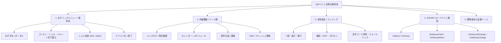

# 1. サイト型仕様マップ（Sitemap & Matrix）

### 1.1 標準ディレクトリ構成・アセット分離仕様マッピング

SSP 標準の配置構造との互換性を確保しつつ、Git リポジトリ汚染を防ぐアセット分離仕様です（詳細は [ghost-import-and-asset-separation-spec.md](../ghost/ghost-import-and-asset-separation-spec.md) 参照）。

|   ディレクトリ    | SSP 標準の役割                        | Nanai 実装仕様                                       | Git 管理ポリシー                               |
| :---------------: | :------------------------------------ | :--------------------------------------------------- | :--------------------------------------------- |
|  `../../../assets/ghost`  | ゴースト格納ディレクトリ (`ghost/`)   | 各ゴースト (`ghost/master/`, `shell/master/`) を配置 | `mock_nanai` のみ追跡。導入ゴーストは Git 除外 |
| `../../../assets/balloon` | バルーン格納ディレクトリ (`balloon/`) | 吹き出しスキン (`descript.txt`, 画像アセット) を配置 | `default` のみ追跡。追加バルーンは Git 除外    |
|    `userData/`    | ユーザー設定・セーブデータ (`data/`)  | 設定・セーブデータ・一時インポートファイル           | 完全除外（ローカル専用データ領域）             |

---
