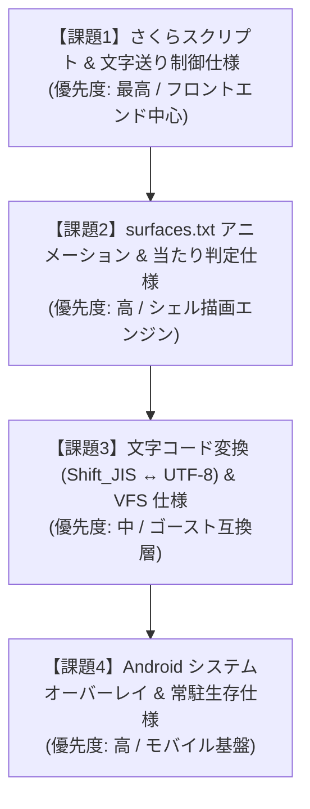

# 今後の開発における検討事項・仕様化ロードマップ

本ドキュメントは、**nanai-android-mascot** を本格的な伺か互換環境および Android 透過常駐マスコットとして完成させるために、**今後順番に検討・仕様化・実装を進めるべき技術的課題** を整理・一覧化したものです。

---

## 1. 検討課題一覧と推奨検討順序

---

## 2. 各検討課題の詳細

### 【課題1】さくらスクリプト（SakuraScript）タグパーサー & バルーン文字送り仕様
ゴースト対話の基本となる「台詞テキスト・演出タグ」を順次解釈し、バルーンに自然なテンポで表示するための仕様。

* **主な検討項目**:
  1. **初期サポート対象タグ**:
     - キャラ切り替え: `\0` (sakura), `\1` (kero)
     - サーフィス指定: `\s[ID]`, `\s0`
     - ウェイト制御: `\w[1-9]`, `\_w[ms]`
     - テキスト制御: `\n` (改行), `\c` (クリア), `\e` (終了)
     - インタラクティブ: `\q[ラベル,ID]` (選択肢ボタン)
  2. **文字送り（タイピング演出）エンジン**:
     - 一括表示ではなく、1文字ずつウェイト（標準約50ms）をかけた自然な文字送り。
     - クリックによる「スキップ（全文字即時表示）」仕様。
  3. **選択肢クリック時の挙動**:
     - `\q` ボタン押下時に、SHIORI へ `OnChoiceSelect` イベントを送り返すデータ連携。

---

### 【課題2】`surfaces.txt` アニメーション合成 & 当たり判定（Collision）仕様
`mock_nanai` をはじめとするゴーストの豊かな表情変化・まばたき・着せ替え・触れ合いを実現するための仕様。

* **主な検討項目**:
  1. **サーフィス合成モード**:
     - `base` (下地画像), `overlay` (上乗せ), `replace` (差し替え) の Canvas レイヤー描画。
  2. **アニメーションインターバル周期**:
     - `sometimes` (約2秒に1回), `rarely` (約4秒に1回), `always` (常時ループ) 等の乱数タイマー駆動。
  3. **当たり判定（Collision）とタッチマッピング**:
     - `surfaces.txt` 内の `collision,x1,y1,x2,y2,ID` 定義。
     - スマホのタップ/スワイプ座標と Collision 矩形を照合し、「頭を撫でた」「つついた」部位情報を付与した `OnMouseClick` / `OnMouseMove` を生成。

---

### 【課題3】文字コード変換（Shift_JIS ↔ UTF-8）& 仮想ファイルシステム（VFS）仕様
歴史的な伺かゴースト資産（Shift_JIS/CP932）を、モダンな UTF-8 環境（Rust / Web / Android）で文字化けなく透過的に読み込むための仕様。

* **主な検討項目**:
  1. **自動文字コード判別 & デコード**:
     - `descript.txt` の `charset,Shift_JIS` 判定。
     - JS 側の `TextDecoder("shift-jis")` または Rust 側の `encoding_rs` の使い分け。
  2. **パスの大文字・小文字差異の吸収**:
     - Windows と Android/Linux の大文字・小文字区別問題（Case Insensitivity）を吸収する仮想パスリゾルバー。

---

### 【課題4】Android システムオーバーレイ & 常駐生存（Background Service）仕様
Android 端末のホーム画面や他アプリ前面に「邪魔にならず常駐する」ための OS 連携仕様。

* **主な検討項目**:
  1. **オーバーレイ権限 (`SYSTEM_ALERT_WINDOW`) の取得**:
     - アプリ起動時の権限チェックおよび Android 設定画面への誘導 UX。
  2. **タッチスルー（透過部分のタッチ透過）**:
     - マスコット以外の透明領域を背後の別アプリへ透過（Touch-through / Passthrough）させるウィンドウフラグ設定。
  3. **フォアグラウンドサービス通知**:
     - OS の省電力キラーから保護するための常駐通知バー常駐仕様。

---

## 3. 進め方（アプローチ方針）

上記の優先順位（**課題1 → 課題2 → 課題3 → 課題4**）に従い、1つずつ個別に仕様化・設計を行い、承認後に実装へと進めます。
