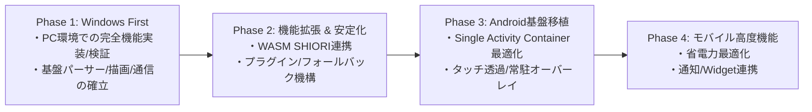
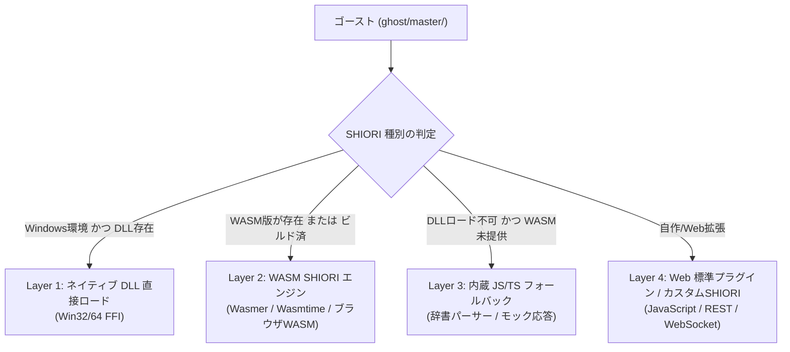

- **言及規格の元ドキュメント・権利者・ライセンス**:
  - **SSP 互換拡張 / ポップアップメニュー規格**: [SSP BUG-SLIK-PRACTICE / 仕様リファレンス](http://ssp.shillest.net/) - © PONapook 氏 / SSP開発チーム (SSP リファレンス仕様)
  - **PLUGIN 規格**: [ukadoc: PLUGIN](https://ukatech.shillest.net/ukadoc-spec/spec/plugin/) - © MATERIA開発チーム / SSP開発チーム / ukadoc プロジェクト (ukadoc 仕様 / パブリックリファレンス)
  - **伺か (Ukagaka) / ゴースト / シェル**: [伺か / 偽春菜 / あれ以外の何か with「何か」](https://ukatech.shillest.net/ukadoc-spec/) - © MATERIA開発チーム / うさださくら 氏 / コミュニティ有志 (コミュニティ規格 / オープンドキュメント)
  - **surfaces.txt / アニメーション合成 / 当たり判定**: [ukadoc: surfaces.txt](https://ukatech.shillest.net/ukadoc-spec/spec/surfaces/) - © MATERIA開発チーム / SSP開発チーム / ukadoc プロジェクト (ukadoc 仕様 / パブリックリファレンス)
  - **さくらスクリプト (Sakura Script)**: [ukadoc: さくらスクリプト](https://ukatech.shillest.net/ukadoc-spec/spec/sakura-script/) - © MATERIA開発チーム / SSP開発チーム / ukadoc プロジェクト (ukadoc 仕様 / パブリックリファレンス)
  - **SHIORI / 各SHIORIサブシステム (里々, YAYA, 華和梨 等)**: [ukadoc: SHIORI/3.0](https://ukatech.shillest.net/ukadoc-spec/spec/shiori3/) - © MATERIA開発チーム / 里々開発チーム / YAYA開発チーム / 華和梨開発チーム / ukadoc プロジェクト (ukadoc 仕様 / 各コミュニティライセンス)
  - **バルーン仕様 (Balloon)**: [ukadoc: surfaces.txt / balloon](https://ukatech.shillest.net/ukadoc-spec/) - © MATERIA開発チーム / SSP開発チーム / ukadoc プロジェクト (ukadoc 仕様 / パブリックリファレンス)

> **AI 関与について**: このドキュメントは GitHub Copilot / Antigravity の支援により作成・更新されました。オーナーユーザーは主に方針決定と技術検討を担当し、コード実装やドキュメント整理は AI が支援しています。

# 開発手法・技術アプローチ (development-approach)

## 1. 概要

本ドキュメントは、**nanai-android-mascot** におけるシステム設計指針、技術スタックの選定理由、クロスプラットフォーム・互換レイヤーの実現アプローチ、および開発プロセスを体系的にまとめた技術文書です。

---

## 2. 開発基本方針

### 2.1 開発戦略: Windows First から段階的 Android 適応へ

当初は Android 向けに特化した開発を進めていましたが、プラットフォーム制約と実装の混在による複雑化を回避するため、開発方針を以下のように再定義しました（詳細は [doc_history.md](doc_history.md) 参照）。



1. **Windows First (デスクトップ先行検証)**:
   - 複数ウィンドウや透過描画、SHIORI 連携のロジックをデスクトップ環境で確実に検証
   - デバッグ容易性の高い環境でコアエンジン（サーフィス描画、スクリプト解析、VFS）の品質を担保
2. **Android Adaptation (検証済みコアの移植)**:
   - 実証済みの Web/Rust コア資産を Android Single Activity Container 環境に適応
   - システムオーバーレイ (`SYSTEM_ALERT_WINDOW`) やタッチ透過等のモバイル固有仕様を段階的に接続

### 2.2 コア設計原則

1. **高い互換性 (SSP 互換)**: 既存の伺か（UKAGAKA）規格（descript.txt, surfaces.txt, さくらスクリプト, SHIORI 3.0）を最大限尊重
2. **高い拡張性とアクセシビリティ**: 拡張機能や UI 開発に Web 標準技術を採用し、ユーザー・作者の参入障壁を低減
3. **安全と堅牢性**: Rust のメモリ安全性とサンドボックス設計による安全な実行環境の提供

---

## 3. 技術スタックの選定理由

### 3.1 アプリケーションフレームワーク: Tauri v2 + Rust

| 比較対象技術 | メリット | 課題・懸念点 | nanai での採否と理由 |
| :--- | :--- | :--- | :--- |
| **Tauri (v2) + Rust** | ・軽量・省メモリ<br>・クロスプラットフォーム (Win/Android/Linux)<br>・システム API への低レイヤーアクセス<br>・UI層は Web 標準技術を活用可能 | ・ネイティブブリッジの初期学習コスト | **✅ 採用**<br>Windows/Android 両対応とデスクトップマスコットに不可欠な軽量性・透過制御を両立。 |
| **Electron** | ・成熟したエコシステム<br>・豊富な実績 | ・高メモリ消費・フットプリント大<br>・**公式で Android 非対応** | ❌ 不採用（Android 常駐要件を満たせない） |
| **Flutter** | ・ネイティブ描画性能<br>・モバイルに強み | ・Web 標準資産の流用が難しい<br>・SHIORI / C++ / Web 拡張との統合難度 | ❌ 不採用（拡張性と互換エンジン連携の面で不利） |
| **React Native** | ・モバイル開発の成熟度 | ・デスクトップ環境での透過やオーバーレイ制御の柔軟性に不足 | ❌ 不採用 |

### 3.2 フロントエンド: Vanilla Web (HTML5 / Modern JavaScript / CSS3)

- **Vanilla 方式の採用理由**:
  - **最小限の依存とオーバーヘッド**: フレームワーク固有のランタイム負荷を排除し、マスコット描画の応答性を最大化
  - **デバッグ容易性**: WebView 開発者ツール（DevTools）で直接インスペクト・リアルタイム調整可能
  - **作者・ユーザーによる拡張性**: 特別なトランスパイル環境不要で、CSS や JavaScript によるスキン・プラグイン拡張が可能
- **フレームワーク（React/Vue/Svelte 等）非採用の背景**:
  - 当初は Rust 製フロントエンド（Dioxus）等の検討も行われましたが、Single Activity Container 内での柔軟な UI 制御とコミュニティ拡張性を重視し、純粋な Web 標準技術に集約。

```text
Frontend Architecture:
├── HTML: ウィンドウ/コンテナ構造・バルーンDOM・メニューモーダル
├── CSS: 透過スタイリング・吹き出し装飾・UIアニメーション
└── JavaScript:
    ├── surface.js       (Canvas 2D サーフィス合成・アニメーション制御)
    ├── sakura-script.js (さくらスクリプト解析・キューイング・文字送り)
    ├── ghost.js         (ゴースト状態管理・ランダムトーク・タイマー)
    └── bridge.js        (Tauri Invoke 連携レイヤー)
```

---

## 4. SHIORI 連携 & クロスプラットフォーム戦略

伺かゴーストの中核である「SHIORI」は、伝統的に Windows ネイティブ 32bit DLL（`satori.dll`, `yaya.dll` など）として配布されています。Android や 64bit/ARM 環境でこれを稼働させるため、**多層フォールバック機構** を採用しています。

詳細な仕様は [plugin-and-shiori-fallback-spec.md](../spec/plugin-and-shiori-fallback-spec.md) および [wasm-and-plugin-extensibility.md](../spec/wasm-and-plugin-extensibility.md) を参照してください。



### 4.1 各プラットフォームでの実行階層

1. **Windows ネイティブ (デスクトップ)**:
   - 既存の DLL を直接ロードして動作互換性を検証
2. **Android / Web / ARM 環境**:
   - C/C++ 製 SHIORI（里々、YAYA 等）を WebAssembly（WASM）化して実行
   - Git サブモジュール経由で上流リポジトリ（`satoriya-shiori`, `yaya-shiori`）をソースレベルで保持・ビルド連携
3. **スタンドアロン・フォールバック**:
   - ネイティブ実行が困難な環境でも、辞書テキスト（`dic_*.txt` 等）を直接解釈する簡易パーサーまたはモック SHIORI で基本対話を継続

---

## 5. ゴーストデータ管理とアセット構造

公式サンプルキャラクター（`mock_nanai`）および外部ゴーストのアセットは、標準的な伺かディレクトリ構造を準拠して管理します（詳細は [standard-ghost-spec.md](../spec/standard-ghost-spec.md) 参照）。

```text
assets/ghost/
└── mock_nanai/           # テンプレートベース公式モックゴースト
    ├── install.txt
    ├── ghost/
    │   └── master/
    │       ├── descript.txt      # ゴースト定義 (name, shiori, craftman 等)
    │       ├── satori.dll        # Windows Win32用 (フォールバック検証用)
    │       ├── dic_*.txt         # 会話辞書 (base, menu, resource, talk 等)
    │       └── satori_*.txt      # 設定・セーブデータ
    └── shell/
        └── master/
            ├── descript.txt      # シェル定義
            ├── readme.txt        # ライセンス表記
            ├── surfaces.txt      # 当たり判定・アニメーション定義
            ├── surfacetable.txt
            ├── surface0.png      # 基本待機サーフィス
            ├── surface10.png     # 表情差分サーフィス
            └── surface*.svg
```

### 著作権・ライセンス管理

- **自作コンテンツ方針**: 標準同梱アセット・画像はすべて自作または商用/二次利用許諾のあるオープンライセンス素材を使用
- **ライセンスの明記**: `readme.txt` に作者、出典、二次利用規約を記載し、同梱配布時の透明性を確保

---

## 6. 開発環境 & 品質管理

### 6.1 開発環境要件

- **言語・ランタイム**:
  - Rust (最新 stable)
  - Node.js (LTS 版)
  - C++ Compiler (CMake / Clang / MSVC: SHIORI ビルド用)
  - Android SDK / NDK (Android 版ビルド用)
- **エディタ・開発支援**:
  - VS Code / Antigravity IDE
  - rust-analyzer / Tauri Extension

### 6.2 品質保証・テスト体制

1. **単体テスト (Unit Test)**:
   - Rust: VFS パス解決、文字コード自動判別 (`encoding_rs`)、イベントディスパッチャの検証
   - JS: さくらスクリプトトークナイザ、バルーンタイピングロジックの単体検証
2. **統合テスト (Integration Test)**:
   - Tauri IPC 経由でのイベント送受信テスト
   - `mock_nanai` を用いた SHIORI リクエスト・レスポンス通信テスト
3. **UI / E2E テスト**:
   - 各種ブラウザおよび Android エミュレータ／実機での透過描画・当たり判定追従確認
4. **コード品質維持**:
   - `cargo fmt` (フォーマット統一)
   - `cargo clippy` (静的解析・リントチェック)
   - `cargo audit` (依存ライブラリのセキュリティ監査)

---

## 7. 開発体制 & AI コラボレーション

### 7.1 AI 駆動開発 (AI-Driven Development)

本プロジェクトは、AI アシスタント（GitHub Copilot / Antigravity）との協調を前提とした開発体制を採用しています（詳細は [AI_driven.md](AI_driven.md) 参照）。

- **オーナーユーザー**:
  - プロジェクトのビジョン策定、要件定義、アーキテクチャの妥当性評価、ライセンス確認
- **AI アシスタント**:
  - 技術調査、詳細設計案の作成、コード実装支援、テストコード生成、ドキュメントの維持・整理
- **継続的なドキュメンテーション**:
  - 実装方針の転換や設計変更が発生した際は、速やかにドキュメントへフィードバックし、コードベースとの乖離を防ぎます。
