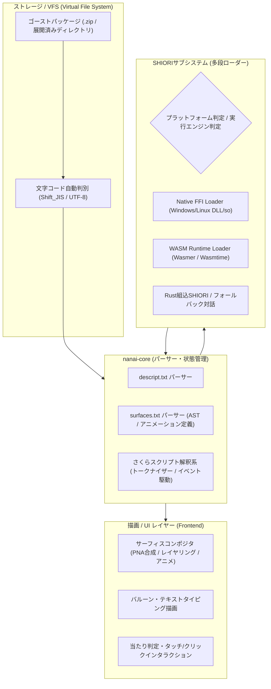

# 互換実装計画仕様書 (compatibility-implementation-plan)

- **言及規格の元ドキュメント・権利者・ライセンス**:
  - **SHIORI 仕様 / 各種サブシステム**:
    - **SHIORI/3.0 規格**: [ukadoc-spec: shiori3](https://ukatech.shillest.net/ukadoc-spec/spec/shiori3/) - © UKADOC project (CC BY 4.0)
    - **里々 (SATORI)**: [ukatech/satori-docs](https://ukatech.shillest.net/satori-docs/) - © Kusigahama Yagi / SEIBIHAN (BSD 2-Clause License)
    - **YAYA**: [YAYA-shiori/yaya-docs](https://yaya-shiori.github.io/yaya-docs/) - (The Unlicense / Public Domain)
    - **華和梨 (KAWARI)**: [ukatech/kawari-docs](https://ukatech.shillest.net/kawari-docs/) - © KAWARI Development Team (BSD 2-Clause License)
  - **SSP 拡張仕様 / メニュー規格**: [ukatech/ukadoc-ssp](https://github.com/ukatech/ukadoc-ssp) / [SSP BUG-SLIK-PRACTICE](http://ssp.shillest.net/) - © UKADOC project (CC BY 4.0) / © PONapook 氏
  - **さくらスクリプト (Sakura Script)**: [ukadoc-spec: さくらスクリプト](https://ukatech.shillest.net/ukadoc-spec/spec/sakura-script/) - © UKADOC project / Ukagaka Tech Team (CC BY 4.0)
  - **バルーン仕様 (Balloon)**: [ukadoc-spec: balloon](https://ukatech.shillest.net/ukadoc-spec/) - © UKADOC project / Ukagaka Tech Team (CC BY 4.0)
  - **伺か標準仕様 / ゴースト / シェル**: [ukatech/ukadoc-spec (UKADOC project)](https://ukatech.shillest.net/ukadoc-spec/) - © UKADOC project / Ukagaka Tech Team (CC BY 4.0)
  - **surfaces.txt / アニメーション合成 / 当たり判定**: [ukadoc-spec: surfaces.txt](https://ukatech.shillest.net/ukadoc-spec/spec/surfaces/) - © UKADOC project / Ukagaka Tech Team (CC BY 4.0)

本ドキュメントは、**nanai-android-mascot** における「伺か（UKAGAKA）/ SSP規格」に対する互換機能の実装ロードマップ、技術アーキテクチャ、および段階的検証計画を定義します。

---

## 1. 互換実装の目的とスコープ

既存の伺かゴースト資産（`descript.txt`、`surfaces.txt`、シェル画像、さくらスクリプト、SHIORIサブシステム）を、モダンなクロスプラットフォーム環境（Windows / Android / WASM）で破綻なく再現・動作させることを目的とします。

### 1.1 対象仕様と互換ターゲット

| 対象レイヤー | 規格・仕様 | 互換目標・対応水準 |
| :--- | :--- | :--- |
| **メタデータ** | `descript.txt` (Ghost / Shell) | 基本プロパティ完全準拠、文字コード自動判別（Shift_JIS / UTF-8） |
| **シェル定義** | `surfaces.txt`, `surfaces2.txt` | SERIKO / surfaces.txt仕様（基本サーフィス、アニメーション定義、当たり判定） |
| **画像・描画** | PNA透過PNG / 単一PNG透過 / BMP | 左上1ピクセル透明化・PNAマスク合成、WASM/Canvasおよびネイティブ最適化 |
| **スクリプト** | さくらスクリプト (SakuraScript) | 基本タグ（`\0`, `\1`, `\s[]`, `\i[]`, `\w[]`, `\e`, `\n`, `\q[]` 等）およびバルーン表示 |
| **SHIORI通信** | SHIORI/3.0 / SHIORI/2.x (互換) | `GET Version`, `NOTIFY request`, `GET Sentence` のプロトコル完全準拠 |
| **SHIORIエンジン** | Native DLL / WASM / Rust組込 / フォールバック | 各プラットフォームに応じた多段ロードとエミュレーション |

---

## 2. アーキテクチャと互換レイヤー構成

---

## 3. 段階別実装計画 (フェーズ展開)

### Phase 1: コア規格パーサーと基礎描画（基盤確立）
- **文字コード判別・正規化**:
  - Shift_JIS（CP932）およびUTF-8の自動検出（`encoding_rs`活用）。
- **`descript.txt` / `surfaces.txt` パーサー**:
  - 表記揺れ（大文字小文字無視、末尾カンマ、コメント行）を許容する柔軟なパーサー構築。
- **PNA合成・サーフィス描画**:
  - ベース画像＋PNAアルファチャンネル合成。
  - 基本サーフィスID（`\s[0]`, `\s[10]`等）の切り替え。

### Phase 2: さくらスクリプトとバルーン・対話制御
- **さくらスクリプト・トークナイザー**:
  - スコープ切り替え（`\0` 本体、`\1` 相方）。
  - サーフィス変更（`\s[N]`）、ウェイト（`\w[N]`）、アニメ発火（`\i[N]`）、改行・消去（`\n`, `\c`）。
  - 選択肢タグ（`\q[ラベル,ID]`）によるユーザー入力イベント生成。
- **バルーンUI**:
  - 文字送りアニメーションとスクロール制御。

### Phase 3: SHIORI/3.0 多段ロードとプラットフォーム抽象化
- **プロトコル抽象レイヤー**:
  - `ShioriEngine` トレイト定義（`load`, `request`, `unload`）。
- **ターゲット別実装方針**:
  - **Windows (デスクトップ)**:
    - ネイティブDLL（`shiori.dll`, 里々, YAYA等）の直接呼び出し（FFI）。
  - **Android / WASM**:
    - WASMビルドされたSHIORIコア（里々WASM, YAYA-WASM）の実行、またはRust内包エンジン。
  - **フォールバック機構**:
    - ネイティブDLL非対応環境での通知・簡易応答エミュレーション。

### Phase 4: 高度な互換機能とモバイル最適化
- **SERIKO高度アニメーション**:
  - `bind`, `add`, `overlay`, `replace` 等の合成モード完全対応。
  - ランダム発火、同期間隔（`interval,runonce`, `sometimes` 等）。
- **当たり判定 (Collision)**:
  - 領域定義（`collision,x,y,w,h,Name`）とマウスホバー/タッチイベント（`OnMouseHover`, `OnMouseDoubleClick`）の発火。
- **Android固有調整**:
  - タッチイベントからさくらスクリプトイベントへのマッピング。

---

## 4. 検証とテスト戦略

1. **規格テストスイートの構築**:
   - `surfaces.txt` のパーステスト（代表的なフリーゴーストの定義ファイルを用いた回帰テスト）。
   - さくらスクリプトのトークン分割・AST生成の単体テスト。
2. **描画コンポジット検証**:
   - PNA合成処理後のピクセル比較（参照実装出力との一致確認）。
3. **SHIORIモックテスト**:
   - `SHIORI/3.0` 仕様リクエスト（`OnBoot`, `OnFirstBoot`, `OnMouseDoubleClick` 等）に対するレスポンスパース検証。
