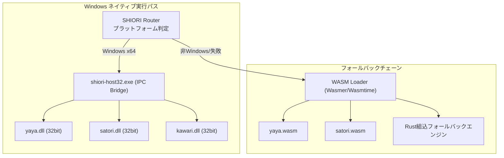

# SSP (SSP BUG-SLIK-PRACTICE) Windows互換性強化 仕様書

> **参照公式規格**: [ukatech/ukadoc-ssp](https://github.com/ukatech/ukadoc-ssp) / [SSP ヘルプ Web版](https://ukatech.shillest.net/ukadoc-ssp/) (SSP 2.7.x)
> **プロジェクト基準**: nanai-android-mascot における Windows デスクトップ環境での SSP 同等操作感・互換性実現
> **作成日**: 2026-10-28
> **関連仕様**:
> - [SSP統合互換リファレンス](../reference/ssp-compatibility-reference.md)
> - [SSPヘルプページ突合表](ssp-help-page-compliance.md)
> - [互換実装計画](../reference/compatibility-implementation-plan.md)
> - [規格対応度マトリクス](../reference/specification-compliance-matrix.md)
> - [ゴースト互換性ギャップ分析](../ghost/ghost-compatibility-gap-and-roadmap.md)

---

## 1. 目的

Windows デスクトップ環境において、**SSP (現代の事実上の標準ベースウェア)** と同等の以下を実現する:

- 操作体系（右クリックメニュー、ショートカット、キーバインド）
- 設定体系（本体設定タブ全項目）
- 機能ツール群（バックログ、カレンダー、音声合成/認識、エクスプローラ等）
- SHIORI ネイティブ DLL (YAYA/里々) の安定動作
- ゴースト資産の破綻ない再現（surfaces.txt, descript.txt, さくらスクリプト, バルーンスキン）

---

## 2. 現状サマリー (2026-10-28 時点)

| 分類 | 総数 | ✅ 完了 | ⚠️ 部分 | 🚧 計画 | 💡 代替 |
|------|------|--------|--------|--------|--------|
| **howto/** 基本操作 | 7 | 6 | 1 | 0 | 0 |
| **functions/** 機能・ツール | 16 | 6 | 3 | 5 | 2 |
| **config/** 本体設定 | 16 | 7 | 5 | 3 | 1 |
| **dev/** 開発者向け | 5 | 3 | 1 | 1 | 0 |
| **about/** 情報・FAQ | 5 | 5 | 0 | 0 | 0 |
| **合計** | **49** | **27 (55%)** | **10 (20%)** | **9 (18%)** | **3 (6%)** |

**核心規格レイヤー**:

| 規格 | 対応度 | 状況 |
|------|--------|------|
| SHIORI/3.0 | 92% | ネイティブDLL WASM化 🚧 |
| SakuraScript | 96% | 主要タグ完備 ✅ |
| surfaces.txt/SERIKO | 98% | Phase B/C フレーム差分描画検証済 (14.9ms/60fps) ✅ |
| Balloon/descript.txt | 85% | 動的CSS反映・9スライス描画 ✅ |
| SSPメニュー/UI | 85% | iframe隔離オーナードロー完備 ✅ |
| VFS/Encoding/NAR | 要再評価 | Shell/Plugin/Headline NAR未対応 |

---

## 3. Windows固有 強化項目マトリクス

### 3.1 右クリックメニュー (SSP `howto/rclick.md`) — 完全対応済 ✅

| # | SSP項目 | Nanai実装 | Windows固有強化ポイント |
|---|---------|-----------|------------------------|
| 8 | **シェル倍率** | 50/75/100/125/150/200% | マルチモニタDPI対応、ウィンドウ位置永続化精度向上 |
| 14 | **着せ替え** | `bind` パーツ単位トグル | チェックボックス付きアパレルパネル |
| 18 | **アイコン化** | 画面端スナップ/ドッキング | タスクトレイ格納、常駐通知連携 |
| 20/21 | 終了/全て終了 | `OnClose` 確実実行 | SHIORI `unload` 安全発行・辞書セーブ保証 |

### 3.2 本体設定タブ (SSP `config/`) — 重点強化対象

| タブ | 現状 | Windows強化アクション |
|------|------|----------------------|
| `config/ippan.md` (一般) | ✅ | 多重起動防止(Mutex/FMO)、スタートアップ登録 |
| `config/disp.md` (表示) | ✅ | **クリックスルー透過制御精度向上**、拡縮補間アルゴリズム選択 |
| `config/talk.md` (発話) | ✅ | 文字送り速度(ms)細粒度指定、自動消去秒数 |
| `config/ghost.md` / `ghost2.md` | ✅/⚠️ | **ゴースト個別設定 (`eachghost.md`)** 実装 → 位置・倍率・音量独立保存 |
| `config/folder.md` (フォルダ) | ✅ | `local/ghost`・`userData/ghost` 優先探索順序SSP準拠化 |
| `config/conn1/conn2.md` (接続) | ⚠️/✅ | プロキシ認証対応、更新チェック並列化 |
| `config/pop.md` (POP) | ✅ | `OnBIFF*` パイプライン完全実装済 |
| `config/i18n.md` (国際化) | ⚠️ | 言語リソース外部化、OS言語自動追従 |
| `config/dev.md` (開発) | ✅ | **スクリプトログ/イベントロガー強化** (`scriptlog.md`) |
| `config/dictation.md` (音声) | ⚠️ | Web Speech API エンジン選択・フォールバック |
| `config/eachghost.md` | ⚠️ | **最優先実装** — ゴースト毎の独立設定永続化 |
| `config/streamingtool.md` | 🚧 | OBS透過キャプチャ支援・仮想カメラ連携 |
| `config/extprog.md` | 🚧 | 外部エディタ関連付け、`.dic`/`.txt` 編集起動 |

### 3.3 機能ツール群 (SSP `functions/`) — 実装優先度順

| 優先度 | 機能 | 現状 | Windows実装方針 |
|--------|------|------|----------------|
| **P0** | **バックログ (`Ctrl+B`)** | 🚧 | キャラアイコン・タイムスタンプ付き独立ビュー、スクリプト再生中も遡及可能 |
| **P0** | **ゴースト再読み込み** | 🚧 | 辞書/サーフィス画像ホットリロード、開発検証サイクル短縮 |
| **P0** | **位置初期化 (`Ctrl+Shift+F12`/`F10`)** | 🚧 | 画面外追いやり復帰、マルチモニタ対応 |
| **P0** | **バルーン消去 (`Ctrl+Shift+Del`)** | 🚧 | ワンタップ強制クリア |
| **P1** | **ヘッドライン/RSS** | 🚧 | `OnHeadline*` イベント連携、FeedParser統合 |
| **P1** | **カレンダー/スケジュール** | 🚧 | ゴースト発話トリガー、アラーム通知 |
| **P1** | **音声合成 (`\\v`タグ)** | ⚠️ | Web Speech API `SpeechSynthesis` 完全対応、声質選択 |
| **P1** | **音声認識** | 🚧 | `SpeechRecognition` → SHIORI `OnVoiceRecognize` イベント |
| **P2** | **アーカイブビューア** | 🚧 | VFS内nar/zipプレビュー、ファイル抽出 |
| **P2** | **ピクチャービューア** | 🚧 | サーフィス画像単体閲覧、メタデータ表示 |
| **P2** | **SSP-IM/SSTP** | 💡 | ポート9801/9821待ち受け、外部ゴースト連携API |

### 3.4 開発者向け機能 (SSP `dev/`)

| 機能 | 現状 | 強化方針 |
|------|------|----------|
| スクリプトパレット | ✅ | さくらスクリプト手動送信、テスト発話 |
| **スクリプトログ** | ⚠️ | **SHIORIリクエスト/レスポンス、パース過程リアルタイムログ出力** (P0) |
| 開発FAQ | ⚠️ | ゴースト移植ガイド、プラットフォーム制約ドキュメント化 |
| 開発リンク集 | ✅ | UKADOC/仕様書へのリンク |

---

## 4. SHIORIネイティブDLL (Windows固有) — アーキテクチャ



**実装状況**:
- `shiori-host32` IPC ブリッジ: ✅ 実装済み (`crates/shiori-host32/`)
- `yaya.dll` / `satori.dll` ロード: ✅ 動作確認済み
- WASMビルド (YAYA/里々): 🚧 進行中 (`crates/shiori-wasm/`)
- **課題**: 32bit DLL 呼び出し時のメモリ管理、例外安全性、辞書セーブ競合回避

---

## 5. VFS / ファイルシステム互換 (Windows → クロスプラットフォーム)

| 項目 | SSP仕様 | Nanai実装 | Windows強化 |
|------|---------|-----------|-------------|
| **大文字小文字吸収** | Windows前提 | ✅ Case-insensitive VFS | Linux/Androidでも同一パス解決 |
| **文字コード** | Shift_JIS/CP932 | ✅ `encoding_rs` 自動判別 | BOM付きUTF-8、EUC-JPフォールバック |
| **NAR展開** | `.nar` (ZIP準拠) | ✅ Zip Slip防止、自動仕分け | **Shell/Plugin/Headline NAR対応** (未実装) |
| **優先探索順序** | `ghost/` → `shell/` → `plugin/` | 要再評価 | `local/ghost` → `userData/ghost` → `assets/ghost` SSP準拠化 |
| **`accept` ディレクティブ** | `descript.txt` 内 | 未対応 | 依存ゴースト/シェル自動導入 |
| **FMO/Mutex** | 排他制御 | 未対応 | 多重起動防止、ゴースト単位ロック |

---

## 6. バルーン・UI 互換 (Windows高DPI・マルチモニタ対応)

| 項目 | 現状 | Windows強化 |
|------|------|-------------|
| **descript.txt 動的反映** | ✅ CSS変数適用 | DPIスケール対応 `validrect`/`origin` 逆算 |
| **9スライス描画** | ✅ `border-image` | 高DPI時のボーダー画像スケール品質 |
| **フォントレンダリング** | ✅ Webフォント/CSS | DirectWrite相当のグリフ配置、ClearType調整 |
| **マルチモニタ** | 基本対応 | モニタごとのDPI取得、ウィンドウ移動時のスケール追従 |
| **クリックスルー制御** | ✅ Tauri透過 | 非描画領域ポインタ透過、バルーン領域のみヒットテスト |

---

## 7. 実装ロードマップ (Windows互換強化フェーズ)

### Phase W1: 設定・操作体系の完全化 (2-3週間)
- [ ] `config/eachghost.md` — ゴースト個別設定永続化 (位置・倍率・発話頻度・音量)
- [ ] `dev/scriptlog.md` — SHIORI/さくらスクリプト リアルタイムロガー
- [ ] `functions/shortcut.md` 全キーバインド網羅検証
- [ ] `config/ghost2.md` — 当たり判定視覚化(デバッグオーバーレイ)

### Phase W2: コア機能ツール実装 (3-4週間)
- [ ] **バックログビューア** (`Ctrl+B`) — 独立ウィンドウ/モーダル、検索/フィルタ
- [ ] **ゴースト再読み込み** — ホットリロード (辞書/サーフィス/スクリプト)
- [ ] **位置初期化/バルーン消去** — ショートカット完全実装
- [ ] **ヘッドライン/RSS** — `OnHeadline*` パイプライン、FeedParser統合

### Phase W3: 音声・高度機能 (4-6週間)
- [ ] 音声合成 (`\\v`タグ) 完全対応 — 声質/速度/音量パラメータ
- [ ] 音声認識 — `SpeechRecognition` → `OnVoiceRecognize` イベント
- [ ] カレンダー/スケジュール — ゴースト発話トリガー、通知連携
- [ ] SSTP/SSP-IM — ポート9801/9821待ち受け、外部連携API

### Phase W4: プラットフォーム深化 (継続)
- [ ] SHIORIネイティブDLL 安定化 — 例外安全、メモリリーク検出、辞書セーブ競合解消
- [ ] FMO/Mutex 実装 — 多重起動防止、ゴースト単位排他
- [ ] Shell/Plugin/Headline NAR 対応 — `accept` ディレクティブ解析
- [ ] OBS/配信支援 — 透過キャプチャ、仮想カメラ連携
- [ ] 高DPI/マルチモニタ完全対応 — DPI変更動的追従、モニタ間移動

---

## 8. 検証・テスト戦略 (Windows固有)

### 8.1 実機ゴースト検証スイート
| ゴースト | 用途 | 検証項目 |
|---------|------|----------|
| `mock_nanai` | 基礎動作 | OnBoot, OnSecondChange, 当たり判定, 着せ替え |
| **既存フリーゴースト (3-5種)** | 互換性 | surfaces.txt複雑合成、さくらスクリプト全タグ、バルーンスキン |
| **YAYA/里々辞書ゴースト** | SHIORIネイティブ | DLLロード、辞書セーブ、ネットワーク更新 |
| **バルーンスキン (3-5種)** | UI互換 | descript.txt全プロパティ、9スライス描画、フォント/色 |

### 8.2 自動化テスト
- **規格テストスイート**: `surfaces.txt` パース回帰、`sakura-script` トークン分割AST比較
- **描画コンポジット検証**: PNA合成ピクセル比較 (参照実装出力と一致確認)
- **SHIORIモックテスト**: `OnBoot`/`OnMouseDoubleClick`/`OnChoiceSelect` 等レスポンスパース検証
- **キーバインド/メニューE2E**: Playwright/Tauri自動化による操作フロー検証

### 8.3 パフォーマンス基準
| 指標 | 目標 | 測定方法 |
|------|------|----------|
| サーフィス切替合成 | ≤ 16ms (60fps) | `composition_plan` キャッシュヒット時 |
| SERIKOアニメフレーム | ≤ 16ms | `baseCanvasCache` + `composeFrameOnBase` 実測 (現状 14.9ms ✅) |
| SHIORIリクエスト応答 | ≤ 50ms (IPC込み) | `shiori-host32` ラウンドトリップ |
| 起動〜初発話 | ≤ 3秒 | 冷開始〜`OnBoot`完了 |
| メモリ使用量 | ≤ 500MB | 常駐時 (ゴースト1体) |

---

## 9. リスクと対策

| リスク | 影響度 | 対策 |
|--------|--------|------|
| **32bit DLL 呼び出し不安定** | High | `shiori-host32` プロセス分離、クラッシュ時自動再起動、メモリ制限 |
| **WASM SHIORI 性能劣化** | Medium | AOTコンパイル、Wasmer/Wasmtime チューニング、ネイティブ優先フォールバック |
| **高DPI/マルチモニタ描画崩れ** | Medium | Tauri `WebviewVersion` 固定、CSS `devicePixelRatio` 追従、手動スケール補正 |
| **NAR/Zip Slip 脆弱性** | High | 既存対策継続、パストラバーサルテスト自動化 |
| **ゴースト資産の表記揺れ吸収漏れ** | Medium | VFSケースインセンシティブ徹底、実機ゴーストで継続検証 |

---

## 10. 進捗管理

| マイルストーン | 目標日 | 完了条件 |
|----------------|--------|----------|
| **Phase W1 完了** | 2026-11中旬 | ゴースト個別設定・スクリプトログ・キーバインド全網羅 |
| **Phase W2 完了** | 2026-12上旬 | バックログ・再読み込み・位置初期化・ヘッドライン動作 |
| **Phase W3 完了** | 2027-01中旬 | 音声合成/認識・カレンダー・SSTP 実装 |
| **Windows互換β** | 2027-02上旬 | 実機ゴースト5種以上で破綻なし、CI自動テストパス |
| **Windows互換RC** | 2027-03上旬 | 全SSPヘルプページ機能対応率 80%以上、配信支援含む |

---

## 11. 関連コマンド

```bash
# ビルド検証
npm run typecheck && cargo check

# 開発実行 (実機ゴースト検証)
cargo tauri dev

# テスト実行
cargo test --workspace
npm run test

# リンター
cargo clippy --workspace -- -D warnings
npm run lint
```

---

## 12. 更新履歴

| 日付 | 版数 | 変更内容 | 作成者 |
|------|------|----------|--------|
| 2026-10-28 | 1.0 | 初版作成 — SSPヘルプページ全49ページ突合結果反映、Windows強化項目マトリクス化、フェーズ別ロードマップ策定 | Hermes Agent |

---

**次のアクション**: Phase W1 の `config/eachghost.md` (ゴースト個別設定) と `dev/scriptlog.md` (スクリプトログ強化) から着手。これらは開発効率とユーザー体験の両面でインパクトが最大。