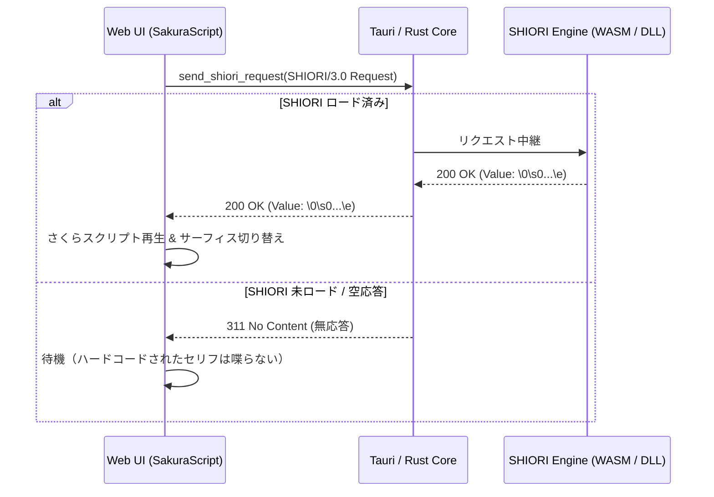
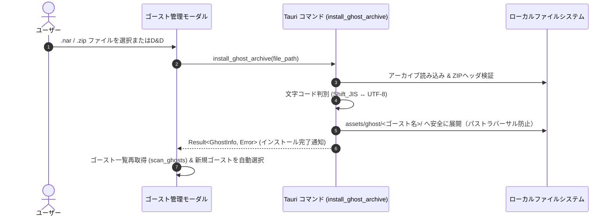

# ゴースト取り込み機能・アセット分離・ハードコード廃止仕様書

- **言及規格の元ドキュメント・権利者・ライセンス**:
  - **SSP 互換拡張 / ポップアップメニュー規格**: [SSP BUG-SLIK-PRACTICE / 仕様リファレンス](http://ssp.shillest.net/) - © PONapook 氏 / SSP開発チーム (SSP リファレンス仕様)
  - **伺か (Ukagaka) / ゴースト / シェル**: [伺か / 偽春菜 / あれ以外の何か with「何か」](https://ukatech.shillest.net/ukadoc-spec/) - © MATERIA開発チーム / うさださくら 氏 / コミュニティ有志 (コミュニティ規格 / オープンドキュメント)
  - **surfaces.txt / アニメーション合成 / 当たり判定**: [ukadoc: surfaces.txt](https://ukatech.shillest.net/ukadoc-spec/spec/surfaces/) - © MATERIA開発チーム / SSP開発チーム / ukadoc プロジェクト (ukadoc 仕様 / パブリックリファレンス)
  - **さくらスクリプト (Sakura Script)**: [ukadoc: さくらスクリプト](https://ukatech.shillest.net/ukadoc-spec/spec/sakura-script/) - © MATERIA開発チーム / SSP開発チーム / ukadoc プロジェクト (ukadoc 仕様 / パブリックリファレンス)
  - **SHIORI / 各SHIORIサブシステム (里々, YAYA, 華和梨 等)**: [ukadoc: SHIORI/3.0](https://ukatech.shillest.net/ukadoc-spec/spec/shiori3/) - © MATERIA開発チーム / 里々開発チーム / YAYA開発チーム / 華和梨開発チーム / ukadoc プロジェクト (ukadoc 仕様 / 各コミュニティライセンス)
  - **バルーン仕様 (Balloon)**: [ukadoc: surfaces.txt / balloon](https://ukatech.shillest.net/ukadoc-spec/) - © MATERIA開発チーム / SSP開発チーム / ukadoc プロジェクト (ukadoc 仕様 / パブリックリファレンス)

> **ステータス**: 確定 (Approved)  
> **対象バージョン**: Nanai Android Mascot v0.2.0+  
> **関連仕様書**:
>
> - [standard-ghost-spec.md](standard-ghost-spec.md)
> - [shiori-integration.md](shiori-integration.md)
> - [encoding-and-vfs-spec.md](encoding-and-vfs-spec.md)

---

## 1. 背景と課題

Nanai Android Mascot のプロトタイプ実装フェーズにおいて、動作確認の迅速化を目的として以下の設計負債（一時的実装）が発生していました：

1. **ローカルゴーストが Git 管理下に混入するリスク**:
   - `assets/ghost/` 配下に外部ゴーストや検証用実データを置くと、Git 追跡対象となりリポジトリ肥大化やライセンス侵害の原因となる。
2. **埋め込みコード（ハードコード）の残存**:
   - `src-tauri/src/lib.rs`、`src/js/ghost.js`、`src/js/surface.js` に `mock_nanai` 用のセリフ、当たり判定、ダミーレスポンスが直接記述されている。
   - 本来は SHIORI レスポンスや `surfaces.txt` から動的取得すべきであり、汎用ゴーストを正しく動作させる障壁となっている。
3. **ゴースト導入の利便性欠如**:
   - 伺か標準の配布形式である `.nar` (NAR: Nanika ARchive) または `.zip` の自動インポート機構がなく、手動配置に依存している。

---

## 2. アセット分離と Git 除外仕様

### 2.1 ディレクトリ構成方針

リポジトリで管理するファイルと、ユーザーが実行時に配置・インポートするローカルデータを厳密に分離します。

```text
nanai-android-mascot/
├── assets/
│   ├── ghost/
│   │   ├── .gitkeep              # Git追跡保持用
│   │   ├── mock_nanai/           # [Git管理対象] 最小動作確認用モックゴースト
│   │   └── *                     # [Git除外] ユーザーが取り込んだ全ゴースト
│   └── balloon/
│       ├── .gitkeep              # Git追跡保持用
│       └── default/              # [Git管理対象] デフォルトバルーン
└── .gitignore                    # 除外定義
```

### 2.2 `.gitignore` 定義仕様

`mock_nanai` と `.gitkeep` のみホワイトリストで許可し、他のゴーストフォルダをすべて除外します。

```gitignore
# ゴースト・シェル・バルーンのローカル分離
assets/ghost/*
!assets/ghost/mock_nanai/
!assets/ghost/.gitkeep

assets/balloon/*
!assets/balloon/default/
!assets/balloon/.gitkeep

# ユーザーデータ / インポート一時領域
userData/
imported_ghosts/
```

### 2.3 SSP（伺か）標準ディレクトリ構造との整合性

本設計におけるアセット配置および除外ルールは、デスクトップ版基準実装である **SSP の標準階層構造と完全に整合** しています。

| ディレクトリ | SSP 標準の役割 | Nanai 実装仕様 | Git 管理ポリシー |
| :--- | :--- | :--- | :--- |
| `assets/ghost/` | ゴースト格納ディレクトリ (`ghost/`) | 各ゴースト (`ghost/master/`, `shell/master/`) を格納 | `mock_nanai` のみ管理対象。取り込んだ外部ゴーストは除外 |
| `assets/balloon/` | バルーン格納ディレクトリ (`balloon/`) | 吹き出しスキン (`descript.txt`, スキン画像) を格納 | `default` のみ管理対象。追加バルーンは除外 |
| `userData/` | ユーザー設定・セーブデータ (`data/`) | 各種設定値、履歴、インポート一時領域 | 完全除外（ローカル専用データ） |

#### 整合によるメリット

1. **NAR アーカイブ展開の互換性**:
   - 伺か標準の NAR / ZIP アーカイブを解凍した際、SSP と全く同じパス構造（`ghost/ゴースト名/`）で直感的に配置・認識できます。
2. **著作権保護・リポジトリ肥大化防止**:
   - 第三者が制作した外部ゴースト・シェル・バルーンをローカルに取り込んで動作検証しても、`.gitignore` の分離ルールによりリポジトリを一切汚染しません。
3. **将来の外部データ領域分離への適応**:
   - 将来的に Android のアプリ内部ストレージや OS の AppData 領域へ配置先を切り替える際も、このディレクトリ構造をそのまま移行可能です。

---

## 3. 埋め込みコード（ハードコード）の完全廃止仕様

### 3.1 撤廃対象と移行後動作一覧

| ファイル | 廃止する埋め込みコード | 移行後の正規動作 |
| :--- | :--- | :--- |
| **`src/js/ghost.js`** | `triggerRandomTalk()` 内の固定セリフ配列 (`const talks = [...]`) | SHIORI へ `OnSecondChange` / `OnRandomTalk` を通知し、SHIORI から返却されたスクリプトを再生。返却なし時は無音維持。 |
| **`src/js/ghost.js`** | `sendShioriEvent()` 内の `if (!isTauriAvailable())` モック分岐 | SHIORI コアへ透過的にリクエストを送信。未ロード時・無応答時は何も喋らない（余計なモック文字列を差し込まない）。 |
| **`src/js/surface.js`** | デフォルト当たり判定 (`collisions.default: [head, face, body]`) | `surfaces.txt` をパースした結果のみを登録。未定義の場合は判定なし（または全体タップ）。 |
| **`src-tauri/src/lib.rs`** | `send_shiori_request` 内の `match event_id { "OnBoot" => ... }` | 組み込み文字列を廃止。SHIORI（WASM / DLL）へ中継し、SHIORI 未実装・未接続時は `311 No Content` を返却。 |

### 3.2 SHIORI 通信の純粋化

フロントエンドおよび Rust バックエンドは、特定のゴーストの内容に依存しない完全な「器（ベースウェア）」として動作させます。



---

## 4. ゴースト取り込み機能（インストーラー）仕様

### 4.1 アーカイブ形式と検証ルール

- **対応拡張子**: `.nar`, `.zip`
- **文字コード自動判別**:
  - `install.txt` または `descript.txt` を Shift_JIS / UTF-8 でデコード。
- **検証手順**:
  1. アーカイブ内のルート直下または第1階層に `install.txt` または `ghost/master/descript.txt` が存在するかスキャン。
  2. `type` が `ghost` であること、またはゴースト基本構成（`shell/master/`, `ghost/master/`）が存在することを確認。
  3. `install.txt` 内の `name` または `descript.txt` の `name` をゴースト識別名として取得。

### 4.2 取り込みシーケンス



### 4.3 安全性要件 (Security Considerations)

- **Zip Slip (パストラバーサル) 脆弱性防止**:
  アーカイブ内のファイルパスに `..` が含まれる場合、解凍処理を即時拒否。
- **ファイル権限**:
  Android/Windows ともにアプリデータ領域配下の安全なスコープに限定展開。

---

## 5. 実装ロードマップ

| フェーズ | 作業内容 | 対象成果物 |
| :--- | :--- | :--- |
| **Phase 1** | **Git 管理除外の適用**<br>・`.gitignore` の更新<br>・不要なローカルゴースト追跡の解除 | [.gitignore](../../.gitignore) |
| **Phase 2** | **埋め込みハードコードの廃止**<br>・`src/js/ghost.js` の固定セリフ・モック撤廃<br>・`src/js/surface.js` の固定判定撤廃<br>・`src-tauri/src/lib.rs` の固定文字列撤廃 | [ghost.js](../../src/js/ghost.js)<br>[surface.js](../../src/js/surface.js)<br>[lib.rs](../../src-tauri/src/lib.rs) |
| **Phase 3** | **ゴースト取り込みバックエンド実装**<br>・`zip` クレート導入<br>・`install_ghost_archive` Tauriコマンド実装 | [Cargo.toml](../../src-tauri/Cargo.toml)<br>[lib.rs](../../src-tauri/src/lib.rs) |
| **Phase 4** | **ゴースト取り込み UI 実装**<br>・モーダルに「ゴースト取り込み (.nar/.zip)」UI追加<br>・D&D対応と自動再読み込み接続 | [index.html](../../src/index.html)<br>[modal.js](../../src/js/modal.js) |
