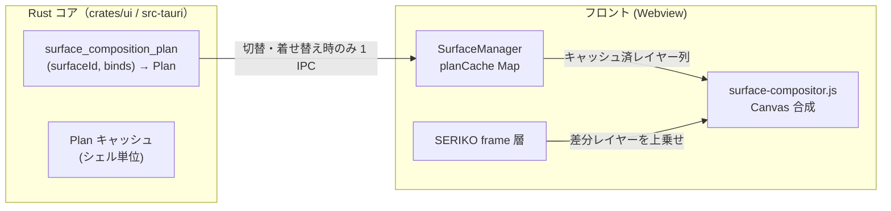

# 多層合成 CompositionPlan 連携仕様書（composition-plan-integration-spec）

> **位置づけ**: `docs/spec/ghost/ghost-compatibility-gap-and-roadmap.md` の
> 「着手中項目① `surfaces.txt` 多重要素合成」とそれが指し示す **Rust
> `CompositionPlan` とフロント Canvas 描画の連携** を仕様化する。
>
> **前提方針**: パフォーマンス重視。**静止構成の計算は Rust で 1 回だけ**行い、
> 毎フレームの IPC・再計算・Canvas 全体再描画を行わない。

## 1. 背景と現状

### 1.1 現状の実装（二重実装）

| 領域 | 実装箇所 | 担当内容 |
| --- | --- | --- |
| 合成計画（要素順・bind 列の解決） | `crates/ui/src/surfaces/types/txt.rs:43` `plan_composition` / `composition.rs` `CompositionPlan` / `shell.rs:122` `Shell::composition_plan` | element0..N（id ソート）+ 装着 bind アニメの pattern 列（index ソート）を描画順レイヤー列として返す |
| 合成実行（ピクセル合成） | `ui/js/surface/surface-compositor.js` `composeSurfaceElements` / `drawLayer` | Canvas 2D での PNA・クロマキー・blend method 合成 |
| bind レイヤー収集 | `ui/js/surface/surface-render.js` `activeBindLayers` | dressupState + bindgroup/addid → pattern レイヤー列を **JS 側で**再構築 |

問題点:

1. **二重実装**: レイヤーの列挙・並び順・method 解釈が Rust（surfaces.txt パーサー）と JS（surfaces から変換されたレガシー構造）の両方に存在し、仕様変更時に乖離するリスクがある。
2. **alias 解決の重複**: pattern surface がエイリアス名のとき JS で乱数抽選して解決。Rust にも `alias_numbers` があるが計画段階では未解決。
3. **plan 未接続**: `Shell::composition_plan` は存在するが IPC で公開されておらず、フロントの合成は JS 収集レイヤーのみで動く。

### 1.2 ユーザー要件（重さの制約）

- 毎フレーム / 毎パターン適用ごとの IPC・Canvas 全面再合成は避けたい（既存の SERIKO
  再生は差分レイヤーのみ JS で重ね、完了を待ってから次へ進む方式）。
- したがって本連携は「**静止ベース構成（element + bind）の計画を Rust に一本化**し、
  変化時（サーフィス切替・着せ替え変更・シェル切替）でのみ 1 回 IPC」を原則とする。

## 2. 目標アーキテクチャ



### 2.1 データ契約（IPC JSON）

Rust `Command`: `surface_composition_plan`

```jsonc
// 入力
{ "surfaceId": "0", "scopeId": 0 }

// 出力: CompositionPlanSnapshot
{
  "surface": 0,
  "layers": [
    { "kind": "element", "file": "surface0.png", "x": 0, "y": 0, "method": "base" },
    { "kind": "element", "file": "surface01.png", "x": 0, "y": 0, "method": "overlay" },
    { "kind": "pattern", "file": "", "surface": 100, "x": 0, "y": 0, "method": "add" }
  ],
  "planHash": "0-100-<layersFingerprint>"
}
```

- `kind` は Rust `CompositionLayer` の externally tagged（`Element` / `Pattern`）を
  JS でそのまま受ける。`file` は element、`surface` は pattern の source 番号。
- **method は Rust の `DrawMethod` を正とする**（`methodToString()` でレガシー文字列へ）。
- `planHash`（レイヤー数 + 各 method/file/surface の単純 fingerprint）で、
  フロント側キャッシュの無効化判定を IPC 無しで行う。

### 2.2 alias 解決の一本化

- Bind pattern の `surface` にエイリアス名が書かれている場合、**Rust 側で数値化**
  （`alias_numbers` / `kero_alias_numbers` + 乱数抽選 1 回）してから計画に含める。
  - 理由: 計画は「静止構成」であり、抽選結果はビルド時に凍結してよい
    （パーツ単位のランダム差分は bind 切替のたびに再抽選される）。
  - `plan_composition(number, binds)` に `aliases` 解決を注入（synthetic Shell で
    テスト可能にする）。
- 本体（\s のエイリアス）抽選は現行どおり JS 側 `resolveSurfaceNumber` で行い、
  その結果の数値サーフィスをコマンドへ渡す。

### 2.3 フロント側のキャッシュと描画フロー

`SurfaceManager` に追加:

```text
planCache: Map<`${surfaceId}__${planHash}`, LayerKey[]>
```

1. `updateSurface(surfaceId, scopeId, frameLayers)`:
   - planCache に plan がなければ `invoke("surface_composition_plan")`
     （着せ替え状態は Rust が保持する `dressupState` のミラーを引数で渡す必要はない —
     Rust は bind ID 列だけ受け取り、bind ID 列は JS の dressupState →
     bindgroup 番号で都度組む。**着せ替え変更時のみ 1 IPC 再取得**）。
   - 以後のアニメーションフレームは plan の layers を ImageBitmap 事前読み込みし、
     毎回 `composeSurfaceElements` を EXIF/dataURL 化せず drawImage 連呼で描く。
2. `bindDressup()`: planCache の当該 scope エントリを invalidate → 次回 draw 時に再取得。
3. `selectShell()` / シェル再ロード: planCache を全消去。

### 2.4 DrawMethod ↔ Canvas の対応（維持）

| Rust `DrawMethod` | レガシー文字列 | Canvas 処理（`drawLayer`） |
| --- | --- | --- |
| Base | `base` | 最初の下地（configure なし描画） |
| Overlay | `overlay` | 通常合成（デフォルト op） |
| Replace / OverlayFast / Fast | `replace` / `overlayfast` / `fast` | 該当矩形 `clearRect` 後描画 |
| Blend(Multiply / Screen / Overlay / SoftLight / Add) | `blend-*` / `add` | `globalCompositeOperation` 切替 |
| Add | `add` | `lighter` |

合成モードの追加対応（`asis` 等）は Rust `DrawMethod::parse` に網羅させる
（**構文解析は Rust のみ**で進化させ、JS 側の文字列 switch は触らない）。

## 3. パフォーマンス契約

| 項目 | 目標 |
| --- | --- |
| IPC 頻度 | サーフィス切替・着せ替え変更・シェル切替時のみ（**毎フレーム 0 回**） |
| plan サイズ | 通常 < 1KB。巨大 bind（数十パーツ）でも配列 1 層分のみ |
| キャッシュヒット | 同一 surface + bind 状態の再描画は IPC なし |
| Canvas 合成 | dataURL 変換をフレーム毎に行わない。layer は `ImageBitmap`/blob URL を事前デコードし `drawImage` で直描き |
| メモリ | planCache エントリは layers の参照列のみ（画像は既存 `load_surface_image` キャッシュと共有） |

**やってはいけないこと**: 毎フレーム `composeSurfaceElements` による
全面 dataURL 再合成（現状の SERIKO フレームもベース plan キャッシュと差し替え可能
となった段階で置き換える指定を持たせる）、および Rust でのピクセル合成
（画像デコードを Rust に置くと IPC で画像転送が発生し、したがって重くなる）。

## 4. 実装段階（段階的移行）

### Phase A — コマンド公開と接続（低リスク）

1. `src-tauri` に `surface_composition_plan` コマンド追加
   （`Shell::composition_plan` のシンラッパ。bind ID 列を `Vec<u32>` で受ける）。
2. フロント `surface-render.js` の `composeSurfaceElements` を
   planCache 準拠へ変更し、キャッシュミス時のみ IPC。
   失敗時（Web/Mock）は現行 `activeBindLayers` をフォールバックとして温存。
3. Rust `plan_composition` に alias 抽選注入 + テスト追加。

### Phase B — SERIKO フレームの高速化（本命）

1. アニメフレームは「ベース plan ImageBitmap + 差分レイヤー drawImage」に切り替え
   （dataURL 再合成の廃止）。
2. fps 測定: まばたき（170ms 周期）・talk 口パクで 60fps を維持することを
   実機確認（DevTools Performance または log 計測）。

### Phase C — 二重実装の撤去

1. `activeBindLayers` / `elements` のレガシー収集を plan 導出へ一本化。
2. JS `surface-parser.js` は構文パース後方互換のみに縮退（Rust 不通時フォールバック）。

## 5. テスト方針

- **Rust 単体**: `plan_composition` の layer 順・method・alias 抽選（rng 注入）・
  未定義 bind 無視・`surface.append` マージ後の計画。既存
  `surfaces::tests::test_plan_composition*` を拡張。
- **JS**: plan → `drawLayer` 呼び出し列が PNA/クロマキー済み src と一致することを
  mock `resolveImagePath` で検証（`tests/ghost-surface.test.js` 方式を踏襲）。
- **整合（ゴールデン）**: 実シェル `mock_nanai` / `Balloon_for_Emily_P4` について
  JS 収集レイヤーと Rust plan の file/x/y/method 列が一致することを
  dev 起動ログで突合する。

## 6. リスクと緩和

| リスク | 緩和策 |
| --- | --- |
| alias 乱数差による見た目不一致（JS/Rust 独立抽選） | 計画は Rust 抽選に一本化、JS 抽選は本体 \s 専用 |
| bind 追加時に `addid` / `mustselect` の扱い差 | bind ID 列の組立ては現行 `bindGroupsForScope` ロジックを共用（JS 側で ID 列だけ作り Rust へ渡す） |
| 巨大シェルでの plan 再計算頻発 | `dressupState` まとめ払い＋planHash 無効化で冪等化 |
| Android 上での ImageBitmap 消費メモリ | layer は shell 画像キャッシュと参照共有し、plan 単体はメタデータのみ |
| Web (非 Tauri) 環境 | planCache を空にして即座にレガシー合成へフォールバック |

## 7. 関連

- 仕様規範: [ukadoc shell-surfaces MAYUNA](../ukadoc/descript/shell-surfaces/surface-brace/introduction_mayuna.md)
- 現行実装: `crates/ui/src/surfaces/types/{composition.rs,txt.rs}`,
  `ui/js/surface/{surface-compositor.js,surface-render.js,bind-menu.js}`
- 関連仕様: [surfaces-and-collision-spec.md](surfaces-and-collision-spec.md),
  [surface-and-subchar-spec.md](surface-and-subchar-spec.md)
