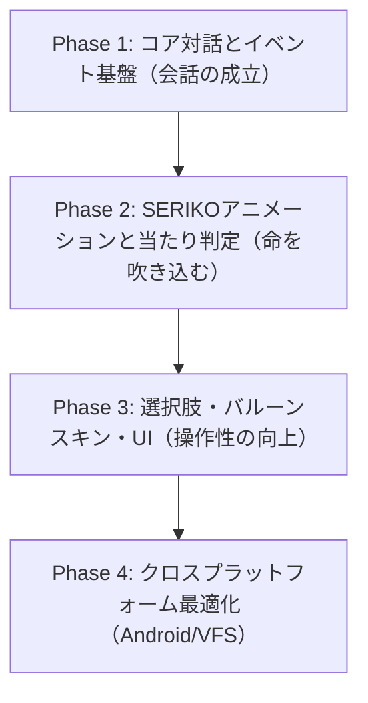

# 伺かゴースト互換性ギャップ分析と実装改善ロードマップ (ghost-compatibility-gap-and-roadmap)

- **関連仕様・規格**:
  - **SHIORI/3.0 規格**: [ukadoc-spec: shiori3](https://ukatech.shillest.net/ukadoc-spec/spec/shiori3/) - © UKADOC project (CC BY 4.0)
  - **さくらスクリプト (Sakura Script)**: [ukadoc-spec: さくらスクリプト](https://ukatech.shillest.net/ukadoc-spec/spec/sakura-script/) - © UKADOC project (CC BY 4.0)
  - **surfaces.txt / SERIKO 仕様**: [ukadoc-spec: surfaces.txt](https://ukatech.shillest.net/ukadoc-spec/spec/surfaces/) - © UKADOC project (CC BY 4.0)
  - **バルーン仕様**: [ukadoc-spec: balloon](https://ukatech.shillest.net/ukadoc-spec/spec/balloon/) - © UKADOC project (CC BY 4.0)
  - **関連文書**:
    - [互換実装計画仕様書](../reference/compatibility-implementation-plan.md)
    - [仕様適合マトリクス](../reference/specification-compliance-matrix.md)
    - [ローカル開発・試験環境 仕様書](../../../local/LOCAL_DEV_SPEC.md)

---

## 1. 概要と現状認識

現在の nanai-android-mascot は、32bitネイティブDLLのブリッジロード（`shiori-host32`）および最小限のSHIORI通信（OnBoot、クリック時の発話取得）、静的な基本サーフィス画像の描画、ならびに最小限のさくらスクリプト解釈に対応しています。

しかし、一般的な伺かゴースト（SSP/CROW等で動作するゴースト資産）を本来のクオリティで動作させるためには、サーフィスアニメーション、当たり判定、タイマー自律発話、選択肢インタラクション、バルーンスキンなどのコア機能が不足しています。

本ドキュメントは、**「現状できていること」と「一般的なゴーストが要求する仕様とのギャップ」を体系的に一覧化し、実装の依存関係を踏まえた優先順位付きロードマップ**として定めます。

---

## 2. 現状の実装状況（できていること）

| 分類               | 実装済み項目                                      | 現状の実装水準と制約                                                                                                                                                                                                                         |
| :----------------- | :------------------------------------------------ | :------------------------------------------------------------------------------------------------------------------------------------------------------------------------------------------------------------------------------------------- |
| **SHIORI通信**     | SHIORI/3.0 基本プロトコル・定期イベント           | `GET Version`, `NOTIFY OnBoot`, `OnSecondChange`(毎秒タイマー), `OnClose`, `OnSurfaceRestore`, `OnDressupChanged` の送受信                                                                                                                   |
| **バイナリ実行**   | 32bit DLLのプロセス間実行・安全終了               | `shiori-host32` (IPC) 経由での yaya.dll / satori.dll ロード、終了時の `unload()` 確実実行による辞書セーブ保持                                                                                                                                |
| **スクリプト解釈** | さくらスクリプト制御・ウェイト・演出              | `\0`, `\1`, `\p[n]`(第3キャラ以降マルチスコープ), `\s[ID]`, `\w1`〜`\w9`, `\_w[ms]`, `\x`(クリック待ち), `\_q`(高速描画切替), `\c`, `\i[ID]`(アニメ呼出), `\q`(選択肢), `\_a`〜`\_a`(アンカー), `\![open,inputbox]`, `\![bind]`, `\![raise]` |
| **サーフィス描画** | SERIKOアニメーション & PNA透過 & 着せ替え         | UKADOC準拠の interval、talk口パク連動、PNAアルファマスク合成＋クロマキー自動切替、着せ替えパーツ状態管理（`bind`）、当たり判定付き `OnMouseDoubleClick` / `OnMouseMove`                                                                      |
| **ファイル基盤**   | ケースインセンシティブ VFS (仮想ファイルシステム) | `open_file`, `load_surface_image`, `load_surface_pna` において大文字・小文字の表記揺れ（`Surface0.PNG` 等）を自動吸収・解決                                                                                                                  |
| **ウィンドウ制御** | マルチウィンドウ / メニュー                       | メインキャラクターウィンドウ、サブウィンドウ（各スコープ `subchar_window_{scopeId}` 動的配置）、右クリックメニューの基礎配置                                                                                                                 |

---

## 3. 未対応課題の全体ギャップ一覧

一般的なゴーストが前提としている標準機能のうち、未実装・不完全な領域を5大カテゴリに分類します。

### 3.1 さくらスクリプト解釈系 (SakuraScript Engine)

一般的なゴーストの会話制御や演出において不可欠なタグ群が未対応です。

1. **ウェイト・演出制御タグ**:
   - `\w1` ～ `\w9`: 相対ウェイト制御（発話速度と間）。
   - `\_w[ミリ秒]`: 絶対ウェイト指定。
   - `\_q`: クイック描画（ウェイト無視で一括表示）の開始/終了切り替え。
   - `\x`: クリック待ち（バルーンのページ送り待ち）。
   - `\c`: バルーン内容のクリア。
2. **選択肢・インタラクションタグ**:
   - `\q[ラベル,ID]`: 選択肢の生成。クリック時に `OnChoiceSelect` イベントをSHIORIへ返答する処理。
   - `\_a[ID]...\_a`: アンカーリンク（用語解説や特定トピックのクリックイベント）。
3. **キャラクタースコープ・消去**:
   - `\s[-1]`: キャラクターの一時非表示（退場演出）。
   - `\p[2]` ～ `\p[n]`: 第3キャラクター以降のスコープ切り替え。
4. **特殊コマンド・制御タグ**:
   - `\![open,...]`: インプットボックス、メニュー、ブラウザ等の起動要求。
   - `\![raise,...]`: 任意イベントの能動的発行。
   - `\![bind,部位,パーツ,状態]`: 着せ替えパーツの切り替え指示。

### 3.2 サーフィス・アニメーション合成 (SERIKO / surfaces.txt)

伺かの表現力の中心である「瞬き」「口パク」「撫で・つつき反応」が未動作です。

1. **SERIKOアニメーション機構**:
   - `interval` による自動アニメーション制御:
     - `sometimes`: ときどき（1/2の確率）。
     - `rarely`: たまに（1/4の確率）。
     - `random,N`: 1/Nの確率での定期的抽選。
     - `periodic,秒`: 一定時間ごとの周期的再生（瞬き等）。
     - `always`: 常時ループ再生。
     - `runonce`: サーフィス切り替え時に1回のみ再生。
     - `talk,秒`: 発話中（テキスト流し中）の口パク連動。
2. **パーツ合成モード（描画レイヤリング）**:
   - `base`, `overlay`, `replace`, `interpolate`, `asis`, `move` 等の合成モード完全再現。
   - オフセット座標（`overlay,ID,X,Y`）の正確な Canvas / CSS 合成。
3. **透過・マスク処理の完全性**:
   - PNA透過（8bitグレイスケールマスク画像）の合成。
   - 左上1ピクセル透明化方式（旧来のサーフィスBMP向け）の自動判別。
4. **当たり判定（Collision）とマウスイベント**:
   - `surfaces.txt` 内の `collision,Left,Top,Right,Bottom,ID`（Head, Face, Bust等）の定義読み込み。
   - マウス移動・ホバーでの `OnMouseMove` 発行となで（Stroke）カウント。
   - クリック・ダブルクリック・ホイール回転イベントの当たり判定ID連動。

### 3.3 イベント駆動・SHIORIライフサイクル (Event Cycle)

自律的な雑談やOS連動、設定保存が欠落しています。

1. **自律発話タイマー (AIトーク)**:
   - `OnSecondChange` / `OnMinuteChange`: 毎秒・毎分の定期イベント発行。
   - 沈黙時間のカウントと自律発話（ランダムトーク）の起動。
2. **マウスインタラクションイベント**:
   - `OnMouseMove`: カーソル座標と判定識別子（Reference3: 部位名, Reference4: 車輪/ストローク等）。
   - `OnMouseDoubleClick`: つつき判定。
   - `OnMouseWheel`: マウスホイール回転。
3. **ライフサイクル・システムイベント**:
   - `OnClose`: 終了リクエストの処理（終了スクリプト再生後にアプリ終了）。
   - `OnWindowStateRestore` / `OnWindowStateMinimize`: 最小化・復帰連動。
   - `OnSurfaceRestore`: 会話終了時のデフォルトサーフィスへの自動復帰。
4. **データ保存・終了処理**:
   - SHIORI `unload` の安全な発行と辞書変数（セーブデータ）の保存保証。

### 3.4 バルーン・UI表現 (Balloon & Skin)

標準的な会話枠の見た目や操作性が未対応です。

1. **バルーンスキン読み込み**:
   - `balloon/` ディレクトリ内の `descript.txt`（フォントカラー、余白、原点、矢印位置等）解析。
   - 背景画像（`balloonk0.png`, `balloons0.png` 等）の9スライスまたはタイル描画。
2. **インタラクティブUI**:
   - 選択肢のホバー・クリック演出。
   - ユーザー入力ボックス（`\![open,inputbox,...]`）による文字列入力ダイアログ。
   - スクロールバーと過去ログ表示。

### 3.5 クロスプラットフォーム・ファイルシステム耐性 (VFS & Platform)

Windows以外のAndroidやLinux環境での互換性確保が必要です。

1. **大文字小文字無視（Case-insensitive VFS）**:
   - Windows前提で作成されたゴーストのパス参照（`Surface0.png` と `surface0.PNG` の混在等）を吸収する仮想ファイルシステム。
2. **エンコーディング対応**:
   - Shift_JIS（CP932）辞書・テキストとUTF-8テキストの無条件透過。
3. **非Windows（Android / Web）向けSHIORIフォールバック**:
   - Windows以外でのNative DLL実行不能に対するWASM版SHIORI（satori-wasm, yaya-wasm）の自動フォールバック。

---

## 4. 改善優先順位・段階的ロードマップ

全体の依存関係を考慮し、**「会話が成立する」→「豊かに動く」→「操作・スキンが整う」→「マルチ展開」**の4フェーズで実装を推進します。

### Phase 1: コア対話とイベント基盤（最優先・必須基盤）

ゴーストが自律的に話し、会話の「間」やテンポが成立する状態を目指します。

1. **さくらスクリプト・ウェイト実装**:
   - `\w1` ～ `\w9`, `\_w[t]`, `\x`（クリック待ち）, `\c`（クリア）の正確な非同期ディレイ処理。
2. **定期時間イベント（タイマー）**:
   - フロントエンドまたはRustバックエンドからの `OnSecondChange` / `OnMinuteChange` 定期送出。
   - SHIORIの自律発話（AIトーク）のトリガー成立。
3. **サーフィス自動復帰（OnSurfaceRestore）**:
   - 発話完了時または一定時間経過後に `\s[0]`（基準表情）へ戻る処理。
4. **SHIORIの安全な終了・セーブ**:
   - ウィンドウ終了時の `OnClose` 処理と SHIORI `unload` の確実な実行。

### Phase 2: SERIKOアニメーションと当たり判定（表現力・インタラクション）

棒立ち状態を解消し、瞬き・口パク・触れ合いを実現します。

1. **SERIKO interval アニメーションエンジン**:
   - `periodic`（周期的な瞬き）、`sometimes`/`rarely`（ランダムなしぐさ）のタイマーループ実装。
   - `talk` によるテキスト出力中の口パク連動。
2. **当たり判定（Collision）とマウスイベント**:
   - `surfaces.txt` の当たり判定矩形を読み込み、透明なヒットテストレイヤーを構成。
   - マウス移動（なで検知）、クリック（つつき検知）を `OnMouseMove` / `OnMouseDoubleClick` としてSHIORIに送信。
3. **パーツ合成モードの拡充**:
   - `overlay`, `replace`, `asis` 等の複数レイヤー合成処理の精度向上。

### Phase 3: 選択肢・バルーンスキン・UI（操作性・再現性）

メニューやイベント選択肢を操作可能にし、視覚的な完成度を高めます。

1. **さくらスクリプト選択肢（\q）とアンカー（\_a）**:
   - 選択肢リンクのUI表示と、クリック時の `OnChoiceSelect` イベント通知。
2. **バルーンスキンパーサー**:
   - `descript.txt` および背景画像の解析、吹き出し形状とマージンの自動適用。
3. **インプットボックス（\![open,inputbox,...]）**:
   - ユーザーからのテキスト入力（名前入力やキーワード応答）のUIダイアログ。
4. **着せ替え機構（\![bind,...]）**:
   - 衣装・アクセサリの表示/非表示フラグ管理とレイヤー反映。

### Phase 4: クロスプラットフォーム最適化（Android・Web・堅牢化）

AndroidやWeb環境でも同一ゴースト資産を安定して動作させます。

1. **VFS（仮想ファイルシステム）による大文字小文字吸収**:
   - Linux/Androidのファイルシステム上での大文字小文字不一致エラーを完全防止。
2. **WASM版SHIORIランタイム統合**:
   - Windowsデスクトップ（32bit DLL）以外で動作する WebAssembly SHIORI（YAYA/里々）の自動切り替え。
3. **マルチキャラクター（\p[n]）の独立ウィンドウ・吸着制御**:
   - 第3キャラクター以降の表示対応と、複数ウィンドウの相対座標維持・追従ドラッグ。

---

## 5. 現在の進捗状況と次の具体的アクション

これまでの実装セッションにより、**Phase 1 ～ Phase 4 の主要基盤（自律発話タイマー、終了時セーブ、さくらスクリプト制御・選択肢・入力ボックス、SERIKO interval/talk、PNAアルファマスク透過、ケースインセンシティブVFS、WASM SHIORIワーカー）は実装・検証済み**です。

### 現在着手中の項目（実機ゴースト表現の完全再現）

1. **`surfaces.txt` 多重要素合成 (`element0`〜`elementN`)** 📐 設計済み:
   - `overlay`, `replace`, `asis` 等のパーツ多重重ね合わせを Canvas レイヤーで事前合成する機能。
   - 接続設計（Rust `CompositionPlan` → フロント Canvas キャッシュ描画、IPC 頻度制約込み）は
     [composition-plan-integration-spec.md](composition-plan-integration-spec.md) 参照。
2. **バルーンスキン動的反映 (`balloon/*/descript.txt`)** ✅ 実装済み:
   - `origin.x`, `origin.y`, `validrect` のCSS/レイアウトへの動的適用。
   - Rust（`balloon_manifest` コマンド / `crates/ui::descript` パーサー）で descript.txt をパースし、
     メインウィンドウ（`app-actions.js`）および独立バルーンウィンドウ（`balloon-window.js`）へ動的反映。
   - スキン切替時は前テーマの上書き値を `resetBalloonDescript()` でリセットしてから適用。
3. **実機（`cargo tauri dev`）における実ゴースト総合動作確認**:
   - 実機環境での自律トーク・当たり判定イベント・バルーン表示の検証。
