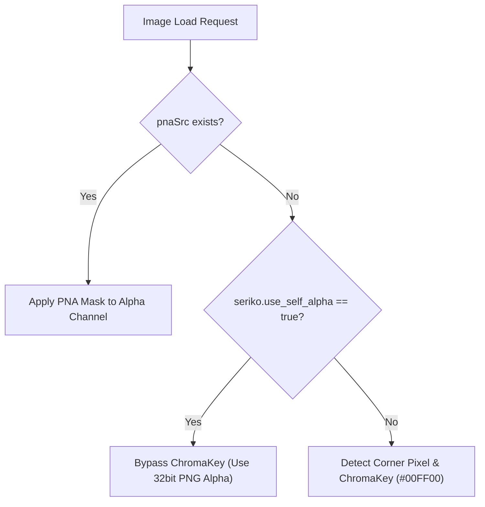
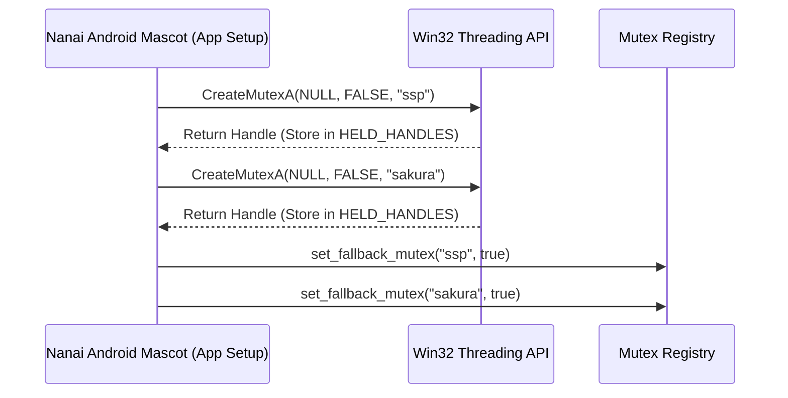
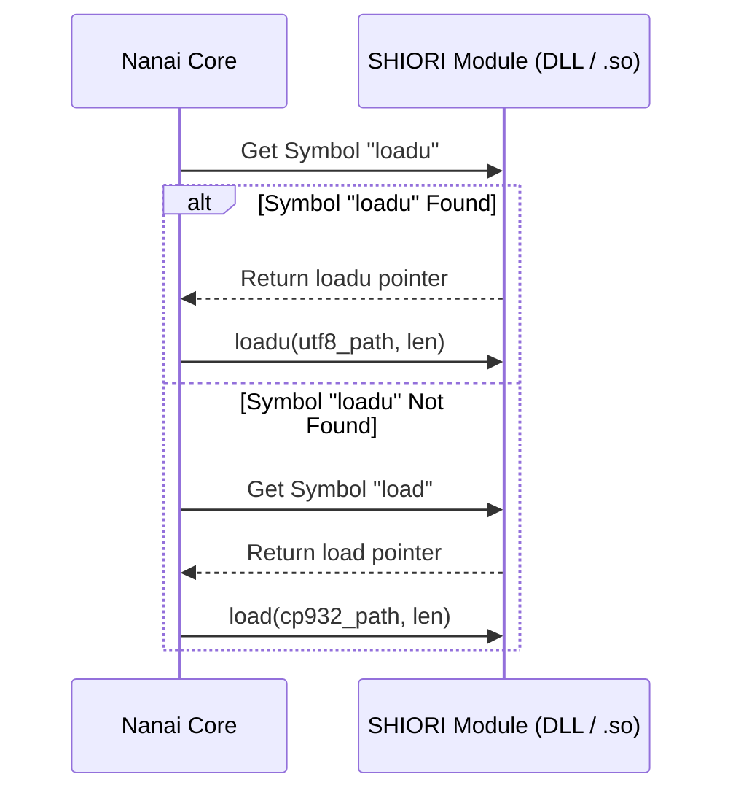

# SSP 互換・暗黙規格統括マスター仕様書 (SSP Master Compatibility Specification)

- **規格**: [Nanai Mascot Master Spec](ssp-master-compatibility-spec.md)
- **検索語**: acquire_base_ware_mutexes
- **対応状況**: ✅ 対応済

本ドキュメントは、Nanai Android Mascot の開発・精察プロセスにおいて確定・暗黙規格化した SSP (Software Space Pilot) 互換仕様、数理的換算根拠、UI レイアウト基準、および外部アプリ連携 (`external`) に対する設計方針を 1 箇所に集約・明文化したマスター参照文書である。

---

## 1. フォントサイズ・96 DPI 換算・インラインサイズフィット規格

> [!IMPORTANT]
> 伺か（Materia / CROW / SSP）におけるフォントサイズ指定は、Windows GDI の `LOGFONT` 構造体 (`lfHeight`) および標準的な 96 DPI 画面ディスプレイ（100% スケーリング）の物理単位系に依存しています。

### 1.1 数理的換算根拠
1 インチ ＝ 72 ポイント (pt) ＝ 96 ピクセル (px)（96 DPI 環境）

$$\text{ピクセルサイズ (px)} = \text{round}\left( \text{ポイントサイズ (pt)} \times \frac{96}{72} \right) = \text{round}\left( \text{pt} \times \frac{4}{3} \right)$$

SSP の標準フォントサイズである **`9pt`** を換算すると：
$$9 \text{ pt} \times \frac{96}{72} = 12 \text{ px}$$
となり、UKADOC 規格 (`font.height,12`) の既定値 **`12px`** に完全一致します。

### 1.2 バルーンフォント評価優先順位ルール
1. **`font.height,数値`** (最優先): ピクセル単位 (`px`)。例: `font.height,14` $\to$ `14px`
2. **`font.size,数値`** (第2優先): ポイント単位 (`pt`)。$\text{pt} \times \frac{96}{72}$ で px に換算。
3. **既定値フォールバック** (最小優先度): 未指定時は **`12px`** (9pt 相当)。

### 1.3 UI・インライン要素の文字サイズ追従ルール
- **バルーン選択肢ボタン (`.balloon-choice-btn`)**: `font-size: 1em;`, `line-height: 1.2;`, `padding: 0.25em 0.6em;` を適用。文面のフォントサイズ変更（`\f[height,N]` 等）に比例して動的にサイズ変化する。
- **インライン画像 (`\_b[...]`)**: `display: inline-block;`, `vertical-align: middle;`, `max-height: 1.2em;` を適用。文面の行高へ自動フィットする。

---

## 2. サーフェスアルファ透過・描画規格 (`seriko.use_self_alpha`)

> [!NOTE]
> アルファチャンネル付き 32bit PNG 画像を意図通りに描画するため、伝統的な緑抜き（クロマキー）を通過させずに画像自体の透明度を利用します。

- **プロパティ**: `seriko.use_self_alpha,1`（`descript.txt` 内）
- **挙動**: 指定時、左上 1 ピクセルクロマキーや緑抜き処理（`#00FF00`）をバイパスし、32bit PNG 画像が持つアルファチャンネル透過を直接コンポジタで利用する。

---

## 3. ベースウェア識別・名前付き Mutex 保持規格 (`ssp` / `sakura`)

> [!TIP]
> ベースウェア起動中にプロセス所有権をアピールするため、Win32 API およびインメモリレジストリで Named Mutex を保持します。

- **識別名**: `"ssp"` (SSP 識別子), `"sakura"` (Materia/CROW 識別子), `"NanaiFMO"`
- **Windows ネイティブ挙動**: アプリ起動時（`setup`）に `CreateMutexA` で `"ssp"` / `"sakura"` ハンドルを獲得・常時保持。他プロセスからの `OpenMutexA` 判定に応答する。
- **Android / 非 Windows 挙動**: インメモリ Mutex レジストリ（`FALLBACK_MUTEXES`）に登録し、IPC リクエスト（`check_base_ware_mutex`）へ `ssp: true`, `sakura: true` を返答。

---

## 4. SHIORI DLL ライフサイクル規格 (`loadu` 優先ロード)

> [!NOTE]
> UTF-8 パスを扱う最新の `loadu` 関数を優先取得することで、Unicode パス環境（日本語・中国語ディレクトリ等）でのロード失敗を防止します。

- **`loadu` 優先検索**: SSP 2.6.92+ 規格に準拠し、DLL / `.so` 内の `loadu`（UTF-8 パス受取関数）を優先取得。存在しない場合のみ従来型 `load`（CP932/ANSI）へフォールバック。
- **メモリ管理**: `GlobalAlloc(GMEM_FIXED, len + 1)` で確保し、ヌル終端文字（`0`）を付与。

---

## 5. スクロール矢印アセット自動展開規格 (`arrow.filename`)

- **ベース名展開**: `arrow.filename,prefix` 指定時、上矢印 `prefix0.png` および下矢印 `prefix1.png` を自動合成・読み込み。
- **CSS 変数バインド**: `--balloon-arrow0-image`, `--balloon-arrow1-image`, `--balloon-arrow0-x/y`, `--balloon-arrow1-x/y` へ一括展開。

---

## 6. 外部アプリ連携 (`external` / `shiori-event-ex/app-common`) に対する設計方針

> [!CAUTION]
> モバイル環境やサンドボックス環境で無闇な外部プロセス監視や外部アプリ起動を行うと、バッテリー消費・発熱・セキュリティ例外の原因となります。

### 「`external` 連携は取りやめるか？」に対する方針決定
- **背景**: Windows デスクトップ時代の `OnApplicationBoot` や外部プロセス監視機能は、Android（モバイル）や Tauri サンドボックス環境下では**実プロセスが存在しない、あるいは OS 制限により動作しない**。
- **結論（方針）**:
  1. **重い外部プロセス監視・外部アプリ起動は「とりやめる（無効化・廃止）」**: モバイルや安全なデスクトップ環境に不要なプロセス常駐を行わない。
  2. **SHIORI プロトコル互換用ダミー応答のみ保持**: ゴーストスクリプトが `OnApplicationBoot` や `checkApplicationExist` を呼び出した場合、エラー落ちを防ぐため空値または safe なブール値（`false`）を返して安全にスルーさせる。

---

## 7. 実装ファイル一覧

- `src-tauri/src/shiori/fmo.rs` (`acquire_base_ware_mutexes`)
- `src-tauri/src/shiori/dynamic/mod.rs` (`loadu`)
- `ui/js/core/actions/balloon-descript/font/base.js`
- `ui/js/ghost/shiori-notify.js`

## 実装箇所

- `src-tauri/src/lib.rs:174` `shiori::fmo::acquire_base_ware_mutexes();`
- `src-tauri/src/shiori/fmo.rs:91` `pub fn acquire_base_ware_mutexes() {`
