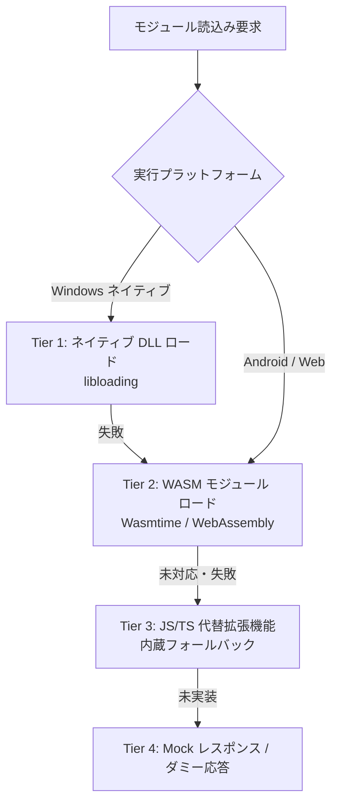

# プラグイン & SHIORI 読込み・代替読込み（Fallback）包括仕様書

- **言及規格の元ドキュメント・権利者・ライセンス**:
  - **SAORI 規格**: [ukadoc: SAORI](https://ukatech.shillest.net/ukadoc-spec/spec/saori/) - © SAORI 規格策定チーム / ukadoc プロジェクト (ukadoc 仕様 / パブリックリファレンス)
  - **PLUGIN 規格**: [ukadoc: PLUGIN](https://ukatech.shillest.net/ukadoc-spec/spec/plugin/) - © MATERIA開発チーム / SSP開発チーム / ukadoc プロジェクト (ukadoc 仕様 / パブリックリファレンス)
  - **伺か (Ukagaka) / ゴースト / シェル**: [伺か / 偽春菜 / あれ以外の何か with「何か」](https://ukatech.shillest.net/ukadoc-spec/) - © MATERIA開発チーム / うさださくら 氏 / コミュニティ有志 (コミュニティ規格 / オープンドキュメント)
  - **SHIORI / 各SHIORIサブシステム (里々, YAYA, 華和梨 等)**: [ukadoc: SHIORI/3.0](https://ukatech.shillest.net/ukadoc-spec/spec/shiori3/) - © MATERIA開発チーム / 里々開発チーム / YAYA開発チーム / 華和梨開発チーム / ukadoc プロジェクト (ukadoc 仕様 / 各コミュニティライセンス)
  - **バルーン仕様 (Balloon)**: [ukadoc: surfaces.txt / balloon](https://ukatech.shillest.net/ukadoc-spec/) - © MATERIA開発チーム / SSP開発チーム / ukadoc プロジェクト (ukadoc 仕様 / パブリックリファレンス)

本仕様書は、**nanai-android-mascot** における「従来の Windows ネイティブ DLL」と「モダンな WASM / JS 拡張機能」の共存、およびプラットフォーム差異を吸収する **多層フォールバック読込み（代替ロード）戦略** を定義・整理したものです。

---

## 1. 読込み対象モジュールの分類と課題

伺かエコシステムにおける拡張モジュールは、主に以下の2系統が存在します。

| モジュール種別 | 役割・用途 | 従来の標準形式 | 主な課題 |
| :--- | :--- | :--- | :--- |
| **ゴースト SHIORI** | キャラクターの知能・辞書解釈・会話生成 | `shiori.dll` (Win32) | Windows 以外（Android/ARM、Web）で実行不可。 |
| **ベースウェア プラグイン** | システム拡張（RSS、メディア再生、連携） | `plugin.dll` (Win32) | Win32 API 依存。モバイルやサンドボックス環境で動作不能。 |
| **SAORI** | SHIORI から呼び出される外部関数 DLL | `*.dll` (Win32) | プラットフォーム依存が高く、セキュリティ上の懸念がある。 |

---

## 2. 読込みアーキテクチャの全体像（フォールバック階層）

本システムは、実行環境（Windows / Android / Web）を自動判定し、以下の優先順位でモジュールをロード・代替実行します。



---

## 3. ゴースト SHIORI の読込み・代替戦略

### 3.1 SHIORI 識別メカニズム

ゴーストディレクトリ内の `ghost/master/descript.txt` およびファイル構成を解析してエンジンを特定します。

```text
descript.txt 解析例:
  shiori,satori.dll   --> SATORI (里々) と判定
  shiori,yaya.dll     --> YAYA と判定
  shiori,kawari.dll   --> KAWARI (華和梨) と判定
  shiori,engine.wasm  --> WASM SHIORI と判定 (独自拡張)
  shiori,index.js     --> JS SHIORI と判定 (独自拡張)
```

### 3.2 プラットフォーム別 SHIORI ロード順序

```text
【Windows Desktop 環境】
 1. ネイティブ DLL (satori.dll, yaya.dll) を直接ロード
 2. 失敗時: 同等エンジンの WASM バイナリ (satori.wasm) で実行
 3. 失敗時: JavaScript 製パーサー/モックエンジンで実行

【Android / Web 環境】
 1. WASM エンジン (satori.wasm, yaya.wasm) をメモリ上仮想FSで実行
 2. 未対応エンジン (例: 古いマイナーSHIORI):
    -> JS 代替レイヤー (JS SHIORI Bridge) で辞書ファイルを直接パース
 3. 辞書パース不能時:
    -> フォールバック辞書 (mock_nanai) による基本会話を維持
```

---

## 4. ベースウェア・プラグインの読込み・代替戦略

### 4.1 プラグイン形式の共存仕様

1. **WASM プラグイン (`*.wasm`)**:
   * 計算負荷の高い処理（画像フィルター、音声合成、暗号化など）。
   * WASI（WebAssembly System Interface）に準拠したサンドボックス実行。
2. **JS/TS プラグイン (`*.js`, `package.json` / `plugin.json`)**:
   * Web API（Fetch、WebSocket、Web Audio）を活用したネットワーク連携。
   * UI 拡張（メニュー項目追加、バルーン内コンポーネント埋め込み）。
3. **DLL プラグイン (Windows 限定)**:
   * 従来の `plugin.dll`。Windows 版でのみ下位互換性のためロードを試行。

### 4.2 プラグイン代替読込み（Compatibility Shim）

従来の Windows 向け人気プラグイン（ヘッドラインセンサー、情報表示等）に対し、同等の機能を提供する **JS エミュレーション・シム（Shim）** を内蔵します。

| 従来の DLL プラグイン | 代替 JS 拡張機能 | 実装アプローチ |
| :--- | :--- | :--- |
| **RSS / ヘッドライン取得** | `plugins/builtin-rss-reader/` | Web 標準の `fetch()` + XML DOM Parser |
| **メディアプレイヤー連携** | `plugins/builtin-media-ctrl/` | Web Media Session API / OS 連携 |
| **カレンダー / スケジューラ** | `plugins/builtin-calendar/` | ローカルストレージ + 通知 API |
| **独自ウィンドウ表示** | Web Components / モーダル | HTML5 / CSS3 によるオーバーレイ表示 |

---

## 5. SAORI（外部呼出しモジュール）の代替戦略

ゴースト辞書内から `\![raise,OnSaoriCall,...]` 等で呼び出される SAORI DLL について：

1. **内蔵シム機能 (Built-in SAORI Shim)**:
   * 代表的な SAORI（`proxy.dll`, `calc.dll`, `regex.dll` など）の関数シグネチャを Rust/JS 側で先回りしてエミュレート。
2. **WASM SAORI**:
   * C/C++ 製 SAORI を WASM 化し、メモリ境界越しに `request()` をエミュレート。
3. **安全なエラーフォールバック**:
   * 未知の Win32 SAORI 呼び出し時はクラッシュさせず、空文字またはエラーコード（404 Not Found）を返却し、ゴーストの対話停止を防止。

---

## 6. 実装アーキテクチャ設計（Tauri 内部構造）

```text
[ Frontend (WebView) ]
      ▲
      │ (JSON-RPC / postMessage)
      ▼
[ Tauri Core Router (Rust) ]
      ├── NativeDllLoader (Windowsのみ / cfg(target_os="windows"))
      ├── WasmEngineManager (Wasmtime / WebAssembly Instance)
      ├── JsPluginHost (WebView内サンドボックス実行)
      └── VirtualFileSystem (VFS: メモリ上での辞書・アセット展開)
```

### コア利点

* **絶対的な安定性**: 壊れた DLL や未対応プラットフォームでも、親プロセスがクラッシュせず上位フォールバックへ安全に縮退。
* **コミュニティ資産の保全**: 既存の膨大なゴースト資産（テキスト・辞書）を無駄にせず、Android / Web へそのまま移行可能。
* **新規開発の容易さ**: 新しい拡張機能は、ブラウザ技術（JavaScript/CSS）だけで簡単に作成・即時リロード可能。
