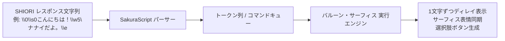

# さくらスクリプト（SakuraScript）パーサー & バルーン文字送り仕様書

- **言及規格の元ドキュメント・権利者・ライセンス**:
  - **SHIORI 仕様 / 各種サブシステム**:
    - **SHIORI/3.0 規格**: [ukadoc-spec: shiori3](https://ukatech.shillest.net/ukadoc-spec/spec/shiori3/) - © UKADOC project (CC BY 4.0)
    - **里々 (SATORI)**: [ukatech/satori-docs](https://ukatech.shillest.net/satori-docs/) - © Kusigahama Yagi / SEIBIHAN (BSD 2-Clause License)
    - **YAYA**: [YAYA-shiori/yaya-docs](https://yaya-shiori.github.io/yaya-docs/) - (The Unlicense / Public Domain)
    - **華和梨 (KAWARI)**: [ukatech/kawari-docs](https://ukatech.shillest.net/kawari-docs/) - © KAWARI Development Team (BSD 2-Clause License)
  - **SSP 拡張仕様 / メニュー規格**: [ukatech/ukadoc-ssp](https://github.com/ukatech/ukadoc-ssp) / [SSP BUG-SLIK-PRACTICE](http://ssp.shillest.net/) - © UKADOC project (CC BY 4.0) / © PONapook 氏
  - **さくらスクリプト (Sakura Script)**: [ukadoc-spec: さくらスクリプト](https://ukatech.shillest.net/ukadoc-spec/spec/sakura-script/) - © UKADOC project / Ukagaka Tech Team (CC BY 4.0)
  - **SSTP (Sakura Script Transfer Protocol)**: [ukadoc-spec: sstp](https://ukatech.shillest.net/ukadoc-spec/spec/sstp/) - © UKADOC project / Ukagaka Tech Team (CC BY 4.0)
  - **バルーン仕様 (Balloon)**: [ukadoc-spec: balloon](https://ukatech.shillest.net/ukadoc-spec/) - © UKADOC project / Ukagaka Tech Team (CC BY 4.0)
  - **伺か標準仕様 / ゴースト / シェル**: [ukatech/ukadoc-spec (UKADOC project)](https://ukatech.shillest.net/ukadoc-spec/) - © UKADOC project / Ukagaka Tech Team (CC BY 4.0)
  - **surfaces.txt / アニメーション合成 / 当たり判定**: [ukadoc-spec: surfaces.txt](https://ukatech.shillest.net/ukadoc-spec/spec/surfaces/) - © UKADOC project / Ukagaka Tech Team (CC BY 4.0)

本仕様書は、**nanai-android-mascot** における SHIORI からの応答テキスト（さくらスクリプト）の解析、バルーンへの文字送りアニメーション、およびユーザー選択肢インタラクションの仕様を定義します。

---

## 1. さくらスクリプト処理パイプライン

本仕様は、公式仕様書 **[ukatech/ukadoc-spec: さくらスクリプト仕様](https://ssp.shillest.net/ukadoc/manual/spec_sakura_script.html)** および **[ukatech/ukadoc-ssp: SSP 拡張タグ仕様](https://ssp.shillest.net/ukadoc/manual/spec_sakura_script.html)** に準拠しています。



---

## 2. 初期サポート対象タグ仕様

### 2.1 キャラクター・サーフィス制御タグ

| タグ記法 | 機能 | 実行エンジン動作 |
| :--- | :--- | :--- |
| `\0`, `\h` | メインキャラクター（sakura）指定 | 対象スコープをメインキャラに切り替え |
| `\1`, `\u` | サブキャラクター（kero）指定 | 対象スコープをサブキャラに切り替え（Phase 2対応） |
| `\s0` / `\s[0]` | サーフィス（表情画像）切り替え | 即座に対象キャラの画像を指定されたサーフィス ID に更新 |

### 2.2 テキスト・バルーン制御タグ

| タグ記法 | 機能 | 実行エンジン動作 |
| :--- | :--- | :--- |
| `\n` | 改行 | バルーン内に `<br>` を挿入 |
| `\n[half]` | 半改行 | スタイルのマージンを小さくした改行を挿入 |
| `\c` | バルーン消去 | 現在表示されているテキストをクリア |
| `\w1` 〜 `\w9` | ウェイト（待機演出） | 1単位あたり **50ms** 待機（例: `\w5` は 250ms、`\w9` は 450ms 停止） |
| `\_w[ms]` | ミリ秒単位ウェイト | 指定ミリ秒数だけ文字送りを一時停止 |
| `\e` | スクリプト終了 | スクリプトの終端。これ以降の記述は無視 |

### 2.3 インタラクティブタグ（選択肢）

| タグ記法 | 機能 | 実行エンジン動作 |
| :--- | :--- | :--- |
| `\q[表示テキスト,ID]` | 選択肢ボタン | バルーン内にクリッカブルな選択肢ボタンを生成 |

---

## 3. 文字送り（タイピング演出）エンジン仕様

### 3.1 描画タイミング制御

- **デフォルト文字送り間隔**: **40ms / 文字**
- **句読点ディレイ**: `、` または `。` `！` `？` の後は自動的に **+100ms** の微小ウェイトを付与。
- **キュー処理方式**:
  - スクリプト全体を一度「トークン（テキスト文字 / コマンド）」のキューに分解。
  - `async/await` ループにより、ウェイトやタグの副作用（画像切り替え）を順次実行。

### 3.2 ユーザースキップ（早送り）仕様

- 文字送りアニメーションの再生中にユーザーがバルーンまたはマスコットを **タップ／クリック** した場合：
  - 残りのウェイト（`\w`）をすべて 0ms としてスキップ。
  - 全文および選択肢ボタンを即座に最終状態まで表示。

---

## 4. 選択肢（`\q`）のイベントデータ連携仕様

ユーザーがバルーン内の選択肢ボタンをタップした際のデータフロー：

```text
[ ユーザーが \q ボタンをタップ ]
              ↓
  ID（例: "SelectMenu01"）を取得
              ↓
  SHIORI イベント OnChoiceSelect を構築
  - イベント名: OnChoiceSelect
  - Reference0: 選択肢ID ("SelectMenu01")
  - Reference1: 選択肢ラベル ("お話しする")
              ↓
  SHIORI にリクエスト送信 (sendShioriEvent)
              ↓
  SHIORI から返された新たな さくらスクリプト を順次再生
```

---

## 5. バルーン構造と自動切り替え仕様（SSP / ukadoc 準拠）

伺か / SSP の標準仕様（ukadoc）に準拠し、バルーンおよびメニューの構造・振る舞いを以下の通り規定します。

### 5.1 バルーンアセット構成と定義

- **ディレクトリ配置**: `assets/balloon/{balloon_name}/`
- **構成ファイル**:
  - `descript.txt`: 文字色 (`font.color.r/g/b`)、フォントサイズ (`font.height`)、文字送り原点座標 (`origin.x/y`)、折り返し (`wordwrappoint.x/y`) 等のメタデータ。
  - `balloons0.png` 〜 `balloons3.png`: メインキャラ（sakura / `\0`）用バルーン画像（通常・選択肢・スクロール等の状態別）。
  - `balloonk0.png` 〜 `balloonk3.png`: サブキャラ（kero / `\1`）用バルーン画像。
  - `balloon*s.txt`: バルーンごとの表示領域・パディング設定（sstp等のアイコン位置やmargin設定）。

### 5.2 ゴースト・バルーン連携と自動切り替えルール

- **ゴーストごとの推奨バルーン**:
  - ゴーストの `install.txt`（`balloon.directory` キー等）またはゴースト設定で指定されたバルーンが存在する場合、ゴースト選択時に連動して自動切り替えを行う（`autoSwitchBalloonWithGhost: true` 時）。
  - 指定がない場合、またはバルーンが存在しない場合はユーザー設定のデフォルトバルーン（アイボリー等）を適用する。
- **さくらスクリプトタグによるバルーン指定**:
  - `\b[番号]`: バルーンサーフェスの切り替え（`\b[0]` は基本、`\b[2]` は幅広等）。
  - `\b[-1]`: バルーンの非表示。

### 5.3 メニューおよびオーナードロー統合

- バルーンのフォント・配色トークン（CSS変数: `--balloon-bg`, `--balloon-text-color`, `--balloon-highlight-bg` 等）は、右クリックメニュー等の UI メニュー（オーナードローメニュー）にも共通トークンとして波及適用される。
- これにより、SSP の「バルーンスキンとメニューデザインの統一感」を Android / Web 上でも完全再現する。

---

## 6. 実装モジュール構成

フロントエンドに以下の専用モジュールを追加します：

- [`src/js/sakura-script.js`](../../src/js/sakura-script.js):
  - `parseSakuraScript(rawText)`: 文字列をトークン列に変換
  - `SakuraScriptPlayer`: キューを非同期ループで再生し、バルーン表示および表情切り替えを同期実行
- [`src/css/balloon-theme.css`](../../src/css/balloon-theme.css):
  - バルーンスキン定義（`emily4`, `ivory`, `pixel`, `comic`, `dark`）およびオーナードローメニュースタイル統合
