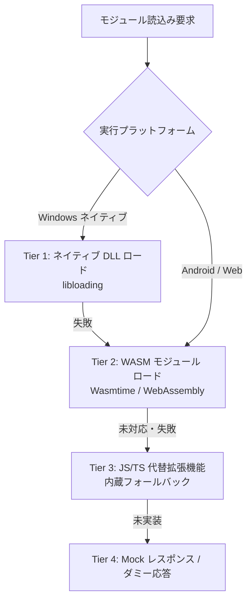

# プラグイン & SHIORI 読込み・代替読込み（Fallback）包括仕様書

- **言及規格の元ドキュメント・権利者・ライセンス**:
  - **SHIORI 仕様 / 各種サブシステム**:
    - **SHIORI/3.0 規格**: [ukadoc-spec: shiori3](https://ukatech.shillest.net/ukadoc-spec/spec/shiori3/) - © UKADOC project (CC BY 4.0)
    - **里々 (SATORI)**: [ukatech/satori-docs](https://ukatech.shillest.net/satori-docs/) - © Kusigahama Yagi / SEIBIHAN (BSD 2-Clause License)
    - **YAYA**: [YAYA-shiori/yaya-docs](https://yaya-shiori.github.io/yaya-docs/) - (The Unlicense / Public Domain)
    - **華和梨 (KAWARI)**: [ukatech/kawari-docs](https://ukatech.shillest.net/kawari-docs/) - © KAWARI Development Team (BSD 2-Clause License)
  - **PLUGIN 規格**: [ukadoc-spec: plugin](https://ukatech.shillest.net/ukadoc-spec/spec/plugin/) - © UKADOC project / Ukagaka Tech Team (CC BY 4.0)
  - **SAORI 規格**: [ukadoc-spec: saori](https://ukatech.shillest.net/ukadoc-spec/spec/saori/) - © UKADOC project / Ukagaka Tech Team (CC BY 4.0)
  - **バルーン仕様 (Balloon)**: [ukadoc-spec: balloon](https://ukatech.shillest.net/ukadoc-spec/) - © UKADOC project / Ukagaka Tech Team (CC BY 4.0)
  - **伺か標準仕様 / ゴースト / シェル**: [ukatech/ukadoc-spec (UKADOC project)](https://ukatech.shillest.net/ukadoc-spec/) - © UKADOC project / Ukagaka Tech Team (CC BY 4.0)

本仕様書は、**nanai-android-mascot** における「従来の Windows ネイティブ DLL」と「モダンな WASM / JS 拡張機能」の共存、およびプラットフォーム差異を吸収する **多層フォールバック読込み（代替ロード）戦略** を定義・整理したものです。

---

## 1. 読込み対象モジュールの分類と課題

伺かエコシステムにおける拡張モジュールは、主に以下の2系統が存在します。

| モジュール種別 | 役割・用途 | 従来の標準形式 | 主な課題 |
| :--- | :--- | :--- | :--- |
| **ゴースト SHIORI** | キャラクターの知能・辞書解釈・会話生成 | `shiori.dll` (Win32) | Windows 以外（Android/ARM、Web）で実行不可。 |
| **ベースウェア プラグイン** | システム拡張（RSS、メディア再生、連携） | `plugin.dll` (Win32) | Win32 API 依存。モバイルやサンドボックス環境で動作不能。 |
| **SAORI** | SHIORI から呼び出される外部関数 DLL | `*.dll` (Win32) | プラットフォーム依存が高く、セキュリティ上の懸念がある。 |

---

## 2. 読込みアーキテクチャの全体像（フォールバック階層）

本システムは、実行環境（Windows / Android / Web）を自動判定し、以下の優先順位でモジュールをロード・代替実行します。



---

## 3. ゴースト SHIORI の読込み・代替戦略

### 3.1 SHIORI 識別メカニズム

ゴーストディレクトリ内の `ghost/master/descript.txt` およびファイル構成を解析してエンジンを特定します。

```text
descript.txt 解析例:
  shiori,satori.dll   --> SATORI (里々) と判定
  shiori,yaya.dll     --> YAYA と判定
  shiori,kawari.dll   --> KAWARI (華和梨) と判定
  shiori,engine.wasm  --> WASM SHIORI と判定 (独自拡張)
  shiori,index.js     --> JS SHIORI と判定 (独自拡張)
```

### 3.2 プラットフォーム別 SHIORI ロード順序

```text
【Windows Desktop 環境】
 1. ネイティブ DLL (satori.dll, yaya.dll) を直接ロード
 2. 失敗時: 同等エンジンの WASM バイナリ (satori.wasm) で実行
 3. 失敗時: JavaScript 製パーサー/モックエンジンで実行

【Android / Web 環境】
 1. WASM エンジン (satori.wasm, yaya.wasm) をメモリ上仮想FSで実行
 2. 未対応エンジン (例: 古いマイナーSHIORI):
    -> JS 代替レイヤー (JS SHIORI Bridge) で辞書ファイルを直接パース
 3. 辞書パース不能時:
    -> フォールバック辞書 (mock_nanai) による基本会話を維持
```

### 3.3 非アプリ同梱・外部ゴーストにおける SHIORI DLL 代替（WASM vs .so 比較）

アプリ本体にバンドル（同梱）せず、後から外部からゴーストを導入・動的追加する際の「Win32 DLL 代替バイナリ形式」として、**WebAssembly (`.wasm`)** と **Android ネイティブ共有ライブラリ (`.so`)** を検討・選定します。

| 評価軸 | WebAssembly (`.wasm`) | ネイティブ共有ライブラリ (`.so`) |
| :--- | :--- | :--- |
| **セキュリティ・配布性** | サンドボックス内で隔離実行されるため安全性が極めて高く、任意サードパーティ製ゴーストの安全な動的配布に最適。 | ネイティブ任意コード実行となるため、マルウェアやクラッシュのリスクが高い。 |
| **Android OS 制約 (W^X / dlopen)** | Wasmer/Wasmtime 等のランタイム上で動的ロード可能。OS のコード実行制約を安全に回避可能。 | Android 10 以降、アプリ専用ストレージ（code-cache等）を除き外部ストレージや任意パスからの `dlopen()` は厳格に制限。 |
| **ABI / アーキテクチャ** | 完全クロスプラットフォーム。1つの `.wasm` で `arm64-v8a`, `armeabi-v7a`, `x86_64` すべて対応。 | アーキテクチャごとに個別コンパイルした `.so` を用意・配布・判定する必要がある。 |
| **既存資産の移植性** | C/C++ や Rust 等の既存 SHIORI ソースから `wasm32-unknown-unknown` / `wasm32-wasip1` 向けビルドが必要。 | C/C++ の既存コードは NDK でビルド可能だが、DLL 向け API の移植と各 ABI 向けビルドは必須。 |
| **実行性能** | ネイティブ比でわずかなオーバーヘッドがあるが、SHIORI の文字列処理・イベント応答用途には十分高速。 | ネイティブ最高速。 |

**採用方針**:

- **アプリ本体同梱（標準組み込み）**: 高性能が求められる標準エンジン（里々・YAYA等）は、公式の C++ ソースコードをアプリビルド時に直接コンパイル（Cargo `cc` クレート / Android NDK 経由での静的リンクまたは `.so` 共有ライブラリ）して内蔵するか、内蔵 JS エンジンで担保する。動的ロードの制約を受けないためネイティブ最速で稼働可能。
- **非アプリ同梱（外部配布・動的インストール）**: ユーザーが後から追加するサードパーティ製ゴーストの DLL 代替としては、**セキュリティ・単一バイナリ配布性・Android の動的ロード制約回避の観点から WASM (`.wasm`) を第一選択**として採用する。

### 3.4 バージョン互換性戦略（同梱版・最新版・旧バージョンの共存）

外部ゴーストの取り込みにおいて極めて肝要となるのが、**「本体同梱エンジンのバージョン」** と **「ゴーストが要求する最新版または特定旧バージョン」** の差異吸収です。

1. **ベースラインとしての本体同梱版（Git サブモジュール管理 / Stable C++ / NDK）**:
   - アプリ本体の Git サブモジュール（`src/cpp/satoriya-shiori`, `src/cpp/yaya-shiori` 等）として特定コミット／安定タグを固定してリポジトリ内に内包。
   - アプリビルド時に直接コンパイル（Cargo `cc` / NDK）して組み込み、事前テスト済みの「安定稼働が保証されたベースライン」として最速のネイティブ実行を提供。
   - サブモジュール管理であるため、リポジトリ自体の更新コミットとバージョンが完全に一致し、ビルドの再現性も担保される。
2. **最新バージョン追従または特殊パッチ版の要求（WASM 提供）**:
   - SHIORI エンジン本体に最新の構文追加や機能拡張があった場合、アプリ本体のアップデート（APK配信・ストア審査）を待たずに、ゴースト同梱または外部配布の **最新版 WASM バイナリ（`shiori.wasm`）** を差し替えることで即座に対応可能。
3. **レガシー・旧バージョン依存ゴーストの保護（マルチバージョン分離）**:
   - 伺かの歴史的ゴーストの中には「特定の旧バージョン（例: YAYA Tc5xx 系、里々初期版の仕様バグ・未定義動作に依存した辞書記述）」でしか正しく動作しないものが存在。
   - ネイティブ直接リンクでは単一プロセス内に複数バージョンの C++ シンボルを抱え込むと衝突（ODR違反）のリスクがあるが、**WASM サンドボックスであればインスタンスごとに独立した旧バージョン環境を安全に切り離して起動・実行可能**。
   - `descript.txt` 内のバージョン指定やメタ情報に応じて、「内蔵 C++ (標準)」「最新 WASM」「レガシー互換 WASM」を適切にルーティングする。


---

## 4. ベースウェア・プラグインの読込み・代替戦略

### 4.1 プラグイン形式の共存仕様

1. **WASM プラグイン (`*.wasm`)**:
   - 計算負荷の高い処理（画像フィルター、音声合成、暗号化など）。
   - WASI（WebAssembly System Interface）に準拠したサンドボックス実行。
2. **JS/TS プラグイン (`*.js`, `package.json` / `plugin.json`)**:
   - Web API（Fetch、WebSocket、Web Audio）を活用したネットワーク連携。
   - UI 拡張（メニュー項目追加、バルーン内コンポーネント埋め込み）。
3. **DLL プラグイン (Windows 限定)**:
   - 従来の `plugin.dll`。Windows 版でのみ下位互換性のためロードを試行。

### 4.2 プラグイン代替読込み（Compatibility Shim）

従来の Windows 向け人気プラグイン（ヘッドラインセンサー、情報表示等）に対し、同等の機能を提供する **JS エミュレーション・シム（Shim）** を内蔵します。

| 従来の DLL プラグイン | 代替 JS 拡張機能 | 実装アプローチ |
| :--- | :--- | :--- |
| **RSS / ヘッドライン取得** | `plugins/builtin-rss-reader/` | Web 標準の `fetch()` + XML DOM Parser |
| **メディアプレイヤー連携** | `plugins/builtin-media-ctrl/` | Web Media Session API / OS 連携 |
| **カレンダー / スケジューラ** | `plugins/builtin-calendar/` | ローカルストレージ + 通知 API |
| **独自ウィンドウ表示** | Web Components / モーダル | HTML5 / CSS3 によるオーバーレイ表示 |

---

## 5. SAORI（外部呼出しモジュール）の代替戦略

ゴースト辞書内から `\![raise,OnSaoriCall,...]` 等で呼び出される SAORI DLL について：

1. **内蔵シム機能 (Built-in SAORI Shim)**:
   - 代表的な SAORI（`proxy.dll`, `calc.dll`, `regex.dll` など）の関数シグネチャを Rust/JS 側で先回りしてエミュレート。
2. **WASM SAORI**:
   - C/C++ 製 SAORI を WASM 化し、メモリ境界越しに `request()` をエミュレート。
3. **安全なエラーフォールバック**:
   - 未知の Win32 SAORI 呼び出し時はクラッシュさせず、空文字またはエラーコード（404 Not Found）を返却し、ゴーストの対話停止を防止。

---

## 6. 実装アーキテクチャ設計（Tauri 内部構造）

```text
[ Frontend (WebView) ]
      ▲
      │ (JSON-RPC / postMessage)
      ▼
[ Tauri Core Router (Rust) ]
      ├── NativeDllLoader (Windowsのみ / cfg(target_os="windows"))
      ├── WasmEngineManager (Wasmtime / WebAssembly Instance)
      ├── JsPluginHost (WebView内サンドボックス実行)
      └── VirtualFileSystem (VFS: メモリ上での辞書・アセット展開)
```

### コア利点

- **絶対的な安定性**: 壊れた DLL や未対応プラットフォームでも、親プロセスがクラッシュせず上位フォールバックへ安全に縮退。
- **コミュニティ資産の保全**: 既存の膨大なゴースト資産（テキスト・辞書）を無駄にせず、Android / Web へそのまま移行可能。
- **新規開発の容易さ**: 新しい拡張機能は、ブラウザ技術（JavaScript/CSS）だけで簡単に作成・即時リロード可能。
