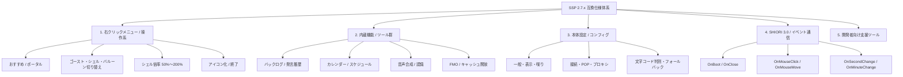

# SSP 仕様ベース 統合互換リファレンスマニュアル

> **リファレンス基準**: [ukatech/ukadoc-ssp](https://github.com/ukatech/ukadoc-ssp) (SSP 2.7.x) / [ukatech/ukadoc-spec](https://github.com/ukatech/ukadoc-spec)  
> **ローカル原典**: [local/ukadoc-ssp/INDEX.md](file:///e:/project/rust/nanai-android-mascot/local/ukadoc-ssp/INDEX.md) / [local/ukadoc-spec/INDEX.md](file:///e:/project/rust/nanai-android-mascot/local/ukadoc-spec/INDEX.md)  
> **本プロジェクトでの位置づけ**: デスクトップ版の基準実装である SSP の全機能・階層メニュー・設定・イベント体系をカタログ化し、**Nanai Android Mascot** における実装優先度・モバイル適応仕様を定めたサイト型統合リファレンス。

---

## 1. サイト型仕様マップ（Sitemap & Matrix）



---

## 2. 右クリックメニュー（オーナードローメニュー）互換仕様

SSP の標準右クリックメニュー（[local/ukadoc-ssp/howto/rclick.md](file:///e:/project/rust/nanai-android-mascot/local/ukadoc-ssp/howto/rclick.md)）に対する、本プロジェクトでの対応状況およびモバイル向け再設計。

| # | SSP 標準メニュー項目 | サブキャラ表示 | 本プロジェクト（Nanai）実装仕様 | モバイル（Android）適応方針 |
| :-: | :--- | :-: | :--- | :--- |
| **1** | おすすめ | ◯ | [docs/spec/classic-ui-and-menu-spec.md](file:///e:/project/rust/nanai-android-mascot/docs/design/classic-ui-and-menu-spec.md) にてブラウザ起動連携 | Android 標準インテント (`ACTION_VIEW`) でブラウザ起動 |
| **2** | ポータルサイト | - | ゴースト/シェル作者サイトへの URL 起動 | 同上 |
| **3** | ネットワーク更新 | - | `updates2.dau` / `updates.txt` によるオンライン差分取得 | Wi-Fi 接続時更新・バックグラウンド更新 |
| **4** | アンインストール (Vanish) | - | ゴーストディレクトリ削除ダイアログ | アプリ内部データ領域からの安全な削除 |
| **5** | RSS/ヘッドライン | - | ヘッドラインセンサ（Plugin）連携 | Web 標準 Fetch による RSS/Atom リーダーシム |
| **6** | プラグイン | - | JS / WASM プラグイン一覧実行 ([docs/spec/wasm-and-plugin-extensibility.md](file:///e:/project/rust/nanai-android-mascot/docs/spec/wasm-and-plugin-extensibility.md)) | サンドボックス内 WebExtension 型プラグイン |
| **7** | メールチェック | - | POP3 メール着信確認 | 将来拡張（優先度: Low） |
| **8** | シェル倍率 | - | **50% / 75% / 100% / 125% / 150% / 200%** | ピンチイン/アウト操作およびスライダー調整 |
| **9** | 機能 | - | サブメニュー展開（カレンダー、バックログ等） | モーダルパネル形式での一覧展開 |
| **10** | 設定 | - | 本体設定ダイアログ | タブ形式のモダン設定モーダル |
| **11** | ゴースト切り替え | - | インストール済みゴースト一覧選択 | カルセール／カード選択 UI |
| **12** | 他のゴーストを呼ぶ | - | 複数ゴースト同時召喚（マルチゴースト） | 単一透過レイヤー内での多体配置（Phase 3） |
| **13** | シェル | - | インストール済み着せ替えシェルの切替 | シェルプレビュー付き切替シート |
| **14** | 着せ替え | ◯ | surfaces `bind` オプションのパーツ単位トグル | チェックボックス付きアパレル選択パネル |
| **15** | バルーン | - | スタイル（吹き出し）の切替 | 吹き出しテーマ選択 |
| **16** | 最近使ったもの | - | 履歴スタック（ゴースト・バルーン） | 最近使ったゴーストへのクイックアクセス |
| **17** | 情報 | - | SSP / ゴーストクレジット情報表示 | アプリバージョン & クレジットダイアログ |
| **18** | アイコン化 | - | 最小化・タスクトレイ格納 | **画面端スナップ（ドッキング）** / 通知領域退避 |
| **19** | Language | - | UI 言語切替（日本語 / 英語） | OS 言語自動追従 + 手動切替 |
| **20** | 終了 | ◯ | 対象ゴーストのクローズ処理 (`OnClose`) | 個別終了 |
| **21** | 全て終了 | ◯ | アプリケーション全体の完全終了 | 常駐サービス停止 & プロセス終了 |

---

## 3. 機能（Functions）サブメニュー仕様

SSP の「機能」項目（[local/ukadoc-ssp/functions/index.md](file:///e:/project/rust/nanai-android-mascot/local/ukadoc-ssp/functions/index.md)）に対する互換・再実装。

### 3.1 優先実装機能（Core Functions）
1. **バックログ（発言履歴） (`Ctrl+B`)**:
   - 会話ログをキャラクターアイコン・タイムスタンプ付きで保持・スクロール表示。
   - スクリプト再生中でも過去ログを遡れる独立ビュー。
2. **ゴースト再読み込み / 動作情報再読み込み**:
   - 辞書ファイルやサーフィス画像をホットリロード。
   - 開発時の検証サイクルを短縮。
3. **シェル位置 / バルーン位置初期化 (`Ctrl+Shift+F12` / `F10`)**:
   - 画面端へ追いやられたキャラクターや吹き出しを画面中央・標準位置へ即時復帰。
4. **バルーンを消す (`Ctrl+Shift+Del`)**:
   - 画面を塞ぐバルーンをワンタップ／ショートカットで強制クリア。

### 3.2 モバイル向け再設計機能（Mobile Adapted）
- **エクスプローラ (`Ctrl+E`)**:
  - ファイルマネージャではなく、モバイルに適した「ゴースト管理・NAR インストーラ・アセットブラウザ」として実装。
- **音声認識 & 音声合成**:
  - Web Speech API (`SpeechRecognition` / `SpeechSynthesis`) を用いて、ブラウザ／WebView ネイティブで動作。

---

## 4. 本体設定（Configuration）体系

SSP の設定ダイアログ群（[local/ukadoc-ssp/config/index.md](file:///e:/project/rust/nanai-android-mascot/local/ukadoc-ssp/config/index.md)）に対応する設定マトリクス。

```text
設定カテゴリ
├── 一般 (ippan): 開発者機能、自動起動、トレイアイコン挙動
├── ゴースト (ghost/ghost2): 会話頻度（おしゃべり度）、重複回避、キャッシュ管理
├── 表示 (disp): 透過アルゴリズム、拡縮補間（Nearest-Neighbor / Bilinear）、最前面表示
├── 喋り/バルーン (talk): 文字送り速度 (ms)、フォントファミリ、行間、自動消去秒数
├── 文字コード (charset): Shift_JIS(CP932) / UTF-8 自動判定・手動上書き
└── 開発/その他 (dev): スクリプトログ、未定義サーフィス非表示、エラーNoticeレベル通知
```

---

## 5. SHIORI / さくらスクリプト / サーフィス互換基準

| 規格 | 参照公式仕様 (ukadoc-spec) | Nanai 実装仕様書 | 互換目標 |
| :--- | :--- | :--- | :--- |
| **SHIORI/3.0** | [spec/shiori3](file:///e:/project/rust/nanai-android-mascot/local/ukadoc-spec/spec/shiori3/index.md) | [shiori-integration.md](file:///e:/project/rust/nanai-android-mascot/docs/spec/shiori-integration.md) | 100% (Event & Response ヘッダ完全準拠) |
| **SakuraScript** | [list/sakura-script](file:///e:/project/rust/nanai-android-mascot/local/ukadoc-spec/list/sakura-script/index.md) | [sakura-script-and-balloon-spec.md](file:///e:/project/rust/nanai-android-mascot/docs/spec/sakura-script-and-balloon-spec.md) | `\0`, `\1`, `\s`, `\w`, `\q`, `\n`, `\c`, `\e` 等主要タグ完全対応 |
| **surfaces.txt** | [descript/shell-surfaces](file:///e:/project/rust/nanai-android-mascot/local/ukadoc-spec/descript/shell-surfaces/index.md) | [surfaces-and-collision-spec.md](file:///e:/project/rust/nanai-android-mascot/docs/spec/surfaces-and-collision-spec.md) | Canvas 2D レイヤー合成、アニメーション、Collision 判定 |
| **descript.txt** | [descript/ghost](file:///e:/project/rust/nanai-android-mascot/local/ukadoc-spec/descript/ghost/index.md) | [encoding-and-vfs-spec.md](file:///e:/project/rust/nanai-android-mascot/docs/spec/encoding-and-vfs-spec.md) | Shift_JIS/UTF-8 自動判別、定義パース |

---

## 6. ドキュメント連携と関連リソース

- **原典リポジトリ（ローカル）**:
  - SSP ヘルプ原典: [local/ukadoc-ssp/INDEX.md](file:///e:/project/rust/nanai-android-mascot/local/ukadoc-ssp/INDEX.md)
  - UKADOC 仕様原典: [local/ukadoc-spec/INDEX.md](file:///e:/project/rust/nanai-android-mascot/local/ukadoc-spec/INDEX.md)
  - 里々公式マニュアル: [local/satori-docs/INDEX.md](file:///e:/project/rust/nanai-android-mascot/local/satori-docs/INDEX.md)
  - YAYA 公式マニュアル: [local/yaya-docs/manual/index.md](file:///e:/project/rust/nanai-android-mascot/local/yaya-docs/manual/index.md)
- **プロジェクト詳細仕様**:
  - UI/メニュー設計: [classic-ui-and-menu-spec.md](file:///e:/project/rust/nanai-android-mascot/docs/design/classic-ui-and-menu-spec.md)
  - Android 固有常駐仕様: [android-overlay-and-service-spec.md](file:///e:/project/rust/nanai-android-mascot/docs/spec/android-overlay-and-service-spec.md)
