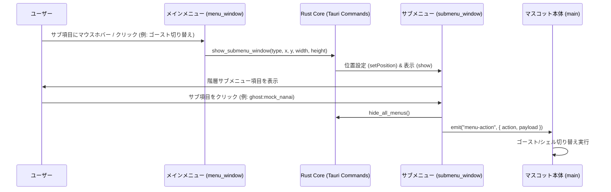

# 独立サブメニューウィンドウ設計・実装仕様書 (submenu-window-spec)

本ドキュメントは、**nanai-android-mascot** におけるデスクトップ環境での「独立サブメニューウィンドウ（`submenu_window`）」のアーキテクチャ、画面座標吸着計算、IPC連携、および段階的実装計画を定義します。

---

## 1. 概要と背景課題

### 1.1 従来の課題

- Webベース（HTML/CSS/iframe）のドロップダウン・ポップアップメニューでは、親コンテナやiframeの枠境界（`overflow: hidden` や最大幅/高さ）により、サブメニューが不可視になるか画面外でクリッピングされる問題が発生していました。
- デスクトップ環境（Windows）において、本家SSP（伺か）同様の自由な階層メニュー体験を実現するには、親ウィンドウ枠に制約されない独立したWebviewWindowが必要です。

### 1.2 独立サブメニューウィンドウ方式のメリット

1. **親境界からの完全な解放**: サブメニューが親メニューやマスコット本体の枠サイズに関係なく、画面上の自由な座標へ展開可能。
2. **SSPネイティブ準拠の吸着・反転**: 親メニュー項目の隣接スクリーン座標へピタリと吸着し、右端が狭い場合は左側へ自動反転。
3. **モバイル（Android）との両立**: デスクトップは独立ウィンドウ、Android環境は画面内ボトムシート/モーダルへ透過的にフォールバック。

---

## 2. アーキテクチャとデータフロー

---

## 3. 実装詳細仕様

### 3.1 ウィンドウプロパティ (`submenu_window`)

- **タイトル**: `Nanai Submenu`
- **透過性**: `transparent: true`
- **ウィンドウ枠**: `decorations: false`
- **最前面表示**: `always_on_top: true`
- **タスクバー表示**: `skip_taskbar: true`
- **リサイズ**: `resizable: false`

### 3.2 座標吸着計算ロジック

- メインメニュー上のトリガー要素の `getBoundingClientRect()` および親ウィンドウのスクリーン座標を取得。
- **右側展開 (デフォルト)**: `X = parentX + itemRight + 2`, `Y = parentY + itemTop`
- **左側反転 (画面右端超過時)**: `X = parentX + itemLeft - submenuWidth - 2`
- **画面下端調整**: モニターのワークエリア高さを超える場合は上方向にシフト補正。

### 3.3 コンポーネント構成

- `src/submenu-iframe.html`: サブメニュー描画用HTML
- `src/js/submenu.js`: サブメニュー項目レンダリングと選択時イベント通知
- `src-tauri/src/lib.rs`: `show_submenu_window`, `hide_submenu_window` コマンドの実装

---

## 4. 段階的実装計画

1. **Phase 1: Tauri側ウィンドウ管理コマンドの追加**:
   - `show_submenu_window(menu_type, screen_x, screen_y, items)` コマンドの実装。
   - `hide_submenu_window()` コマンドの実装。
2. **Phase 2: サブメニュー用フロントエンドの実装**:
   - `submenu-iframe.html` および `submenu.js` の作成。
   - バルーンスキン連動テーマ（`balloon-theme.css`）の適用。
3. **Phase 3: メインメニュー (`classic-menu.js`) との結合**:
   - ホバー／クリック時にスクリーン座標を算出して `show_submenu_window` を呼び出し。
4. **Phase 4: 動作検証**:
   - ウィンドウ吸着位置、クリック選択、自動消退（Auto-Dismiss）のテスト。
