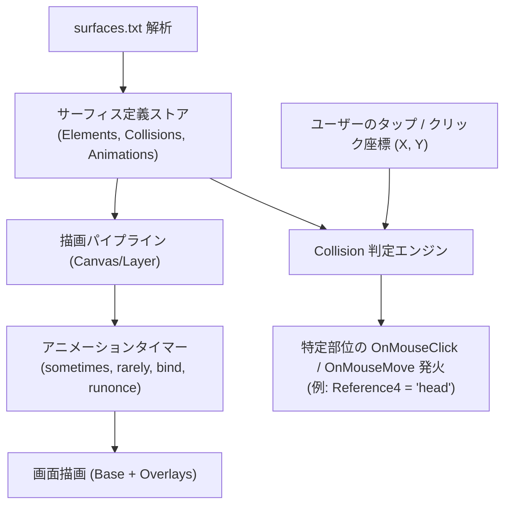

# surfaces.txt アニメーション合成 & 当たり判定（Collision）仕様書

- **言及規格の元ドキュメント・権利者・ライセンス**:
  - **SSP 互換拡張 / ポップアップメニュー規格**: [SSP BUG-SLIK-PRACTICE / 仕様リファレンス](http://ssp.shillest.net/) - © PONapook 氏 / SSP開発チーム (SSP リファレンス仕様)
  - **伺か (Ukagaka) / ゴースト / シェル**: [伺か / 偽春菜 / あれ以外の何か with「何か」](https://ukatech.shillest.net/ukadoc-spec/) - © MATERIA開発チーム / うさださくら 氏 / コミュニティ有志 (コミュニティ規格 / オープンドキュメント)
  - **surfaces.txt / アニメーション合成 / 当たり判定**: [ukadoc: surfaces.txt](https://ukatech.shillest.net/ukadoc-spec/spec/surfaces/) - © MATERIA開発チーム / SSP開発チーム / ukadoc プロジェクト (ukadoc 仕様 / パブリックリファレンス)
  - **SHIORI / 各SHIORIサブシステム (里々, YAYA, 華和梨 等)**: [ukadoc: SHIORI/3.0](https://ukatech.shillest.net/ukadoc-spec/spec/shiori3/) - © MATERIA開発チーム / 里々開発チーム / YAYA開発チーム / 華和梨開発チーム / ukadoc プロジェクト (ukadoc 仕様 / 各コミュニティライセンス)

本仕様書は、**nanai-android-mascot** におけるゴーストのシェル定義ファイル（`surfaces.txt`）の解析、複数画像のレイヤー合成・アニメーション再生、およびタッチ・マウスクリック時の部位判定（Collision）の仕様を定義します。

---

## 1. 処理アーキテクチャの全体像

本仕様は、公式仕様書 **[ukatech/ukadoc-spec: surfaces.txt 仕様](https://ssp.shillest.net/ukadoc/manual/descript_surfaces.html)** および **[ukatech/ukadoc-ssp: Collision 拡張仕様](https://ssp.shillest.net/ukadoc/manual/spec_shiori3.html)** に準拠しています。従来の静的な `` 表示から、HTML5 `<canvas>` または CSS スプライト合成レイヤーによる描画エンジンへと移行します。



---

## 2. サーフィス要素（Elements）の合成仕様

### 2.1 定義書式

```text
surface0
{
  element0,base,surface0.png,0,0
  element1,overlay,surface_face_smile.png,20,30
}
```

### 2.2 合成モード仕様

| 合成モード | 描画動作 |
| :--- | :--- |
| `base` | 下地レイヤー。キャンバスをクリアし、指定座標にベース画像を描画 |
| `overlay` / `add` | 現在のキャンバスの上に、透明部分を保ったまま上乗せ合成 |
| `replace` | 現在の描画内容を指定領域のみ差し替え |
| `overlayfast` | アルファブレンドなしの高速上乗せ |

---

## 3. アニメーション仕様（まばたき・口パク・着せ替え）

### 3.1 インターバル周期（Interval）

`animation[ID].interval` で定義される発火タイミング：

| インターバル | 発火タイミング | 用途 |
| :--- | :--- | :--- |
| `sometimes` | 約 2〜4 秒に 1 回（確率的） | まばたき（瞬き） |
| `rarely` | 約 8〜10 秒に 1 回（稀） | あくび、ため息、服の揺れ |
| `always` | ループ終了後、即座に再開 | 呼吸、常時動く尻尾や装飾 |
| `runonce` | サーフィス切り替え時に 1 回だけ再生 | 驚き、ポーズ遷移アクション |
| `bind` | 着せ替え・装飾パーツ用 | ユーザーが着せ替え ON にした時のみ合成 |

### 3.2 パターン（コマ割り）仕様

```text
animation0.pattern0,overlay,100,50,0,0   // 50ms 待機
animation0.pattern1,overlay,101,100,0,0  // 100ms 待機
animation0.pattern2,overlay,-1,0,0,0     // -1 でアニメーション終了・元のサーフィスに戻る
```

---

## 4. 当たり判定（Collision / CollisionEx）仕様

### 4.1 定義書式

`mock_nanai` で採用されている `collisionex` および標準 `collision` の解釈：

```text
// 書式: collisionex[ID],[部位名称],[形状:rect|polygon],[座標(x1,y1,x2,y2)]
collisionex0,head,rect,34,20,157,72
collisionex1,bust,rect,63,159,122,198
collisionex2,skirt,rect,24,301,163,383
```

### 4.2 タッチ判定と SHIORI イベントへのマッピング

ユーザーがマスコットの座標 `(canvasX, canvasY)` をタップ／スワイプした際：

1. **矩形判定（rect）**:
   * `x1 <= canvasX && canvasX <= x2 && y1 <= canvasY && canvasY <= y2`
2. **優先順位**:
   * 複数の判定領域が重なっている場合、ID の大きい定義（より手前に定義されたもの）を優先。
   * どの当たり判定にも入っていない場合は「部位なし（未定義領域）」として処理。
3. **SHIORI リクエスト生成**:

   ```http
   GET SHIORI/3.0
   ID: OnMouseClick
   Reference0: 34       // クリックX座標
   Reference1: 52       // クリックY座標
   Reference2: 0        // マウスホイール
   Reference3: 0        // キャラクタ番号 (0: sakura)
   Reference4: head     // 判定部位識別子 ("head", "bust", "skirt" 等)
   Reference5: 0        // 左クリック
   ```

---

## 5. モバイル（Android）最適化要件

1. **スケーリング対応**:
   * シェル倍率（50%〜200%）が変更されても、CSS サイズから元のテクスチャ座標へ逆変換して当たり判定を計算：
     $$\text{canvasX} = \text{touchX} \times \frac{\text{元の画像幅}}{\text{表示幅}}$$
2. **撫で判定（Stroke）**:
   * 同一の Collision 部位内で指を動かした移動距離（ピクセル数）を積算し、規定値（例: 40px）を超えた時点で `OnMouseMove` を撫でイベントとして発行。
